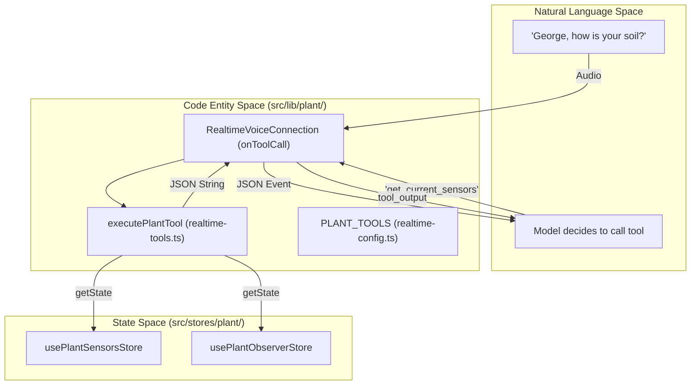
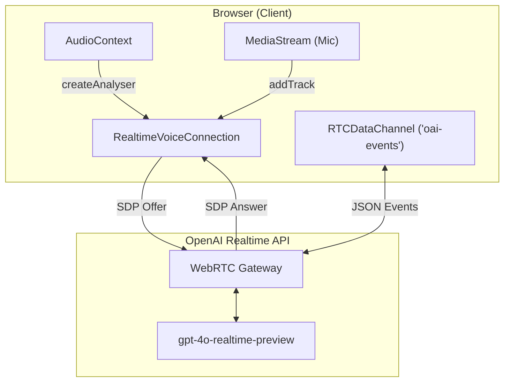

<!-- source: DeepWiki mcp.deepwiki.com · repo openai/planttalk · page 6.1 Realtime Voice Configuration & Tools · fetched 2026-10-26 -->

# Realtime Voice Configuration & Tools

Relevant source files

The following files were used as context for generating this wiki page:

- [src/lib/plant/realtime-config.ts](src/lib/plant/realtime-config.ts)
- [src/lib/plant/realtime-connection.ts](src/lib/plant/realtime-connection.ts)
- [src/lib/plant/realtime-tools.ts](src/lib/plant/realtime-tools.ts)

The Realtime Voice subsystem manages the low-latency, bidirectional voice interaction between the user and the plant. It combines OpenAI's Realtime API (WebRTC) with local state access via function calling (tools), allowing the plant to "feel" its sensors and "remember" its history during a spoken conversation.

## Configuration: Identity and Senses

The file `realtime-config.ts` serves as the single source of truth for the plant's personality and the capabilities it can exercise via the model. This file is shared between the browser and the server to ensure consistency [src/lib/plant/realtime-config.ts:1-2]().

### Personality & Instructions
The `PLANT_INSTRUCTIONS` constant defines the system prompt. It establishes the plant as a "quirky, funny, a little dramatic" character named George [src/lib/plant/realtime-config.ts:4, 36-40](). Key directives include:
*   **Voice Style**: Responses are limited to 1–3 sentences to maintain a natural conversational flow [src/lib/plant/realtime-config.ts:43-44]().
*   **Tool Usage**: The model is instructed to call `get_current_sensors` before answering questions about its vitals rather than guessing [src/lib/plant/realtime-config.ts:51-54]().
*   **Grounding**: The model is forbidden from inventing sensor numbers [src/lib/plant/realtime-config.ts:64]().

### Tool Definitions
The `PLANT_TOOLS` array defines the functions available to the model during the WebRTC session [src/lib/plant/realtime-config.ts:76-99]():

| Tool Name | Description | Parameters |
| :--- | :--- | :--- |
| `get_current_sensors` | Reads live moisture and light status. | None |
| `get_observation_history` | Retrieves a summary of past observations. | `window`: "recent" or "full" |

Sources: [src/lib/plant/realtime-config.ts:4-102]()

## Tool Execution Logic

While tools are defined in the config, their implementation resides in `realtime-tools.ts`. When the model requests a tool call, the browser executes the logic against the application's Zustand stores and returns the result as a JSON string [src/lib/plant/realtime-tools.ts:1-7]().

### `executePlantTool`
This function dispatches calls based on the tool name [src/lib/plant/realtime-tools.ts:22-23]():
*   **`get_current_sensors`**: Accesses `usePlantSensorsStore` to retrieve `moisture` and `light` values. It also identifies the data source (Arduino hardware vs. manual sliders) [src/lib/plant/realtime-tools.ts:24-37]().
*   **`get_observation_history`**: Accesses `usePlantObserverStore` to summarize the plant's diary. It supports a "full" window for long-term statistics or a "recent" window for detailed recent events [src/lib/plant/realtime-tools.ts:39-56]().

### Tool Data Flow
The following diagram illustrates how a natural language question about the plant's health triggers code-level state retrieval.

**Natural Language to Code Entity Mapping: Tool Execution**

Sources: [src/lib/plant/realtime-tools.ts:22-61](), [src/lib/plant/realtime-connection.ts:211-225]()

## Realtime Connection Management

The `RealtimeVoiceConnection` class in `realtime-connection.ts` manages the WebRTC lifecycle, audio processing, and OpenAI event handling.

### Connection Lifecycle
1.  **Mic Acquisition**: Requests user media with echo cancellation and noise suppression [src/lib/plant/realtime-connection.ts:81-89]().
2.  **Token Minting**: Calls the backend `/api/realtime-token` to get an ephemeral client secret [src/lib/plant/realtime-connection.ts:102-112]().
3.  **SDP Handshake**: Creates an `RTCPeerConnection`, adds the local mic track, and performs the Session Description Protocol (SDP) exchange with the OpenAI Realtime servers [src/lib/plant/realtime-connection.ts:117-123, 172-192]().
4.  **Data Channel**: Opens an `oai-events` channel for JSON-based control signals (transcripts, tool calls, and session updates) [src/lib/plant/realtime-connection.ts:161-169]().

### Audio Analysis & Monitoring
The connection wires up `AnalyserNode` instances for both local and remote audio. These are used by the UI (e.g., the `AuroraOrb`) to visualize speech volume [src/lib/plant/realtime-connection.ts:135-148]().
*   **Local**: `localAnalyser` monitors the user's microphone.
*   **Remote**: `remoteAnalyser` monitors the plant's incoming voice stream.

### Idle Management
To prevent unnecessary API costs, the system implements an `IDLE_TIMEOUT_MS` (60 seconds). If no speech activity is detected from either the user or the model for this duration, the connection is automatically hung up [src/lib/plant/realtime-connection.ts:41, 269-273]().

**Entity Mapping: Connection Architecture**

Sources: [src/lib/plant/realtime-connection.ts:43-273]()

## Key Functions and Events

| Function/Event | File | Description |
| :--- | :--- | :--- |
| `resolvePlantVoice` | `realtime-config.ts` | Validates that a requested voice is within the allowed `PLANT_VOICES` list [src/lib/plant/realtime-config.ts:27-31](). |
| `handleServerEvent` | `realtime-connection.ts` | The primary dispatcher for incoming OpenAI events, including `response.audio_transcript.delta` and `response.function_call_arguments.done` [src/lib/plant/realtime-connection.ts:195-245](). |
| `send` | `realtime-connection.ts` | Sends a JSON payload over the WebRTC data channel [src/lib/plant/realtime-connection.ts:258-261](). |
| `setMuted` | `realtime-connection.ts` | Toggles the `enabled` state of the microphone tracks without closing the connection [src/lib/plant/realtime-connection.ts:72-76](). |

Sources: [src/lib/plant/realtime-config.ts:27-31](), [src/lib/plant/realtime-connection.ts:72-261]()

---

