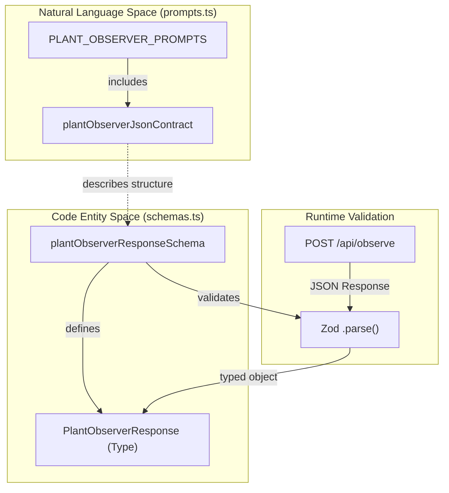
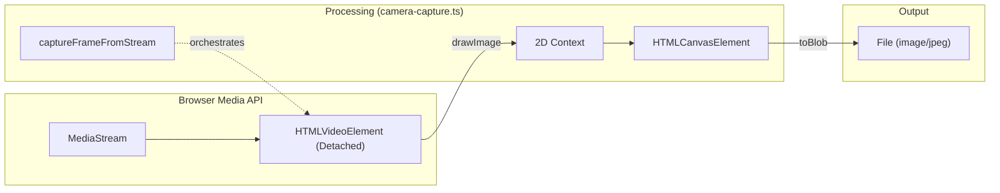

<!-- source: DeepWiki mcp.deepwiki.com · repo openai/planttalk · page 6.2 Vision Prompts, Schemas & Observation API Client · fetched 2026-10-26 -->

# Vision Prompts, Schemas & Observation API Client

Relevant source files

The following files were used as context for generating this wiki page:

- [src/lib/plant/camera-capture.ts](src/lib/plant/camera-capture.ts)
- [src/lib/plant/plants.ts](src/lib/plant/plants.ts)
- [src/lib/plant/prompts.ts](src/lib/plant/prompts.ts)
- [src/lib/plant/schemas.ts](src/lib/plant/schemas.ts)
- [src/lib/plant/sensors.ts](src/lib/plant/sensors.ts)

This page documents the vision processing pipeline, the structured data contracts between the application and OpenAI's models, and the client-side API helpers that facilitate plant observations and analysis.

## Vision Prompts & JSON Contracts

The system uses two distinct prompt sets defined in `src/lib/plant/prompts.ts`. These prompts enforce strict JSON structures to ensure the model's output can be programmatically parsed and stored.

### 1. Plant Analysis (One-Shot)
The `PLANT_ANALYSIS_PROMPTS` set is used for the "Plant Upload" feature, providing a quick assessment of a plant's physical state from a single image [src/lib/plant/prompts.ts:16-37]().

*   **System Prompt**: Instructs the model to focus on the dominant plant, estimate size (using a U.S. quarter as a reference if visible), branching, and texture [src/lib/plant/prompts.ts:17-29]().
*   **JSON Contract**: Requires exactly four keys: `dryness`, `size`, `branching`, and `physicalTexture` [src/lib/plant/prompts.ts:4-14]().

### 2. Plant Observer (Periodic)
The `PLANT_OBSERVER_PROMPTS` set powers the core observation loop. It fuses visual data with sensor readings and historical context [src/lib/plant/prompts.ts:50-83]().

*   **Context Fusion**: The user prompt is a function that accepts `sensorSummary`, `hardwareSummary`, and `historySummary` to provide the model with a temporal view of the plant's health [src/lib/plant/prompts.ts:64-82]().
*   **Observer Thoughts**: The model is required to generate 3 to 6 "thoughts" (interstitial messages) that describe its reasoning process as it analyzes the data [src/lib/plant/prompts.ts:41-42]().
*   **Hardware Awareness**: The prompts explicitly instruct the model to handle "stale" or "manual_sliders" data by leaning more heavily on visual evidence from the photo [src/lib/plant/prompts.ts:57-60]().

### Prompt to Code Mapping

| Concept | Code Entity | Purpose |
| :--- | :--- | :--- |
| One-shot Analysis | `PLANT_ANALYSIS_PROMPTS` | Structured extraction for UI testing/manual uploads. |
| Periodic Loop | `PLANT_OBSERVER_PROMPTS` | The main scientific observation logic. |
| Data Contract | `plantObserverJsonContract` | Shared string enforcing JSON schema in prompts. |

**Sources:** [src/lib/plant/prompts.ts:1-83]()

## Structured Output Schemas

The application uses **Zod** to define and validate the data returned by the OpenAI Vision API. These schemas are defined in `src/lib/plant/schemas.ts` and serve as the single source of truth for the application's data types.

### Key Schemas
*   **`plantAttributeAnalysisSchema`**: Validates one-shot analysis. Includes constraints like `size` (1-5000mm) and `dryness` (1-10) [src/lib/plant/schemas.ts:9-35]().
*   **`plantObserverResponseSchema`**: Validates periodic observations. It ensures `observerThoughts` are between 18 and 120 characters and that the `trend` is one of the allowed enum values: `improving`, `stable`, `declining`, or `insufficient-data` [src/lib/plant/schemas.ts:48-75]().

### Data Flow: Vision Response to Typed Object
The following diagram illustrates how natural language prompts and Zod schemas bridge the gap between the LLM and the TypeScript environment.

**Vision Data Contract Mapping**

**Sources:** [src/lib/plant/schemas.ts:1-80](), [src/lib/plant/prompts.ts:39-48]()

## Observation API Client

The `src/lib/plant/plants.ts` module provides high-level helpers for communicating with the backend API.

### Key Functions
*   **`analyzePlantImageFile(imageFile)`**: Sends a base64 encoded image to `/api/analyze` for one-shot processing [src/lib/plant/plants.ts:71-82]().
*   **`observePlantFileWithReasoningStream(...)`**: The primary method used by the dashboard. It sends image data, sensor readings, and history to `/api/observe` with `stream: true` [src/lib/plant/plants.ts:115-182]().
*   **`consumeNdjsonStream(stream, onLine)`**: A utility that handles the processing of Newline Delimited JSON (NDJSON). This allows the UI to display `reasoning_summary_delta` events in real-time as the model "thinks" [src/lib/plant/plants.ts:232-250]().

### Image Handling
Images are captured from the camera stream as a `JPEG File` [src/lib/plant/camera-capture.ts:7-57](), validated to be under 8MB [src/lib/plant/plants.ts:189-193](), and converted to a Data URL before being sent in the JSON request body [src/lib/plant/plants.ts:207-214]().

**Sources:** [src/lib/plant/plants.ts:1-250](), [src/lib/plant/camera-capture.ts:1-57]()

## Sensor Data & Camera Capture

### Sensor Definitions
`src/lib/plant/sensors.ts` defines the shape of sensor data shared between the frontend and the backend [src/lib/plant/sensors.ts:3-10]().
*   **Moisture**: 0-100% [src/lib/plant/sensors.ts:30]().
*   **Light**: Binary (0 or 100). Values > 50 are considered "on" [src/lib/plant/sensors.ts:34-36]().
*   **Source**: Readings are tagged as either `hardware` (Arduino) or `fallback` (UI Sliders) [src/lib/plant/sensors.ts:22]().

### Camera Capture Implementation
The `captureFrameFromStream` function in `src/lib/plant/camera-capture.ts` uses a detached `<video>` and `<canvas>` element to grab frames without interfering with the DOM [src/lib/plant/camera-capture.ts:3-5]().

**Camera Capture Flow**

**Sources:** [src/lib/plant/sensors.ts:1-37](), [src/lib/plant/camera-capture.ts:7-57]()

---

