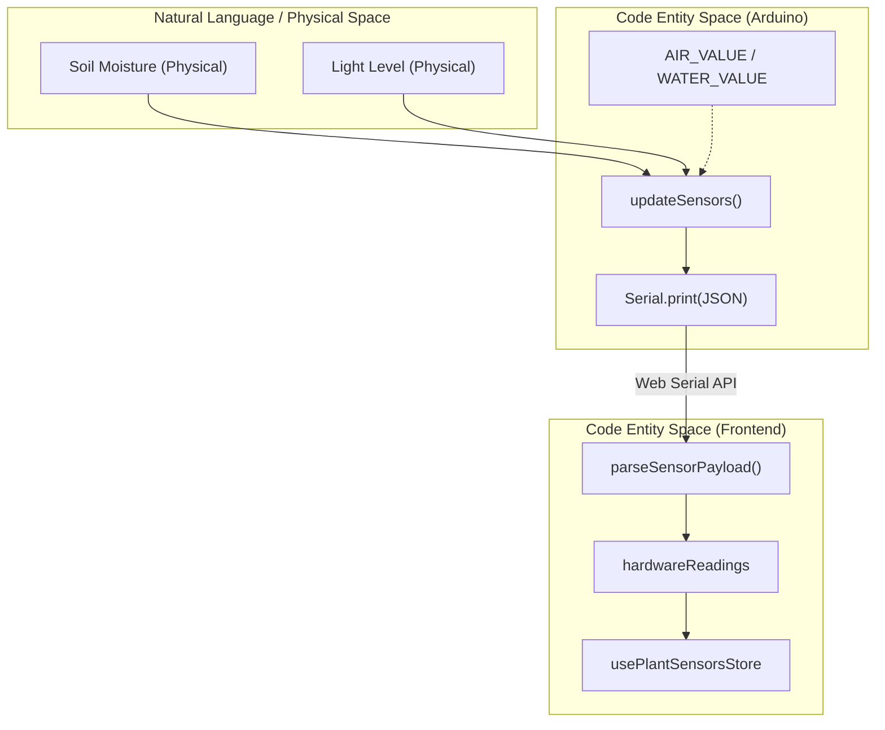
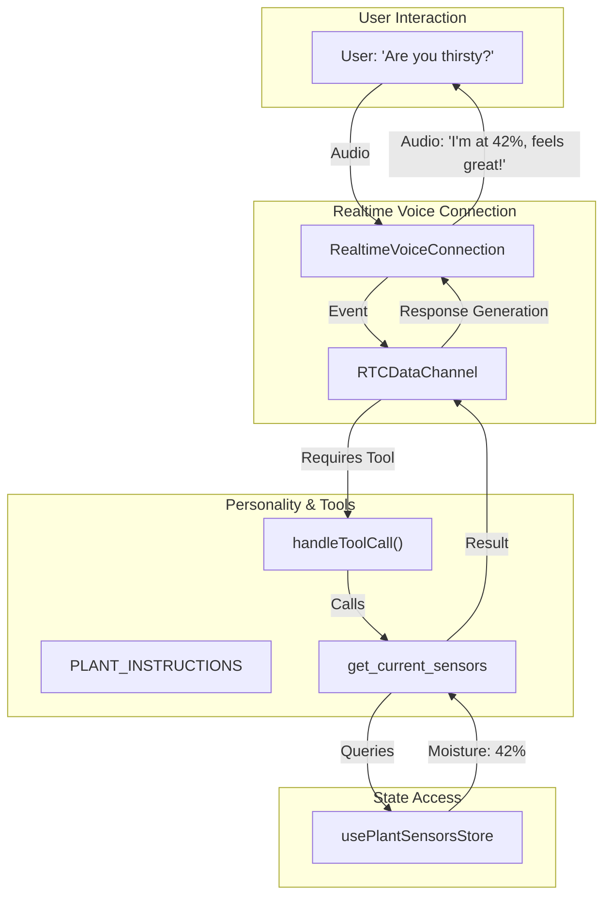

<!-- source: DeepWiki mcp.deepwiki.com · repo openai/planttalk · page 8 Glossary · fetched 2026-10-26 -->

# Glossary

Relevant source files

The following files were used as context for generating this wiki page:

- [AGENTS.md](AGENTS.md)
- [README.md](README.md)
- [arduino/PlantSensors/PlantSensors.ino](arduino/PlantSensors/PlantSensors.ino)
- [server/observe.ts](server/observe.ts)
- [src/lib/plant/realtime-config.ts](src/lib/plant/realtime-config.ts)
- [src/lib/plant/realtime-connection.ts](src/lib/plant/realtime-connection.ts)
- [src/lib/plant/schemas.ts](src/lib/plant/schemas.ts)
- [src/stores/plant/observation-loop-store.ts](src/stores/plant/observation-loop-store.ts)
- [src/stores/plant/sensors-store.ts](src/stores/plant/sensors-store.ts)

This glossary defines the codebase-specific terminology, domain concepts, and architectural entities used within the Plant Talk project. It serves as a technical reference for onboarding engineers to understand how physical sensor data, vision analysis, and realtime voice interaction are unified.

## Core System Concepts

### The Observation Loop
The central state machine that periodically captures the plant's state. It orchestrates the camera, sensor readings, and the OpenAI Vision API to generate a structured record of the plant's health.

*   **Implementation**: Managed by `useObservationLoopStore` in [src/stores/plant/observation-loop-store.ts:51-51]().
*   **Data Flow**:
    1.  Triggered via `sendLiveUpdate` [src/stores/plant/observation-loop-store.ts:63-63]().
    2.  Captures a frame using `captureLiveFrame` from `usePlantCameraStore`.
    3.  Gathers current readings from `usePlantSensorsStore` [src/stores/plant/observation-loop-store.ts:89-89]().
    4.  Calls the `/api/observe` endpoint [src/lib/plant/plants.ts:60-60]().
    5.  Streams reasoning deltas into the UI and saves the final `PlantObserverResponse` to IndexedDB via `addObservation` [src/stores/plant/observation-loop-store.ts:138-138]().

### Ambient Mode
A specialized "kiosk" view of the application designed for public display. It focuses on the visual representation of the plant's "mood" and the voice conversation, hiding the technical dashboard.

*   **Key Component**: `AmbientExperience` in [src/components/public/AmbientExperience.tsx:28-28]().
*   **Visuals**: Uses the `AuroraOrb` [src/components/public/AuroraOrb.tsx:24-24]() which reacts to `isPlantSpeaking` state.

---

## Technical Terms & Abbreviations

| Term | Definition | Code Pointer |
| :--- | :--- | :--- |
| **ADC** | Analog-to-Digital Converter. Raw values (0-1023) read from the Arduino pins. | [arduino/PlantSensors/PlantSensors.ino:39-40]() |
| **NDJSON** | Newline Delimited JSON. Used to stream reasoning steps from the server to the client. | [server/observe.ts:164-168]() |
| **Zod Schema** | Runtime type validation for LLM outputs to ensure they match the expected JSON contract. | [src/lib/plant/schemas.ts:9-9]() |
| **Web Serial** | The browser API used to communicate directly with the Arduino over USB. | [src/stores/plant/sensors-store.ts:17-28]() |
| **Realtime API** | OpenAI's low-latency WebSocket/WebRTC interface for multimodal (voice) interaction. | [src/lib/plant/realtime-connection.ts:43-43]() |
| **Ephemeral Token** | A short-lived client secret (`ek_...`) minted by the server to allow the browser to connect to OpenAI. | [server/realtime.ts:24-24]() |

**Sources**: [arduino/PlantSensors/PlantSensors.ino:1-50](), [server/observe.ts:154-170](), [src/lib/plant/schemas.ts:1-80](), [src/lib/plant/realtime-connection.ts:1-50]()

---

## Code Entity Space: Sensors & Data

The following diagram bridges the **Physical/Natural Space** (what the user sees) to the **Code Entity Space** (how the data is handled).

### Sensor Data Mapping
"Physical World" -- "Serial JSON" --> [ "PlantSensors.ino" ]
[ "PlantSensors.ino" ] -- "115200 Baud" --> [ "usePlantSensorsStore" ]
[ "usePlantSensorsStore" ] -- "selectSensorReadings" --> [ "useObservationLoopStore" ]
[ "useObservationLoopStore" ] -- "POST /api/observe" --> [ "handleObserveRequest" ]

**Sources**: [arduino/PlantSensors/PlantSensors.ino:52-111](), [src/stores/plant/sensors-store.ts:104-134](), [src/stores/plant/sensors-store.ts:447-480]()

---

## AI & Personality Entities

### Plant Personality
The identity of the plant is defined by a set of instructions and tools that ground the AI in the specific sensor data of the physical plant.

*   **`PLANT_INSTRUCTIONS`**: The system prompt defining the "George" persona [src/lib/plant/realtime-config.ts:36-73]().
*   **`PLANT_TOOLS`**: Definitions for `get_current_sensors` and `get_observation_history` [src/lib/plant/realtime-config.ts:76-99]().
*   **`realtime-tools.ts`**: The client-side implementation of these tools, which query the Zustand stores [src/lib/plant/realtime-tools.ts:13-36]().

### Observation Schemas
The "scientific" side of the plant's brain, governed by Zod schemas.

*   **`plantObserverResponseSchema`**: Defines the `observation`, `hypothesis`, `trend`, and `dryness` fields [src/lib/plant/schemas.ts:48-75]().
*   **`observerThoughts`**: Interstitial reasoning summaries that explain the model's logic before the final result [src/lib/plant/schemas.ts:49-55]().

### Voice Conversation Flow
This diagram maps the interaction between the user's voice and the system's internal tool-calling logic.

**Sources**: [src/lib/plant/realtime-config.ts:36-99](), [src/lib/plant/realtime-connection.ts:160-200](), [src/lib/plant/realtime-tools.ts:13-36]()

---

## Hardware Definitions

*   **`AIR_VALUE` / `WATER_VALUE`**: Calibration constants in the Arduino firmware used to map raw voltage to a 0.0-1.0 moisture range [arduino/PlantSensors/PlantSensors.ino:52-53]().
*   **`NE555`**: The timer chip found on most capacitive moisture sensors; the firmware uses `SAMPLES 16` averaging to mitigate its electrical jitter [arduino/PlantSensors/PlantSensors.ino:56-56]().
*   **`LM393`**: The comparator chip on the light sensor module; its digital output is inverted in code because `LOW` signifies light detection [arduino/PlantSensors/PlantSensors.ino:104-104]().
*   **Watchdog Timer**: A frontend safety mechanism in `sensors-store.ts` that forces a serial reconnection if no data is received within a specific window (default: `arduinoCheckIntervalMs * 3`) [src/stores/plant/sensors-store.ts:143-172]().

**Sources**: [arduino/PlantSensors/PlantSensors.ino:1-111](), [src/stores/plant/sensors-store.ts:143-172]()