# Page: Plant Talk — Project Overview

# Plant Talk — Project Overview

<details>
<summary>Relevant source files</summary>

The following files were used as context for generating this wiki page:

- [AGENTS.md](AGENTS.md)
- [LICENSE](LICENSE)
- [NOTICE](NOTICE)
- [README.md](README.md)

</details>


Plant Talk is an interactive houseplant system that enables natural language conversations with a plant using the OpenAI Realtime API and Vision models. By combining computer vision, physical sensors (via Arduino), and a voice-enabled interface, the project gives a plant a "personality" that can perceive its environment and report on its own health.

The system is designed to run as a local web application that bridges physical hardware with cloud-based AI. It supports two primary modes of operation: a **Dashboard** for technical monitoring and an **Ambient Mode** for a high-fidelity, full-screen public experience.

### System Concept Map

The following diagram illustrates how the "Natural Language Space" (the user's conversation) maps to the "Code Entity Space" (the underlying software components).

**Natural Language to Code Entity Mapping**
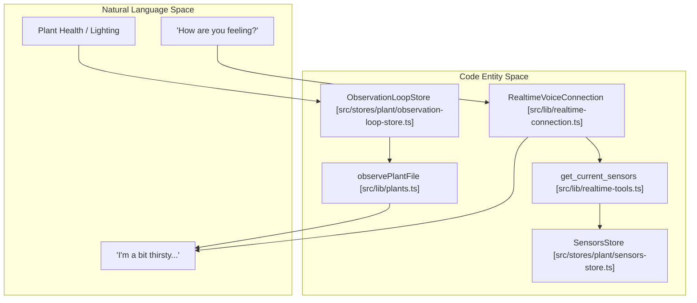
Sources: [src/lib/realtime-connection.ts:1-20](), [src/stores/plant/observation-loop-store.ts:1-30](), [src/lib/plants.ts:1-15](), [src/lib/realtime-tools.ts:1-25](), [src/stores/plant/sensors-store.ts:1-20]()

---

### End-to-End Data Flow

Plant Talk functions through a continuous cycle of sensing, observing, and communicating. Data originates from either physical sensors or manual overrides and is fused with visual data before being processed by the LLM.

1.  **Sensing:** The `SensorsStore` ingests data from `PlantSensors.ino` via the Web Serial API or from manual sliders in the UI [src/stores/plant/sensors-store.ts:80-120]().
2.  **Observing:** The `ObservationLoopStore` periodically captures a frame from the `CameraPanel` and sends it to the Express backend's `/api/observe` endpoint [src/stores/plant/observation-loop-store.ts:150-180]().
3.  **Reasoning:** The server uses `PLANT_OBSERVER_PROMPTS` and the OpenAI Vision model to generate a structured JSON response and a reasoning stream [server/observe.ts:40-90]().
4.  **Conversing:** The `RealtimeVoiceConnection` maintains a WebRTC audio stream. When the user speaks, the model can call `get_current_sensors` or `get_observation_history` to provide context-aware answers [src/lib/realtime-config.ts:45-70]().

**High-Level Subsystem Architecture**
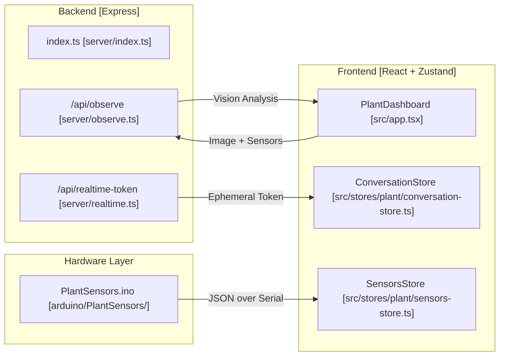
Sources: [server/index.ts:1-30](), [server/observe.ts:1-50](), [server/realtime.ts:1-40](), [src/app.tsx:1-40](), [arduino/PlantSensors/PlantSensors.ino:1-50]()

---

### Key Subsystems

| Subsystem | Primary Responsibility | Key Files |
| :--- | :--- | :--- |
| **Hardware** | Acquires moisture/light data and transmits via Serial. | `PlantSensors.ino`, `arduino-instructions.md` |
| **Backend** | Securely handles OpenAI API keys and proxies vision/token requests. | `server/observe.ts`, `server/realtime.ts` |
| **Sensing** | Manages live data streams from hardware or UI fallbacks. | `sensors-store.ts`, `sensors.ts` |
| **Vision** | Periodically analyzes camera frames for health trends. | `observation-loop-store.ts`, `prompts.ts` |
| **Voice** | Manages WebRTC connection and Realtime tool execution. | `realtime-connection.ts`, `realtime-tools.ts` |
| **UI** | Provides Dashboard and Ambient (kiosk) interfaces. | `app.tsx`, `AmbientExperience.tsx` |

---

### Deeper Reading

To explore specific parts of the codebase, refer to the following child pages:

*   **[Getting Started & Setup](#1.1)**: Instructions for environment configuration, `npm run setup`, and launching the dual-process development environment [AGENTS.md:79-140]().
*   **[System Architecture & Data Flow](#1.2)**: A detailed look at the three-tier architecture and how sensor readings are fused into LLM context [README.md:68-82]().

Sources: [AGENTS.md:1-168](), [README.md:1-116](), [src/app.tsx:1-50](), [server/index.ts:1-25]()

---

# Page: Getting Started & Setup

# Getting Started & Setup

<details>
<summary>Relevant source files</summary>

The following files were used as context for generating this wiki page:

- [.env.example](.env.example)
- [package.json](package.json)
- [scripts/setup.mjs](scripts/setup.mjs)
- [vite.config.ts](vite.config.ts)

</details>


This page provides a technical guide for initializing the Plant Talk development environment. It covers the automated bootstrap process, environment configuration, and the dual-process architecture used during local development.

## Environment Requirements

Plant Talk requires **Node.js version 20.12.0 or newer** [package.json:8-10](). The project utilizes modern JavaScript features and Node APIs (such as `node:fs` and `node:path` modules) that are not available in older LTS releases [scripts/setup.mjs:1-4]().

## Initializing the Project

The project includes a bootstrap script to ensure the environment is correctly configured before the first run.

### 1. Clone and Install
After cloning the repository, install the dependencies defined in `package.json`:
```bash
npm install
```

### 2. Run Setup Script
Execute the setup utility:
```bash
npm run setup
```

The `npm run setup` command invokes `scripts/setup.mjs` [package.json:12](), which performs the following logic:
1.  **Node Version Check**: Compares `process.versions.node` against the `MIN_NODE` constant `[20, 12, 0]` [scripts/setup.mjs:4-19]().
2.  **Environment File Creation**: Checks for the existence of a `.env` file. If missing, it copies `.env.example` to `.env` and sets restrictive file permissions (`0o600`) [scripts/setup.mjs:43-46]().
3.  **API Key Validation**: Scans the `.env` file to verify if the `OPENAI_API_KEY` has been changed from the default `replace-me` value [scripts/setup.mjs:21-26]().

### 3. Configure OpenAI API Key
You must provide a valid OpenAI API key to enable the Vision and Realtime capabilities.
1.  Open the newly created `.env` file.
2.  Locate the `OPENAI_API_KEY` variable [.env.example:4]().
3.  Replace `replace-me` with your secret key from the [OpenAI Platform](https://platform.openai.com/api-keys).

**Sources:** [package.json:8-12](), [scripts/setup.mjs:4-60](), [.env.example:1-4]()

## Development Environment Architecture

Plant Talk operates using a two-process development model coordinated via the `concurrently` utility [package.json:13, 38]().

### Process Breakdown

| Process | Command | Port | Responsibility |
| :--- | :--- | :--- | :--- |
| **Web Frontend** | `vite dev` | `3000` | Serves the React SPA and handles HMR. |
| **API Backend** | `tsx watch server/index.ts` | `3001` | Proxies OpenAI requests and serves Realtime tokens. |

### Development Data Flow & Proxying
The Vite development server is configured to proxy all requests starting with `/api` to the Express server running on port `3001` [vite.config.ts:25-31](). This avoids Cross-Origin Resource Sharing (CORS) issues during development.

To prevent `ENOBUFS` errors (common on Windows when handling long-lived streams like the `/api/observe` endpoint), the proxy uses a persistent `http.Agent` with `keepAlive: true` [vite.config.ts:10, 29]().

### Setup and Execution Flow
The following diagram illustrates the transition from the `setup` script to the active development state.

**Project Bootstrap and Dev Loop**
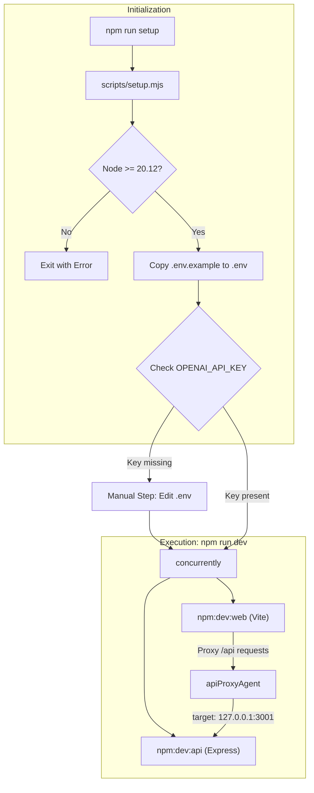
**Sources:** [package.json:11-15](), [vite.config.ts:10-31](), [scripts/setup.mjs:30-60]()

## Launching the Application

To start both the frontend and the backend simultaneously, run:
```bash
npm run dev
```

Once running:
*   **Frontend**: Accessible at `http://localhost:3000`.
*   **Backend**: Internal API at `http://localhost:3001`.
*   **Path Aliases**: The project uses the `@/` alias to refer to the `src` directory, configured in `vite.config.ts` [vite.config.ts:16-18]().

### Key Entity Mapping
This diagram bridges the conceptual setup steps to the specific code entities responsible for the environment.

**Configuration to Entity Mapping**
```mermaid
graph LR
    subgraph "Natural Language Space"
        "Node Requirement"
        "Environment Variables"
        "API Proxying"
        "Task Orchestration"
    end

    subgraph "Code Entity Space"
        "Node Requirement" --- "package.json [engines]"
        "Environment Variables" --- ".env.example"
        "API Proxying" --- "vite.config.ts [apiProxyAgent]"
        "Task Orchestration" --- "package.json [scripts.dev]"
    end
```
**Sources:** [package.json:8-15](), [vite.config.ts:10-31](), [.env.example:1-4]()

---

# Page: System Architecture & Data Flow

# System Architecture & Data Flow

<details>
<summary>Relevant source files</summary>

The following files were used as context for generating this wiki page:

- [AGENTS.md](AGENTS.md)
- [README.md](README.md)
- [server/index.ts](server/index.ts)
- [src/app.tsx](src/app.tsx)

</details>


This page details the three-tier architecture of Plant Talk, the mechanisms for environmental sensing, and the end-to-end data pipeline that transforms physical sensor data and visual frames into an interactive AI personality.

## Three-Tier Architecture

Plant Talk is structured as a distributed system across three distinct layers: the physical hardware (Arduino), the secure backend (Express), and the user interface (React).

1.  **Hardware Layer (Arduino Firmware):** A microcontroller runs a C++ loop to sample analog and digital sensors. It performs signal averaging and normalization before streaming JSON packets over USB Serial `[arduino/PlantSensors/PlantSensors.ino:1-10]()`.
2.  **Backend Layer (Express Server):** Acts as a security proxy and API orchestrator. It holds the `OPENAI_API_KEY` to prevent exposure to the client `[server/index.ts:1-6]()`. It handles high-bandwidth image uploads and manages the minting of ephemeral WebRTC tokens for the Realtime API `[server/realtime.ts:12-25]()`.
3.  **Frontend Layer (React SPA):** The central nervous system of the application. It manages the Web Serial connection to the hardware, handles the webcam lifecycle, maintains a local IndexedDB of plant history, and orchestrates the voice conversation using WebRTC `[src/app.tsx:6-11]()`.

### System Component Map

The following diagram maps high-level system components to their specific code entities.

**Diagram: System Component Mapping**
```mermaid
graph TD
    subgraph "Physical Space"
        "Sensors"["Analog/Digital Sensors"]
        "Arduino"["Arduino (PlantSensors.ino)"]
    end

    subgraph "Code Entity Space (Client)"
        "SerialStore"["sensors-store.ts (Zustand)"]
        "ObsLoop"["observation-loop-store.ts"]
        "VoiceConn"["realtime-connection.ts (WebRTC)"]
        "IDB"["observer-store.ts (IndexedDB)"]
    end

    subgraph "Code Entity Space (Server)"
        "ExpServer"["server/index.ts (Express)"]
        "ObsRoute"["server/observe.ts (handleObserveRequest)"]
        "RTToken"["server/realtime.ts (handleRealtimeTokenRequest)"]
    end

    "Sensors" -->|Raw Voltage| "Arduino"
    "Arduino" -->|JSON via Web Serial| "SerialStore"
    "SerialStore" --> "ObsLoop"
    "ObsLoop" -->|POST /api/observe| "ObsRoute"
    "ObsRoute" -->|NDJSON Reasoning| "ObsLoop"
    "VoiceConn" -->|POST /api/realtime-token| "RTToken"
    "ObsLoop" -->|Store Results| "IDB"
```
Sources: `[arduino/PlantSensors/PlantSensors.ino:1-20]()`, `[server/index.ts:25-35]()`, `[src/stores/plant/sensors-store.ts:1-15]()`, `[src/stores/plant/observation-loop-store.ts:1-20]()`.

## Sensing Modes

The system supports two sensing modes, toggled via the `useSensorsStore` `[src/stores/plant/sensors-store.ts:18-25]()`.

### 1. Manual Sliders Mode
Used for testing or software-only setups. The frontend uses React state driven by UI sliders in the `SensorsPanel` `[src/components/dashboard/sensors-panel.tsx:30-50]()` to simulate moisture and light levels.

### 2. Arduino Sensors Mode
When enabled, the frontend utilizes the **Web Serial API** to connect to the Arduino's COM port.
-   **Data Ingestion:** The `connect` function in `sensors-store.ts` opens the port at 115200 baud `[src/stores/plant/sensors-store.ts:68-75]()`.
-   **Parsing:** Incoming strings are processed by `parseSensorPayload`, which handles JSON objects like `{"moisture": 45, "light": 100}` `[src/stores/plant/sensors-store.ts:133-150]()`.
-   **Watchdog:** A timer monitors the stream; if no data arrives for 5 seconds, the system marks the hardware as disconnected `[src/stores/plant/sensors-store.ts:45-55]()`.

## End-to-End Data Flow

The "Observation Loop" is the primary data pipeline. It executes periodically (default 30 seconds) to update the plant's state.

### The Observation Pipeline
1.  **Capture:** The `ObservationPanel` triggers the `captureFrame` utility to get a base64 string from the `<video>` element `[src/lib/plant/camera-capture.ts:5-15]()`.
2.  **Context Fusion:** The `observation-loop-store.ts` gathers current sensor readings and the last 10 historical observations from the `observer-store.ts` `[src/stores/plant/observation-loop-store.ts:80-95]()`.
3.  **Backend Analysis:** Data is sent to `POST /api/observe`. The server uses `PLANT_OBSERVER_PROMPTS` to instruct the LLM (GPT-4o) to analyze the image and sensors together `[server/observe.ts:60-85]()`.
4.  **Reasoning Stream:** The server streams "thinking" steps as NDJSON (Networked Delimited JSON) so the UI can show live reasoning summaries `[server/observe.ts:110-125]()`.
5.  **Structured Output:** The final result is validated against the `plantObserverResponseSchema` (Zod), ensuring fields like `healthScore` and `statusMessage` are present `[src/lib/plant/schemas.ts:22-45]()`.

**Diagram: Data Fusion & LLM Pipeline**
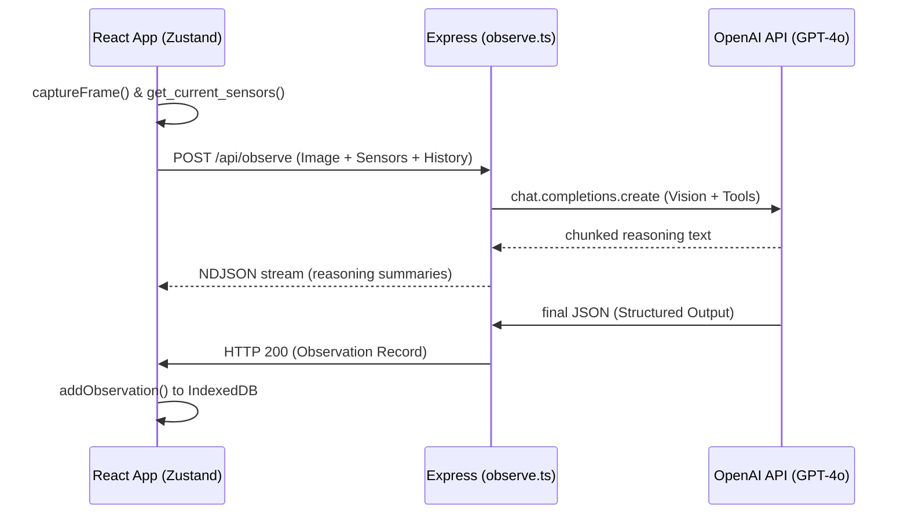
Sources: `[server/observe.ts:100-140]()`, `[src/stores/plant/observation-loop-store.ts:100-130]()`, `[src/lib/plant/plants.ts:35-55]()`.

## Voice Conversation Flow

The voice interaction uses the **OpenAI Realtime API** via WebRTC.

1.  **Token Exchange:** The client calls `handleRealtimeTokenRequest` on the server to get an ephemeral key `[server/realtime.ts:12-30]()`.
2.  **WebRTC Handshake:** The client establishes a peer connection. The session is configured server-side with `PLANT_INSTRUCTIONS` and `PLANT_TOOLS` `[src/lib/plant/realtime-connection.ts:60-85]()`.
3.  **Tool Execution:** When the user asks "How are you?", the model calls `get_current_sensors` or `get_observation_history`. These functions are executed **client-side** in `realtime-tools.ts`, which reads directly from the Zustand stores `[src/lib/plant/realtime-tools.ts:10-30]()`.
4.  **Audio Loop:** The model's response is streamed as audio directly to the browser's `RTCPeerConnection` track `[src/lib/plant/realtime-connection.ts:110-125]()`.

Sources: `[server/realtime.ts:1-40]()`, `[src/lib/plant/realtime-config.ts:1-25]()`, `[src/lib/plant/realtime-tools.ts:1-40]()`.

---

# Page: Arduino Hardware Layer

# Arduino Hardware Layer

<details>
<summary>Relevant source files</summary>

The following files were used as context for generating this wiki page:

- [arduino/PlantSensors/PlantSensors.ino](arduino/PlantSensors/PlantSensors.ino)
- [arduino/arduino-instructions.md](arduino/arduino-instructions.md)

</details>


The Arduino Hardware Layer serves as the "nervous system" for the Plant Talk project. It consists of a microcontroller (typically an Arduino Uno, Nano, or Mega) running specialized firmware to interface with physical sensors. This layer translates analog and digital signals from the environment into a structured JSON format, which is then consumed by the web application via the browser's Web Serial API.

### Hardware Architecture

The system utilizes two primary sensors to monitor the plant's environment. The Arduino acts as a data acquisition hub, performing multi-sample averaging to filter electronic noise before transmitting normalized values to the frontend.

#### High-Level Data Flow
The diagram below illustrates how physical signals are transformed into code entities and transmitted to the application.

**Diagram: Hardware to Browser Data Pipeline**
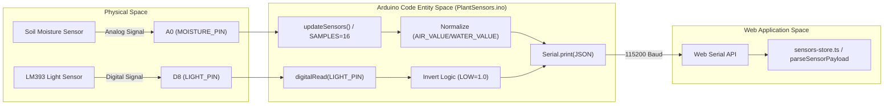
**Sources:** [arduino/PlantSensors/PlantSensors.ino:55-111](), [arduino/arduino-instructions.md:14-38](), [arduino/arduino-instructions.md:157-164]()

---

### PlantSensors Firmware
The `PlantSensors.ino` firmware is a lightweight C++ sketch responsible for polling sensors and managing a serial command interface. It implements a 16-sample rolling average [arduino/PlantSensors/PlantSensors.ino:56-56]() to mitigate jitter common in inexpensive NE555-based capacitive sensors.

The firmware outputs a single line of JSON every 1000ms by default [arduino/PlantSensors/PlantSensors.ino:62-62]():
```json
{"moisture":0.42,"light":1.00}
```

Key features include:
*   **Normalization:** Converts raw ADC values into a 0.0–1.0 float based on configurable `AIR_VALUE` and `WATER_VALUE` constants [arduino/PlantSensors/PlantSensors.ino:98-101]().
*   **Command Interface:** Supports interactive serial commands such as `calibrate`, `interval <ms>`, and `status` to adjust behavior without re-uploading code [arduino/PlantSensors/PlantSensors.ino:128-157]().

For a deep dive into the calibration workflow and logic, see **[PlantSensors Firmware (#2.1)]**.

**Sources:** [arduino/PlantSensors/PlantSensors.ino:1-49](), [arduino/PlantSensors/PlantSensors.ino:106-110]()

---

### Hardware Integration & Connectivity
The hardware layer is designed for accessibility, using common components that interface with the browser via standard USB serial communication.

| Component | Pin Mapping | Logic |
| :--- | :--- | :--- |
| **Capacitive Moisture Sensor** | `A0` (Analog) | Lower ADC = Wetter (Inverted in code) |
| **LM393 Light Sensor** | `D8` (Digital) | `LOW` = Light detected, `HIGH` = Dark |

**Web Serial Integration:**
The frontend connects to the Arduino at a baud rate of **115200** [arduino/arduino-instructions.md:159-161](). This connection allows the React application to receive real-time telemetry, which is then used to drive the plant's "personality" and the observation logic in the LLM.

For detailed wiring diagrams, pinouts, and browser connection troubleshooting, see **[Hardware Wiring & Web Serial Integration (#2.2)]**.

**Sources:** [arduino/arduino-instructions.md:82-109](), [arduino/PlantSensors/PlantSensors.ino:58-59](), [arduino/PlantSensors/PlantSensors.ino:103-104]()

---

### System Component Mapping
This diagram maps the physical hardware components to the specific code variables and logic gates defined in the firmware.

**Diagram: Component to Code Mapping**
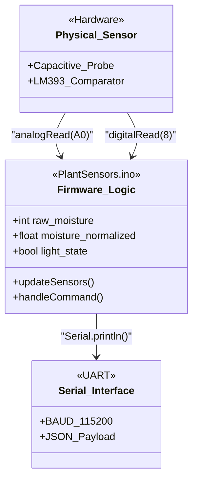
**Sources:** [arduino/PlantSensors/PlantSensors.ino:58-111](), [arduino/arduino-instructions.md:82-109]()

---

# Page: PlantSensors Firmware

# PlantSensors Firmware

<details>
<summary>Relevant source files</summary>

The following files were used as context for generating this wiki page:

- [arduino/PlantSensors/PlantSensors.ino](arduino/PlantSensors/PlantSensors.ino)

</details>


The `PlantSensors.ino` firmware is a lightweight data acquisition script designed for Arduino-compatible microcontrollers (Uno, Nano, Mega). Its primary purpose is to sample environmental data from a capacitive soil moisture sensor and an LM393-based light sensor, then transmit normalized readings as JSON strings over a serial connection at 115200 baud [arduino/PlantSensors/PlantSensors.ino:1-10]().

### Data Acquisition Pipeline

The firmware implements a robust sampling strategy to mitigate hardware inconsistencies common in low-cost NE555-based capacitive sensors.

#### NE555 Jitter Mitigation
Cheap capacitive sensors often suffer from oscillator jitter, which manifests as unstable ADC readings. To counter this, the firmware uses a multi-sample averaging technique [arduino/PlantSensors/PlantSensors.ino:42-43]().
*   **Sampling Rate**: The system takes 16 consecutive samples from the `MOISTURE_PIN` (A0) [arduino/PlantSensors/PlantSensors.ino:56-58]().
*   **Averaging**: The samples are summed into a `long` variable and divided by the `SAMPLES` constant to produce a stable integer `raw` value [arduino/PlantSensors/PlantSensors.ino:85-89]().

#### Moisture Normalization
Capacitive sensors are inversely proportional to moisture: a lower ADC value indicates higher moisture content [arduino/PlantSensors/PlantSensors.ino:26-27](). The firmware normalizes this raw input into a float between `0.0` (bone dry) and `1.0` (fully saturated) using the following formula [arduino/PlantSensors/PlantSensors.ino:98-99]():

$$moisture = \frac{AIR\_VALUE - raw}{AIR\_VALUE - WATER\_VALUE}$$

The result is clamped between `0.0` and `1.0` to prevent out-of-bounds values during environmental extremes [arduino/PlantSensors/PlantSensors.ino:100-101]().

#### LM393 Digital Inversion
The LM393 light sensor module provides a digital output on `LIGHT_PIN` (D8) [arduino/PlantSensors/PlantSensors.ino:59-60](). By default, the module's DO pin is `HIGH` when dark and `LOW` when light is detected [arduino/PlantSensors/PlantSensors.ino:34-34](). The firmware inverts this logic to provide a more intuitive `1.0` (light) or `0.0` (dark) value [arduino/PlantSensors/PlantSensors.ino:103-104]().

**Sources:** [arduino/PlantSensors/PlantSensors.ino:1-111]()

### Firmware Logic & Data Flow

The following diagram illustrates the relationship between the hardware pins, the internal processing functions, and the resulting serial output.

**Firmware Data Flow**
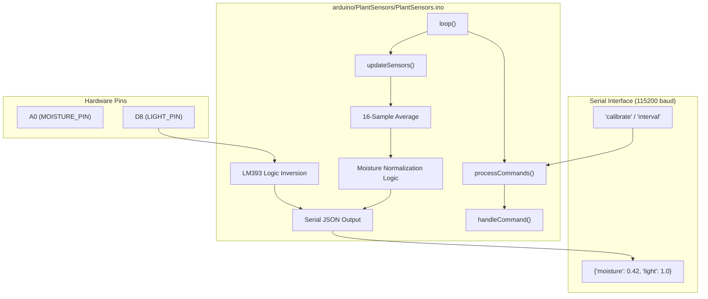
**Sources:** [arduino/PlantSensors/PlantSensors.ino:58-111](), [arduino/PlantSensors/PlantSensors.ino:113-126]()

### Calibration Workflow

Calibration is required to map the specific electrical characteristics of the soil probe to the `0.0`–`1.0` range. This is managed via the `AIR_VALUE` and `WATER_VALUE` constants [arduino/PlantSensors/PlantSensors.ino:51-53]().

1.  **Enter Calibration Mode**: Send the `calibrate` command over serial. This sets `calibrateMode` to `true` and increases the reporting frequency to every 200ms [arduino/PlantSensors/PlantSensors.ino:80-81](), [arduino/PlantSensors/PlantSensors.ino:141-145]().
2.  **Measure Air**: Hold the probe in dry air and record the `raw` value output by the serial monitor. Update `AIR_VALUE` [arduino/PlantSensors/PlantSensors.ino:38-39]().
3.  **Measure Water**: Submerge the probe in water up to the white line and record the `raw` value. Update `WATER_VALUE` [arduino/PlantSensors/PlantSensors.ino:40-41]().
4.  **Re-upload**: Flash the firmware with the new constants.

**Sources:** [arduino/PlantSensors/PlantSensors.ino:37-43](), [arduino/PlantSensors/PlantSensors.ino:141-145]()

### Interactive Command Interface

The firmware maintains a non-blocking command processor in `processCommands()` that listens for newline-terminated strings [arduino/PlantSensors/PlantSensors.ino:113-126]().

| Command | Action | Implementation |
| :--- | :--- | :--- |
| `calibrate` | Toggles raw ADC output every 200ms for sensor tuning. | [arduino/PlantSensors/PlantSensors.ino:141-145]() |
| `interval <ms>` | Sets the reporting frequency (100ms to 60000ms). | [arduino/PlantSensors/PlantSensors.ino:129-138]() |
| `read` | Forces an immediate sensor sample and serial transmission. | [arduino/PlantSensors/PlantSensors.ino:139-140]() |
| `status` | Returns JSON object containing current interval and calibration values. | [arduino/PlantSensors/PlantSensors.ino:146-153]() |

### Serial Output Format

The firmware outputs a single JSON line per interval. This format is designed for easy parsing by the Web Serial API in the browser.

*   **Standard Reading**: `{"moisture":0.42,"light":1.00}` [arduino/PlantSensors/PlantSensors.ino:106-110]()
*   **Calibration Reading**: `{"raw":385}` [arduino/PlantSensors/PlantSensors.ino:91-95]()
*   **System Status**: `{"status":{"serial_interval":1000,"air_value":398,"water_value":56}}` [arduino/PlantSensors/PlantSensors.ino:147-153]()

**Sources:** [arduino/PlantSensors/PlantSensors.ino:91-110](), [arduino/PlantSensors/PlantSensors.ino:147-153]()

### Code Entity Mapping

The following diagram maps the logical hardware components to their respective software identifiers within the `PlantSensors.ino` file.

**Hardware to Code Mapping**
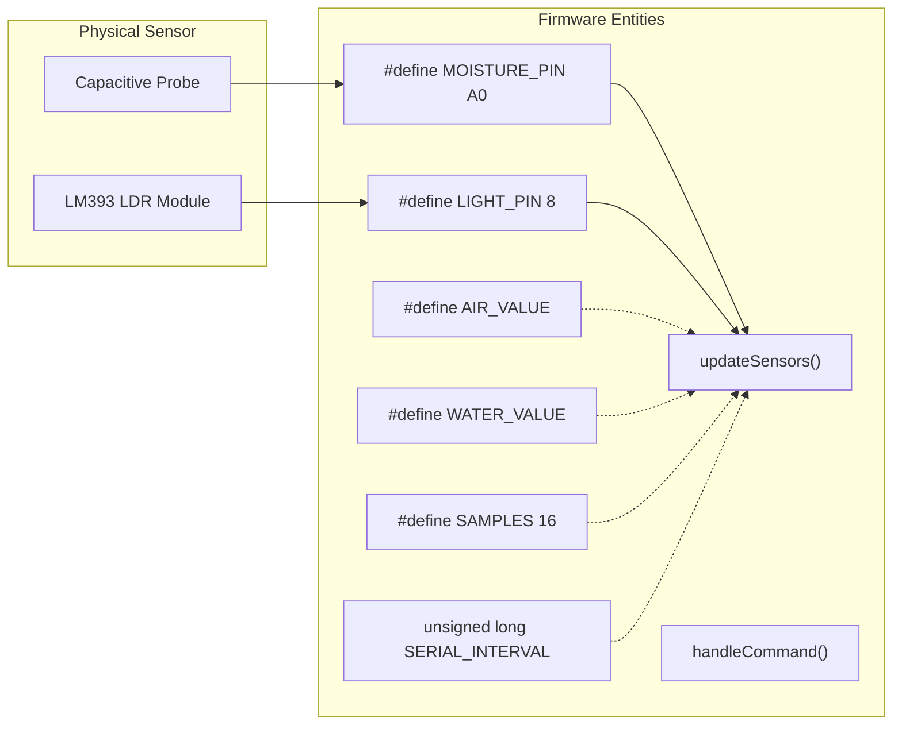
**Sources:** [arduino/PlantSensors/PlantSensors.ino:52-62](), [arduino/PlantSensors/PlantSensors.ino:79-111]()

---

# Page: Hardware Wiring & Web Serial Integration

# Hardware Wiring & Web Serial Integration

<details>
<summary>Relevant source files</summary>

The following files were used as context for generating this wiki page:

- [arduino/arduino-instructions.md](arduino/arduino-instructions.md)
- [src/stores/plant/sensors-store.ts](src/stores/plant/sensors-store.ts)

</details>


This page details the physical assembly of the Plant Talk sensor suite and the technical implementation of the Web Serial bridge that ingests sensor data into the browser.

## Physical Hardware Mapping

The system utilizes an Arduino-compatible microcontroller to interface with two primary sensors. The firmware, `PlantSensors.ino`, expects specific pin assignments for analog and digital signals.

### Sensor Pinout Table
| Component | Arduino Pin | Signal Type | Description |
| :--- | :--- | :--- | :--- |
| **Soil Moisture Sensor** | `A0` | Analog Input | Measures resistance/capacitance (0-100%). |
| **Light Sensor (LM393)** | `D8` | Digital Input | High/Low threshold detection. |
| **Power (VCC)** | `5V` | Power Rail | Common 5V supply for both modules. |
| **Ground (GND)** | `GND` | Ground Rail | Common ground for both modules. |

### Wiring Logic
*   **Moisture Sensor**: The probe signal must be connected to `A0` [arduino/arduino-instructions.md:87-91](). It estimates moisture by measuring electrical resistance, where raw values are normalized based on calibration constants [arduino/arduino-instructions.md:60-68]().
*   **Light Sensor**: The LM393 module outputs a digital signal to `D8` [arduino/arduino-instructions.md:99-106](). While the physical sensor outputs `HIGH` for dark and `LOW` for light, the firmware inverts this logic to report `100` (light) or `0` (dark) for a more intuitive UI experience [arduino/arduino-instructions.md:74-75]().

**Sources:** [arduino/arduino-instructions.md:82-107](), [arduino/arduino-instructions.md:58-80]()

---

## Web Serial Implementation

The frontend communicates with the Arduino using the **Web Serial API**. This allows the browser to directly read the JSON stream emitted by the hardware without requiring a local proxy server.

### Connection Lifecycle
The connection is managed by `usePlantSensorsStore` in `src/stores/plant/sensors-store.ts`.

1.  **Initiation**: The user triggers `connect()`, which invokes `navigator.serial.requestPort()` [src/stores/plant/sensors-store.ts:252-258]().
2.  **Configuration**: The port is opened at a fixed baud rate of **115200** [src/stores/plant/sensors-store.ts:33-33](), [src/stores/plant/sensors-store.ts:264-266]().
3.  **Data Stream**: The store uses a `TextDecoderStream` to convert raw `Uint8Array` chunks into a string-based `ReadableStream` [src/stores/plant/sensors-store.ts:276-281]().
4.  **Parsing**: Lines are parsed in `parseSensorPayload`, which supports multiple JSON keys (e.g., `moisture`, `soil`, `lux`) to ensure compatibility with various sensor modules [src/stores/plant/sensors-store.ts:38-41](), [src/stores/plant/sensors-store.ts:468-492]().

### Hardware-to-Code Mapping
The following diagram bridges the physical hardware concepts to the specific TypeScript entities managing them.

**Diagram: Hardware Integration Data Flow**
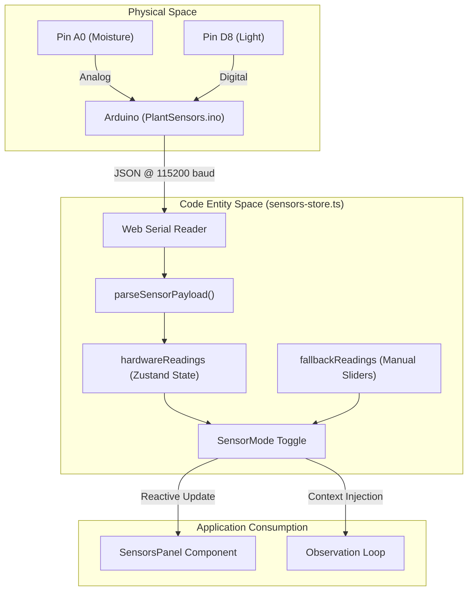
**Sources:** [src/stores/plant/sensors-store.ts:30-59](), [src/stores/plant/sensors-store.ts:468-500](), [arduino/arduino-instructions.md:168-174]()

---

## UI Flow & Sensor Modes

The application supports two modes defined by the `SensorMode` type: `manual` and `arduino` [src/stores/plant/sensors-store.ts:31-31]().

### Mode Switching
*   **Manual Mode**: Readings are driven by UI sliders (`fallbackReadings`). This is the default if no hardware is connected [src/stores/plant/sensors-store.ts:45-45]().
*   **Arduino Mode**: The UI displays `hardwareReadings`. If the connection is lost, the system can be configured to persist the last known hardware value or wait for reconnection [src/stores/plant/sensors-store.ts:52-54]().

### Reliability Mechanisms
To handle the instability of physical serial connections, the store implements:
*   **Watchdog Timer**: If no data is received within a specific window (calculated as `interval * 3`), the store forces a port closure and attempts a reconnect [src/stores/plant/sensors-store.ts:143-172]().
*   **Startup Grace Period**: A 20-second buffer (`STARTUP_GRACE_MS`) allows the Arduino bootloader to finish before the watchdog begins monitoring [src/stores/plant/sensors-store.ts:35-35]().
*   **Auto-Reconnect**: If a known port is disconnected (e.g., USB cable tug), the store polls `getPorts()` every 3 seconds to restore the session [src/stores/plant/sensors-store.ts:34-34](), [src/stores/plant/sensors-store.ts:181-210]().

**Sources:** [src/stores/plant/sensors-store.ts:33-36](), [src/stores/plant/sensors-store.ts:143-172](), [src/stores/plant/sensors-store.ts:181-210]()

---

## Troubleshooting & Common States

| State / Issue | Cause | Resolution |
| :--- | :--- | :--- |
| **Scrambled Characters** | Baud Rate Mismatch | Ensure Serial Monitor or Web Serial is set to `115200` [arduino/arduino-instructions.md:160-165](). |
| **Port Locked** | Port in use by another app | Close the Arduino IDE Serial Monitor before connecting in the browser [arduino/arduino-instructions.md:142-143](). |
| **Inverted Moisture** | Wiring or sensor type | Check if the sensor is capacitive vs resistive; calibrate using `AIR_VALUE` and `WATER_VALUE` [arduino/arduino-instructions.md:60-68](). |
| **Watchdog Reconnects** | Arduino `interval` too high | The watchdog auto-adjusts based on the `arduinoCheckIntervalMs` setting [src/stores/plant/sensors-store.ts:147-149](). |

### Internal State Machine
The connection lifecycle transitions through four distinct states.

**Diagram: Connection State Machine**
```mermaid
stateDiagram-v2
    [*] --> "disconnected"
    "disconnected" --> "connecting" : "connect() called"
    "connecting" --> "connected" : "Port opened & Stream active"
    "connecting" --> "disconnected" : "Error / Port denied"
    "connected" --> "disconnected" : "disconnect() / Watchdog timeout"
    "connected" --> "unsupported" : "Browser lacks Web Serial"
```
**Sources:** [src/stores/plant/sensors-store.ts:30-30](), [src/stores/plant/sensors-store.ts:74-76](), [src/stores/plant/sensors-store.ts:252-290]()

---

# Page: Express Backend Server

# Express Backend Server

<details>
<summary>Relevant source files</summary>

The following files were used as context for generating this wiki page:

- [server/env.ts](server/env.ts)
- [server/index.ts](server/index.ts)
- [server/openai.ts](server/openai.ts)

</details>


The Express server (located in the `server/` directory) acts as the secure orchestration layer for the Plant Talk application. It is a Node.js application that bridges the frontend React SPA with the OpenAI API.

## Core Responsibilities

The server fulfills two primary roles within the architecture:

1.  **API Security Proxy**: It encapsulates the `OPENAI_API_KEY`, ensuring that sensitive credentials never reach the client browser [server/index.ts:3-5](). All requests to OpenAI are proxied through authenticated server-side handlers.
2.  **Production Hosting**: In production environments, the server hosts the static assets of the built Single Page Application (SPA) from the `dist` directory [server/index.ts:38-42]().

### Environment Configuration
The server utilizes native Node.js environment file support (v20.12+) via `process.loadEnvFile()` [server/env.ts:8](). This is triggered by a side-effect import at the very top of the entry point to guarantee configuration is available before any other modules are evaluated [server/index.ts:10]().

## System Integration Diagram

The following diagram illustrates how the `express` server connects the "Natural Language Space" (OpenAI) to the "Code Entity Space" (API Handlers).

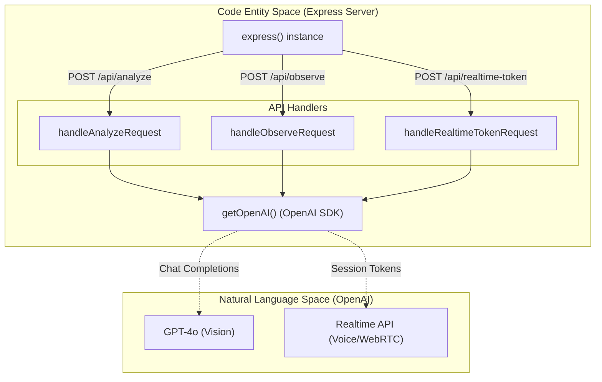
**Sources:** [server/index.ts:19-34](), [server/openai.ts:11-14](), [server/observe.ts:13-13](), [server/realtime.ts:15-15]()

## API Endpoints

The server exposes three specific POST endpoints to handle high-bandwidth data (like camera frames) and secure token exchange. Due to the transmission of base64-encoded images, the JSON body limit is increased to `12mb` [server/index.ts:23]().

| Endpoint | Handler Function | Description |
| :--- | :--- | :--- |
| `POST /api/analyze` | `handleAnalyzeRequest` | Performs a one-shot vision analysis of a plant image to identify species and health. |
| `POST /api/observe` | `handleObserveRequest` | Processes a frame, sensor data, and history to generate a "personality-driven" observation. |
| `POST /api/realtime-token` | `handleRealtimeTokenRequest` | Mints ephemeral WebRTC tokens for the plant's voice conversation. |

**Sources:** [server/index.ts:25-34]()

## OpenAI SDK Integration

The server interacts with OpenAI using a lazily-initialized client via the `getOpenAI()` function [server/openai.ts:11-14](). This prevents the server from crashing at boot time if the `OPENAI_API_KEY` is missing, instead allowing it to start and issue warnings [server/index.ts:44-49]().

### Key Security & Validation
Before processing any API request, the server verifies the environment configuration:
*   **`isApiKeyConfigured()`**: Checks if the key exists and is not the default placeholder [server/openai.ts:16-19]().
*   **`ensureApiKey(res)`**: A middleware-style helper that returns a `500` error to the client if the server is unconfigured [server/openai.ts:21-30]().

## Detailed Endpoint Documentation

The logic for these endpoints is split into specialized modules based on the OpenAI capability they leverage.

### Vision API Endpoints (`/api/analyze` & `/api/observe`) {#3.1}
These endpoints handle image-based reasoning. `handleAnalyzeRequest` is used for the initial "What plant is this?" identification, while `handleObserveRequest` is the heart of the plant's periodic awareness, combining visual data with hardware sensor readings.
*   For details, see [Vision API Endpoints (`/api/analyze` & `/api/observe`)](#3.1).

### Realtime Token Endpoint (`/api/realtime-token`) {#3.2}
This endpoint enables the low-latency voice interface. It generates a short-lived `client_secret` that allows the browser to establish a direct WebRTC connection to OpenAI's Realtime API without exposing the master API key.
*   For details, see [Realtime Token Endpoint (`/api/realtime-token`)](#3.2).

## Data Flow: Request Lifecycle

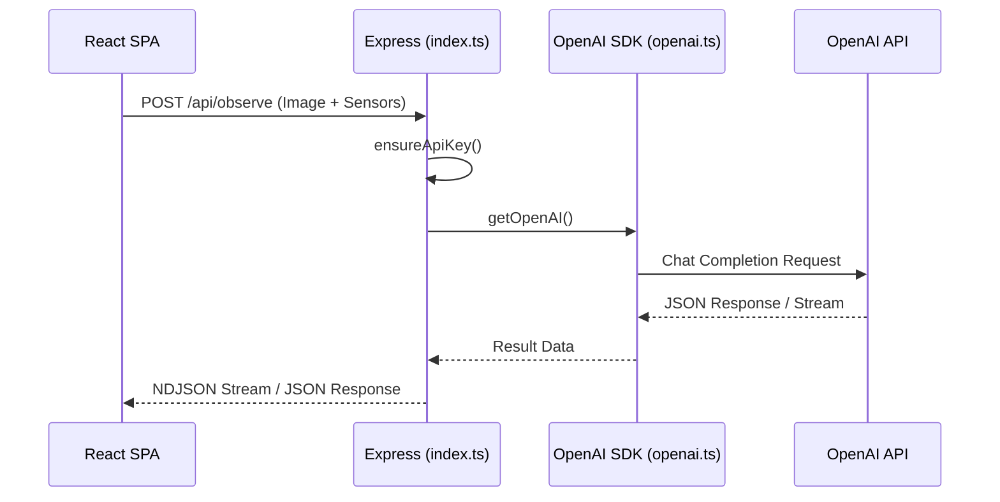
**Sources:** [server/index.ts:30-30](), [server/openai.ts:21-30](), [server/openai.ts:11-14]()

---

# Page: Vision API Endpoints (`/api/analyze` & `/api/observe`)

# Vision API Endpoints (`/api/analyze` & `/api/observe`)

<details>
<summary>Relevant source files</summary>

The following files were used as context for generating this wiki page:

- [server/observe.ts](server/observe.ts)
- [src/lib/api/response-logging.ts](src/lib/api/response-logging.ts)
- [src/lib/plant/prompts.ts](src/lib/plant/prompts.ts)
- [src/lib/plant/schemas.ts](src/lib/plant/schemas.ts)

</details>


The Vision API layer in the Express server acts as a secure proxy and data-fusion engine for OpenAI's vision models. It processes incoming camera frames and sensor data, applies domain-specific prompts, and enforces strict structured output validation using Zod schemas.

## Overview of Endpoints

The server exposes two primary POST endpoints in `server/observe.ts` [server/observe.ts:1-31]():

1.  **`POST /api/analyze`**: A one-shot endpoint used primarily for the "Plant Analysis" debug/test tool. It performs a deep visual inspection of a single image without historical context.
2.  **`POST /api/observe`**: The core of the periodic observation loop. It fuses current image data, live sensor readings, hardware status, and historical observation summaries into a single prompt to generate a structured record of the plant's state.

### Technical Constraints
- **Model**: Both endpoints utilize `gpt-5.4` (configured as `plantAnalysisModel`) [server/observe.ts:17]().
- **Timeout**: A hard ceiling of 120 seconds (`MODEL_CALL_TIMEOUT_MS`) is enforced to prevent stalled LLM calls from wedging the observation loop [server/observe.ts:27]().
- **Payload Limit**: Images are validated against a `MAX_IMAGE_DATA_URL_LENGTH` of approximately 8MB (base64 encoded) [server/observe.ts:21]().

## Data Flow: Vision Analysis Pipeline

The following diagram illustrates how raw sensor data and images from the frontend are transformed into structured JSON by the server.

### Vision Request Lifecycle
| Step | Description | Code Reference |
| :--- | :--- | :--- |
| **Validation** | Checks for API keys and validates the base64 image string. | [server/observe.ts:32-35]() |
| **Fusion** | Merges `sensorReadings`, `hardwareSummary`, and `historySummary` into the prompt. | [server/observe.ts:86-116]() |
| **Inference** | Calls OpenAI with `response_format` set to a Zod-backed JSON schema. | [server/observe.ts:124-133]() |
| **Logging** | Successful observations are written to the `/logs` directory as JSON files. | [server/observe.ts:145](), [src/lib/api/response-logging.ts:20-30]() |

### Code Entity Mapping: Request Handling
This diagram maps the logical flow of a request to the specific functions and schemas in the codebase.

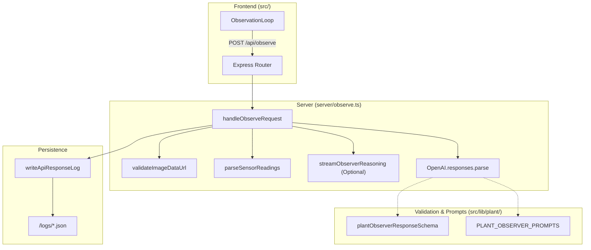
Sources: [server/observe.ts:80-151](), [src/lib/plant/schemas.ts:48-75](), [src/lib/api/response-logging.ts:20-30]()

## Periodic Observation (`/api/observe`)

The `/api/observe` endpoint supports both standard JSON responses and a streaming NDJSON mode for "reasoning summaries."

### Sensor Reading Validation
Before calling the LLM, the server validates sensor data using `parseSensorReadings` [server/observe.ts:86](). It ensures that readings like `moisture` and `light` fall within the `PLANT_SENSOR_LIMITS` [server/observe.ts:11-15]().

### Prompt Engineering
The endpoint utilizes `PLANT_OBSERVER_PROMPTS` [src/lib/plant/prompts.ts:50]().
- **System Prompt**: Instructs the model to act as a scientific observer, compare data against history, and handle "stale" or "manual" sensor data with skepticism [src/lib/plant/prompts.ts:51-63]().
- **User Prompt**: A dynamic template that injects the `sensorSummary`, `hardwareSummary`, and `historySummary` [src/lib/plant/prompts.ts:64-82]().

### Streaming Reasoning (NDJSON)
When the `stream` flag is true, the server switches to `streamObserverReasoning` [server/observe.ts:154]().
- **Content-Type**: `application/x-ndjson` [server/observe.ts:164]().
- **Events**: It streams `reasoning_summary_delta` and `reasoning_summary_done` events to the client [server/observe.ts:197-205](). This allows the UI to show the plant's "thoughts" in real-time before the final structured observation is complete.
- **Abort Logic**: If the client disconnects (`res.on("close")`), the OpenAI stream is immediately aborted to save tokens and server resources [server/observe.ts:186-190]().

Sources: [server/observe.ts:154-215](), [src/lib/plant/prompts.ts:50-83]()

## One-Shot Analysis (`/api/analyze`)

The `/api/analyze` endpoint is a simpler version of the observation logic, used for testing and initial setup [server/observe.ts:31]().

- **Input**: Only requires a `image` data URL [server/observe.ts:34]().
- **Prompt**: Uses `PLANT_ANALYSIS_PROMPTS`, which focuses on visual estimation of size (using a U.S. quarter as a reference if present), branching, and texture [src/lib/plant/prompts.ts:16-37]().
- **Schema**: Validated against `plantAttributeAnalysisSchema` [src/lib/plant/schemas.ts:9-35]().

## Structured Output Schemas

The project relies on Zod to bridge the gap between LLM text generation and typed TypeScript objects.

| Schema Name | Fields | Purpose |
| :--- | :--- | :--- |
| `plantAttributeAnalysisSchema` | `dryness`, `size`, `branching`, `physicalTexture` | Detailed physical metrics for one-shot analysis. [src/lib/plant/schemas.ts:9-35]() |
| `plantObserverResponseSchema` | `observerThoughts`, `observation`, `hypothesis`, `trend`, `dryness` | Periodic state tracking for the plant's long-term memory. [src/lib/plant/schemas.ts:48-75]() |

### Data Relationship Diagram
This diagram shows how the server-side logic interacts with the Zod schemas and the OpenAI SDK.

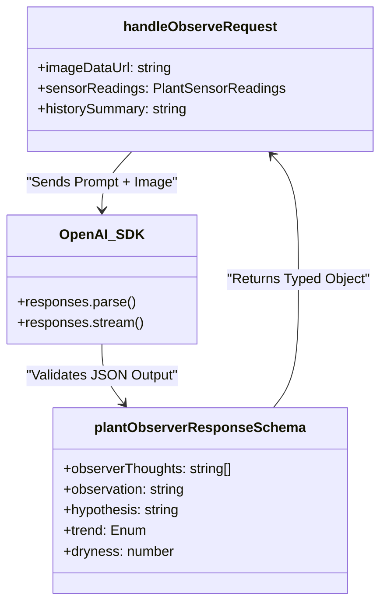
Sources: [server/observe.ts:80-151](), [src/lib/plant/schemas.ts:48-75]()

## Response Logging

Every successful observation is logged to the server's local filesystem in the `/logs` directory [src/lib/api/response-logging.ts:4]().
- **Filename Format**: `YYYYMMDDHHMMSSms.json` (e.g., `20231027103015500.json`) [src/lib/api/response-logging.ts:6-18]().
- **Function**: `writeApiResponseLog(payload)` handles the directory creation and asynchronous write [src/lib/api/response-logging.ts:20-30]().

Sources: [src/lib/api/response-logging.ts:1-36]()

---

# Page: Realtime Token Endpoint (`/api/realtime-token`)

# Realtime Token Endpoint (`/api/realtime-token`)

<details>
<summary>Relevant source files</summary>

The following files were used as context for generating this wiki page:

- [server/realtime.ts](server/realtime.ts)
- [src/lib/plant/realtime-config.ts](src/lib/plant/realtime-config.ts)

</details>


The `/api/realtime-token` endpoint is a secure proxy responsible for minting ephemeral client secrets for the OpenAI Realtime API. It ensures that the sensitive `OPENAI_API_KEY` remains on the server while providing the frontend with a short-lived token (`ek_...`) to establish a direct WebRTC connection with OpenAI [server/realtime.ts:1-7]().

Crucially, this endpoint "locks" the session configuration—including the model, voice, system instructions, and available tools—at the time of token creation. This prevents the client-side code from tampering with the plant's personality or capabilities [server/realtime.ts:5-7]().

### Token Minting Process

The server uses the `openai.realtime.clientSecrets.create` method to generate a session token. This token is configured with specific parameters that define the plant's interactive behavior [server/realtime.ts:28-34]().

| Parameter | Value / Source | Description |
|:---|:---|:---|
| **Model** | `REALTIME_MODEL` | Hardcoded to `gpt-realtime-1.5` [src/lib/plant/realtime-config.ts:6-6](). |
| **TTL** | `CLIENT_SECRET_TTL_SECONDS` | Default 600 seconds (10 minutes) [src/lib/plant/realtime-config.ts:33-33](). |
| **Instructions** | `PLANT_INSTRUCTIONS` | The "George" personality and tool-use guidelines [src/lib/plant/realtime-config.ts:36-73](). |
| **Voice** | `resolvePlantVoice()` | Validated voice selection from the request body [server/realtime.ts:25-25](). |
| **Tools** | `PLANT_TOOLS` | Definitions for `get_current_sensors` and `get_observation_history` [src/lib/plant/realtime-config.ts:76-99](). |

#### Data Flow: Token Request Lifecycle

This diagram illustrates how a request from the browser results in a secure, server-configured session token.

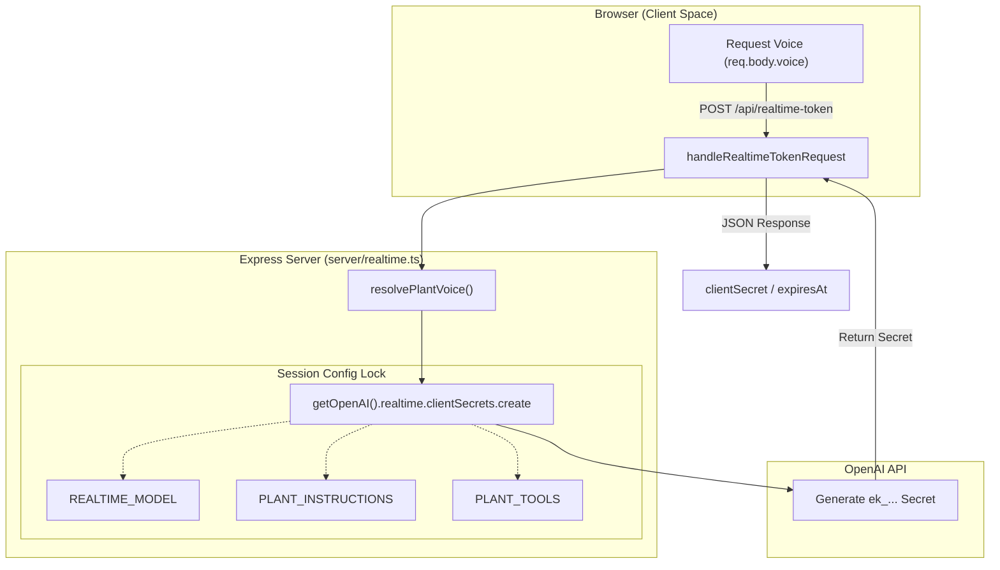

**Sources:** [server/realtime.ts:19-63](), [src/lib/plant/realtime-config.ts:1-33]()

### Session Configuration & Security

The endpoint implements several security and stability measures:

1.  **API Key Protection**: It calls `ensureApiKey(res)` before any processing to verify that the server-side environment is correctly configured [server/realtime.ts:20-20]().
2.  **Input Validation**: The `resolvePlantVoice` function ensures that the client can only select voices defined in the `PLANT_VOICES` whitelist [src/lib/plant/realtime-config.ts:27-31](). If an invalid voice is requested, it falls back to the default `PLANT_VOICE` ("cedar") [src/lib/plant/realtime-config.ts:24-31]().
3.  **Fast-Fail Strategy**: The OpenAI SDK call is wrapped with a 15-second timeout and a single retry [server/realtime.ts:56-56](). This prevents hung requests from exhausting the server's connection pool [server/realtime.ts:53-55]().
4.  **Audio Settings**: The session is configured with `semantic_vad` (Voice Activity Detection), which uses AI to determine when the user has finished speaking based on context rather than just silence duration [server/realtime.ts:47-47](). It also enables `gpt-4o-mini-transcribe` for real-time transcription of user speech [server/realtime.ts:44-44]().

### Implementation Details

The core logic resides in the `handleRealtimeTokenRequest` function.

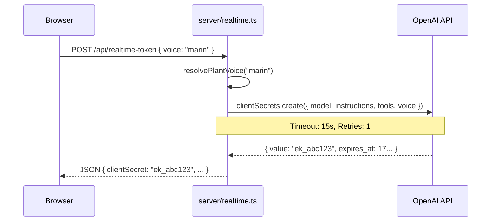

#### Error Handling
If the OpenAI API fails to return a token, the server logs the error and returns a `502 Bad Gateway` status to the client with a generic error message [server/realtime.ts:64-67]().

**Sources:** [server/realtime.ts:19-68](), [src/lib/plant/realtime-config.ts:4-31]()

---

# Page: Frontend Application

# Frontend Application

<details>
<summary>Relevant source files</summary>

The following files were used as context for generating this wiki page:

- [index.html](index.html)
- [src/app.tsx](src/app.tsx)
- [src/main.tsx](src/main.tsx)
- [src/styles.css](src/styles.css)

</details>


The Plant Talk frontend is a React-based Single Page Application (SPA) built with Vite and styled using PicoCSS. It serves as the orchestration layer that connects hardware sensor data, camera feeds, and the OpenAI Realtime API into a unified interface. The application is designed to support two distinct operational modes: a technical **Dashboard** for monitoring system internals and an **Ambient Mode** for public-facing kiosk installations.

## Entry Point and App Structure

The application initializes at `src/main.tsx`, which mounts the `App` component into the `index.html` root element [index.html:13-15](). It dynamically sets the document title based on the `PLANT_NAME` constant [src/main.tsx:9-15]().

The `App` component acts as the top-level controller. It does not use a traditional router; instead, it uses a state-driven conditional rendering approach managed by the `useUiModeStore` [src/app.tsx:8-30](). This allows the background processes—such as the observation loop and sensor monitoring—to persist even when switching between views.

### Application Layout Flow
The diagram below illustrates the mounting sequence and the relationship between the two primary views.

**View Orchestration Diagram**
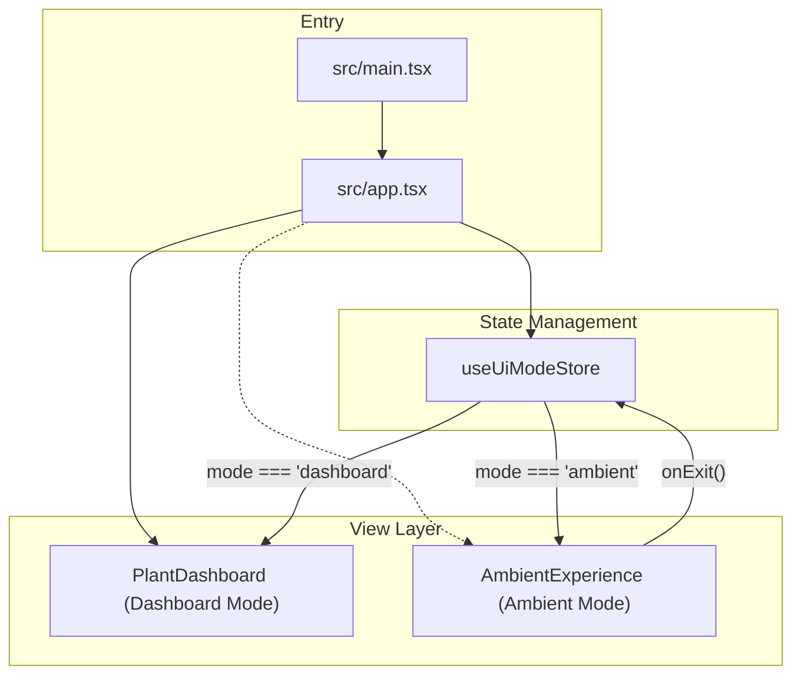
Sources: [src/main.tsx:1-15](), [src/app.tsx:1-30](), [index.html:13-17]()

## Primary Views

The application switches between two primary interfaces depending on the `mode` state in `useUiModeStore`.

| View | Component | Purpose |
| :--- | :--- | :--- |
| **Dashboard** | `PlantDashboard` | Technical view showing sensor telemetry, camera preview, LLM reasoning logs, and manual overrides. |
| **Ambient Mode** | `AmbientExperience` | A high-fidelity, public-facing overlay featuring WebGL visuals and a simplified "Press to Talk" interface. |

### Dashboard Mode
The Dashboard is the default view. It utilizes a responsive CSS grid that adjusts from 1 to 4 columns based on screen width [src/styles.css:28-51](). It is composed of multiple panels that expose the internal state of the plant's "brain" and "senses."

For details on the specific panels and the observation loop, see [Dashboard Components](#4.1).

### Ambient Mode
Ambient Mode is rendered as an overlay on top of the dashboard [src/app.tsx:27-27](). This ensures that while the user sees a clean, artistic interface, the underlying `PlantDashboard` components remain mounted to handle hardware communication and API requests.

For details on the WebGL visuals and kiosk UX, see [Ambient Mode (Public Experience)](#4.2).

Sources: [src/app.tsx:6-29](), [src/styles.css:28-51]()

## State Wiring (Zustand)

The frontend relies on **Zustand** stores to bridge the gap between low-level logic (like Web Serial streams or WebRTC audio) and the React UI. Components subscribe to specific slices of state to minimize re-renders.

**Data Flow: Sensors to UI**
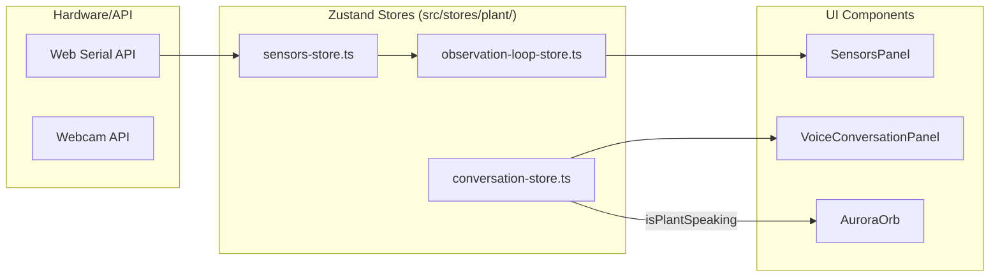

Key store interactions include:
*   **UI Mode Store**: Manages the toggle between `dashboard` and `ambient` views [src/stores/plant/ui-mode-store.ts]().
*   **Sensor Store**: Tracks real-time moisture and light data from the Arduino [src/stores/plant/sensors-store.ts]().
*   **Conversation Store**: Manages the OpenAI Realtime connection and audio levels [src/stores/plant/conversation-store.ts]().

Sources: [src/app.tsx:9-10](), [src/styles.css:99-103]()

## Global Styles

The application uses **PicoCSS** for semantic HTML styling with minimal overrides. Custom styles in `src/styles.css` handle:
*   **The Dashboard Grid**: A responsive layout using `grid-template-columns` [src/styles.css:28-51]().
*   **Animations**: The `.flash-on-update` class used to highlight new analysis results [src/styles.css:77-80]().
*   **Audio Visualizers**: Styles for `.level-meters` used in voice conversation [src/styles.css:99-103]().

Sources: [src/styles.css:1-103](), [src/main.tsx:3-4]()

---

# Page: Dashboard Components

# Dashboard Components

<details>
<summary>Relevant source files</summary>

The following files were used as context for generating this wiki page:

- [src/components/dashboard/action-glyph.ts](src/components/dashboard/action-glyph.ts)
- [src/components/dashboard/camera-panel.tsx](src/components/dashboard/camera-panel.tsx)
- [src/components/dashboard/debug-panel.tsx](src/components/dashboard/debug-panel.tsx)
- [src/components/dashboard/history-panel.tsx](src/components/dashboard/history-panel.tsx)
- [src/components/dashboard/observation-panel.tsx](src/components/dashboard/observation-panel.tsx)
- [src/components/dashboard/plant-analysis-panel.tsx](src/components/dashboard/plant-analysis-panel.tsx)
- [src/components/dashboard/plant-dashboard.tsx](src/components/dashboard/plant-dashboard.tsx)
- [src/components/dashboard/plant-upload-panel.tsx](src/components/dashboard/plant-upload-panel.tsx)
- [src/components/dashboard/sensors-panel.tsx](src/components/dashboard/sensors-panel.tsx)
- [src/components/dashboard/voice-conversation-panel.tsx](src/components/dashboard/voice-conversation-panel.tsx)

</details>


The `PlantDashboard` serves as the primary administrative interface for the Plant Talk system. It is implemented as a CSS grid of modular panels located in `src/components/dashboard/`, each responsible for a specific subsystem (vision, sensors, voice, or state).

## PlantDashboard Layout and Lifecycle

The `PlantDashboard` component [src/components/dashboard/plant-dashboard.tsx:15-75]() manages the high-level orchestration of the application's lifecycle, including sensor initialization, camera auto-start, and the periodic observation loop.

### Observation Loop Wiring
The observation loop is managed via three `useEffect` hooks in `PlantDashboard`:
1.  **Sensor Initialization**: Calls `initSensors()` on mount to reconnect to remembered Arduino devices and `cleanupSensors()` on unmount [src/components/dashboard/plant-dashboard.tsx:26-31]().
2.  **Immediate Observation**: When `autoUpdatesEnabled` is toggled on and the camera is `ready`, it triggers an immediate call to `sendLiveUpdate` [src/components/dashboard/plant-dashboard.tsx:44-47]().
3.  **Interval Rescheduling**: Sets up a `setInterval` based on `observationIntervalMs`. By including `lastUpdatedAt` in the dependency array, manual triggers ("Observe now") effectively reset the timer, preventing overlapping API calls [src/components/dashboard/plant-dashboard.tsx:51-59]().

### Dashboard Component Architecture
Title: Dashboard Data Flow and Entity Mapping
```mermaid
graph TD
    subgraph "Natural Language Space"
        A["'How is the plant doing?'"]
        B["'What does it see?'"]
        C["'Is the soil dry?'"]
    end

    subgraph "Code Entity Space (src/components/dashboard/)"
        D["VoiceConversationPanel"]
        E["CameraPanel"]
        F["SensorsPanel"]
        G["ObservationPanel"]
    end

    subgraph "Zustand Stores (src/stores/plant/)"
        H["useConversationStore"]
        I["usePlantCameraStore"]
        J["usePlantSensorsStore"]
        K["useObservationLoopStore"]
    end

    A <--> D
    B <--> E
    C <--> F
    
    D --- H
    E --- I
    F --- J
    G --- K

    K -- "triggers" --> E
    K -- "reads" --> J
```
Sources: [src/components/dashboard/plant-dashboard.tsx:1-75](), [src/components/dashboard/observation-panel.tsx:1-129]()

## Panel Reference

### CameraPanel
Provides a live preview of the webcam feed and device selection.
*   **Implementation**: Uses a `videoRef` to imperatively bind the `MediaStream` from `usePlantCameraStore` [src/components/dashboard/camera-panel.tsx:19-23]().
*   **Functionality**: Refreshes the device list when `devicechange` events occur [src/components/dashboard/camera-panel.tsx:28-35]().
*   **State**: Displays `cameraStatus` (ready, starting, error, etc.) using `ActionStatus` glyphs [src/components/dashboard/camera-panel.tsx:43-52]().

### SensorsPanel
Manages the source of environmental data.
*   **Modes**: Toggles between `manual` (UI sliders) and `arduino` (Web Serial) [src/components/dashboard/sensors-panel.tsx:59-80]().
*   **Arduino Integration**: Allows connecting/disconnecting via Web Serial and configuring the `interval` command to change the hardware reporting rate [src/components/dashboard/sensors-panel.tsx:127-142]().
*   **Manual Fallback**: Provides sliders for moisture and light when hardware is unavailable [src/components/dashboard/sensors-panel.tsx:91-107]().

### ObservationPanel
Triggers and displays periodic AI observations.
*   **Streaming Reasoning**: Displays a list of `reasoningLog` entries as the model processes the image and sensors in real-time [src/components/dashboard/observation-panel.tsx:76-92]().
*   **Countdown**: Calculates and displays the time remaining until the next automatic observation [src/components/dashboard/observation-panel.tsx:33-48]().
*   **Manual Trigger**: The "Observe now" button calls `sendLiveUpdate("manual", captureLiveFrame)` [src/components/dashboard/observation-panel.tsx:105]().

### VoiceConversationPanel
Handles the WebRTC-based Realtime Voice connection.
*   **Connection Lifecycle**: Manages `connect` and `disconnect` states, including token minting and microphone requesting [src/components/dashboard/voice-conversation-panel.tsx:73-80]().
*   **Transcript**: Renders a scrollable history of the conversation between the user and the plant [src/components/dashboard/voice-conversation-panel.tsx:131-142]().
*   **Tool Visibility**: Shows a summary of tool calls (e.g., `get_current_sensors`) made by the model during the conversation [src/components/dashboard/voice-conversation-panel.tsx:144-161]().

### HistoryPanel
Displays the "Plant's Memory" persisted in IndexedDB.
*   **Data Source**: Reads from `usePlantObserverStore` [src/components/dashboard/history-panel.tsx:9]().
*   **Visualization**: Lists the last 25 observations, flagging whether they used live hardware readings (`🔌`) or manual sliders (`🎚️`) [src/components/dashboard/history-panel.tsx:26-44]().

### DebugPanel
A technical overview of the system state.
*   **Status Tracking**: Monitors the health of the Serial connection, Camera, API calls, and Network connectivity in a tabular format [src/components/dashboard/debug-panel.tsx:60-105]().

### PlantUploadPanel & PlantAnalysisPanel
Used for testing the vision model with static files.
*   **Upload**: Allows users to select a local JPG/PNG and trigger `analyzePlantImage` [src/components/dashboard/plant-upload-panel.tsx:24-39]().
*   **Analysis**: Displays the raw JSON and a formatted table of attributes (dryness, size, texture) returned by the `analyze` endpoint [src/components/dashboard/plant-analysis-panel.tsx:34-70]().

## Status Visualization
All primary panels use `action-glyph.ts` to provide a consistent visual language for system readiness:
| Glyph | Status | Meaning |
| :--- | :--- | :--- |
| `👉` | `todo` | User action required (e.g., Start Camera) |
| `⏳` | `working` | Async operation in progress |
| `✅` | `done` | System active and healthy |
| `❌` | `error` | Failure state |
| `⚠️` | `warn` | Feature unsupported by browser |

Sources: [src/components/dashboard/action-glyph.ts:7-20](), [src/components/dashboard/camera-panel.tsx:43-52](), [src/components/dashboard/sensors-panel.tsx:43-51]()

## Component Interaction Diagram
Title: UI Component and Store Interactions
```mermaid
sequenceDiagram
    participant P as PlantDashboard
    participant O as ObservationPanel
    participant S as SensorsPanel
    participant LS as useObservationLoopStore
    participant SS as usePlantSensorsStore
    participant API as Express /api/observe

    P->>SS: init()
    P->>LS: useEffect (Interval)
    Note over LS: Interval triggers
    LS->>SS: get readings
    LS->>API: POST /api/observe
    API-->>LS: NDJSON Stream (Reasoning)
    LS-->>O: update reasoningLog
    API-->>LS: Final JSON Response
    LS-->>O: update latestObservation
    LS->>P: update lastUpdatedAt
    Note over P: Reschedules next tick
```
Sources: [src/components/dashboard/plant-dashboard.tsx:51-59](), [src/components/dashboard/observation-panel.tsx:18-25](), [src/components/dashboard/sensors-panel.tsx:18-26]()

---

# Page: Ambient Mode (Public Experience)

# Ambient Mode (Public Experience)

<details>
<summary>Relevant source files</summary>

The following files were used as context for generating this wiki page:

- [src/components/public/intro-view.tsx](src/components/public/intro-view.tsx)
- [src/components/public/landing-view.tsx](src/components/public/landing-view.tsx)
- [src/components/public/number-counter.tsx](src/components/public/number-counter.tsx)
- [src/components/public/public-experience.css](src/components/public/public-experience.css)
- [src/components/public/public-experience.tsx](src/components/public/public-experience.tsx)
- [src/components/public/streaming-text.tsx](src/components/public/streaming-text.tsx)
- [src/components/public/webgl/aurora-orb.tsx](src/components/public/webgl/aurora-orb.tsx)
- [src/components/public/webgl/color.ts](src/components/public/webgl/color.ts)
- [src/components/public/webgl/wave-gradient-background.tsx](src/components/public/webgl/wave-gradient-background.tsx)

</details>


The Ambient Mode, implemented in `src/components/public/`, provides a kiosk-optimized user interface designed for public installations. Unlike the data-heavy Dashboard, this mode focuses on a high-fidelity visual experience using WebGL shaders and simplified sensor readouts to facilitate natural conversation between a visitor and the plant.

## Overview and Kiosk UX

The `AmbientExperience` component acts as a full-screen overlay [src/components/public/public-experience.tsx:11-15](). It manages two primary sub-views: the `LandingView` (an attract loop) and the `IntroView` (the active conversation interface) [src/components/public/public-experience.tsx:9-9]().

### Key UX Features:
*   **Scroll Lock:** The component programmatically disables document scrolling upon mounting to prevent the dashboard from appearing behind the overlay [src/components/public/public-experience.tsx:32-38]().
*   **Esc-to-Exit:** A hidden "developer exit" is implemented via a global key listener, allowing an operator to return to the dashboard by pressing `Escape` [src/components/public/public-experience.tsx:22-28]().
*   **Visual Hint:** A transient `public-experience__hint` informs the user/developer how to exit, which fades out after 3.5 seconds [src/components/public/public-experience.tsx:41-44]().
*   **Responsive Scaling:** The UI uses CSS `clamp()` and `vmin` units extensively to ensure the "Orb" and typography scale correctly across different display aspect ratios [src/components/public/public-experience.css:25-26](), [src/components/public/public-experience.css:94-94]().

**Sources:** [src/components/public/public-experience.tsx:1-81](), [src/components/public/public-experience.css:1-268]()

## Component Architecture

### Data Flow: Natural Language to UI
The following diagram illustrates how the `conversation-store` and `sensors-store` drive the visual elements in the Ambient Mode.

**Ambient Mode Data Flow**
```mermaid
graph TD
    subgraph "Zustand Stores"
        CS["useConversationStore"]
        SS["usePlantSensorsStore"]
    end

    subgraph "Visual Components"
        AO["AuroraOrb (WebGL)"]
        ST["StreamingText"]
        NC["NumberCounter"]
        IV["IntroView"]
    end

    CS -- "isPlantSpeaking" --> AO
    CS -- "transcript (last line)" --> ST
    SS -- "moisture" --> NC
    SS -- "light" --> IV
```
**Sources:** [src/components/public/public-experience.tsx:19-19](), [src/components/public/intro-view.tsx:21-35](), [src/components/public/intro-view.tsx:82-91]()

### Landing vs. Intro Views
1.  **LandingView:** Displays a "Talk to [PLANT_NAME]" call-to-action [src/components/public/landing-view.tsx:20-20](). It tracks hover state to pulse the background `AuroraOrb` [src/components/public/public-experience.tsx:57-58]().
2.  **IntroView:** Automatically triggers the `connect()` method of the `useConversationStore` upon mounting [src/components/public/intro-view.tsx:38-41](). It monitors the `status` and `isActive` flags; if the conversation ends (e.g., server hangup), it automatically reverts the UI to the `LandingView` [src/components/public/intro-view.tsx:49-56]().

**Sources:** [src/components/public/landing-view.tsx:1-24](), [src/components/public/intro-view.tsx:1-94]()

## Visual Layer (WebGL & Animation)

The ambient experience utilizes the `ogl` library for high-performance WebGL rendering.

### AuroraOrb
The `AuroraOrb` is a central visual element that uses a GLSL simplex-noise shader to create a gaseous, glowing effect.
*   **Shader Logic:** It uses a 3D simplex noise function (`snoise3`) to perturb the distance field of the orb [src/components/public/webgl/aurora-orb.tsx:46-70]().
*   **Speaking Interaction:** The `active` prop (driven by `isPlantSpeaking`) is passed to the shader's `hover` uniform, which increases the noise turbulence and rotation when the plant is talking [src/components/public/webgl/aurora-orb.tsx:57-58](), [src/components/public/webgl/aurora-orb.tsx:130-131]().
*   **Color Utilities:** Hex and RGB strings are converted to normalized `[0, 1]` arrays via `toRgb` for use as GLSL uniforms [src/components/public/webgl/color.ts:3-14]().

### WaveGradientBackground
A full-bleed background that renders a warped gradient.
*   **Warping:** The shader applies a rotation matrix and harmonic sine waves to the UV coordinates to create a "liquid" movement [src/components/public/webgl/wave-gradient-background.tsx:74-101]().
*   **Fallback:** If the WebGL program fails to link, the component gracefully falls back to a static CSS gradient defined in `public-experience.css` [src/components/public/webgl/wave-gradient-background.tsx:216-227]().

**Sources:** [src/components/public/webgl/aurora-orb.tsx:8-141](), [src/components/public/webgl/wave-gradient-background.tsx:8-140](), [src/components/public/webgl/color.ts:1-15]()

## Specialized Text Components

To maintain a "natural" feel, text and numbers do not snap instantly.

### StreamingText
Used for the plant's spoken dialogue. It mimics a typewriter effect but with word-aware wrapping.
*   **Implementation:** It splits the incoming text into tokens (words and spaces) [src/components/public/streaming-text.tsx:46-52](). 
*   **Animation:** Each character is wrapped in a `span` with the `public-experience__char` class, which triggers a CSS `translateY` and `opacity` animation [src/components/public/public-experience.css:166-180]().
*   **Reset Logic:** It uses a `generation` counter to force a React remount when a new utterance starts, ensuring the animation replays from the beginning [src/components/public/streaming-text.tsx:19-24]().

### NumberCounter
Used for soil moisture percentages. 
*   **Easing:** It uses a `requestAnimationFrame` loop with an `easeOutCubic` function to animate the transition between two numeric values [src/components/public/number-counter.tsx:33-41]().
*   **Formatting:** Supports custom `decimalPlaces`, `prefix`, and `suffix` [src/components/public/number-counter.tsx:12-19]().

**Sources:** [src/components/public/streaming-text.tsx:1-71](), [src/components/public/number-counter.tsx:1-52]()

## Code Entity Mapping

This diagram maps the UI concepts to their specific code implementations.

**UI to Code Entity Mapping**
```mermaid
classDiagram
    class AmbientExperience {
        +setView(view)
        +onExit()
        +isPlantSpeaking
    }
    class IntroView {
        +connect()
        +disconnect()
        +getIdleLine(moisture, light)
    }
    class AuroraOrb {
        +VERTEX_SHADER
        +FRAGMENT_SHADER
        +snoise3(p)
    }
    class StreamingText {
        +tokens
        +generation
        +tick(ts)
    }

    AmbientExperience *-- IntroView
    AmbientExperience *-- AuroraOrb
    IntroView *-- StreamingText
    IntroView *-- NumberCounter
```
**Sources:** [src/components/public/public-experience.tsx:15-80](), [src/components/public/intro-view.tsx:20-94](), [src/components/public/webgl/aurora-orb.tsx:166-177](), [src/components/public/streaming-text.tsx:8-71]()

---

# Page: State Management (Zustand Stores)

# State Management (Zustand Stores)

<details>
<summary>Relevant source files</summary>

The following files were used as context for generating this wiki page:

- [src/stores/plant/experience-store.ts](src/stores/plant/experience-store.ts)
- [src/stores/plant/settings-store.ts](src/stores/plant/settings-store.ts)
- [src/stores/plant/ui-mode-store.ts](src/stores/plant/ui-mode-store.ts)

</details>


The Plant Talk application uses **Zustand** for state management, organized into several specialized stores within `src/stores/plant/`. The architecture is designed to handle high-frequency sensor data, periodic AI observation loops, and real-time voice interactions while maintaining a responsive UI and persistent history across sessions.

## Store Organization & Persistence

The system utilizes different persistence strategies based on the nature of the data:
*   **Volatile State:** UI flags, connection statuses, and transient analysis results are kept in memory.
*   **LocalStorage:** User preferences (intervals, voice selection, UI mode) are persisted using Zustand's `persist` middleware or manual `localStorage` setters [src/stores/plant/settings-store.ts:51](), [src/stores/plant/ui-mode-store.ts:24]().
*   **IndexedDB:** Large datasets, specifically the observation history, are stored in IndexedDB via `idb-keyval` to avoid LocalStorage size limits and performance bottlenecks.

### Store Architecture Overview

The following diagram illustrates the relationship between the major stores and their persistence layers:

**Zustand Store Ecosystem**
```mermaid
graph TD
    subgraph "Zustand Stores"
        SS["sensors-store"]
        OLS["observation-loop-store"]
        OS["observer-store"]
        CS["conversation-store"]
        SET["settings-store"]
        UI["ui-mode-store"]
        EXP["experience-store"]
    end

    subgraph "Persistence"
        IDB[("IndexedDB (idb-keyval)")]
        LS[("LocalStorage")]
    end

    OS -->|History Data| IDB
    SET -->|Intervals| LS
    UI -->|View State| LS
    CS -->|Voice Prefs| LS

    SS -->|Readings| OLS
    OLS -->|Observation Result| OS
    OS -.->|Tool Call Data| CS
```
**Sources:** [src/stores/plant/settings-store.ts:29-51](), [src/stores/plant/ui-mode-store.ts:20-28](), [src/stores/plant/experience-store.ts:18-19]()

## Core Stores

### Settings & UI Stores
These stores manage the application's configuration and high-level visual state.

*   **`usePlantSettingsStore`**: Manages user-tunable timings like `observationIntervalMs` (default 15m) and `arduinoCheckIntervalMs` (default 1s) [src/stores/plant/settings-store.ts:6-7](). It includes a migration path to handle legacy setting names and enforces safe limits for API rate-limiting [src/stores/plant/settings-store.ts:60-84]().
*   **`useUiModeStore`**: Tracks whether the user is in `dashboard` or `ambient` mode [src/stores/plant/ui-mode-store.ts:5](). This state is manually persisted to `localStorage` [src/stores/plant/ui-mode-store.ts:22-27]().
*   **`usePlantExperienceStore`**: Specifically handles the "One-shot Analysis" flow, managing image file selection, object URL revocation for previews, and the `analyzePlantImage` async operation [src/stores/plant/experience-store.ts:27-61]().

**Sources:** [src/stores/plant/settings-store.ts:1-95](), [src/stores/plant/ui-mode-store.ts:1-29](), [src/stores/plant/experience-store.ts:1-80]()

### Sensor & Observation Stores
This group handles the ingestion of hardware data and the periodic execution of the AI "Observer" logic.

| Store | Responsibility | Key Entities |
| :--- | :--- | :--- |
| **Sensors** | Web Serial lifecycle & data parsing. | `parseSensorPayload`, `watchdog` |
| **Observation Loop** | Periodic execution of vision analysis. | `sendLiveUpdate`, `exponentialBackoff` |
| **Observer** | Persistence of historical sensor/AI data. | `summarizeObservationHistory`, `idb-keyval` |

For a deep dive into serial connections and the observation lifecycle, see **[Sensor & Observation Stores (#5.1)](#)**.

### Conversation & UI Stores
This group manages the interactive layer, including the Realtime Voice API and device hardware.

| Store | Responsibility | Key Entities |
| :--- | :--- | :--- |
| **Conversation** | Wrapper for `RealtimeVoiceConnection`. | `transcript`, `toolActivityLog` |
| **Microphone** | Audio input device selection. | `enumerateDevices`, `selectedDeviceId` |

For details on voice interaction and tool execution, see **[Conversation & UI Stores (#5.2)](#)**.

## Store Interactivity

The stores are designed to be decoupled but interact through the React component tree or direct tool execution:

1.  **Data Ingestion**: `sensors-store` provides raw values.
2.  **Context Aggregation**: When `observation-loop-store` triggers, it pulls the latest readings from `sensors-store`.
3.  **Persistence**: The resulting AI observation is saved into `observer-store` (IndexedDB).
4.  **Tool Execution**: When the LLM calls `get_observation_history` via the `conversation-store`, the store retrieves data from `observer-store` to provide context to the model.

**Natural Language to Code Mapping**
```mermaid
graph LR
    subgraph "Natural Language Concepts"
        A["Plant Memory"]
        B["Plant Senses"]
        C["User Settings"]
    end

    subgraph "Code Entities"
        A --- OS["observer-store.ts"]
        B --- SS["sensors-store.ts"]
        C --- SET["settings-store.ts"]
    end
```
**Sources:** [src/stores/plant/settings-store.ts:1-5](), [src/stores/plant/experience-store.ts:1-16]()

---

# Page: Sensor & Observation Stores

# Sensor & Observation Stores

<details>
<summary>Relevant source files</summary>

The following files were used as context for generating this wiki page:

- [src/stores/plant/camera-store.ts](src/stores/plant/camera-store.ts)
- [src/stores/plant/observation-loop-store.ts](src/stores/plant/observation-loop-store.ts)
- [src/stores/plant/observer-store.ts](src/stores/plant/observer-store.ts)
- [src/stores/plant/sensors-store.ts](src/stores/plant/sensors-store.ts)

</details>


The state management for Plant Talk is divided into two primary domains: real-time environmental data acquisition via **Sensors** and long-term memory via **Observations**. These stores coordinate to provide the LLM with a comprehensive context of the plant's current state and its historical trends.

## 5.1.1 Sensor Store (`sensors-store.ts`)

The `usePlantSensorsStore` manages the lifecycle of environmental data, supporting both a "Manual" mode (UI sliders) and an "Arduino" mode (Web Serial API). It handles the complexities of serial connection persistence, watchdog monitoring, and multi-format payload parsing.

### Connection Lifecycle & Auto-Reconnect
The store implements a robust connection manager for the Web Serial API. When in `arduino` mode, it attempts to maintain an active connection to the microcontroller.
*   **Auto-Reconnect**: If a connection is lost, a `reconnectTimer` polls for available ports every 3000ms [src/stores/plant/sensors-store.ts:34-34](), [src/stores/plant/sensors-store.ts:184-206]().
*   **Watchdog Timer**: To detect "silent" hardware failures (where the serial port is open but the firmware has hung), a watchdog timer is used [src/stores/plant/sensors-store.ts:143-172](). If no data arrives within a window (3x the `arduinoCheckIntervalMs`), the store forces a port closure and triggers a reconnect [src/stores/plant/sensors-store.ts:166-171]().
*   **Manual Override**: If a user explicitly clicks "Disconnect", `suppressAutoReconnect` is set to `true` to prevent the background timers from fighting the user's intent [src/stores/plant/sensors-store.ts:72-72]().

### Data Parsing & Selection
The store handles data from `PlantSensors.ino` which may arrive in various formats. The `parseSensorPayload` function uses a flexible alias system to map incoming JSON keys (e.g., `soil`, `lux`, `moisturePercent`) to the internal `moisture` and `light` keys [src/stores/plant/sensors-store.ts:38-41](), [src/stores/plant/sensors-store.ts:397-434]().

**Hardware vs. Fallback Logic:**
The system always maintains two sets of readings: `hardwareReadings` and `fallbackReadings`. The `selectSensorReadings` selector determines which to provide to the rest of the application based on the current `sensorMode` and the "freshness" of the hardware data [src/stores/plant/sensors-store.ts:468-479]().

### Sensors Entity Space
The following diagram bridges the logical sensing concepts to the code entities in `sensors-store.ts`.

```mermaid
graph TD
  subgraph "Natural Language Space"
    A["'The Soil is Dry'"]
    B["'The Light is Bright'"]
    C["'Arduino Unplugged'"]
  end

  subgraph "Code Entity Space (sensors-store.ts)"
    direction LR
    D["usePlantSensorsStore"]
    E["parseSensorPayload()"]
    F["watchdogTimer"]
    G["selectSensorReadings()"]
    H["SENSOR_ALIASES"]
  end

  A -->|Mapped via| H
  B -->|Validated by| E
  C -->|Triggered by| F
  D -->|Provides| G
  G -->|Returns| I["PlantSensorReadings"]
```
Sources: [src/stores/plant/sensors-store.ts:38-41](), [src/stores/plant/sensors-store.ts:143-149](), [src/stores/plant/sensors-store.ts:397-400](), [src/stores/plant/sensors-store.ts:468-470]()

---

## 5.1.2 Observation Loop Store (`observation-loop-store.ts`)

The `useObservationLoopStore` orchestrates the periodic "heartbeat" of the system. Every N minutes, it captures a snapshot of the plant and consults the Vision LLM.

### Periodic Loop & Rate Limiting
The store facilitates the execution of `sendLiveUpdate`, which can be triggered automatically by a `setInterval` in the UI or manually by the user [src/stores/plant/observation-loop-store.ts:63-63]().
*   **Exponential Backoff**: If the OpenAI API returns a `429 Rate Limit` error, the store calculates a backoff window using `RATE_LIMIT_BASE_BACKOFF_MS` and an exponential multiplier [src/stores/plant/observation-loop-store.ts:166-176](). Auto-updates are skipped until this cooldown expires [src/stores/plant/observation-loop-store.ts:76-81]().
*   **Tab Visibility**: To save API costs, auto-updates are paused if `document.hidden` is true [src/stores/plant/observation-loop-store.ts:70-72]().

### Reasoning Log Streaming
Instead of waiting for a final JSON response, the store utilizes `observePlantFileWithReasoningStream` to ingest a stream of NDJSON events [src/stores/plant/observation-loop-store.ts:100-115](). As the model "thinks," the `reasoningLog` array is updated, allowing the UI to show real-time progress of the plant's analysis [src/stores/plant/observation-loop-store.ts:113-113]().

Sources: [src/stores/plant/observation-loop-store.ts:24-25](), [src/stores/plant/observation-loop-store.ts:70-72](), [src/stores/plant/observation-loop-store.ts:100-115](), [src/stores/plant/observation-loop-store.ts:166-176]()

---

## 5.1.3 Observer Store (`observer-store.ts`)

The `usePlantObserverStore` acts as the long-term memory of the plant, persisting data to the browser's **IndexedDB** using `idb-keyval` [src/stores/plant/observer-store.ts:1-1](), [src/stores/plant/observer-store.ts:35-46]().

### Persistence & Ring Buffer
Observations are stored in a "ring buffer" limited to `MAX_OBSERVATIONS` (1440 records), representing approximately 10 days of history at a 10-minute interval [src/stores/plant/observer-store.ts:12-12](). This ensures the database does not grow indefinitely while maintaining enough data for trend analysis.

### History Selection for LLM Context
Because LLM context windows are limited, the store does not send the entire history. The `selectObservationsForPrompt` function creates a curated subset [src/stores/plant/observer-store.ts:125-149]():
1.  **Recent Records**: The 5 most recent observations (`HISTORY_RECENT_COUNT`) [src/stores/plant/observer-store.ts:13-13]().
2.  **Sparse Records**: 6 records spread evenly across the entire historical window (`HISTORY_SPARSE_COUNT`) [src/stores/plant/observer-store.ts:14-14]().

### History Summarization
The `summarizeObservationHistory` and `computeHistorySummary` functions generate a natural language string describing moisture trends (e.g., "rising", "stable") and total light exposure in hours [src/stores/plant/observer-store.ts:152-181](). This summary provides the LLM with "at-a-glance" knowledge of the past several days without consuming excessive tokens [src/stores/plant/observer-store.ts:191-191]().

### Observation Data Flow
The following diagram tracks the movement of a single observation from the camera to the persistent database.

```mermaid
graph TD
  subgraph "Capture & Analysis"
    CAM["camera-store.ts: captureLiveFrame()"]
    LOOP["observation-loop-store.ts: sendLiveUpdate()"]
    API["/api/observe (Vision LLM)"]
  end

  subgraph "Storage & Memory"
    STORE["observer-store.ts: addObservation()"]
    IDB[("IndexedDB (idb-keyval)")]
    BUF["Ring Buffer (1440 records)"]
  end

  CAM -->|Image File| LOOP
  LOOP -->|POST| API
  API -->|JSON Result| LOOP
  LOOP -->|Commit| STORE
  STORE -->|Persist| IDB
  STORE -->|Slice| BUF
```
Sources: [src/stores/plant/camera-store.ts:174-180](), [src/stores/plant/observation-loop-store.ts:63-63](), [src/stores/plant/observation-loop-store.ts:138-148](), [src/stores/plant/observer-store.ts:12-12](), [src/stores/plant/observer-store.ts:35-46]()

---

# Page: Conversation & UI Stores

# Conversation & UI Stores

<details>
<summary>Relevant source files</summary>

The following files were used as context for generating this wiki page:

- [src/stores/plant/conversation-store.ts](src/stores/plant/conversation-store.ts)
- [src/stores/plant/microphone-store.ts](src/stores/plant/microphone-store.ts)
- [src/stores/plant/ui-mode-store.ts](src/stores/plant/ui-mode-store.ts)

</details>


This section details the state management for the voice interaction pipeline, hardware input selection, and global application display modes. These stores are built using Zustand and serve as the reactive bridge between low-level WebRTC/Hardware APIs and the React UI components.

## Conversation Store

The `useConversationStore` acts as a thin reactive wrapper around the `RealtimeVoiceConnection` class. It manages the lifecycle of a voice session, maintains a rolling history of transcripts and tool executions, and provides status updates for UI feedback.

### Core Implementation
The store holds a reference to the active `RealtimeVoiceConnection` in a closure, ensuring that the connection instance itself does not trigger unnecessary React re-renders [src/stores/plant/conversation-store.ts:60-60](). It exposes reactive state for connection status, speech activity, and error messages.

### Data Management Logic
*   **Transcript Upserting**: Transcripts are streamed as deltas. The `upsertTranscript` function handles merging these deltas by matching conversation item IDs. When a "final" event is received, it replaces the accumulated delta with the authoritative text [src/stores/plant/conversation-store.ts:66-82]().
*   **Tool Activity Log**: Tracks the lifecycle of tool calls (e.g., `get_current_sensors`). It records the call ID, arguments, and eventually the result after `executePlantTool` completes [src/stores/plant/conversation-store.ts:120-136]().
*   **Debug Event Buffer**: Maintains a ring buffer of the last 100 server events for diagnostic purposes [src/stores/plant/conversation-store.ts:34-34](), [src/stores/plant/conversation-store.ts:145-149]().
*   **Voice Persistence**: The user's preferred plant voice is persisted to `localStorage` using the `SELECTED_VOICE_STORAGE_KEY` [src/stores/plant/conversation-store.ts:10-10](), [src/stores/plant/conversation-store.ts:173-178]().

### Connection Lifecycle
When `connect()` is called, the store initializes a new `RealtimeVoiceConnection` and passes a series of callbacks to sync the internal state with the WebRTC data channel events [src/stores/plant/conversation-store.ts:97-158]().

### Conversation Data Flow
The following diagram illustrates how the `useConversationStore` orchestrates data between the OpenAI Realtime API and the local application state.

**Diagram: Conversation State & Tool Execution Flow**
```mermaid
graph TD
    subgraph "Realtime Space"
        RVC["RealtimeVoiceConnection"]
        API["OpenAI Realtime API"]
    end

    subgraph "Conversation Store (Zustand)"
        CS["useConversationStore"]
        TS["transcript: TranscriptEntry[]"]
        TL["toolActivity: ToolActivityEntry[]"]
    end

    subgraph "Execution Space"
        EPT["executePlantTool()"]
        SS["useSensorsStore"]
        OS["useObserverStore"]
    end

    RVC -- "onUserTranscript / onModelTranscript" --> CS
    CS -- "upsertTranscript()" --> TS
    
    RVC -- "onToolCall" --> CS
    CS -- "executePlantTool(name, args)" --> EPT
    EPT -- "Read State" --> SS
    EPT -- "Read History" --> OS
    EPT -- "Return Result" --> CS
    CS -- "onToolResult" --> TL
    CS -- "sendToolResponse" --> RVC
    RVC <== "WebRTC Data Channel" ==> API
```
Sources: [src/stores/plant/conversation-store.ts:59-183](), [src/lib/plant/realtime-tools.ts:1-20]()

## Microphone Store

The `useMicrophoneStore` manages the enumeration and selection of audio input devices. It mirrors the logic used for camera selection but is specifically consumed by the `useConversationStore` when initiating a voice call.

### Key Behaviors
*   **Device Enumeration**: Uses `navigator.mediaDevices.enumerateDevices()` to filter for `audioinput` devices [src/stores/plant/microphone-store.ts:28-48]().
*   **Permission Sync**: Browser security often hides device labels until permission is granted. The store triggers a `refreshMicrophoneList()` inside the conversation store's `onStatusChange` callback once a connection is successfully established [src/stores/plant/conversation-store.ts:106-110]().
*   **Persistence**: The `selectedMicrophoneId` is stored in `localStorage` to maintain user preference across sessions [src/stores/plant/microphone-store.ts:50-60]().
*   **Next-Call Application**: Because WebRTC track replacement is complex, a change in the selected microphone only takes effect the next time `connect()` is called [src/stores/plant/microphone-store.ts:153-155]().

Sources: [src/stores/plant/microphone-store.ts:23-61](), [src/stores/plant/conversation-store.ts:154-154]()

## UI Mode Store

The `useUiModeStore` is a simple state container that determines which top-level view is rendered: the technical **Dashboard** or the public-facing **Ambient Mode**.

### Implementation Details
*   **Modes**: Supports `"dashboard"` (default) and `"ambient"` (kiosk/presentation mode) [src/stores/plant/ui-mode-store.ts:5-5]().
*   **Initial Load**: Checks `localStorage` on initialization to return the user to their last active view [src/stores/plant/ui-mode-store.ts:9-13]().
*   **Global Toggle**: Provides a `setMode` function used by the layout components to switch views, which also updates the persistent storage [src/stores/plant/ui-mode-store.ts:22-27]().

Sources: [src/stores/plant/ui-mode-store.ts:1-29]()

## Store Interaction & Hierarchy

The stores interact to provide a seamless experience where hardware selection, AI communication, and UI presentation are synchronized.

**Diagram: Store Interaction Map**
```mermaid
graph LR
    subgraph "UI Layer"
        DASH["PlantDashboard"]
        AMB["AmbientExperience"]
    end

    subgraph "State Stores"
        UIMS["useUiModeStore"]
        CS["useConversationStore"]
        MS["useMicrophoneStore"]
    end

    subgraph "External Drivers"
        RVC["RealtimeVoiceConnection"]
        NAV["navigator.mediaDevices"]
    end

    UIMS -- "mode" --> DASH
    UIMS -- "mode" --> AMB
    
    MS -- "selectedMicrophoneId" --> CS
    NAV -- "enumerateDevices" --> MS
    
    CS -- "connect()" --> RVC
    RVC -- "onStatusChange (connected)" --> MS
    RVC -- "isPlantSpeaking" --> AMB
```
Sources: [src/stores/plant/conversation-store.ts:109-109](), [src/stores/plant/conversation-store.ts:154-154](), [src/stores/plant/ui-mode-store.ts:20-29]()

### Summary Table: Store Responsibilities

| Store | File | Primary Responsibility | Persistence |
| :--- | :--- | :--- | :--- |
| `useConversationStore` | `conversation-store.ts` | WebRTC session state, transcripts, tool logs. | `localStorage` (Voice) |
| `useMicrophoneStore` | `microphone-store.ts` | Audio input enumeration and selection. | `localStorage` (Device ID) |
| `useUiModeStore` | `ui-mode-store.ts` | Toggling between Dashboard and Ambient views. | `localStorage` (UI Mode) |

Sources: [src/stores/plant/conversation-store.ts:1-183](), [src/stores/plant/microphone-store.ts:1-61](), [src/stores/plant/ui-mode-store.ts:1-29]()

---

# Page: Plant Personality & AI Configuration

# Plant Personality & AI Configuration

<details>
<summary>Relevant source files</summary>

The following files were used as context for generating this wiki page:

- [src/lib/plant/prompts.ts](src/lib/plant/prompts.ts)
- [src/lib/plant/realtime-config.ts](src/lib/plant/realtime-config.ts)
- [src/lib/plant/realtime-tools.ts](src/lib/plant/realtime-tools.ts)
- [src/lib/plant/schemas.ts](src/lib/plant/schemas.ts)

</details>


This section provides a high-level overview of the configuration layer that defines the plant's identity, its sensory tools, and the AI models' behavioral constraints. The system separates "Personality" (how the plant speaks) from "Observation" (the scientific data logging), ensuring the plant's long-term memory remains factual even if its voice changes.

The AI configuration is distributed across several key files that bridge natural language instructions with structured code execution:

*   **`realtime-config.ts`**: Defines the name, voice, and conversational persona.
*   **`prompts.ts`**: Contains the neutral, scientific instructions for the vision-based observation loop.
*   **`schemas.ts`**: Enforces strict JSON contracts for AI responses using Zod.
*   **`realtime-tools.ts`**: Maps AI "function calls" to actual TypeScript code that reads from application state.

### System Configuration Map

The following diagram illustrates how configuration constants and schemas are distributed across the "Natural Language Space" (prompts) and "Code Entity Space" (Zod schemas and Tool handlers).

**Configuration Entity Mapping**
```mermaid
graph TD
    subgraph "Natural Language Space (Prompts)"
        PI["PLANT_INSTRUCTIONS"]
        PAP["PLANT_ANALYSIS_PROMPTS"]
        POP["PLANT_OBSERVER_PROMPTS"]
    end

    subgraph "Code Entity Space (Logic & Validation)"
        RV["resolvePlantVoice"]
        PT["PLANT_TOOLS"]
        ET["executePlantTool"]
        ZS["schemas.ts (Zod)"]
    end

    PI -->|"Uses Name"| RV
    PI -->|"Defines Capabilities"| PT
    PT -->|"Implements"| ET
    PAP -->|"Validated by"| ZS
    POP -->|"Validated by"| ZS
    
    style PI stroke-dasharray: 5 5
    style PAP stroke-dasharray: 5 5
    style POP stroke-dasharray: 5 5
```
**Sources:** [src/lib/plant/realtime-config.ts:4-102](), [src/lib/plant/prompts.ts:1-83](), [src/lib/plant/schemas.ts:1-81](), [src/lib/plant/realtime-tools.ts:22-61]()

---

## Personality & Voice Configuration

The plant's personality is defined in `realtime-config.ts`. This configuration governs the **Realtime API** session, controlling how the plant interacts with users via voice.

*   **Identity**: Defined by `PLANT_NAME` (defaulting to "George") [src/lib/plant/realtime-config.ts:4-4]().
*   **Persona**: The `PLANT_INSTRUCTIONS` string provides the system prompt, instructing the model to be "quirky, funny, a little dramatic" and to speak in the first person about its physical body [src/lib/plant/realtime-config.ts:36-73]().
*   **Voice Selection**: A curated list of `PLANT_VOICES` is available, with `resolvePlantVoice` ensuring that only valid OpenAI voices are used [src/lib/plant/realtime-config.ts:9-31]().

For a deep dive into the voice implementation and WebRTC connectivity, see [Realtime Voice Configuration & Tools](#6.1).

---

## Sensory Tools (Function Calling)

To prevent the AI from hallucinating its own state, the system provides "tools" (function calls) that the model must use to access sensor data.

*   **`get_current_sensors`**: Allows the model to see live moisture and light levels [src/lib/plant/realtime-config.ts:79-82]().
*   **`get_observation_history`**: Provides access to the "diary" of past scientific observations [src/lib/plant/realtime-config.ts:85-98]().

These tools are defined in `realtime-config.ts` but implemented in `realtime-tools.ts`, where they query the `usePlantSensorsStore` and `usePlantObserverStore` to return real-time data to the model [src/lib/plant/realtime-tools.ts:24-56]().

**Tool Execution Flow**
```mermaid
sequenceDiagram
    participant AI as "OpenAI Realtime"
    participant RTC as "realtime-connection.ts"
    participant Tools as "realtime-tools.ts"
    participant Store as "Zustand Stores"

    AI->>RTC: tool_call (get_current_sensors)
    RTC->>Tools: executePlantTool("get_current_sensors")
    Tools->>Store: selectSensorReadings()
    Store-->>Tools: { moisture: 45, light: true }
    Tools-->>RTC: JSON String
    RTC-->>AI: tool_call_output
```
**Sources:** [src/lib/plant/realtime-config.ts:76-101](), [src/lib/plant/realtime-tools.ts:22-61]()

---

## Observation & Vision Pipeline

While the personality layer is "dramatic," the observation layer is "scientific." This pipeline uses GPT-4o with Vision to analyze images and sensor data periodically.

*   **Neutrality**: `PLANT_OBSERVER_PROMPTS` instructs the model to be a "careful scientific observer" and to keep the tone "neutral and factual" [src/lib/plant/prompts.ts:51-61]().
*   **Structured Output**: Every observation must conform to `plantObserverResponseSchema`, which requires fields like `observerThoughts`, `hypothesis`, and `trend` [src/lib/plant/schemas.ts:48-75]().
*   **One-Shot Analysis**: A separate `PLANT_ANALYSIS_PROMPTS` is used for manual image uploads, focusing on physical attributes like `size` (in millimeters) and `branching` [src/lib/plant/prompts.ts:16-37]().

For details on the prompt engineering and the Zod schemas used for validation, see [Vision Prompts, Schemas & Observation API Client](#6.2).

---

## Child Pages
*   [Realtime Voice Configuration & Tools](#6.1) — Detailed documentation of the voice persona, WebRTC handling, and client-side tool execution.
*   [Vision Prompts, Schemas & Observation API Client](#6.2) — Technical breakdown of the vision prompts, Zod validation schemas, and the client-side API helpers.

---

# Page: Realtime Voice Configuration & Tools

# Realtime Voice Configuration & Tools

<details>
<summary>Relevant source files</summary>

The following files were used as context for generating this wiki page:

- [src/lib/plant/realtime-config.ts](src/lib/plant/realtime-config.ts)
- [src/lib/plant/realtime-connection.ts](src/lib/plant/realtime-connection.ts)
- [src/lib/plant/realtime-tools.ts](src/lib/plant/realtime-tools.ts)

</details>


The Realtime Voice subsystem manages the low-latency, bidirectional voice interaction between the user and the plant. It combines OpenAI's Realtime API (WebRTC) with local state access via function calling (tools), allowing the plant to "feel" its sensors and "remember" its history during a spoken conversation.

## Configuration: Identity and Senses

The file `realtime-config.ts` serves as the single source of truth for the plant's personality and the capabilities it can exercise via the model. This file is shared between the browser and the server to ensure consistency [src/lib/plant/realtime-config.ts:1-2]().

### Personality & Instructions
The `PLANT_INSTRUCTIONS` constant defines the system prompt. It establishes the plant as a "quirky, funny, a little dramatic" character named George [src/lib/plant/realtime-config.ts:4, 36-40](). Key directives include:
*   **Voice Style**: Responses are limited to 1–3 sentences to maintain a natural conversational flow [src/lib/plant/realtime-config.ts:43-44]().
*   **Tool Usage**: The model is instructed to call `get_current_sensors` before answering questions about its vitals rather than guessing [src/lib/plant/realtime-config.ts:51-54]().
*   **Grounding**: The model is forbidden from inventing sensor numbers [src/lib/plant/realtime-config.ts:64]().

### Tool Definitions
The `PLANT_TOOLS` array defines the functions available to the model during the WebRTC session [src/lib/plant/realtime-config.ts:76-99]():

| Tool Name | Description | Parameters |
| :--- | :--- | :--- |
| `get_current_sensors` | Reads live moisture and light status. | None |
| `get_observation_history` | Retrieves a summary of past observations. | `window`: "recent" or "full" |

Sources: [src/lib/plant/realtime-config.ts:4-102]()

## Tool Execution Logic

While tools are defined in the config, their implementation resides in `realtime-tools.ts`. When the model requests a tool call, the browser executes the logic against the application's Zustand stores and returns the result as a JSON string [src/lib/plant/realtime-tools.ts:1-7]().

### `executePlantTool`
This function dispatches calls based on the tool name [src/lib/plant/realtime-tools.ts:22-23]():
*   **`get_current_sensors`**: Accesses `usePlantSensorsStore` to retrieve `moisture` and `light` values. It also identifies the data source (Arduino hardware vs. manual sliders) [src/lib/plant/realtime-tools.ts:24-37]().
*   **`get_observation_history`**: Accesses `usePlantObserverStore` to summarize the plant's diary. It supports a "full" window for long-term statistics or a "recent" window for detailed recent events [src/lib/plant/realtime-tools.ts:39-56]().

### Tool Data Flow
The following diagram illustrates how a natural language question about the plant's health triggers code-level state retrieval.

**Natural Language to Code Entity Mapping: Tool Execution**
```mermaid
graph TD
    subgraph "Natural Language Space"
        User["'George, how is your soil?'"]
        Model["Model decides to call tool"]
    end

    subgraph "Code Entity Space (src/lib/plant/)"
        RealtimeConn["RealtimeVoiceConnection (onToolCall)"]
        ToolExec["executePlantTool (realtime-tools.ts)"]
        Config["PLANT_TOOLS (realtime-config.ts)"]
    end

    subgraph "State Space (src/stores/plant/)"
        SensorsStore["usePlantSensorsStore"]
        ObserverStore["usePlantObserverStore"]
    end

    User -->|Audio| RealtimeConn
    RealtimeConn -->|JSON Event| Model
    Model -->|'get_current_sensors'| RealtimeConn
    RealtimeConn --> ToolExec
    ToolExec -->|getState| SensorsStore
    ToolExec -->|getState| ObserverStore
    ToolExec -->|JSON String| RealtimeConn
    RealtimeConn -->|tool_output| Model
```
Sources: [src/lib/plant/realtime-tools.ts:22-61](), [src/lib/plant/realtime-connection.ts:211-225]()

## Realtime Connection Management

The `RealtimeVoiceConnection` class in `realtime-connection.ts` manages the WebRTC lifecycle, audio processing, and OpenAI event handling.

### Connection Lifecycle
1.  **Mic Acquisition**: Requests user media with echo cancellation and noise suppression [src/lib/plant/realtime-connection.ts:81-89]().
2.  **Token Minting**: Calls the backend `/api/realtime-token` to get an ephemeral client secret [src/lib/plant/realtime-connection.ts:102-112]().
3.  **SDP Handshake**: Creates an `RTCPeerConnection`, adds the local mic track, and performs the Session Description Protocol (SDP) exchange with the OpenAI Realtime servers [src/lib/plant/realtime-connection.ts:117-123, 172-192]().
4.  **Data Channel**: Opens an `oai-events` channel for JSON-based control signals (transcripts, tool calls, and session updates) [src/lib/plant/realtime-connection.ts:161-169]().

### Audio Analysis & Monitoring
The connection wires up `AnalyserNode` instances for both local and remote audio. These are used by the UI (e.g., the `AuroraOrb`) to visualize speech volume [src/lib/plant/realtime-connection.ts:135-148]().
*   **Local**: `localAnalyser` monitors the user's microphone.
*   **Remote**: `remoteAnalyser` monitors the plant's incoming voice stream.

### Idle Management
To prevent unnecessary API costs, the system implements an `IDLE_TIMEOUT_MS` (60 seconds). If no speech activity is detected from either the user or the model for this duration, the connection is automatically hung up [src/lib/plant/realtime-connection.ts:41, 269-273]().

**Entity Mapping: Connection Architecture**
```mermaid
graph TD
    subgraph "Browser (Client)"
        RVC["RealtimeVoiceConnection"]
        AC["AudioContext"]
        DC["RTCDataChannel ('oai-events')"]
        MS["MediaStream (Mic)"]
    end

    subgraph "OpenAI Realtime API"
        WebRTC["WebRTC Gateway"]
        ModelEngine["gpt-4o-realtime-preview"]
    end

    MS -->|addTrack| RVC
    RVC -->|SDP Offer| WebRTC
    WebRTC -->|SDP Answer| RVC
    DC <-->|JSON Events| WebRTC
    WebRTC <--> ModelEngine
    AC -->|createAnalyser| RVC
```
Sources: [src/lib/plant/realtime-connection.ts:43-273]()

## Key Functions and Events

| Function/Event | File | Description |
| :--- | :--- | :--- |
| `resolvePlantVoice` | `realtime-config.ts` | Validates that a requested voice is within the allowed `PLANT_VOICES` list [src/lib/plant/realtime-config.ts:27-31](). |
| `handleServerEvent` | `realtime-connection.ts` | The primary dispatcher for incoming OpenAI events, including `response.audio_transcript.delta` and `response.function_call_arguments.done` [src/lib/plant/realtime-connection.ts:195-245](). |
| `send` | `realtime-connection.ts` | Sends a JSON payload over the WebRTC data channel [src/lib/plant/realtime-connection.ts:258-261](). |
| `setMuted` | `realtime-connection.ts` | Toggles the `enabled` state of the microphone tracks without closing the connection [src/lib/plant/realtime-connection.ts:72-76](). |

Sources: [src/lib/plant/realtime-config.ts:27-31](), [src/lib/plant/realtime-connection.ts:72-261]()

---

# Page: Vision Prompts, Schemas & Observation API Client

# Vision Prompts, Schemas & Observation API Client

<details>
<summary>Relevant source files</summary>

The following files were used as context for generating this wiki page:

- [src/lib/plant/camera-capture.ts](src/lib/plant/camera-capture.ts)
- [src/lib/plant/plants.ts](src/lib/plant/plants.ts)
- [src/lib/plant/prompts.ts](src/lib/plant/prompts.ts)
- [src/lib/plant/schemas.ts](src/lib/plant/schemas.ts)
- [src/lib/plant/sensors.ts](src/lib/plant/sensors.ts)

</details>


This page documents the vision processing pipeline, the structured data contracts between the application and OpenAI's models, and the client-side API helpers that facilitate plant observations and analysis.

## Vision Prompts & JSON Contracts

The system uses two distinct prompt sets defined in `src/lib/plant/prompts.ts`. These prompts enforce strict JSON structures to ensure the model's output can be programmatically parsed and stored.

### 1. Plant Analysis (One-Shot)
The `PLANT_ANALYSIS_PROMPTS` set is used for the "Plant Upload" feature, providing a quick assessment of a plant's physical state from a single image [src/lib/plant/prompts.ts:16-37]().

*   **System Prompt**: Instructs the model to focus on the dominant plant, estimate size (using a U.S. quarter as a reference if visible), branching, and texture [src/lib/plant/prompts.ts:17-29]().
*   **JSON Contract**: Requires exactly four keys: `dryness`, `size`, `branching`, and `physicalTexture` [src/lib/plant/prompts.ts:4-14]().

### 2. Plant Observer (Periodic)
The `PLANT_OBSERVER_PROMPTS` set powers the core observation loop. It fuses visual data with sensor readings and historical context [src/lib/plant/prompts.ts:50-83]().

*   **Context Fusion**: The user prompt is a function that accepts `sensorSummary`, `hardwareSummary`, and `historySummary` to provide the model with a temporal view of the plant's health [src/lib/plant/prompts.ts:64-82]().
*   **Observer Thoughts**: The model is required to generate 3 to 6 "thoughts" (interstitial messages) that describe its reasoning process as it analyzes the data [src/lib/plant/prompts.ts:41-42]().
*   **Hardware Awareness**: The prompts explicitly instruct the model to handle "stale" or "manual_sliders" data by leaning more heavily on visual evidence from the photo [src/lib/plant/prompts.ts:57-60]().

### Prompt to Code Mapping

| Concept | Code Entity | Purpose |
| :--- | :--- | :--- |
| One-shot Analysis | `PLANT_ANALYSIS_PROMPTS` | Structured extraction for UI testing/manual uploads. |
| Periodic Loop | `PLANT_OBSERVER_PROMPTS` | The main scientific observation logic. |
| Data Contract | `plantObserverJsonContract` | Shared string enforcing JSON schema in prompts. |

**Sources:** [src/lib/plant/prompts.ts:1-83]()

## Structured Output Schemas

The application uses **Zod** to define and validate the data returned by the OpenAI Vision API. These schemas are defined in `src/lib/plant/schemas.ts` and serve as the single source of truth for the application's data types.

### Key Schemas
*   **`plantAttributeAnalysisSchema`**: Validates one-shot analysis. Includes constraints like `size` (1-5000mm) and `dryness` (1-10) [src/lib/plant/schemas.ts:9-35]().
*   **`plantObserverResponseSchema`**: Validates periodic observations. It ensures `observerThoughts` are between 18 and 120 characters and that the `trend` is one of the allowed enum values: `improving`, `stable`, `declining`, or `insufficient-data` [src/lib/plant/schemas.ts:48-75]().

### Data Flow: Vision Response to Typed Object
The following diagram illustrates how natural language prompts and Zod schemas bridge the gap between the LLM and the TypeScript environment.

**Vision Data Contract Mapping**
```mermaid
graph TD
    subgraph "Natural Language Space (prompts.ts)"
        P1["PLANT_OBSERVER_PROMPTS"]
        C1["plantObserverJsonContract"]
    end

    subgraph "Code Entity Space (schemas.ts)"
        S1["plantObserverResponseSchema"]
        T1["PlantObserverResponse (Type)"]
    end

    subgraph "Runtime Validation"
        API["POST /api/observe"]
        VAL["Zod .parse()"]
    end

    P1 -->|includes| C1
    C1 -.->|describes structure| S1
    S1 -->|defines| T1
    API -->|JSON Response| VAL
    S1 -->|validates| VAL
    VAL -->|typed object| T1
```
**Sources:** [src/lib/plant/schemas.ts:1-80](), [src/lib/plant/prompts.ts:39-48]()

## Observation API Client

The `src/lib/plant/plants.ts` module provides high-level helpers for communicating with the backend API.

### Key Functions
*   **`analyzePlantImageFile(imageFile)`**: Sends a base64 encoded image to `/api/analyze` for one-shot processing [src/lib/plant/plants.ts:71-82]().
*   **`observePlantFileWithReasoningStream(...)`**: The primary method used by the dashboard. It sends image data, sensor readings, and history to `/api/observe` with `stream: true` [src/lib/plant/plants.ts:115-182]().
*   **`consumeNdjsonStream(stream, onLine)`**: A utility that handles the processing of Newline Delimited JSON (NDJSON). This allows the UI to display `reasoning_summary_delta` events in real-time as the model "thinks" [src/lib/plant/plants.ts:232-250]().

### Image Handling
Images are captured from the camera stream as a `JPEG File` [src/lib/plant/camera-capture.ts:7-57](), validated to be under 8MB [src/lib/plant/plants.ts:189-193](), and converted to a Data URL before being sent in the JSON request body [src/lib/plant/plants.ts:207-214]().

**Sources:** [src/lib/plant/plants.ts:1-250](), [src/lib/plant/camera-capture.ts:1-57]()

## Sensor Data & Camera Capture

### Sensor Definitions
`src/lib/plant/sensors.ts` defines the shape of sensor data shared between the frontend and the backend [src/lib/plant/sensors.ts:3-10]().
*   **Moisture**: 0-100% [src/lib/plant/sensors.ts:30]().
*   **Light**: Binary (0 or 100). Values > 50 are considered "on" [src/lib/plant/sensors.ts:34-36]().
*   **Source**: Readings are tagged as either `hardware` (Arduino) or `fallback` (UI Sliders) [src/lib/plant/sensors.ts:22]().

### Camera Capture Implementation
The `captureFrameFromStream` function in `src/lib/plant/camera-capture.ts` uses a detached `<video>` and `<canvas>` element to grab frames without interfering with the DOM [src/lib/plant/camera-capture.ts:3-5]().

**Camera Capture Flow**
```mermaid
graph LR
    subgraph "Browser Media API"
        MS["MediaStream"]
        VE["HTMLVideoElement (Detached)"]
    end

    subgraph "Processing (camera-capture.ts)"
        CF["captureFrameFromStream"]
        CAN["HTMLCanvasElement"]
        CTX["2D Context"]
    end

    subgraph "Output"
        FILE["File (image/jpeg)"]
    end

    MS --> VE
    VE -->|drawImage| CTX
    CTX --> CAN
    CAN -->|toBlob| FILE
    CF -.->|orchestrates| VE
```

**Sources:** [src/lib/plant/sensors.ts:1-37](), [src/lib/plant/camera-capture.ts:7-57]()

---

# Page: Tooling & Project Configuration

# Tooling & Project Configuration

<details>
<summary>Relevant source files</summary>

The following files were used as context for generating this wiki page:

- [.gitignore](.gitignore)
- [eslint.config.mjs](eslint.config.mjs)
- [package.json](package.json)
- [tsconfig.json](tsconfig.json)
- [vite.config.ts](vite.config.ts)

</details>


This section details the build toolchain, development environment, and static analysis configuration of the Plant Talk project. The project utilizes a modern TypeScript stack, leveraging Vite for the frontend build and a custom Express-based backend, orchestrated via a dual-process development script.

## Development Orchestration

Plant Talk operates as a split-architecture system requiring both a frontend development server and a backend API server to run simultaneously. This is managed through the `concurrently` package [package.json:38-38]().

### Dual-Process Execution
The primary entry point for developers is the `npm run dev` script [package.json:13-13](). This script spawns two distinct processes:

1.  **Web Process (`dev:web`)**: Executes `vite dev` [package.json:14-14](). This serves the React SPA on port 3000 [vite.config.ts:21-21]().
2.  **API Process (`dev:api`)**: Executes `tsx watch server/index.ts` [package.json:15-15](). This uses `tsx` to provide hot-reloading for the TypeScript Express server on port 3001.

### Build and Runtime Scripts
| Script | Command | Purpose |
| :--- | :--- | :--- |
| `setup` | `node scripts/setup.mjs` | Initial environment bootstrapping [package.json:12-12](). |
| `build` | `vite build` | Compiles the frontend into the `dist/` directory [package.json:16-16](). |
| `start` | `tsx server/index.ts` | Production-ready start command for the backend [package.json:17-17](). |
| `lint` | `eslint` | Executes static analysis [package.json:18-18](). |

**Sources:** [package.json:11-19](), [vite.config.ts:19-21]()

## Vite Development Proxy

To avoid Cross-Origin Resource Sharing (CORS) issues and simplify client-side networking, Vite is configured with a reverse proxy. Requests starting with `/api` are forwarded from the frontend (port 3000) to the backend (port 3001).

### Socket Management and Stability
A critical aspect of the proxy configuration is the use of a persistent `http.Agent` [vite.config.ts:10-10]().
*   **Keep-Alive**: The `apiProxyAgent` maintains persistent sockets to prevent the socket churn associated with frequent API calls and long-lived NDJSON streams (like `/api/observe`).
*   **ENOBUFS Prevention**: On certain operating systems (notably Windows), rapid opening/closing of sockets can exhaust the ephemeral port buffer. By setting `keepAlive: true` and targeting `127.0.0.1` instead of `localhost` [vite.config.ts:24-27](), the system avoids dual-stack IPv6/IPv4 connection overhead and buffer exhaustion.

### Process Data Flow Diagram
The following diagram illustrates how the tooling manages the lifecycle and communication between the two development processes.

**Title: Development Process Data Flow**
```mermaid
graph TD
    subgraph "Development Host"
        "NPM_DEV[npm run dev]" --> "CONC[concurrently]"
        
        subgraph "Vite Process (Port 3000)"
            "CONC" --> "VITE_SRV[Vite Dev Server]"
            "VITE_SRV" --> "VITE_PROXY[Vite Proxy Config]"
            "VITE_PROXY" -- "agent: apiProxyAgent" --> "HTTP_KEEP_ALIVE[http.Agent Keep-Alive]"
        end

        subgraph "Express Process (Port 3001)"
            "CONC" --> "TSX_WATCH[tsx watch]"
            "TSX_WATCH" --> "EXP_SRV[Express Server]"
        end
        
        "BROWSER[Web Browser]" -- "GET /" --> "VITE_SRV"
        "BROWSER" -- "POST /api/observe" --> "VITE_PROXY"
        "HTTP_KEEP_ALIVE" -- "Forward to 127.0.0.1:3001" --> "EXP_SRV"
    end
```
**Sources:** [package.json:13-15](), [vite.config.ts:10-31]()

## TypeScript Configuration

The project uses a unified `tsconfig.json` to manage both the frontend React code and the backend Express code.

### Compiler Options
*   **Target/Module**: Set to `ES2022` and `ESNext` to leverage modern JavaScript features [tsconfig.json:5-10]().
*   **Path Aliases**: The configuration defines a path alias `@/*` mapping to `./src/*` [tsconfig.json:20-22](). This allows for clean imports (e.g., `import { ... } from "@/stores/..."`) and is mirrored in the `vite.config.ts` resolution settings [vite.config.ts:15-17]().
*   **Strictness**: `strict: true` is enabled to ensure type safety across the board [tsconfig.json:8-8]().
*   **Module Resolution**: Uses `bundler` resolution to align with Vite's expectations [tsconfig.json:11-11]().

### Scope
The compiler includes files from `src/`, `server/`, and the `vite.config.ts` itself [tsconfig.json:2-2](), while excluding `node_modules` and the `dist` build output [tsconfig.json:3-3]().

**Sources:** [tsconfig.json:1-24](), [vite.config.ts:14-18]()

## Linting and Static Analysis

Plant Talk uses ESLint with the "Flat Config" format (`eslint.config.mjs`) and `typescript-eslint`.

### Configuration Structure
*   **Ignores**: The linter is configured to skip build artifacts (`dist/`), dependencies (`node_modules/`), and utility scripts [eslint.config.mjs:7-7]().
*   **Globals**: Environment globals are defined for both `browser` and `node` to accommodate the full-stack nature of the repository [eslint.config.mjs:14-16]().
*   **Rules**: 
    *   Inherits `js.configs.recommended` [eslint.config.mjs:9-9]().
    *   Inherits `tseslint.configs.recommended` for TypeScript-specific best practices [eslint.config.mjs:10-10]().
    *   **Customization**: Specifically allows empty `catch` blocks [eslint.config.mjs:19-19](), which is useful for silent failures in non-critical sensor polling or hardware connection attempts.

### Entity Mapping: Tooling to Code
This diagram bridges the configuration files to their respective roles in the system.

**Title: Configuration Entity Mapping**
```mermaid
classDiagram
    class "Build Toolchain" {
        +package.json scripts
        +vite.config.ts proxy
    }
    class "Static Analysis" {
        +eslint.config.mjs rules
        +tsconfig.json aliases
    }
    class "Runtime Environment" {
        +.env API Keys
        +.gitignore exclusions
    }

    "Build Toolchain" --|> "VITE_SRV[vite dev]" : Configures
    "Build Toolchain" --|> "EXP_SRV[server/index.ts]" : Launches
    "Static Analysis" --|> "SRC_DIR[src/]" : Validates
    "Static Analysis" --|> "SERVER_DIR[server/]" : Validates
    "Runtime Environment" --|> "NODE_ENV[Node >=20.12]" : Constraints
```
**Sources:** [eslint.config.mjs:1-22](), [package.json:8-10](), [.gitignore:1-25]()

---

# Page: Glossary

# Glossary

<details>
<summary>Relevant source files</summary>

The following files were used as context for generating this wiki page:

- [AGENTS.md](AGENTS.md)
- [README.md](README.md)
- [arduino/PlantSensors/PlantSensors.ino](arduino/PlantSensors/PlantSensors.ino)
- [server/observe.ts](server/observe.ts)
- [src/lib/plant/realtime-config.ts](src/lib/plant/realtime-config.ts)
- [src/lib/plant/realtime-connection.ts](src/lib/plant/realtime-connection.ts)
- [src/lib/plant/schemas.ts](src/lib/plant/schemas.ts)
- [src/stores/plant/observation-loop-store.ts](src/stores/plant/observation-loop-store.ts)
- [src/stores/plant/sensors-store.ts](src/stores/plant/sensors-store.ts)

</details>


This glossary defines the codebase-specific terminology, domain concepts, and architectural entities used within the Plant Talk project. It serves as a technical reference for onboarding engineers to understand how physical sensor data, vision analysis, and realtime voice interaction are unified.

## Core System Concepts

### The Observation Loop
The central state machine that periodically captures the plant's state. It orchestrates the camera, sensor readings, and the OpenAI Vision API to generate a structured record of the plant's health.

*   **Implementation**: Managed by `useObservationLoopStore` in [src/stores/plant/observation-loop-store.ts:51-51]().
*   **Data Flow**:
    1.  Triggered via `sendLiveUpdate` [src/stores/plant/observation-loop-store.ts:63-63]().
    2.  Captures a frame using `captureLiveFrame` from `usePlantCameraStore`.
    3.  Gathers current readings from `usePlantSensorsStore` [src/stores/plant/observation-loop-store.ts:89-89]().
    4.  Calls the `/api/observe` endpoint [src/lib/plant/plants.ts:60-60]().
    5.  Streams reasoning deltas into the UI and saves the final `PlantObserverResponse` to IndexedDB via `addObservation` [src/stores/plant/observation-loop-store.ts:138-138]().

### Ambient Mode
A specialized "kiosk" view of the application designed for public display. It focuses on the visual representation of the plant's "mood" and the voice conversation, hiding the technical dashboard.

*   **Key Component**: `AmbientExperience` in [src/components/public/AmbientExperience.tsx:28-28]().
*   **Visuals**: Uses the `AuroraOrb` [src/components/public/AuroraOrb.tsx:24-24]() which reacts to `isPlantSpeaking` state.

---

## Technical Terms & Abbreviations

| Term | Definition | Code Pointer |
| :--- | :--- | :--- |
| **ADC** | Analog-to-Digital Converter. Raw values (0-1023) read from the Arduino pins. | [arduino/PlantSensors/PlantSensors.ino:39-40]() |
| **NDJSON** | Newline Delimited JSON. Used to stream reasoning steps from the server to the client. | [server/observe.ts:164-168]() |
| **Zod Schema** | Runtime type validation for LLM outputs to ensure they match the expected JSON contract. | [src/lib/plant/schemas.ts:9-9]() |
| **Web Serial** | The browser API used to communicate directly with the Arduino over USB. | [src/stores/plant/sensors-store.ts:17-28]() |
| **Realtime API** | OpenAI's low-latency WebSocket/WebRTC interface for multimodal (voice) interaction. | [src/lib/plant/realtime-connection.ts:43-43]() |
| **Ephemeral Token** | A short-lived client secret (`ek_...`) minted by the server to allow the browser to connect to OpenAI. | [server/realtime.ts:24-24]() |

**Sources**: [arduino/PlantSensors/PlantSensors.ino:1-50](), [server/observe.ts:154-170](), [src/lib/plant/schemas.ts:1-80](), [src/lib/plant/realtime-connection.ts:1-50]()

---

## Code Entity Space: Sensors & Data

The following diagram bridges the **Physical/Natural Space** (what the user sees) to the **Code Entity Space** (how the data is handled).

### Sensor Data Mapping
"Physical World" -- "Serial JSON" --> [ "PlantSensors.ino" ]
[ "PlantSensors.ino" ] -- "115200 Baud" --> [ "usePlantSensorsStore" ]
[ "usePlantSensorsStore" ] -- "selectSensorReadings" --> [ "useObservationLoopStore" ]
[ "useObservationLoopStore" ] -- "POST /api/observe" --> [ "handleObserveRequest" ]

```mermaid
graph TD
    subgraph "Natural Language / Physical Space"
        A["Soil Moisture (Physical)"]
        B["Light Level (Physical)"]
    end

    subgraph "Code Entity Space (Arduino)"
        C["AIR_VALUE / WATER_VALUE"]
        D["updateSensors()"]
        E["Serial.print(JSON)"]
    end

    subgraph "Code Entity Space (Frontend)"
        F["usePlantSensorsStore"]
        G["parseSensorPayload()"]
        H["hardwareReadings"]
    end

    A --> D
    B --> D
    C -.-> D
    D --> E
    E -- "Web Serial API" --> G
    G --> H
    H --> F
```
**Sources**: [arduino/PlantSensors/PlantSensors.ino:52-111](), [src/stores/plant/sensors-store.ts:104-134](), [src/stores/plant/sensors-store.ts:447-480]()

---

## AI & Personality Entities

### Plant Personality
The identity of the plant is defined by a set of instructions and tools that ground the AI in the specific sensor data of the physical plant.

*   **`PLANT_INSTRUCTIONS`**: The system prompt defining the "George" persona [src/lib/plant/realtime-config.ts:36-73]().
*   **`PLANT_TOOLS`**: Definitions for `get_current_sensors` and `get_observation_history` [src/lib/plant/realtime-config.ts:76-99]().
*   **`realtime-tools.ts`**: The client-side implementation of these tools, which query the Zustand stores [src/lib/plant/realtime-tools.ts:13-36]().

### Observation Schemas
The "scientific" side of the plant's brain, governed by Zod schemas.

*   **`plantObserverResponseSchema`**: Defines the `observation`, `hypothesis`, `trend`, and `dryness` fields [src/lib/plant/schemas.ts:48-75]().
*   **`observerThoughts`**: Interstitial reasoning summaries that explain the model's logic before the final result [src/lib/plant/schemas.ts:49-55]().

### Voice Conversation Flow
This diagram maps the interaction between the user's voice and the system's internal tool-calling logic.

```mermaid
graph TD
    subgraph "User Interaction"
        U["User: 'Are you thirsty?'"]
    end

    subgraph "Realtime Voice Connection"
        RC["RealtimeVoiceConnection"]
        DC["RTCDataChannel"]
    end

    subgraph "Personality & Tools"
        INST["PLANT_INSTRUCTIONS"]
        TOOL["get_current_sensors"]
        EXEC["handleToolCall()"]
    end

    subgraph "State Access"
        STORE["usePlantSensorsStore"]
    end

    U -- "Audio" --> RC
    RC -- "Event" --> DC
    DC -- "Requires Tool" --> EXEC
    EXEC -- "Calls" --> TOOL
    TOOL -- "Queries" --> STORE
    STORE -- "Moisture: 42%" --> TOOL
    TOOL -- "Result" --> DC
    DC -- "Response Generation" --> RC
    RC -- "Audio: 'I'm at 42%, feels great!'" --> U
```
**Sources**: [src/lib/plant/realtime-config.ts:36-99](), [src/lib/plant/realtime-connection.ts:160-200](), [src/lib/plant/realtime-tools.ts:13-36]()

---

## Hardware Definitions

*   **`AIR_VALUE` / `WATER_VALUE`**: Calibration constants in the Arduino firmware used to map raw voltage to a 0.0-1.0 moisture range [arduino/PlantSensors/PlantSensors.ino:52-53]().
*   **`NE555`**: The timer chip found on most capacitive moisture sensors; the firmware uses `SAMPLES 16` averaging to mitigate its electrical jitter [arduino/PlantSensors/PlantSensors.ino:56-56]().
*   **`LM393`**: The comparator chip on the light sensor module; its digital output is inverted in code because `LOW` signifies light detection [arduino/PlantSensors/PlantSensors.ino:104-104]().
*   **Watchdog Timer**: A frontend safety mechanism in `sensors-store.ts` that forces a serial reconnection if no data is received within a specific window (default: `arduinoCheckIntervalMs * 3`) [src/stores/plant/sensors-store.ts:143-172]().

**Sources**: [arduino/PlantSensors/PlantSensors.ino:1-111](), [src/stores/plant/sensors-store.ts:143-172]()