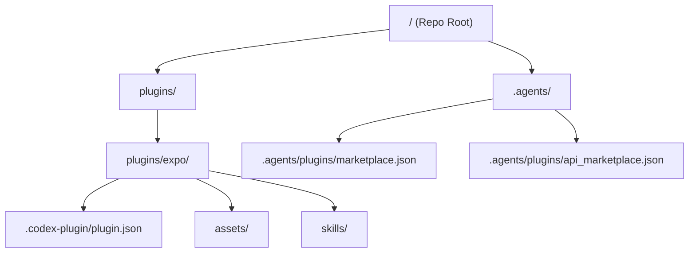
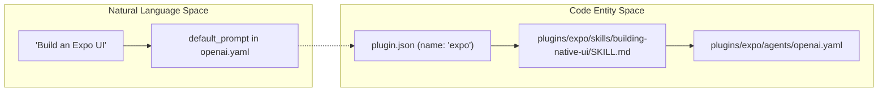
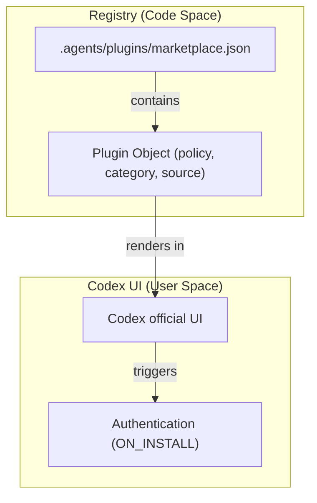

<!-- source: DeepWiki mcp.deepwiki.com · repo openai/plugins · page 1 Overview · fetched 2026-10-26 -->

# Overview

Relevant source files

The following files were used as context for generating this wiki page:

- [.agents/plugins/marketplace.json](.agents/plugins/marketplace.json)
- [.gitignore](.gitignore)
- [README.md](README.md)
- [plugins/expo/LICENSE](plugins/expo/LICENSE)
- [plugins/expo/README.md](plugins/expo/README.md)
- [plugins/expo/agents/openai.yaml](plugins/expo/agents/openai.yaml)
- [plugins/expo/assets/expo.png](plugins/expo/assets/expo.png)
- [plugins/expo/commands/setup-codex-run-actions.md](plugins/expo/commands/setup-codex-run-actions.md)
- [plugins/expo/skills/building-native-ui/SKILL.md](plugins/expo/skills/building-native-ui/SKILL.md)
- [plugins/expo/skills/building-native-ui/agents/openai.yaml](plugins/expo/skills/building-native-ui/agents/openai.yaml)
- [plugins/expo/skills/building-native-ui/references/animations.md](plugins/expo/skills/building-native-ui/references/animations.md)

The `openai/plugins` repository is a curated collection of Codex plugin examples, ranging from productivity tools and developer utilities to third-party marketplace stubs. This repository serves as the central hub for defining how Codex interacts with external applications through **Skills**, **Agents**, and the **Model Context Protocol (MCP)**.

Each plugin in this ecosystem is self-contained within the `plugins/` directory and follows a standardized manifest schema that defines its identity, capabilities, and UI presentation [README.md:1-9]().

## Repository Architecture

The repository is organized into two primary top-level areas:
1.  **`plugins/`**: Contains the implementation code, assets, and manifests for every individual plugin such as `plugins/figma`, `plugins/notion`, or `plugins/expo` [README.md:5-9]().
2.  **`.agents/`**: Contains internal tooling, including the Marketplace registry and the scaffolding scripts used to generate new plugins [.agents/plugins/marketplace.json:1-6]().

### Repository Layout

Sources: [README.md:1-12]().

---

## Plugin Anatomy

A plugin is defined by a mandatory manifest file located at `.codex-plugin/plugin.json` [README.md:5-9](). This file acts as the "Code Entity" that bridges the gap between raw functionality and the Natural Language interface used by Codex.

### The Plugin Manifest (`plugin.json`)
The manifest includes metadata such as the version, author, and repository, but most importantly, it defines the `interface` block. This block controls how the plugin appears in the Codex UI, including its `displayName`, `shortDescription`, and `defaultPrompt` starters. For example, the Expo plugin defines its interface with specific icons and a default prompt focused on app development [plugins/expo/agents/openai.yaml:1-6]().

For more details on the manifest schema and optional companion files like `.app.json` or `.mcp.json`, see **[Repository Structure and Plugin Anatomy](#1.1)**.

### Bridging Natural Language to Code
The following diagram illustrates how a user's natural language intent is mapped to specific code entities defined in the plugin structure.

**Intent Mapping Diagram**

Sources: [plugins/expo/agents/openai.yaml:1-6](), [plugins/expo/skills/building-native-ui/agents/openai.yaml:1-4](), [plugins/expo/skills/building-native-ui/SKILL.md:1-6]().

---

## Plugin Creation and Scaffolding

To maintain consistency across the repository, the `plugin-creator` tool is used to scaffold new plugins. This tool ensures that every plugin has a valid `plugin.json` and the correct directory structure.

*   **Scaffolding**: Automated generation of `plugins/<name>/` directory with required sub-directories [README.md:5-9]().
*   **Standards**: Enforces naming conventions and mandatory file presence for marketplace readiness.

For usage instructions and CLI flags, see **[Plugin Creator Scaffolding Tool](#1.2)**.

---

## Marketplace and Discovery

The `marketplace.json` file is the source of truth for plugin discovery and installation policies within the Codex environment. It resides at `.agents/plugins/marketplace.json` [.agents/plugins/marketplace.json:1-10]().

### Marketplace Integration Flow
The marketplace manages how plugins are surfaced to users, including their installation status (`AVAILABLE`, `INSTALLED_BY_DEFAULT`) and authentication requirements (`ON_INSTALL`, `ON_USE`) [.agents/plugins/marketplace.json:13-16]().

**Registry and UI Flow**

Sources: [.agents/plugins/marketplace.json:1-30]().

For a deep dive into installation policies and product gating, see **[Marketplace Registry](#1.3)**.

---

## Wiki Navigation

This wiki is organized to take you from high-level concepts to specific implementation details:

*   **[Repository Structure and Plugin Anatomy](#1.1)**: Detailed look at file layouts and the `plugin.json` spec.
*   **[Plugin Creator Scaffolding Tool](#1.2)**: How to use scripts to build new plugins.
*   **[Marketplace Registry](#1.3)**: How the global `marketplace.json` manages plugin lifecycle and visibility.
*   **[Plugin Evaluation Framework](#1.4)**: Documentation for the `plugin-eval` CLI tool and benchmark engine.
*   **[Plugin Architecture Concepts](#2)**: Core patterns like the Skills system, MCP, and Auth flows.
*   **[Productivity Plugins](#3)**: Deep dives into Notion, Slack, and Google/Microsoft suites.
*   **[Coding and Development Plugins](#4)**: Technical details for GitHub, Figma, Expo, and Cloud deployment tools.
*   **[Finance, Analytics, and Research Plugins](#5)**: Documentation for Moody's, Morningstar, and specialized research tools.
*   **[Marketplace Plugins (Third-Party and Stub Entries)](#6)**: Documentation for third-party "stub" entries.
*   **[Glossary](#7)**: Definitions of repository-specific terminology.

---

