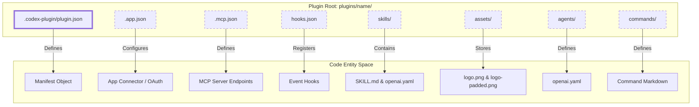
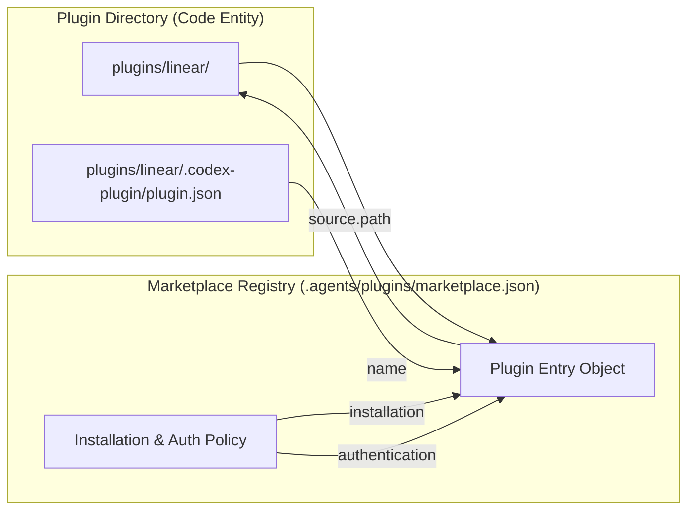

<!-- source: DeepWiki mcp.deepwiki.com · repo openai/plugins · page 1.1 Repository Structure and Plugin Anatomy · fetched 2026-10-26 -->

# Repository Structure and Plugin Anatomy

<details>
<summary>Relevant source files</summary>

The following files were used as context for generating this wiki page:

- [.agents/plugins/api_marketplace.json](.agents/plugins/api_marketplace.json)
- [.agents/plugins/marketplace.json](.agents/plugins/marketplace.json)
- [.gitignore](.gitignore)
- [README.md](README.md)
- [plugins/base44/.codex-plugin/plugin.json](plugins/base44/.codex-plugin/plugin.json)
- [plugins/expo/LICENSE](plugins/expo/LICENSE)
- [plugins/expo/README.md](plugins/expo/README.md)
- [plugins/expo/agents/openai.yaml](plugins/expo/agents/openai.yaml)
- [plugins/expo/assets/expo.png](plugins/expo/assets/expo.png)
- [plugins/expo/commands/setup-codex-run-actions.md](plugins/expo/commands/setup-codex-run-actions.md)
- [plugins/expo/skills/building-native-ui/SKILL.md](plugins/expo/skills/building-native-ui/SKILL.md)
- [plugins/expo/skills/building-native-ui/agents/openai.yaml](plugins/expo/skills/building-native-ui/agents/openai.yaml)
- [plugins/expo/skills/building-native-ui/references/animations.md](plugins/expo/skills/building-native-ui/references/animations.md)
- [plugins/figma/.codex-plugin/plugin.json](plugins/figma/.codex-plugin/plugin.json)
- [plugins/figma/.mcp.json](plugins/figma/.mcp.json)
- [plugins/github/.codex-plugin/plugin.json](plugins/github/.codex-plugin/plugin.json)
- [plugins/github/.mcp.json](plugins/github/.mcp.json)
- [plugins/github/README.md](plugins/github/README.md)
- [plugins/github/assets/logo.png](plugins/github/assets/logo.png)
- [plugins/shopify/.codex-plugin/plugin.json](plugins/shopify/.codex-plugin/plugin.json)
- [plugins/supabase/.codex-plugin/plugin.json](plugins/supabase/.codex-plugin/plugin.json)
- [plugins/vercel/.codex-plugin/plugin.json](plugins/vercel/.codex-plugin/plugin.json)

</details>


This page documents the physical layout and manifest specifications of the `openai/plugins` repository. It covers how plugins are structured on disk, the schema for mandatory and optional configuration files, and the lifecycle of a plugin from local scaffolding to marketplace registration.

## Top-Level Directory Layout

The repository is organized into two primary functional areas: the `plugins/` directory, which contains the source code and manifests for every available tool, and the `.agents/` directory, which contains the orchestration logic, registry metadata, and the scaffolding tools used to manage the ecosystem.

| Directory | Purpose | Key Contents |
|:---|:---|:---|
| `plugins/` | The root for all plugin implementations. | Each subdirectory (e.g., `plugins/figma/`) represents a standalone plugin [[README.md:5-9]](). |
| `.agents/` | System-level configuration and internal tools. | Contains the `marketplace.json` registry and system-level agents/skills [[.agents/plugins/marketplace.json:1-12]](). |
| `.agents/plugins/` | Marketplace metadata. | Holds `marketplace.json` and `api_marketplace.json` which define UI ordering and installation policies [[.agents/plugins/marketplace.json:1-12]](), [[.agents/plugins/api_marketplace.json:1-12]](). |

**Sources:**
- [README.md:1-13]()
- [.agents/plugins/marketplace.json:1-12]()
- [.agents/plugins/api_marketplace.json:1-12]()

## Plugin Directory Structure

A standard plugin follows a specific anatomy to ensure compatibility with the Codex host. While only the `.codex-plugin/plugin.json` manifest is strictly mandatory for registration, functional plugins typically include several companion directories.

### Visual Anatomy of a Plugin
The following diagram bridges the "Natural Language Space" (how a developer describes a plugin) to the "Code Entity Space" (the actual file system structure).

"Plugin Anatomy Overview"

**Sources:**
- [README.md:5-9]()
- [plugins/figma/.codex-plugin/plugin.json:19-22]()
- [plugins/github/.codex-plugin/plugin.json:21-23]()

### Component Breakdown
*   **`.codex-plugin/plugin.json`**: The primary manifest. It defines the plugin's identity, version, and metadata for the Codex UI [[plugins/figma/.codex-plugin/plugin.json:1-46]]().
*   **`skills/`**: Contains one or more subdirectories, each housing a `SKILL.md` (natural language instructions) and `openai.yaml` (API/Tool definitions) [[plugins/expo/skills/building-native-ui/SKILL.md:1-6]](), [[plugins/expo/skills/building-native-ui/agents/openai.yaml:1-5]]().
*   **`.app.json`**: Used for plugins requiring OAuth or third-party app connections (e.g., GitHub, Notion) [[plugins/github/.codex-plugin/plugin.json:22-22]](), [[plugins/github/README.md:8-12]]().
*   **`.mcp.json`**: Configures Model Context Protocol (MCP) servers that the plugin uses to execute tools [[plugins/figma/.mcp.json:1-9]](), [[plugins/github/.mcp.json:1-9]]().
*   **`assets/`**: Stores visual brand assets like `logo.png` and `composerIcon` [[plugins/figma/.codex-plugin/plugin.json:42-43]]().
*   **`agents/`**: Contains top-level agent definitions, typically an `openai.yaml` for the primary plugin persona [[plugins/expo/agents/openai.yaml:1-5]]().
*   **`commands/`**: Stores slash-command definitions (e.g., `/setup-codex-run-actions`) [[plugins/expo/commands/setup-codex-run-actions.md:1-4]]().

---

## The Plugin Manifest (`plugin.json`)

The `plugin.json` file is the source of truth for the plugin's capabilities and presentation. It is located at `<plugin-root>/.codex-plugin/plugin.json`.

### Manifest Schema Highlights

| Field | Type | Description |
|:---|:---|:---|
| `name` | `string` | Unique identifier in kebab-case. Must match the folder name [[plugins/figma/.codex-plugin/plugin.json:2-2]](). |
| `skills` | `path` | Relative path (usually `./skills/`) to the skills directory [[plugins/figma/.codex-plugin/plugin.json:19-19]](). |
| `interface.displayName` | `string` | The human-readable name shown in the Codex UI [[plugins/figma/.codex-plugin/plugin.json:23-23]](). |
| `interface.capabilities` | `array` | List of supported interaction modes: `Interactive`, `Read`, `Write` [[plugins/figma/.codex-plugin/plugin.json:28-32]](). |
| `interface.defaultPrompt`| `array` | Starter prompts shown to the user in the composer [[plugins/figma/.codex-plugin/plugin.json:36-40]](). |
| `mcpServers` | `path` | Relative path to the MCP configuration file [[plugins/github/.codex-plugin/plugin.json:23-23]](). |

**Sources:**
- [plugins/figma/.codex-plugin/plugin.json:1-46]()
- [plugins/github/.codex-plugin/plugin.json:1-45]()
- [plugins/vercel/.codex-plugin/plugin.json:1-53]()

---

## Marketplace Registration

For a plugin to be discoverable in the Codex UI, it must be registered in the global marketplace manifest located at `.agents/plugins/marketplace.json`.

### Registration Data Flow
The following diagram illustrates how a plugin defined in the `plugins/` directory is mapped into the marketplace registry.

"Marketplace Registration Data Flow"


### Marketplace Entry Schema
Each entry in the `plugins` array of `marketplace.json` defines how the system should treat the plugin regarding installation and security.

```json
{
  "name": "linear",
  "source": {
    "source": "local",
    "path": "./plugins/linear"
  },
  "policy": {
    "installation": "AVAILABLE",
    "authentication": "ON_INSTALL"
  },
  "category": "Productivity"
}
```

*   **`installation`**: Can be `AVAILABLE`, `INSTALLED_BY_DEFAULT`, or `NOT_AVAILABLE` [[.agents/plugins/marketplace.json:14-14]]().
*   **`authentication`**: Can be `ON_INSTALL` (auth required to add) or `ON_USE` (auth required upon first tool call) [[.agents/plugins/marketplace.json:15-15]](), [[.agents/plugins/api_marketplace.json:84-84]]().
*   **`products`**: Optional gating for specific client types (e.g., `["CODEX"]`) [[.agents/plugins/marketplace.json:208-208]]().

**Sources:**
- [.agents/plugins/marketplace.json:7-18, 205-211]()
- [.agents/plugins/api_marketplace.json:82-90]()
- [README.md:10-12]()

---

