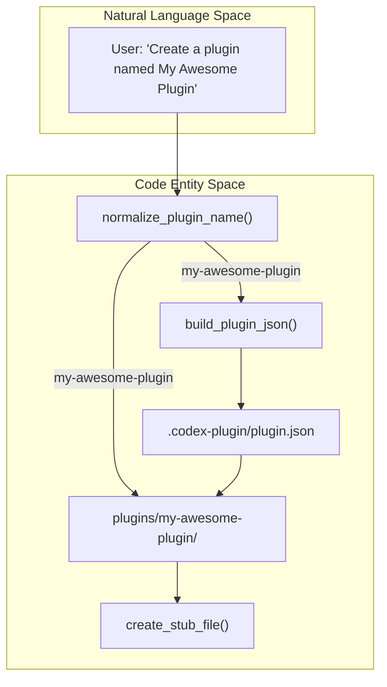
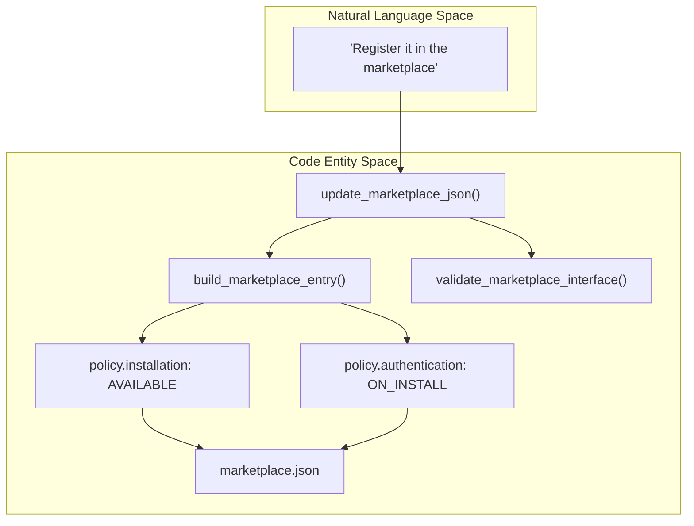
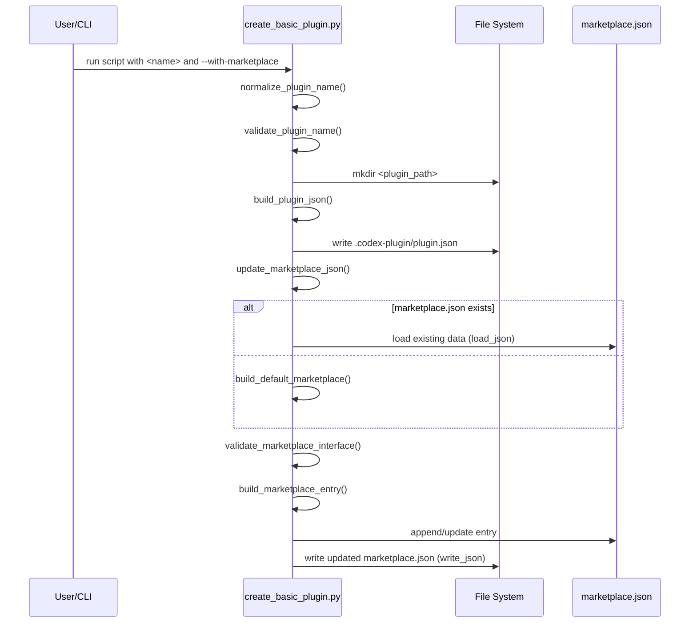

<!-- source: DeepWiki mcp.deepwiki.com · repo openai/plugins · page 1.2 Plugin Creator Scaffolding Tool · fetched 2026-10-26 -->

# Plugin Creator Scaffolding Tool

Relevant source files

The following files were used as context for generating this wiki page:

- [.agents/skills/plugin-creator/SKILL.md](.agents/skills/plugin-creator/SKILL.md)
- [.agents/skills/plugin-creator/agents/openai.yaml](.agents/skills/plugin-creator/agents/openai.yaml)
- [.agents/skills/plugin-creator/references/plugin-json-spec.md](.agents/skills/plugin-creator/references/plugin-json-spec.md)
- [.agents/skills/plugin-creator/scripts/create_basic_plugin.py](.agents/skills/plugin-creator/scripts/create_basic_plugin.py)

The Plugin Creator is a dedicated system for scaffolding new plugins within the Codex ecosystem. It ensures that every plugin follows the mandatory directory structure, includes a valid manifest, and can be optionally registered in the global marketplace registry.

## Core Script: create_basic_plugin.py

The primary entry point for scaffolding is the `create_basic_plugin.py` script [[.agents/skills/plugin-creator/scripts/create_basic_plugin.py:1-2]](). This script automates the creation of the plugin root directory, the mandatory `.codex-plugin/plugin.json` manifest, and various optional companion files and directories.

### Key Functions and Implementation

- **`normalize_plugin_name(plugin_name: str)`**: Enforces strict naming rules by converting input to lowercase hyphen-case, removing non-alphanumeric characters (converting them to hyphens), and collapsing consecutive hyphens [[.agents/skills/plugin-creator/scripts/create_basic_plugin.py:24-30]]().
- **`validate_plugin_name(plugin_name: str)`**: Ensures the name contains at least one letter or digit and does not exceed the `MAX_PLUGIN_NAME_LENGTH` of 64 characters [[.agents/skills/plugin-creator/scripts/create_basic_plugin.py:13-13]](), [[.agents/skills/plugin-creator/scripts/create_basic_plugin.py:33-41]]().
- **`build_plugin_json(plugin_name: str)`**: Generates the initial `plugin.json` structure populated with `[TODO: ...]` placeholders for metadata like version, author, and interface details [[.agents/skills/plugin-creator/scripts/create_basic_plugin.py:43-85]]().
- **`update_marketplace_json(...)`**: Handles the logic for appending or updating a plugin entry in the central `marketplace.json` file. It supports a `--force` flag to overwrite existing entries [[.agents/skills/plugin-creator/scripts/create_basic_plugin.py:129-166]]().
- **`create_stub_file(path: Path, payload: dict, force: bool)`**: A helper function used to write optional JSON configuration files like `.mcp.json` or `.app.json` if they do not already exist [[.agents/skills/plugin-creator/scripts/create_basic_plugin.py:177-184]]().

**Sources:** [[.agents/skills/plugin-creator/scripts/create_basic_plugin.py:1-184]]()

### CLI Flags and Options

The script supports several flags to customize the scaffolding process via `argparse` [[.agents/skills/plugin-creator/scripts/create_basic_plugin.py:186-218]]():

| Flag | Description | File/Directory Created |
| :--- | :--- | :--- |
| `--path` | Parent directory for the new plugin (defaults to `~/plugins`). | `<path>/<plugin-name>/` |
| `--with-skills` | Adds a skills directory. | `skills/` |
| `--with-hooks` | Adds a hooks configuration. | `hooks.json` |
| `--with-mcp` | Adds a Model Context Protocol config. | `.mcp.json` |
| `--with-apps` | Adds an App connector manifest. | `.app.json` |
| `--with-assets` | Adds a directory for icons/logos. | `assets/` |
| `--with-marketplace` | Updates the marketplace registry. | `marketplace.json` |
| `--marketplace-path` | Custom path to the `marketplace.json` file. | N/A |
| `--force` | Overwrites existing files or marketplace entries. | N/A |

**Sources:** [[.agents/skills/plugin-creator/SKILL.md:40-47]](), [[.agents/skills/plugin-creator/scripts/create_basic_plugin.py:186-218]]()

## Natural Language to Code Entity Mapping

The following diagrams illustrate how user intent (Natural Language Space) is translated into specific code structures and file entities (Code Entity Space).

### Plugin Scaffolding Flow
This diagram shows how the `plugin-creator` skill translates a request to create a plugin into file system entities.

**Sources:** [[.agents/skills/plugin-creator/scripts/create_basic_plugin.py:24-30]](), [[.agents/skills/plugin-creator/scripts/create_basic_plugin.py:43-45]](), [[.agents/skills/plugin-creator/scripts/create_basic_plugin.py:177-177]](), [[.agents/skills/plugin-creator/SKILL.md:62-66]]()

### Marketplace Registration Logic
This diagram bridges the request for marketplace inclusion to the internal JSON structure and policy enforcement.

**Sources:** [[.agents/skills/plugin-creator/scripts/create_basic_plugin.py:88-105]](), [[.agents/skills/plugin-creator/scripts/create_basic_plugin.py:123-128]](), [[.agents/skills/plugin-creator/scripts/create_basic_plugin.py:129-136]](), [[.agents/skills/plugin-creator/SKILL.md:82-96]]()

## Plugin Manifest Reference (`plugin.json`)

Every plugin must contain a `.codex-plugin/plugin.json` file [[.agents/skills/plugin-creator/SKILL.md:58-58]](). This manifest defines the plugin's identity, its capabilities, and how it is presented in the Codex UI.

### Top-Level Fields
- `name`: Unique kebab-case identifier. Required as the component namespace [[.agents/skills/plugin-creator/references/plugin-json-spec.md:52]]().
- `version`: Plugin semantic version [[.agents/skills/plugin-creator/references/plugin-json-spec.md:53]]().
- `skills`: Relative path to the skills directory (usually `./skills/`) [[.agents/skills/plugin-creator/references/plugin-json-spec.md:63]]().
- `mcpServers`: Path to `.mcp.json` if the plugin uses MCP [[.agents/skills/plugin-creator/references/plugin-json-spec.md:65]]().
- `apps`: Path to `.app.json` for app-backed integrations [[.agents/skills/plugin-creator/references/plugin-json-spec.md:66]]().

### Interface Metadata
The `interface` block controls the UI presentation [[.agents/skills/plugin-creator/references/plugin-json-spec.md:69]]():
- `displayName`: User-facing title shown for the plugin [[.agents/skills/plugin-creator/references/plugin-json-spec.md:71]]().
- `capabilities`: Array of strings such as `Interactive`, `Read`, or `Write` [[.agents/skills/plugin-creator/references/plugin-json-spec.md:76]]().
- `defaultPrompt`: Up to 3 starter prompts for the composer, capped at 128 characters each [[.agents/skills/plugin-creator/references/plugin-json-spec.md:80-82]]().
- `brandColor`: Theme color for the plugin card (Hex code) [[.agents/skills/plugin-creator/references/plugin-json-spec.md:84]]().

**Sources:** [[.agents/skills/plugin-creator/references/plugin-json-spec.md:1-90]]()

## Marketplace Integration

The `marketplace.json` file acts as the central registry for the Codex UI. It can be personal (`~/.agents/plugins/marketplace.json`) or repository-specific (`<repo-root>/.agents/plugins/marketplace.json`) [[.agents/skills/plugin-creator/SKILL.md:77-78]]().

### Entry Requirements
When the `--with-marketplace` flag is used, the tool ensures the following fields are present in the entry [[.agents/skills/plugin-creator/SKILL.md:150-150]]():
- `source`: Defines the plugin location, typically `{"source": "local", "path": "./plugins/<name>"}` [[.agents/skills/plugin-creator/references/plugin-json-spec.md:143-145]]().
- `policy`:
    - `installation`: Defaults to `AVAILABLE`. Other values: `NOT_AVAILABLE`, `INSTALLED_BY_DEFAULT` [[.agents/skills/plugin-creator/scripts/create_basic_plugin.py:16-20]]().
    - `authentication`: Defaults to `ON_INSTALL`. Other value: `ON_USE` [[.agents/skills/plugin-creator/scripts/create_basic_plugin.py:17-21]]().
- `category`: Defaults to `Productivity` [[.agents/skills/plugin-creator/scripts/create_basic_plugin.py:18-18]]().

### Marketplace Metadata
Marketplace files support top-level metadata including a `name` and an `interface.displayName` [[.agents/skills/plugin-creator/SKILL.md:79-81]](). The `plugins` array determines the render order in the Codex UI [[.agents/skills/plugin-creator/SKILL.md:80-80]]().

**Sources:** [[.agents/skills/plugin-creator/scripts/create_basic_plugin.py:88-120]](), [[.agents/skills/plugin-creator/references/plugin-json-spec.md:128-160]]()

## Data Flow: Scaffolding a Plugin

The following sequence diagram details the execution flow when a user runs the `create_basic_plugin.py` script.

**Sources:** [[.agents/skills/plugin-creator/scripts/create_basic_plugin.py:108-111]](), [[.agents/skills/plugin-creator/scripts/create_basic_plugin.py:129-166]](), [[.agents/skills/plugin-creator/SKILL.md:9-27]]()

---

