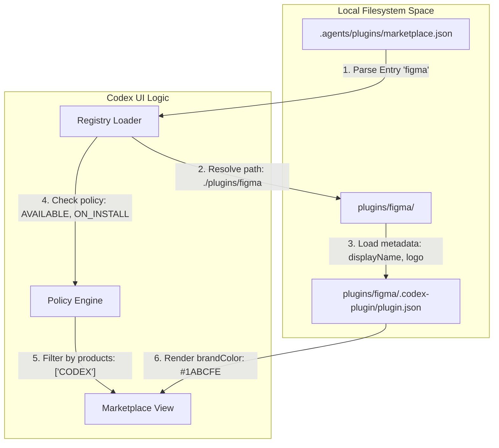
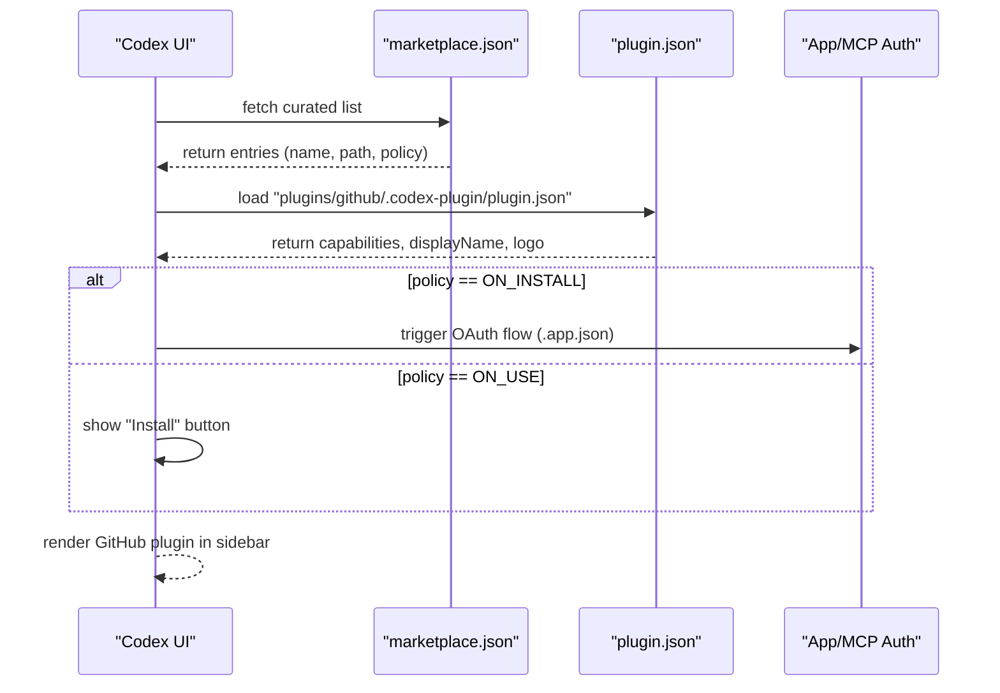

<!-- source: DeepWiki mcp.deepwiki.com · repo openai/plugins · page 1.3 Marketplace Registry · fetched 2026-10-26 -->

# Marketplace Registry

<details>
<summary>Relevant source files</summary>

The following files were used as context for generating this wiki page:

- [.agents/plugins/api_marketplace.json](.agents/plugins/api_marketplace.json)
- [.agents/plugins/marketplace.json](.agents/plugins/marketplace.json)
- [plugins/base44/.codex-plugin/plugin.json](plugins/base44/.codex-plugin/plugin.json)
- [plugins/figma/.codex-plugin/plugin.json](plugins/figma/.codex-plugin/plugin.json)
- [plugins/figma/.mcp.json](plugins/figma/.mcp.json)
- [plugins/github/.codex-plugin/plugin.json](plugins/github/.codex-plugin/plugin.json)
- [plugins/github/.mcp.json](plugins/github/.mcp.json)
- [plugins/github/README.md](plugins/github/README.md)
- [plugins/github/assets/logo.png](plugins/github/assets/logo.png)
- [plugins/shopify/.codex-plugin/plugin.json](plugins/shopify/.codex-plugin/plugin.json)
- [plugins/supabase/.codex-plugin/plugin.json](plugins/supabase/.codex-plugin/plugin.json)
- [plugins/vercel/.codex-plugin/plugin.json](plugins/vercel/.codex-plugin/plugin.json)

</details>


The Marketplace Registry is the central configuration point for plugin discovery, ordering, and governance within the Codex ecosystem. It is defined by a single JSON file that determines which plugins are visible to users, how they are categorized, and what security or installation constraints apply to them.

## The marketplace.json File

The registry is primarily located at `.agents/plugins/marketplace.json`. This file serves as the source of truth for the Codex UI to render the plugin store and manage the lifecycle of plugin availability. A secondary file, `.agents/plugins/api_marketplace.json`, specifically targets API-driven Codex sessions with a subset of curated developer tools [[.agents/plugins/api_marketplace.json:1-6]]().

### High-Level Structure
The file consists of marketplace-level metadata and an ordered array of plugin entries.

| Field | Type | Description |
| :--- | :--- | :--- |
| `name` | `string` | Unique identifier for the marketplace (e.g., `openai-curated`). [[.agents/plugins/marketplace.json:2-2]]() |
| `interface` | `object` | UX metadata for the marketplace itself. |
| `interface.displayName` | `string` | The title displayed in the Codex UI (e.g., "Codex official"). [[.agents/plugins/marketplace.json:4-4]]() |
| `plugins` | `array` | A list of plugin entry objects. The index in this array determines the render order in the UI. [[.agents/plugins/marketplace.json:6-6]]() |

### Plugin Entry Schema
Each object within the `plugins` array must follow a strict schema to ensure the Codex UI can resolve the plugin source and enforce policies.

```json
{
  "name": "linear",
  "source": {
    "source": "local",
    "path": "./plugins/linear"
  },
  "policy": {
    "installation": "AVAILABLE",
    "authentication": "ON_INSTALL",
    "products": ["CODEX"]
  },
  "category": "Productivity"
}
```
*Example structure from [[.agents/plugins/marketplace.json:7-18]]().*

**Sources:** [[.agents/plugins/marketplace.json:1-18]](), [[.agents/plugins/api_marketplace.json:1-10]]()

---

## Installation and Authentication Policies

Policies govern how a user interacts with a plugin before it becomes functional. These are defined in the `policy` block of each entry.

### Installation Policies (`installation`)
This field determines the default state of the plugin for a user.

*   **`AVAILABLE`**: The plugin is visible in the marketplace and can be manually installed by the user. [[.agents/plugins/marketplace.json:14-14]]()
*   **`INSTALLED_BY_DEFAULT`**: The plugin is pre-installed for all users in the target environment.
*   **`NOT_AVAILABLE`**: The plugin is registered in the codebase but hidden from the marketplace UI.

### Authentication Policies (`authentication`)
This field defines when the user is prompted to connect their account (e.g., via OAuth defined in `.app.json`).

*   **`ON_INSTALL`**: The user must complete the authentication flow immediately upon clicking "Install". This is standard for App Connectors like Slack or Gmail [[.agents/plugins/marketplace.json:51-51]](), [[.agents/plugins/marketplace.json:63-63]]().
*   **`ON_USE`**: The user can install the plugin without auth, but will be prompted to authenticate the first time a Skill within the plugin is invoked. This is used for specialized developer tools like `build-web-apps` [[.agents/plugins/api_marketplace.json:84-84]]().

### Product Gating (`products`)
An optional array used to restrict plugin availability to specific OpenAI product tiers or environments. For example, the `superpowers` and `game-studio` plugins are gated specifically to the `CODEX` product [[.agents/plugins/marketplace.json:208-208]](), [[.agents/plugins/marketplace.json:221-221]]().

**Sources:** [[.agents/plugins/marketplace.json:13-16]](), [[.agents/plugins/api_marketplace.json:82-87]](), [[.agents/plugins/api_marketplace.json:202-204]]()

---

## Data Flow: Registry to UI

The following diagram illustrates how the `marketplace.json` file acts as a bridge between the physical plugin files and the rendered Codex UI.

### Marketplace Resolution Flow

**Sources:** [[.agents/plugins/marketplace.json:128-138]](), [[plugins/figma/.codex-plugin/plugin.json:22-45]]()

---

## Programmatic Management

The registry is managed through standardized naming and scaffolding conventions to ensure the UI can consistently map plugin names to their filesystem locations.

### Key Logic and Constraints

*   **Name Normalization**: The `name` field in `marketplace.json` (e.g., `google-drive`) must correspond to the directory name in the `plugins/` root [[.agents/plugins/marketplace.json:262-265]]().
*   **Interface Synchronization**: While `marketplace.json` provides the discovery entry, the actual UI assets (logos, icons, brand colors) are pulled from the plugin's local `.codex-plugin/plugin.json` file [[plugins/figma/.codex-plugin/plugin.json:41-44]](), [[plugins/github/.codex-plugin/plugin.json:40-43]]().
*   **Dual Registry**: High-priority developer plugins are often registered in both `marketplace.json` and `api_marketplace.json` to ensure availability across different Codex interfaces [[.agents/plugins/marketplace.json:213-224]](), [[.agents/plugins/api_marketplace.json:23-36]]().

### Interaction Diagram: Plugin Discovery
This diagram shows how the Codex UI consumes the registry to initialize a plugin session.


**Sources:** [[.agents/plugins/marketplace.json:238-248]](), [[plugins/github/.codex-plugin/plugin.json:24-44]](), [[plugins/github/README.md:8-12]]()

---

## Category Assignments

Plugins are grouped into categories to facilitate browsing. Common categories found in the registry include:

*   **Productivity**: Linear, Google Calendar, SharePoint, Outlook, Notion, Jam, Box [[.agents/plugins/marketplace.json:17-236]]().
*   **Communication**: Gmail, Slack, Teams, Outlook Email [[.agents/plugins/marketplace.json:53-101]]().
*   **Developer Tools**: Hugging Face, Netlify, Vercel, Game Studio, Superpowers, GitHub, CircleCI, Shopify, Base44 [[.agents/plugins/marketplace.json:149-247]](), [[plugins/shopify/.codex-plugin/plugin.json:26-27]](), [[plugins/base44/.codex-plugin/plugin.json:20-20]]().
*   **Creativity**: Canva, Figma, Remotion, Hyperframes [[.agents/plugins/marketplace.json:125-137]](), [[.agents/plugins/api_marketplace.json:191-245]]().
*   **Finance**: Stripe, Ramp [[.agents/plugins/marketplace.json:185-186]]().

**Sources:** [[.agents/plugins/marketplace.json:1-300]](), [[.agents/plugins/api_marketplace.json:1-200]]()

---

