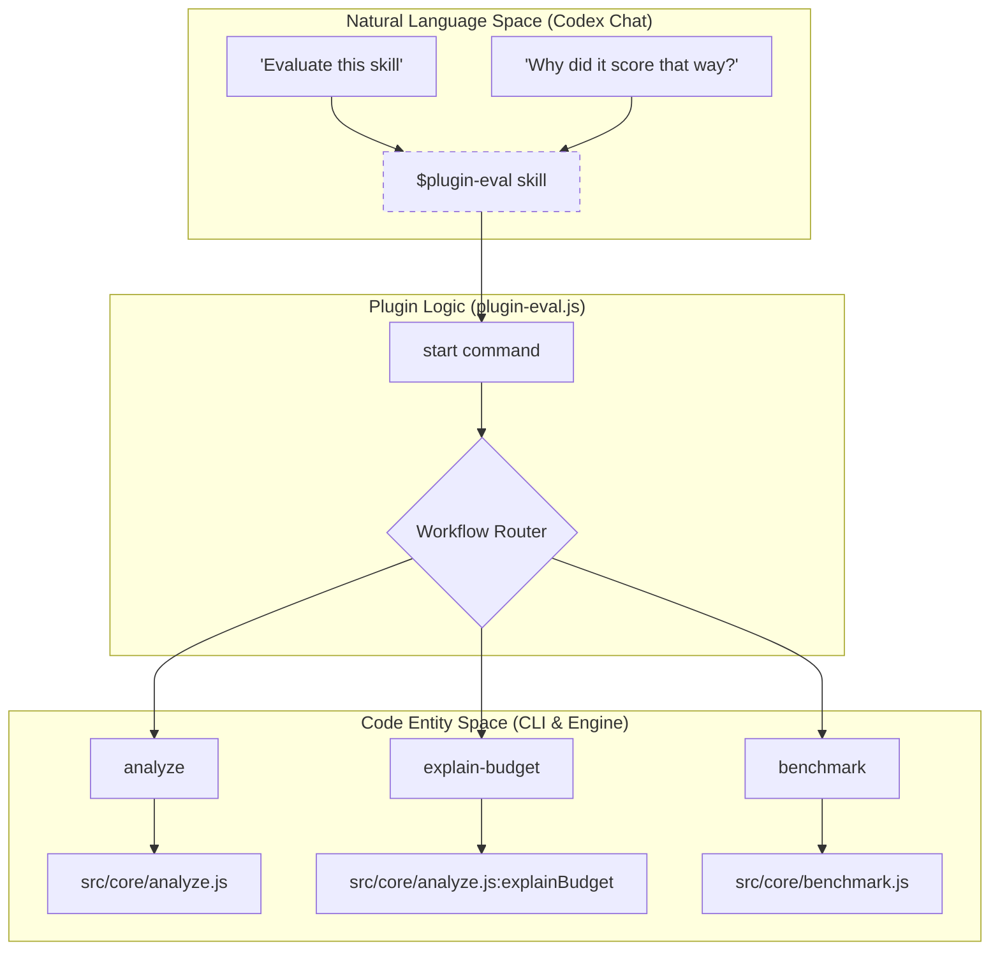
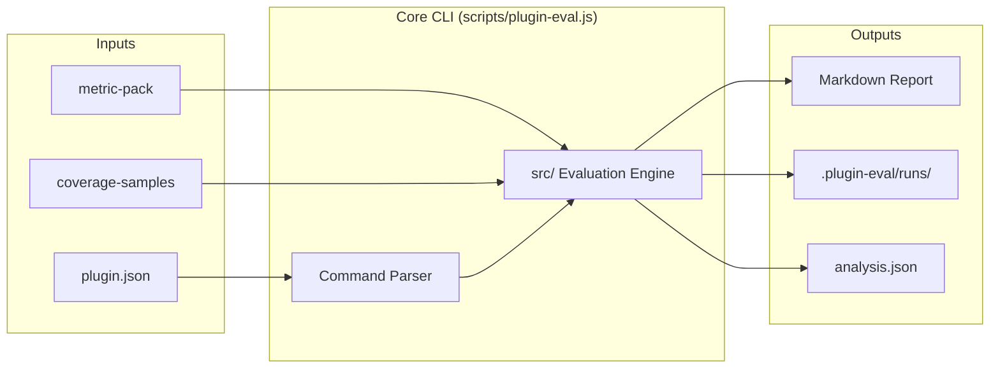

<!-- source: DeepWiki mcp.deepwiki.com · repo openai/plugins · page 1.4 Plugin Evaluation Framework · fetched 2026-10-26 -->

# Plugin Evaluation Framework

Relevant source files

The following files were used as context for generating this wiki page:

- [plugins/plugin-eval/.codex-plugin/plugin.json](plugins/plugin-eval/.codex-plugin/plugin.json)
- [plugins/plugin-eval/README.md](plugins/plugin-eval/README.md)
- [plugins/plugin-eval/fixtures/minimal-plugin/.codex-plugin/plugin.json](plugins/plugin-eval/fixtures/minimal-plugin/.codex-plugin/plugin.json)
- [plugins/plugin-eval/fixtures/multi-skill-plugin/.codex-plugin/plugin.json](plugins/plugin-eval/fixtures/multi-skill-plugin/.codex-plugin/plugin.json)
- [plugins/plugin-eval/src/core/benchmark-workspace.js](plugins/plugin-eval/src/core/benchmark-workspace.js)
- [plugins/plugin-eval/tests/plugin-eval.test.js](plugins/plugin-eval/tests/plugin-eval.test.js)
- [plugins/twilio-developer-kit/.codex-plugin/plugin.json](plugins/twilio-developer-kit/.codex-plugin/plugin.json)

The `plugin-eval` system is a dual-purpose toolset designed to evaluate Codex skills and plugins. It operates both as a **local Node.js CLI** for engineers and as a **Codex plugin bundle** for chat-based analysis. It provides static analysis, token budget explanations, and live benchmarking to ensure plugin quality and performance.

Sources: [plugins/plugin-eval/README.md:1-9](), [plugins/plugin-eval/.codex-plugin/plugin.json:1-45]()

## System Architecture

The framework bridges the gap between natural language requests in chat and deterministic local evaluation logic.

### Natural Language to Code Entity Mapping

This diagram illustrates how a user's intent in Codex chat maps to specific CLI commands and underlying source entities.

**Intent Mapping Architecture**

Sources: [plugins/plugin-eval/README.md:66-91](), [plugins/plugin-eval/.codex-plugin/plugin.json:22-45](), [plugins/plugin-eval/scripts/plugin-eval.js:1-8](), [plugins/plugin-eval/tests/plugin-eval.test.js:9-14]()

### Component Interaction

The `plugin-eval` CLI acts as the primary interface for the evaluation engine, consuming plugin manifests and fixtures to produce reports.

**Evaluation Data Flow**

Sources: [plugins/plugin-eval/README.md:117-122](), [plugins/plugin-eval/scripts/plugin-eval.js:8]()

## CLI Entrypoint and Commands

The main entrypoint for the evaluation tool is `scripts/plugin-eval.js`. It can be run directly via `node` or linked globally using `npm link`.

Sources: [plugins/plugin-eval/README.md:31-60](), [plugins/plugin-eval/README.md:12-12]()

### Primary Commands

| Command | Description | Implementation Detail |
| :--- | :--- | :--- |
| `start` | The chat-first router. | Implemented via `buildWorkflowGuide` in `src/core/workflow-guide.js`. |
| `analyze` | Static local report. | Uses `analyzePath` in `src/core/analyze.js` to perform deterministic analysis. |
| `explain-budget` | Token budget analysis. | Uses `explainBudget` in `src/core/analyze.js` to calculate token consumption. |
| `benchmark` | Live execution. | Uses `runBenchmark` in `src/core/benchmark.js` to run real `codex exec` sessions. |
| `compare` | Regression testing. | Uses `compareResults` in `src/core/compare.js` to compare two JSON results. |
| `init-benchmark` | Scaffolding. | Uses `initializeBenchmark` in `src/core/benchmark.js` to create config. |

Sources: [plugins/plugin-eval/README.md:68-102](), [plugins/plugin-eval/tests/plugin-eval.test.js:9-14]()

## The Evaluation Engine (`src/`)

The core logic resides in `src/core/`, which handles the heavy lifting for analysis and benchmarking.

### Benchmarking and Workspace Isolation
To ensure safety and reproducibility, the framework uses isolated temporary workspaces for benchmarks.
- **Provisioning**: `provisionBenchmarkWorkspace` in `src/core/benchmark-workspace.js` creates a copy of the target or uses `git-worktree` [src/core/benchmark-workspace.js:135-175]().
- **Codex Home Seeding**: It seeds a local `.codex` home with `auth.json` and `config.toml` to maintain environment consistency [src/core/benchmark-workspace.js:113-123]().
- **Snapshotting**: The engine takes a `snapshotWorkspace` before and after execution to detect file changes and line counts [src/core/benchmark-workspace.js:217-221]().

### Analysis and Checks
The `analyzePath` function in `src/core/analyze.js` runs a series of checks against the plugin structure:
- **Description Bloat**: Flags oversized descriptions in `SKILL.md` [tests/plugin-eval.test.js:186-195]().
- **Token Budgeting**: Estimates static costs using `estimated-static` methods [tests/plugin-eval.test.js:164-164]().

Sources: [plugins/plugin-eval/src/core/benchmark-workspace.js:1-221](), [plugins/plugin-eval/tests/plugin-eval.test.js:159-195]()

## Fixture Formats

The framework uses standardized fixture formats to ingest external data for evaluation.

### Metric Packs
A metric pack is a directory containing a `manifest.json` and an execution script. It allows custom logic to emit checks and metrics into the evaluation engine.
- **Manifest**: Defines supported target kinds (`skill`, `plugin`, `directory`) and the command to run.
- **Output**: The script must return a JSON object containing `checks`, `metrics`, and `artifacts`.

### Coverage Samples
The engine supports standard code coverage formats to assess test thoroughness:
- **LCOV**: `lcov.info` files.
- **XML**: `coverage.xml` (Cobertura style).
- **JSON**: `coverage-final.json` (Istanbul style).

## Local and Plugin Execution

### Local Installation
To run the framework locally for development:
1. Navigate to `plugins/plugin-eval`.
2. Run `npm link` to add the `plugin-eval` command to your PATH [plugins/plugin-eval/README.md:48-51]().
3. Alternatively, run via `node ./scripts/plugin-eval.js` [plugins/plugin-eval/README.md:31-32]().

### Codex Plugin Integration
When installed as a Codex plugin, it exposes chat-facing skills defined in the `skills/` directory. The manifest defines the `interface` metadata used by Codex:
- **Category**: `Developer Tools` [plugins/plugin-eval/.codex-plugin/plugin.json:27-27]().
- **Capabilities**: `Interactive`, `Write` [plugins/plugin-eval/.codex-plugin/plugin.json:28-31]().
- **Default Prompts**: Includes "Give me an analysis of the game studio plugin" and "Evaluate this plugin" [plugins/plugin-eval/.codex-plugin/plugin.json:35-39]().

Sources: [plugins/plugin-eval/README.md:131-143](), [plugins/plugin-eval/.codex-plugin/plugin.json:22-45]()

## Safety and Artifacts
- **Isolated Workspaces**: The `benchmark` command uses temporary workspaces to prevent side effects on the local environment [src/core/benchmark-workspace.js:141-142]().
- **Artifact Storage**: Reports and run data are stored in `.plugin-eval/runs/` and should typically be ignored by version control [plugins/plugin-eval/README.md:117-118]().
- **Deterministic vs. Live**: `analyze` and `explain-budget` are local and deterministic, whereas `benchmark` involves live model execution via `codex exec` [plugins/plugin-eval/README.md:113-118]().

Sources: [plugins/plugin-eval/README.md:119-126](), [plugins/plugin-eval/src/core/benchmark-workspace.js:141-175]()

---

