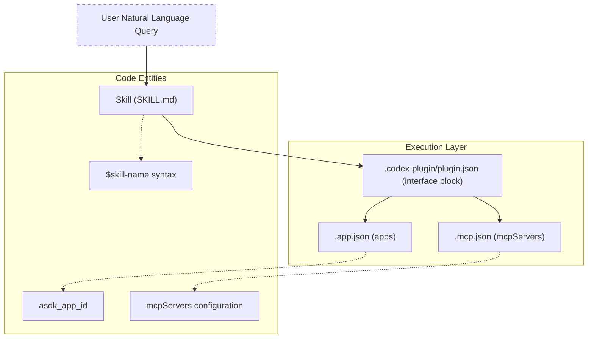
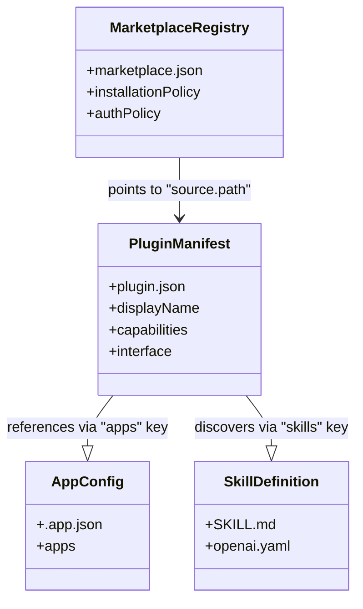

<!-- source: DeepWiki mcp.deepwiki.com · repo openai/plugins · page 2 Plugin Architecture Concepts · fetched 2026-10-26 -->

# Plugin Architecture Concepts

Relevant source files

The following files were used as context for generating this wiki page:

- [.agents/plugins/api_marketplace.json](.agents/plugins/api_marketplace.json)
- [.agents/skills/plugin-creator/SKILL.md](.agents/skills/plugin-creator/SKILL.md)
- [.agents/skills/plugin-creator/agents/openai.yaml](.agents/skills/plugin-creator/agents/openai.yaml)
- [.agents/skills/plugin-creator/references/plugin-json-spec.md](.agents/skills/plugin-creator/references/plugin-json-spec.md)
- [.agents/skills/plugin-creator/scripts/create_basic_plugin.py](.agents/skills/plugin-creator/scripts/create_basic_plugin.py)
- [plugins/base44/.codex-plugin/plugin.json](plugins/base44/.codex-plugin/plugin.json)
- [plugins/figma/.codex-plugin/plugin.json](plugins/figma/.codex-plugin/plugin.json)
- [plugins/figma/.mcp.json](plugins/figma/.mcp.json)
- [plugins/github/.codex-plugin/plugin.json](plugins/github/.codex-plugin/plugin.json)
- [plugins/github/.mcp.json](plugins/github/.mcp.json)
- [plugins/github/README.md](plugins/github/README.md)
- [plugins/github/assets/logo.png](plugins/github/assets/logo.png)
- [plugins/shopify/.codex-plugin/plugin.json](plugins/shopify/.codex-plugin/plugin.json)
- [plugins/supabase/.codex-plugin/plugin.json](plugins/supabase/.codex-plugin/plugin.json)
- [plugins/vercel/.codex-plugin/plugin.json](plugins/vercel/.codex-plugin/plugin.json)

This page provides a high-level overview of the core architectural patterns shared across the `openai/plugins` repository. The architecture is designed to bridge natural language intent with structured API execution through a multi-layered system of Skills, Agents, and Connectors.

## Core Architectural Layers

The plugin ecosystem is built on a modular hierarchy that allows for varying levels of integration, from simple stateless tools to complex, authenticated application workflows.

| Layer | Component | Purpose |
| :--- | :--- | :--- |
| **Interface** | `plugin.json` | Defines the identity, capabilities, and visual metadata for the Codex UI. |
| **Logic** | **Skills System** | Encapsulates specific workflows (e.g., "Research", "Triage") using natural language instructions. |
| **Execution** | **MCP Servers** | Provides the technical bridge to local or remote resources via the Model Context Protocol. |
| **Connectivity** | **App Connectors** | Manages OAuth identities and persistent connections to third-party SaaS platforms. |

### System Relationship Diagram

The following diagram illustrates how natural language requests flow through the architectural entities defined in the codebase.

**Natural Language to Code Entity Mapping**

Sources: [plugins/figma/.codex-plugin/plugin.json:19-32](), [plugins/github/.codex-plugin/plugin.json:21-33](), [.agents/skills/plugin-creator/references/plugin-json-spec.md:17-21]()

---

## 1. Skills System
The **Skills System** is the primary method for defining complex, multi-step workflows. Unlike raw tools, a Skill contains "reasoning" instructions that guide the model on how to combine multiple tools to achieve a user goal. Skills are discovered via the `skills` field in `plugin.json` [.agents/skills/plugin-creator/references/plugin-json-spec.md:63]().

*   **Structure:** Each skill resides in a subdirectory, typically under a `skills/` folder, containing a `SKILL.md` file [.agents/skills/plugin-creator/SKILL.md:1-4]().
*   **Interface:** Skills often include an `agents/openai.yaml` file to define the `display_name`, `short_description`, and `default_prompt` for specific model surfaces [.agents/skills/plugin-creator/agents/openai.yaml:1-4]().
*   **Invocation:** Skills can be explicitly triggered via the `$skill-name` syntax or through natural language matching of their description [.agents/skills/plugin-creator/agents/openai.yaml:4]().

For details, see [Skills System](#2.1).

---

## 2. Model Context Protocol (MCP) Integration
Plugins use the **Model Context Protocol (MCP)** to expose underlying tools and resources to the model. This allows for a standardized way to connect to services like Figma, GitHub, or Vercel.

*   **Configuration:** Plugins define their server connections in a `.mcp.json` file, referenced by the `mcpServers` field in the manifest [plugins/figma/.codex-plugin/plugin.json:21](), [.agents/skills/plugin-creator/references/plugin-json-spec.md:19]().
*   **Implementation:** MCP servers can be `http` based and often require an `oauth_resource` for secure tool execution [plugins/figma/.mcp.json:1-9]().

For details, see [Model Context Protocol (MCP) Integration](#2.2).

---

## 3. App Connectors and Authentication
For plugins interacting with private user data (e.g., Notion, Slack, Shopify), the **App Connector** system manages identity and authorization.

*   **Identity:** Apps are identified via the `apps` field in `plugin.json` pointing to an `.app.json` manifest [plugins/vercel/.codex-plugin/plugin.json:29](), [plugins/base44/.codex-plugin/plugin.json:14]().
*   **Authentication Policy:** The marketplace registry defines when authentication occurs, using `ON_INSTALL` or `ON_USE` policies [.agents/plugins/api_marketplace.json:15](), [.agents/skills/plugin-creator/references/plugin-json-spec.md:154-156]().

For details, see [App Connectors and Authentication](#2.3).

---

## 4. Capability Model and Interface Metadata
The `interface` block in `plugin.json` defines how a plugin is rendered and gated within the marketplace and the Codex UI.

**Interface Configuration Example**
| Field | Purpose | Example Value |
| :--- | :--- | :--- |
| `capabilities` | Defines access levels | `["Interactive", "Read", "Write"]` |
| `category` | UI grouping | `"Developer Tools"` |
| `defaultPrompt` | Initial user guidance | `["Inspect a Figma design..."]` |
| `brandColor` | Theme color for UI cards | `"#1ABCFE"` |

Sources: [plugins/figma/.codex-plugin/plugin.json:22-45](), [plugins/shopify/.codex-plugin/plugin.json:22-44](), [.agents/skills/plugin-creator/references/plugin-json-spec.md:69-87]()

For details, see [Plugin Capabilities and Interface Metadata](#2.4).

---

## Architectural Entity Mapping

This diagram maps specific file paths and JSON keys to their roles in the plugin lifecycle as managed by the system's scaffolding tools like `create_basic_plugin.py`.

**File-to-Role Mapping**

Sources: [.agents/skills/plugin-creator/references/plugin-json-spec.md:1-45](), [.agents/skills/plugin-creator/scripts/create_basic_plugin.py:43-105](), [.agents/plugins/api_marketplace.json:6-21]()

---

