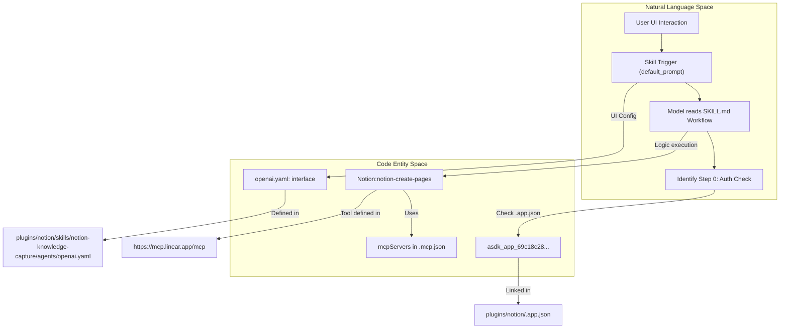
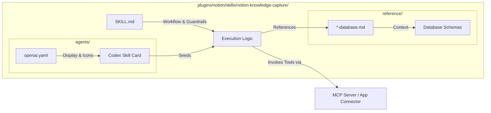

<!-- source: DeepWiki mcp.deepwiki.com · repo openai/plugins · page 2.1 Skills System · fetched 2026-10-26 -->

# Skills System

<details>
<summary>Relevant source files</summary>

The following files were used as context for generating this wiki page:

- [plugins/linear/.app.json](plugins/linear/.app.json)
- [plugins/linear/.codex-plugin/plugin.json](plugins/linear/.codex-plugin/plugin.json)
- [plugins/linear/.mcp.json](plugins/linear/.mcp.json)
- [plugins/linear/skills/linear/LICENSE.txt](plugins/linear/skills/linear/LICENSE.txt)
- [plugins/linear/skills/linear/SKILL.md](plugins/linear/skills/linear/SKILL.md)
- [plugins/linear/skills/linear/agents/openai.yaml](plugins/linear/skills/linear/agents/openai.yaml)
- [plugins/linear/skills/linear/assets/linear-small.svg](plugins/linear/skills/linear/assets/linear-small.svg)
- [plugins/linear/skills/linear/assets/linear.png](plugins/linear/skills/linear/assets/linear.png)
- [plugins/motherduck/.app.json](plugins/motherduck/.app.json)
- [plugins/motherduck/.codex-plugin/plugin.json](plugins/motherduck/.codex-plugin/plugin.json)
- [plugins/notion/.app.json](plugins/notion/.app.json)
- [plugins/notion/README.md](plugins/notion/README.md)
- [plugins/notion/agents/openai.yaml](plugins/notion/agents/openai.yaml)
- [plugins/notion/skills/notion-knowledge-capture/SKILL.md](plugins/notion/skills/notion-knowledge-capture/SKILL.md)
- [plugins/notion/skills/notion-knowledge-capture/agents/openai.yaml](plugins/notion/skills/notion-knowledge-capture/agents/openai.yaml)
- [plugins/notion/skills/notion-meeting-intelligence/SKILL.md](plugins/notion/skills/notion-meeting-intelligence/SKILL.md)
- [plugins/notion/skills/notion-meeting-intelligence/agents/openai.yaml](plugins/notion/skills/notion-meeting-intelligence/agents/openai.yaml)
- [plugins/notion/skills/notion-research-documentation/SKILL.md](plugins/notion/skills/notion-research-documentation/SKILL.md)
- [plugins/notion/skills/notion-research-documentation/agents/openai.yaml](plugins/notion/skills/notion-research-documentation/agents/openai.yaml)
- [plugins/notion/skills/notion-spec-to-implementation/SKILL.md](plugins/notion/skills/notion-spec-to-implementation/SKILL.md)
- [plugins/notion/skills/notion-spec-to-implementation/agents/openai.yaml](plugins/notion/skills/notion-spec-to-implementation/agents/openai.yaml)

</details>


The Skills System defines modular, high-level capabilities within a plugin. While a plugin provides the underlying tools, MCP servers, and authentication, a **Skill** encapsulates a specific workflow, persona, or specialized task. Skills allow the model to transition from generic tool-calling to executing structured, multi-step processes guided by domain-specific instructions.

## Anatomy of a Skill

A Skill is defined as a directory within a plugin's `skills/` folder [plugins/linear/.codex-plugin/plugin.json:13-13](). Each Skill contains configuration files that define its logic and its interface.

### 1. The SKILL.md Format
The `SKILL.md` file serves as the "brain" of the skill. It uses a Markdown format with a YAML frontmatter block to define the skill's identity and a body that contains the execution instructions for the model.

| Field | Description |
| :--- | :--- |
| `name` | The unique identifier for the skill (e.g., `notion-knowledge-capture`). [plugins/notion/skills/notion-knowledge-capture/SKILL.md:2-2]() |
| `description` | A concise summary used by the model to decide when to invoke this skill. [plugins/notion/skills/notion-knowledge-capture/SKILL.md:3-3]() |
| `metadata` | Includes `short-description` for UI rendering. [plugins/notion/skills/notion-knowledge-capture/SKILL.md:4-6]() |

**Key Conventions:**
*   **Trigger-based Descriptions**: Descriptions typically start with "Use when..." to focus on triggering conditions (e.g., "use when turning chats/notes into wiki entries") [plugins/notion/skills/notion-knowledge-capture/SKILL.md:3-3]().
*   **Tool-call Guardrails**: Skills often include specific instructions on how to handle tool failures, such as pausing to ask for authentication if an app-connector is missing [plugins/notion/skills/notion-knowledge-capture/SKILL.md:19-32]().

### 2. The Interface Definition (openai.yaml)
The `agents/openai.yaml` file defines how the skill is presented in the Codex UI and provides the initial trigger for the model.

```yaml
interface:
  display_name: "Knowledge Capture"
  short_description: "Capture conversations into structured Notion pages"
  icon_small: "./assets/notion-small.svg"
  icon_large: "./assets/notion.png"
  default_prompt: "Capture this conversation into structured Notion pages..."
```
*Source: [plugins/notion/skills/notion-knowledge-capture/agents/openai.yaml:1-6]()*

**Key Fields:**
*   **`display_name`**: The human-readable name shown in the UI [plugins/notion/skills/notion-knowledge-capture/agents/openai.yaml:2-2]().
*   **`icon_small` / `icon_large`**: Assets used for visual branding in the composer and skill cards [plugins/notion/skills/notion-knowledge-capture/agents/openai.yaml:4-5]().
*   **`default_prompt`**: The "Seed" used when a user clicks the skill. This prompt guides the model's initial behavior for that specific skill [plugins/notion/skills/notion-knowledge-capture/agents/openai.yaml:6-6]().

**Sources:** [plugins/notion/skills/notion-knowledge-capture/SKILL.md:1-6](), [plugins/notion/skills/notion-knowledge-capture/agents/openai.yaml:1-6](), [plugins/notion/README.md:40-44]()

---

## Skill Invocation and Discovery

### Invocation Syntax
Skills are often invoked using a `$skill-name` syntax within a `default_prompt`. When the model sees this token, it is a signal to load the context and instructions defined in the corresponding `SKILL.md`.

### Directory Conventions
Skills follow a strict nested directory structure to ensure the discovery engine can locate assets and definitions:
`plugins/[plugin-name]/skills/[skill-name]/`
- `SKILL.md`: Main reference and workflow logic [plugins/notion/README.md:42-43]().
- `agents/openai.yaml`: Interface metadata and UI assets [plugins/notion/skills/notion-knowledge-capture/agents/openai.yaml:1-1]().
- `reference/`: Optional documentation, database schemas, or templates used by the skill [plugins/notion/skills/notion-knowledge-capture/SKILL.md:58-59]().
- `examples/`: Walkthroughs showing the skill in practice [plugins/notion/skills/notion-knowledge-capture/SKILL.md:60-60]().

### Discovery from plugin.json
The `plugin.json` manifest (located in `.codex-plugin/`) acts as the entry point. The `skills` field in `plugin.json` specifies the relative path (usually `./skills/`) where the system should look for skill directories [plugins/linear/.codex-plugin/plugin.json:13-13]().

**Sources:** [plugins/notion/README.md:20-44](), [plugins/linear/.codex-plugin/plugin.json:1-13]()

---

## Data Flow: From UI to Execution

The following diagram illustrates how a user interaction in the UI triggers the skill logic and subsequent tool execution.

### Skill Trigger and Tool Interaction Flow
"User invokes the Knowledge Capture skill to document a chat in Notion"


**Sources:** [plugins/notion/skills/notion-knowledge-capture/SKILL.md:12-32](), [plugins/notion/.app.json:1-7](), [plugins/linear/.mcp.json:1-9]()

---

## Skill Implementation Mapping

Skills bridge the gap between user intent and specific tool calls. For example, the Notion plugin contains multiple skills that all use the same underlying tools but with different prompt engineering and templates.

| Skill Name | Purpose | Primary Tool Calls |
| :--- | :--- | :--- |
| `notion-knowledge-capture` | Conversations to wiki entries | `Notion:search`, `Notion:notion-create-pages` [plugins/notion/skills/notion-knowledge-capture/SKILL.md:12-17]() |
| `notion-research-documentation` | Synthesizing briefs | `Notion:fetch`, `Notion:notion-create-pages` [plugins/notion/skills/notion-research-documentation/SKILL.md:12-17]() |
| `notion-meeting-intelligence` | Agendas and pre-reads | `Notion:search`, `Notion:notion-update-page` [plugins/notion/skills/notion-meeting-intelligence/SKILL.md:12-17]() |

### Skill Structure Mapping
This diagram maps the file structure of a typical skill to its logical components in the system.



**Sources:** [plugins/notion/README.md:40-44](), [plugins/notion/skills/notion-knowledge-capture/SKILL.md:58-60](), [plugins/notion/skills/notion-knowledge-capture/agents/openai.yaml:1-6]()

---

