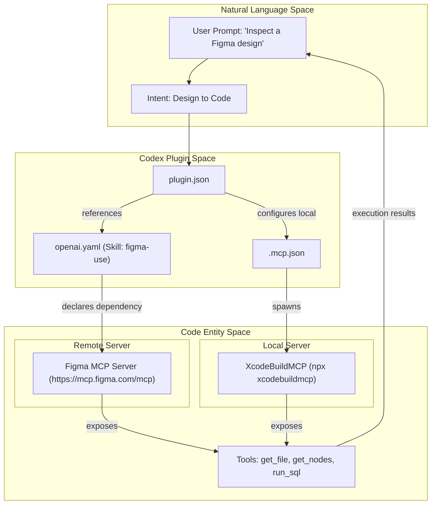
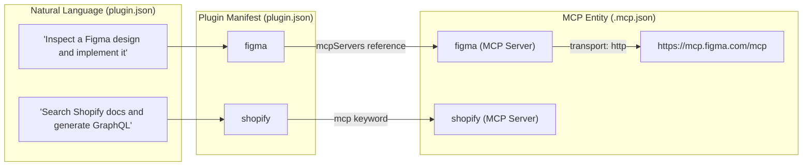

<!-- source: DeepWiki mcp.deepwiki.com · repo openai/plugins · page 2.2 Model Context Protocol (MCP) Integration · fetched 2026-10-26 -->

# Model Context Protocol (MCP) Integration

<details>
<summary>Relevant source files</summary>

The following files were used as context for generating this wiki page:

- [.agents/plugins/api_marketplace.json](.agents/plugins/api_marketplace.json)
- [plugins/atlassian-rovo/.codex-plugin/plugin.json](plugins/atlassian-rovo/.codex-plugin/plugin.json)
- [plugins/atlassian-rovo/assets/logo-dark.png](plugins/atlassian-rovo/assets/logo-dark.png)
- [plugins/atlassian-rovo/assets/logo.png](plugins/atlassian-rovo/assets/logo.png)
- [plugins/base44/.codex-plugin/plugin.json](plugins/base44/.codex-plugin/plugin.json)
- [plugins/figma/.codex-plugin/plugin.json](plugins/figma/.codex-plugin/plugin.json)
- [plugins/figma/.mcp.json](plugins/figma/.mcp.json)
- [plugins/github/.codex-plugin/plugin.json](plugins/github/.codex-plugin/plugin.json)
- [plugins/github/.mcp.json](plugins/github/.mcp.json)
- [plugins/github/README.md](plugins/github/README.md)
- [plugins/github/assets/logo.png](plugins/github/assets/logo.png)
- [plugins/neon-postgres/.codex-plugin/plugin.json](plugins/neon-postgres/.codex-plugin/plugin.json)
- [plugins/neon-postgres/assets/neon-small.svg](plugins/neon-postgres/assets/neon-small.svg)
- [plugins/neon-postgres/assets/neon.jpg](plugins/neon-postgres/assets/neon.jpg)
- [plugins/neon-postgres/skills/neon-postgres-egress-optimizer/SKILL.md](plugins/neon-postgres/skills/neon-postgres-egress-optimizer/SKILL.md)
- [plugins/neon-postgres/skills/neon-postgres-egress-optimizer/agents/openai.yaml](plugins/neon-postgres/skills/neon-postgres-egress-optimizer/agents/openai.yaml)
- [plugins/neon-postgres/skills/neon-postgres-egress-optimizer/assets/neon-small.svg](plugins/neon-postgres/skills/neon-postgres-egress-optimizer/assets/neon-small.svg)
- [plugins/neon-postgres/skills/neon-postgres-egress-optimizer/assets/neon.jpg](plugins/neon-postgres/skills/neon-postgres-egress-optimizer/assets/neon.jpg)
- [plugins/neon-postgres/skills/neon-postgres/SKILL.md](plugins/neon-postgres/skills/neon-postgres/SKILL.md)
- [plugins/neon-postgres/skills/neon-postgres/agents/openai.yaml](plugins/neon-postgres/skills/neon-postgres/agents/openai.yaml)
- [plugins/neon-postgres/skills/neon-postgres/assets/neon-small.svg](plugins/neon-postgres/skills/neon-postgres/assets/neon-small.svg)
- [plugins/notion/.codex-plugin/plugin.json](plugins/notion/.codex-plugin/plugin.json)
- [plugins/notion/.mcp.json](plugins/notion/.mcp.json)
- [plugins/notion/assets/notion-dark.png](plugins/notion/assets/notion-dark.png)
- [plugins/notion/assets/notion.png](plugins/notion/assets/notion.png)
- [plugins/shopify/.codex-plugin/plugin.json](plugins/shopify/.codex-plugin/plugin.json)
- [plugins/supabase/.codex-plugin/plugin.json](plugins/supabase/.codex-plugin/plugin.json)
- [plugins/vercel/.codex-plugin/plugin.json](plugins/vercel/.codex-plugin/plugin.json)

</details>


The Model Context Protocol (MCP) integration allows Codex plugins to connect to external, standardized servers that provide tools, resources, and prompts. By using MCP, plugins can offer authenticated, live access to third-party APIs (like Cloudflare, Vercel, or Neon) without needing to manually implement every API endpoint as a separate tool in the plugin manifest.

## Overview of MCP in Plugins

Plugins in this repository utilize MCP in two primary ways:
1.  **Direct Integration**: The plugin manifest (`plugin.json`) points to a `.mcp.json` configuration file or contains direct server references via the `mcpServers` field [plugins/figma/.codex-plugin/plugin.json:21-21]().
2.  **Skill-Level Dependencies**: Individual skills within a plugin can declare specific MCP servers as tool dependencies in their `openai.yaml` configuration [plugins/neon-postgres/skills/neon-postgres/agents/openai.yaml:9-15]().

### Key Configuration Files

| File | Purpose |
| :--- | :--- |
| `plugin.json` | The main manifest that defines the plugin's metadata and references skills or MCP configurations [plugins/figma/.codex-plugin/plugin.json:1-46](). |
| `.mcp.json` | Defines the connection parameters (URL, transport type, or local command execution) for one or more MCP servers [plugins/figma/.mcp.json:1-9](). |
| `openai.yaml` | Located in skill directories; declares specific MCP tools needed by that skill using the `mcp` tool type [plugins/neon-postgres/skills/neon-postgres/agents/openai.yaml:9-15](). |

**Sources:** [plugins/figma/.codex-plugin/plugin.json:21-21](), [plugins/figma/.mcp.json:1-9](), [plugins/neon-postgres/skills/neon-postgres/agents/openai.yaml:9-15]()

---

## Data Flow: MCP Request Lifecycle

The following diagram illustrates how a user request flows from the Codex UI through a plugin to an MCP server, distinguishing between remote HTTP-based servers and local CLI-based servers.

### MCP Interaction Architecture

**Sources:** [plugins/figma/.codex-plugin/plugin.json:21-21](), [plugins/figma/.mcp.json:2-8](), [plugins/neon-postgres/skills/neon-postgres/agents/openai.yaml:11-15]()

---

## Implementation Details

### 1. The `.mcp.json` Configuration
The `.mcp.json` file is used to define MCP servers that are run locally via a command-line interface or connected via specific HTTP transports.

**Example (GitHub):**
This configuration uses a bearer token for authentication to a remote GitHub MCP endpoint.
```json
{
  "mcpServers": {
    "github": {
      "type": "http",
      "url": "https://api.githubcopilot.com/mcp/",
      "bearer_token_env_var": "GITHUB_PAT_TOKEN"
    }
  }
}
```
[plugins/github/.mcp.json:1-9]()

### 2. Skill-Level Tool Dependencies
Skills map specific MCP capabilities in their `agents/openai.yaml` file. This allows a plugin to be composed of multiple skills that might hit different MCP endpoints or use different transport layers.

**Example (Neon Postgres):**
```yaml
dependencies:
  tools:
    - type: "mcp"
      value: "neon"
      description: "Neon MCP server"
      transport: "streamable_http"
      url: "https://mcp.neon.tech/mcp"
```
[plugins/neon-postgres/skills/neon-postgres/agents/openai.yaml:9-15]()

### 3. App-Connector vs. MCP-Backed Plugins
*   **App-Connector Plugins**: Primarily rely on `.app.json` for OAuth-based connections to high-level SaaS APIs (e.g., Notion, Slack) [plugins/notion/.codex-plugin/plugin.json:20-22]().
*   **MCP-Backed Plugins**: Focus on technical toolsets (SQL, CLI wrappers, infrastructure). They often coexist with app connectors; for instance, `figma` uses both an app definition and an MCP server [plugins/figma/.codex-plugin/plugin.json:20-21]().

---

## Example Integrations

### Figma
The Figma plugin utilizes a remote MCP server to enable design inspection and implementation workflows.
*   **Configuration**: The `.mcp.json` file defines the `http` transport and the `oauth_resource` for the Figma MCP server [plugins/figma/.mcp.json:4-6]().
*   **Capabilities**: Exposes design-to-code workflows, including Code Connect templates and design system rule generation [plugins/figma/.codex-plugin/plugin.json:24-25]().

### Neon Postgres
The Neon plugin utilizes a remote MCP server to enable complex database operations without the plugin needing to bundle the logic for every SQL command.
*   **Skill Integration**: The `neon-postgres` skill uses the `streamable_http` transport to reach the Neon MCP endpoint [plugins/neon-postgres/skills/neon-postgres/agents/openai.yaml:14-15]().
*   **Egress Optimization**: The `neon-postgres-egress-optimizer` skill provides specific prompts and guides for diagnosing high database bills [plugins/neon-postgres/skills/neon-postgres-egress-optimizer/SKILL.md:14-35]().

### Shopify
The Shopify plugin is categorized as MCP-backed, focusing on developer tools like GraphQL validation and Liquid code generation [plugins/shopify/.codex-plugin/plugin.json:14-18]().

---

## MCP Logic Association

The following diagram bridges the natural language prompts found in `plugin.json` and `SKILL.md` files to the technical MCP tool dependencies.

### Skill-to-MCP Mapping

**Sources:** [plugins/figma/.codex-plugin/plugin.json:36-37](), [plugins/shopify/.codex-plugin/plugin.json:35-37](), [plugins/figma/.mcp.json:1-9](), [plugins/shopify/.codex-plugin/plugin.json:14-14]()

**Key Code Entities:**
*   `transport: "streamable_http"`: The protocol used for remote MCP communication in skills [plugins/neon-postgres/skills/neon-postgres/agents/openai.yaml:14-14]().
*   `type: "mcp"`: The tool definition type that triggers the MCP client logic [plugins/neon-postgres/skills/neon-postgres/agents/openai.yaml:11-11]().
*   `mcpServers`: The key in `plugin.json` or `.mcp.json` for defining server instances [plugins/figma/.codex-plugin/plugin.json:21-21](), [plugins/figma/.mcp.json:2-2]().

**Sources:** [plugins/figma/.codex-plugin/plugin.json:1-46](), [plugins/figma/.mcp.json:1-9](), [plugins/neon-postgres/skills/neon-postgres/agents/openai.yaml:9-15]()

---

