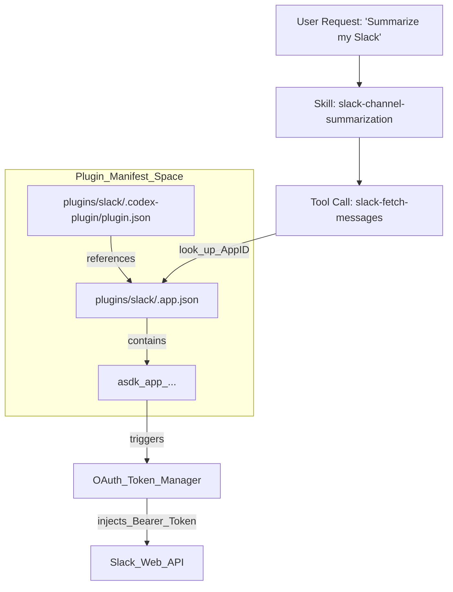
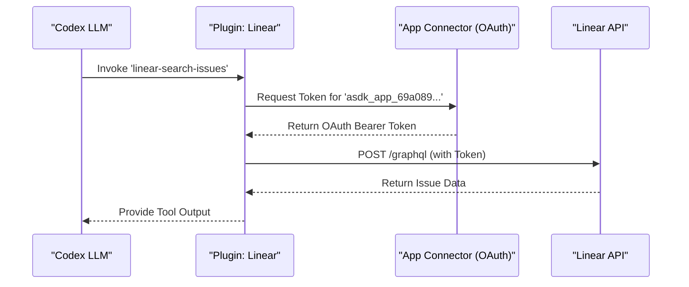

<!-- source: DeepWiki mcp.deepwiki.com · repo openai/plugins · page 2.3 App Connectors and Authentication · fetched 2026-10-26 -->

# App Connectors and Authentication

Relevant source files

The following files were used as context for generating this wiki page:

- [plugins/atlassian-rovo/.codex-plugin/plugin.json](plugins/atlassian-rovo/.codex-plugin/plugin.json)
- [plugins/atlassian-rovo/assets/logo-dark.png](plugins/atlassian-rovo/assets/logo-dark.png)
- [plugins/atlassian-rovo/assets/logo.png](plugins/atlassian-rovo/assets/logo.png)
- [plugins/canva/.codex-plugin/plugin.json](plugins/canva/.codex-plugin/plugin.json)
- [plugins/gmail/.codex-plugin/plugin.json](plugins/gmail/.codex-plugin/plugin.json)
- [plugins/linear/.app.json](plugins/linear/.app.json)
- [plugins/linear/.codex-plugin/plugin.json](plugins/linear/.codex-plugin/plugin.json)
- [plugins/linear/.mcp.json](plugins/linear/.mcp.json)
- [plugins/linear/skills/linear/LICENSE.txt](plugins/linear/skills/linear/LICENSE.txt)
- [plugins/linear/skills/linear/SKILL.md](plugins/linear/skills/linear/SKILL.md)
- [plugins/linear/skills/linear/agents/openai.yaml](plugins/linear/skills/linear/agents/openai.yaml)
- [plugins/linear/skills/linear/assets/linear-small.svg](plugins/linear/skills/linear/assets/linear-small.svg)
- [plugins/linear/skills/linear/assets/linear.png](plugins/linear/skills/linear/assets/linear.png)
- [plugins/motherduck/.app.json](plugins/motherduck/.app.json)
- [plugins/motherduck/.codex-plugin/plugin.json](plugins/motherduck/.codex-plugin/plugin.json)
- [plugins/notion/.codex-plugin/plugin.json](plugins/notion/.codex-plugin/plugin.json)
- [plugins/notion/.mcp.json](plugins/notion/.mcp.json)
- [plugins/notion/assets/notion-dark.png](plugins/notion/assets/notion-dark.png)
- [plugins/notion/assets/notion.png](plugins/notion/assets/notion.png)
- [plugins/slack/.app.json](plugins/slack/.app.json)
- [plugins/slack/.codex-plugin/plugin.json](plugins/slack/.codex-plugin/plugin.json)
- [plugins/slack/skills/slack/agents/openai.yaml](plugins/slack/skills/slack/agents/openai.yaml)

This page documents the architecture and implementation of **App Connectors**, the mechanism by which plugins interface with third-party SaaS platforms (e.g., Notion, Slack, Linear, Gmail) using managed OAuth flows. Unlike standalone or MCP-backed plugins, app-backed plugins rely on a centralized authentication system identified by unique application IDs.

## The .app.json Pattern

App-backed plugins are identified by the presence of a `.app.json` file in the plugin root. This file acts as a bridge between the local plugin definition and the managed authentication service.

### Manifest Integration
The primary plugin manifest, `plugin.json`, must point to this file using the `apps` key:
- [plugins/notion/.codex-plugin/plugin.json:22-22]()
- [plugins/linear/.codex-plugin/plugin.json:14-14]()
- [plugins/slack/.codex-plugin/plugin.json:19-19]()
- [plugins/canva/.codex-plugin/plugin.json:14-14]()
- [plugins/atlassian-rovo/.codex-plugin/plugin.json:16-16]()

### Structure of .app.json
The file contains a mapping of app names to their unique `asdk_app_` identifiers. These identifiers are used by the Codex platform to resolve the correct OAuth credentials and API endpoints for the tools used within the plugin's skills.

| Plugin | App Identifier (`asdk_app_...`) | Source |
| :--- | :--- | :--- |
| **Linear** | `asdk_app_69a089a326dc8191b32a3f2553f5be2c` | [plugins/linear/.app.json:4-4]() |
| **Notion** | `asdk_app_69c18c28f1188191bf5b8445c4ab0a2e` | (Managed via centralized registry) |

**Sources:**
- [plugins/linear/.app.json:1-7]()
- [plugins/slack/.app.json:1-7]()
- [plugins/motherduck/.app.json:1-7]()
- [plugins/atlassian-rovo/.codex-plugin/plugin.json:16-16]()

---

## Authentication Flow and Data Flow

The authentication flow for App Connectors is managed by the platform. When a skill attempts to call a tool associated with an app, the system checks for a valid OAuth token associated with that `asdk_app_` ID.

### Natural Language to Code Entity Space: Auth Resolution
The following diagram illustrates how a user request triggers the resolution of an App Connector through the manifest structure.

**Diagram: App Connector Resolution Path**

**Sources:**
- [plugins/slack/.codex-plugin/plugin.json:1-19]()
- [plugins/slack/.app.json:1-7]()

---

## Step 0: The Auth-Check Pattern

A critical convention in app-backed skills is the **Step 0: Auth Check**. Because tools may be unavailable if the user has not yet completed the OAuth handshake, skills must explicitly define a recovery path.

### Implementation in Skill Definitions
Skills using App Connectors include standardized instructions that guide the model on how to handle missing permissions.

1.  **Detection**: If tools (e.g., `notion-search`) are unavailable in the context.
2.  **Instruction**: Pause the execution.
3.  **Call to Action**: Ask the user to "connect the [App] app" and complete the auth flow.
4.  **Recovery**: Once connected, the user is told to retry.

**Example: Slack Auth-Check Pattern**
[plugins/slack/skills/slack/agents/openai.yaml:1-7]() defines the skill interface which relies on the connected Slack integration specified in the parent manifest [plugins/slack/.codex-plugin/plugin.json:19-19]().

**Sources:**
- [plugins/slack/skills/slack/agents/openai.yaml:1-7]()
- [plugins/linear/skills/linear/agents/openai.yaml:1-6]()

---

## App-Backed vs. MCP-Backed Plugins

While both provide external capabilities, App Connectors and MCP (Model Context Protocol) servers serve different roles. Some plugins, like **Linear** and **Notion**, use both: App Connectors for high-level identity/OAuth and MCP for specific tool execution.

| Feature | App-Backed (Connectors) | MCP-Backed |
| :--- | :--- | :--- |
| **Identifier** | `.app.json` (`asdk_app_...`) | `.mcp.json` |
| **Auth Mechanism** | Managed OAuth (Centralized) | API Keys, Local Auth, or `oauth_resource` |
| **Manifest Key** | `"apps"` | `"mcpServers"` |
| **Primary Examples** | Gmail, Slack, Canva | Cloudflare, Vercel, MotherDuck |
| **Hybrid Examples** | Linear, Notion | Linear, Notion |

**Sources:**
- [plugins/notion/.codex-plugin/plugin.json:22-23]()
- [plugins/linear/.codex-plugin/plugin.json:14-15]()
- [plugins/linear/.mcp.json:1-9]()
- [plugins/notion/.mcp.json:1-9]()

---

## Technical Data Flow: Tool Execution

When a skill invokes a tool through an App Connector, the request follows a specific path through the infrastructure, utilizing the `asdk_app_` ID to retrieve secrets and authorize the request.

**Diagram: App-Backed Tool Execution**

**Sources:**
- [plugins/linear/.app.json:4-4]()
- [plugins/linear/.codex-plugin/plugin.json:14-14]()
- [plugins/linear/.mcp.json:6-6]()

---

