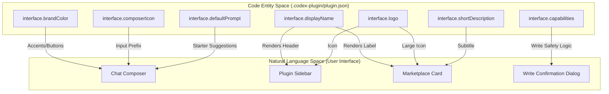
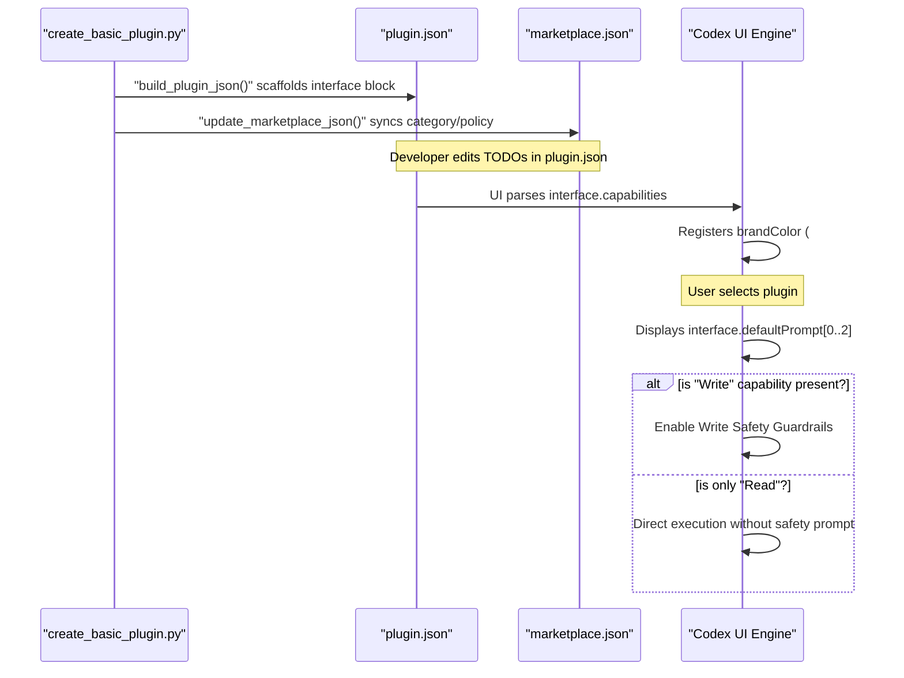

<!-- source: DeepWiki mcp.deepwiki.com · repo openai/plugins · page 2.4 Plugin Capabilities and Interface Metadata · fetched 2026-10-26 -->

# Plugin Capabilities and Interface Metadata

Relevant source files

The following files were used as context for generating this wiki page:

- [.agents/plugins/api_marketplace.json](.agents/plugins/api_marketplace.json)
- [.agents/skills/plugin-creator/SKILL.md](.agents/skills/plugin-creator/SKILL.md)
- [.agents/skills/plugin-creator/agents/openai.yaml](.agents/skills/plugin-creator/agents/openai.yaml)
- [.agents/skills/plugin-creator/references/plugin-json-spec.md](.agents/skills/plugin-creator/references/plugin-json-spec.md)
- [.agents/skills/plugin-creator/scripts/create_basic_plugin.py](.agents/skills/plugin-creator/scripts/create_basic_plugin.py)
- [plugins/base44/.codex-plugin/plugin.json](plugins/base44/.codex-plugin/plugin.json)
- [plugins/figma/.codex-plugin/plugin.json](plugins/figma/.codex-plugin/plugin.json)
- [plugins/figma/.mcp.json](plugins/figma/.mcp.json)
- [plugins/github/.codex-plugin/plugin.json](plugins/github/.codex-plugin/plugin.json)
- [plugins/github/.mcp.json](plugins/github/.mcp.json)
- [plugins/github/README.md](plugins/github/README.md)
- [plugins/github/assets/logo.png](plugins/github/assets/logo.png)
- [plugins/shopify/.codex-plugin/plugin.json](plugins/shopify/.codex-plugin/plugin.json)
- [plugins/supabase/.codex-plugin/plugin.json](plugins/supabase/.codex-plugin/plugin.json)
- [plugins/vercel/.codex-plugin/plugin.json](plugins/vercel/.codex-plugin/plugin.json)

This page documents the `interface` block within the `.codex-plugin/plugin.json` manifest. These fields define how a plugin is presented, categorized, and restricted within the Codex UI and marketplace.

## Overview and Purpose

The `interface` block serves as the bridge between the raw technical capabilities of a plugin (its skills, MCP servers, or app connectors) and the end-user experience. It provides the metadata necessary for the Codex UI to render plugin icons, descriptions, brand colors, and interactive safety guardrails.

### Data Flow: From Manifest to UI
1.  **Definition**: Developers define metadata in `plugins/<plugin-name>/.codex-plugin/plugin.json` [[.agents/skills/plugin-creator/references/plugin-json-spec.md:21-44]()].
2.  **Scaffolding**: The `create_basic_plugin.py` script generates this block using `build_plugin_json()` with `[TODO]` placeholders for developers to fill [[.agents/skills/plugin-creator/scripts/create_basic_plugin.py:43-85]()].
3.  **Registration**: The `Marketplace Registry` consumes these manifests to populate `marketplace.json`, using the `category` and `name` to organize the UI [[.agents/plugins/api_marketplace.json:7-21](), [.agents/skills/plugin-creator/scripts/create_basic_plugin.py:88-105]()].
4.  **Rendering**: The Codex UI uses the `displayName`, `brandColor`, and `logo` to create the plugin's visual identity in the composer and sidebar.

Sources: `.agents/skills/plugin-creator/references/plugin-json-spec.md`, `.agents/skills/plugin-creator/scripts/create_basic_plugin.py`, `.agents/plugins/api_marketplace.json`.

---

## Interface Block Schema

The following table details the fields found in the `interface` object as defined in the plugin specification [[.agents/skills/plugin-creator/references/plugin-json-spec.md:69-90]()]:

| Field | Type | Description |
| :--- | :--- | :--- |
| `displayName` | String | User-facing title shown for the plugin in the UI [[.agents/skills/plugin-creator/references/plugin-json-spec.md:71]()] |
| `shortDescription` | String | Brief subtitle used in compact views and search results [[.agents/skills/plugin-creator/references/plugin-json-spec.md:72]()] |
| `longDescription` | String | Detailed explanation used on the plugin's details screen [[.agents/skills/plugin-creator/references/plugin-json-spec.md:73]()] |
| `developerName` | String | Human-readable publisher name (e.g., "OpenAI", "Figma") [[.agents/skills/plugin-creator/references/plugin-json-spec.md:74]()] |
| `category` | String | The marketplace category bucket (e.g., "Developer Tools", "Creativity") [[.agents/skills/plugin-creator/references/plugin-json-spec.md:75]()] |
| `capabilities` | Array | List of capabilities: `Interactive`, `Read`, `Write` [[.agents/skills/plugin-creator/references/plugin-json-spec.md:76]()] |
| `brandColor` | String | Hex theme color used for the plugin card and UI accents [[.agents/skills/plugin-creator/references/plugin-json-spec.md:84]()] |
| `composerIcon` | Path | Relative path to the icon asset used in the chat composer [[.agents/skills/plugin-creator/references/plugin-json-spec.md:85]()] |
| `logo` | Path | Relative path to the high-resolution logo asset [[.agents/skills/plugin-creator/references/plugin-json-spec.md:86]()] |
| `defaultPrompt` | Array | Up to 3 starter prompts (max 128 chars each) shown in the UX [[.agents/skills/plugin-creator/references/plugin-json-spec.md:80-83]()] |
| `screenshots` | Array | List of relative paths to PNG screenshots in `./assets/` [[.agents/skills/plugin-creator/references/plugin-json-spec.md:87-89]()] |

### Capabilities Model
The `capabilities` field defines the security and interaction boundaries for the plugin [[.agents/skills/plugin-creator/references/plugin-json-spec.md:27]()]:
*   **`Read`**: The plugin can retrieve data from external sources (e.g., searching Shopify documentation) [[plugins/shopify/.codex-plugin/plugin.json:29]()].
*   **`Write`**: The plugin can modify data or perform side effects (e.g., creating a PR in GitHub). This triggers "Write Safety" confirmations [[plugins/github/.codex-plugin/plugin.json:32](), [plugins/vercel/.codex-plugin/plugin.json:38]()].
*   **`Interactive`**: Enables real-time UI components, browser automation, or complex multi-turn flows [[plugins/figma/.codex-plugin/plugin.json:29](), [plugins/github/.codex-plugin/plugin.json:31]()].

Sources: `.agents/skills/plugin-creator/references/plugin-json-spec.md`, `plugins/github/.codex-plugin/plugin.json`, `plugins/shopify/.codex-plugin/plugin.json`, `plugins/figma/.codex-plugin/plugin.json`.

---

## Visual Identity and Assets

Plugins use relative paths to assets stored within the plugin directory, typically under an `assets/` folder [[.agents/skills/plugin-creator/references/plugin-json-spec.md:88-89]()].

### Asset Conventions
*   **Icons**: Manifests point to assets like `./assets/logo-padded.png` for both `logo` and `composerIcon` [[plugins/figma/.codex-plugin/plugin.json:42-43](), [plugins/vercel/.codex-plugin/plugin.json:48-49]()].
*   **Format**: Screenshots and icons must be PNG files [[.agents/skills/plugin-creator/references/plugin-json-spec.md:88]()].

### Implementation Diagram: Manifest to UI Rendering

This diagram illustrates how fields in `plugin.json` map to specific UI components in the Codex environment.

Title: Metadata Mapping to Codex UI

Sources: `.agents/skills/plugin-creator/references/plugin-json-spec.md`, `plugins/vercel/.codex-plugin/plugin.json`, `plugins/figma/.codex-plugin/plugin.json`.

---

## Technical Data Flow

The `interface` block is processed by the scaffolding tools and the marketplace registry. The following diagram shows how the system handles the metadata.

Title: Interface Metadata Processing Flow

Sources: `.agents/skills/plugin-creator/scripts/create_basic_plugin.py:43-85](), [.agents/skills/plugin-creator/scripts/create_basic_plugin.py:129-165](), [.agents/skills/plugin-creator/references/plugin-json-spec.md:80-83]().

---

## Examples

### Creativity Category: Figma
The Figma plugin uses `Interactive`, `Read`, and `Write` capabilities to handle design-to-code workflows.
*   **Path**: `plugins/figma/.codex-plugin/plugin.json` [[plugins/figma/.codex-plugin/plugin.json:22-45]()]
*   **Brand Color**: `#1ABCFE`
*   **Capabilities**: `Interactive`, `Read`, `Write`

### Developer Tools Category: GitHub
The GitHub plugin uses `Interactive` and `Write` for triage and publishing flows.
*   **Path**: `plugins/github/.codex-plugin/plugin.json` [[plugins/github/.codex-plugin/plugin.json:24-44]()]
*   **Brand Color**: `#24292F`
*   **Capabilities**: `Interactive`, `Write`

### Developer Tools Category: Vercel
The Vercel plugin uses a black brand color and focuses on deployment side effects.
*   **Path**: `plugins/vercel/.codex-plugin/plugin.json` [[plugins/vercel/.codex-plugin/plugin.json:30-52]()]
*   **Brand Color**: `#000000`
*   **Capabilities**: `Interactive`, `Write`

Sources: `plugins/figma/.codex-plugin/plugin.json`, `plugins/github/.codex-plugin/plugin.json`, `plugins/vercel/.codex-plugin/plugin.json`.

---

