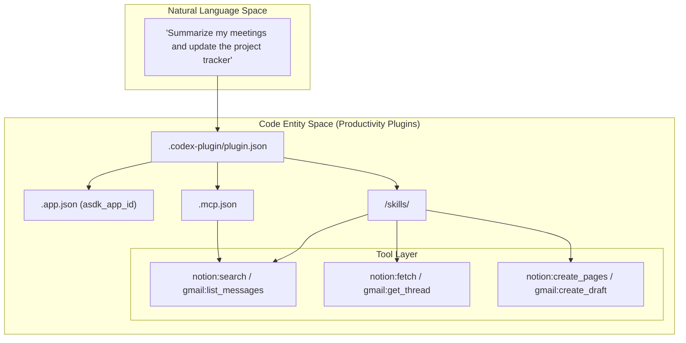
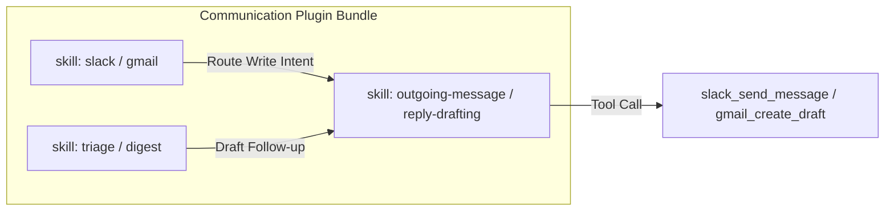

<!-- source: DeepWiki mcp.deepwiki.com · repo openai/plugins · page 3 Productivity Plugins · fetched 2026-10-26 -->

# Productivity Plugins

Relevant source files

The following files were used as context for generating this wiki page:

- [plugins/atlassian-rovo/.codex-plugin/plugin.json](plugins/atlassian-rovo/.codex-plugin/plugin.json)
- [plugins/atlassian-rovo/assets/logo-dark.png](plugins/atlassian-rovo/assets/logo-dark.png)
- [plugins/atlassian-rovo/assets/logo.png](plugins/atlassian-rovo/assets/logo.png)
- [plugins/canva/.codex-plugin/plugin.json](plugins/canva/.codex-plugin/plugin.json)
- [plugins/gmail/.codex-plugin/plugin.json](plugins/gmail/.codex-plugin/plugin.json)
- [plugins/notion/.codex-plugin/plugin.json](plugins/notion/.codex-plugin/plugin.json)
- [plugins/notion/.mcp.json](plugins/notion/.mcp.json)
- [plugins/notion/assets/notion-dark.png](plugins/notion/assets/notion-dark.png)
- [plugins/notion/assets/notion.png](plugins/notion/assets/notion.png)
- [plugins/slack/.app.json](plugins/slack/.app.json)
- [plugins/slack/.codex-plugin/plugin.json](plugins/slack/.codex-plugin/plugin.json)
- [plugins/slack/skills/slack/agents/openai.yaml](plugins/slack/skills/slack/agents/openai.yaml)

The **Productivity** category encompasses plugins designed to streamline communication, project management, document authoring, and calendar coordination. These plugins are typically "App-Backed," meaning they leverage the `.app.json` manifest to connect to third-party OAuth platforms like Notion, Slack, Google, or Microsoft 365.

## Overview of Productivity Suites

Productivity plugins in this repository follow a high-level "Search-Fetch-Synthesize-Action" lifecycle. They are characterized by their use of the `Productivity` [plugins/notion/.codex-plugin/plugin.json:29-29]() or `Communication` [plugins/slack/.codex-plugin/plugin.json:25-25]() categories in their `plugin.json` manifest and often include `Interactive`, `Read`, and `Write` capabilities [plugins/notion/.codex-plugin/plugin.json:30-34]().

### Core Service Architecture
The following diagram illustrates how Productivity plugins bridge natural language requests to specific service entities and tools.

**Productivity Service Mapping**

**Sources:** [plugins/notion/.codex-plugin/plugin.json:1-45](), [plugins/notion/.app.json:1-7](), [plugins/notion/.mcp.json:1-9](), [plugins/gmail/.codex-plugin/plugin.json:1-41]()

---

## 3.1 Notion Plugin
The Notion plugin provides advanced workflows for turning unstructured data into durable workspace knowledge. It is backed by an app connector and an MCP server located at `https://mcp.notion.com/mcp` [plugins/notion/.mcp.json:5-5]().

*   **Capabilities:** Supports `Interactive`, `Read`, and `Write` operations [plugins/notion/.codex-plugin/plugin.json:30-34]().
*   **Key Skills:** Covers implementation planning, research synthesis, and meeting preparation [plugins/notion/.codex-plugin/plugin.json:4-4]().

For technical details on the Search-Fetch-Synthesize-Create lifecycle, see **[Notion Plugin](#3.1)**.

## 3.2 Slack Plugin
The Slack plugin focuses on communication triage and message composition. It uses a specific app ID `asdk_app_69a1d78e929881919bba0dbda1f6436d` for its integration [plugins/slack/.app.json:4-4]().

*   **Interface:** The `openai.yaml` definition sets the `brand_color` to `#611F69` and provides a `default_prompt` for summarizing threads [plugins/slack/skills/slack/agents/openai.yaml:6-7]().
*   **Composition:** Optimized for drafting posts and summarizing threads [plugins/slack/skills/slack/agents/openai.yaml:3-3]().

For details on the Triage Engine and Write Safety guardrails, see **[Slack Plugin](#3.2)**.

## 3.3 Microsoft 365 Plugins
This suite covers Outlook (Email and Calendar), Teams, and SharePoint. These plugins enable cross-app workflows such as extracting tasks from emails and placing them into a Planner board or summarizing SharePoint documents for a Teams daily digest.

For details on M365 integration, see **[Microsoft 365 Plugins (Outlook, Teams, SharePoint)](#3.3)**.

## 3.4 Google Workspace Plugins
The Google Workspace suite provides deep integration with Gmail, Calendar, Drive, and the Editors (Docs, Sheets, Slides). 

*   **Gmail:** Uses the `Communication` category and supports `Interactive` and `Write` capabilities [plugins/gmail/.codex-plugin/plugin.json:25-29]().
*   **Workflow:** Summarizes inbox activity and drafts replies [plugins/gmail/.codex-plugin/plugin.json:23-23]().

For details on Workspace tools, see **[Google Workspace Plugins (Gmail, Calendar, Drive, Docs, Sheets, Slides)](#3.4)**.

## 3.5 Project Management Plugins
These plugins connect specialized tracking tools to the broader productivity ecosystem.

*   **Linear:** Optimized for issue triaging and project referencing.
*   **Atlassian Rovo:** Handles Jira and Confluence workflows with a focus on speed [plugins/atlassian-rovo/.codex-plugin/plugin.json:4-4]().
*   **Box:** Manages enterprise content and bulk file operations.

For details on issue management and content APIs, see **[Project Management Plugins (Linear, Atlassian Rovo, Box)](#3.5)**.

## 3.6 Research and Reference Plugins
These tools bridge academic and professional research with document authoring.

*   **Zotero:** Integration with local Zotero Desktop APIs.
*   **Life Science Research:** A massive orchestration layer for specialized genetics, chemistry, and clinical evidence retrieval.
*   **Boltz & NGS Analysis:** Specialized tools for protein structure prediction and next-generation sequencing.

For details on research orchestration, see **[Research and Reference Plugins (Zotero, Life Science Research, Boltz, NGS Analysis)](#3.6)**.

## 3.7 Communication Plugins
This group covers high-utility communication platforms beyond standard chat and email.

*   **Zoom:** Extensive REST API and SDK integration for meetings, phone, and chat.
*   **Superhuman Mail:** MCP-backed high-performance email and calendar workflows.

For details on REST API and SDK orchestration, see **[Communication Plugins (Zoom, Superhuman Mail)](#3.7)**.

---

## Technical Skill Handoff Pattern
Productivity plugins frequently hand off tasks between specialized skills to maintain focus. A common pattern involves a general entry-point skill delegating to a specialized "Write" skill.

**Skill Delegation Workflow**

**Sources:** [plugins/slack/.codex-plugin/plugin.json:18-23](), [plugins/gmail/.codex-plugin/plugin.json:18-23](), [plugins/slack/skills/slack/agents/openai.yaml:7-7]()

**Sources:**
- [plugins/notion/.codex-plugin/plugin.json:1-45]()
- [plugins/notion/.app.json:1-7]()
- [plugins/notion/.mcp.json:1-9]()
- [plugins/slack/.codex-plugin/plugin.json:1-41]()
- [plugins/slack/.app.json:1-7]()
- [plugins/slack/skills/slack/agents/openai.yaml:1-7]()
- [plugins/gmail/.codex-plugin/plugin.json:1-41]()
- [plugins/atlassian-rovo/.codex-plugin/plugin.json:1-39]()

---

