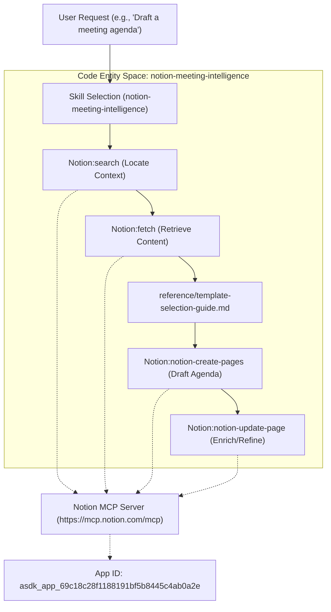
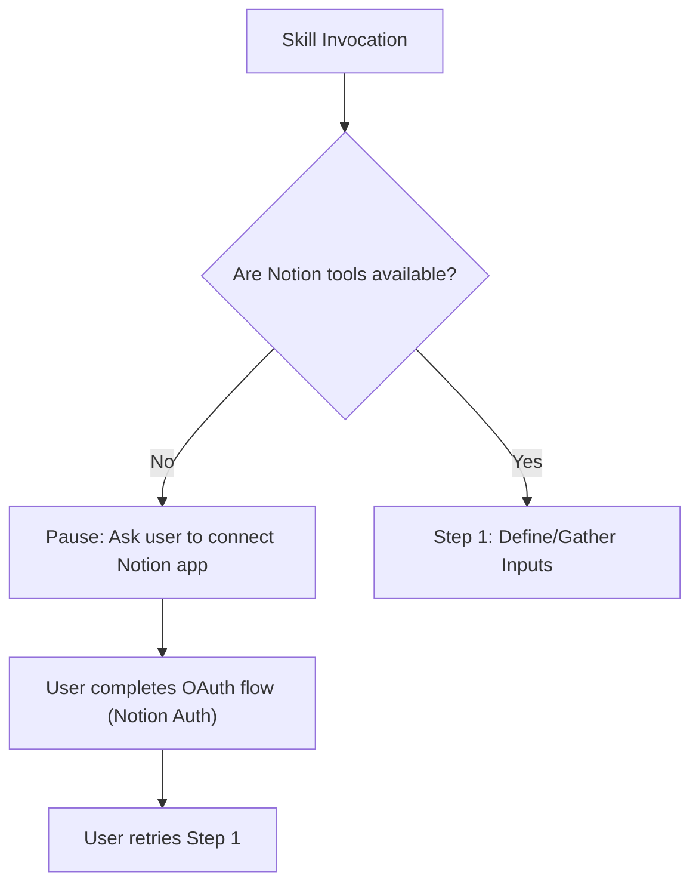

<!-- source: DeepWiki mcp.deepwiki.com · repo openai/plugins · page 3.1 Notion Plugin · fetched 2026-10-26 -->

# Notion Plugin

Relevant source files

The following files were used as context for generating this wiki page:

- [plugins/atlassian-rovo/.codex-plugin/plugin.json](plugins/atlassian-rovo/.codex-plugin/plugin.json)
- [plugins/atlassian-rovo/assets/logo-dark.png](plugins/atlassian-rovo/assets/logo-dark.png)
- [plugins/atlassian-rovo/assets/logo.png](plugins/atlassian-rovo/assets/logo.png)
- [plugins/notion/.app.json](plugins/notion/.app.json)
- [plugins/notion/.codex-plugin/plugin.json](plugins/notion/.codex-plugin/plugin.json)
- [plugins/notion/.mcp.json](plugins/notion/.mcp.json)
- [plugins/notion/README.md](plugins/notion/README.md)
- [plugins/notion/agents/openai.yaml](plugins/notion/agents/openai.yaml)
- [plugins/notion/assets/notion-dark.png](plugins/notion/assets/notion-dark.png)
- [plugins/notion/assets/notion.png](plugins/notion/assets/notion.png)
- [plugins/notion/skills/notion-knowledge-capture/SKILL.md](plugins/notion/skills/notion-knowledge-capture/SKILL.md)
- [plugins/notion/skills/notion-knowledge-capture/agents/openai.yaml](plugins/notion/skills/notion-knowledge-capture/agents/openai.yaml)
- [plugins/notion/skills/notion-meeting-intelligence/SKILL.md](plugins/notion/skills/notion-meeting-intelligence/SKILL.md)
- [plugins/notion/skills/notion-meeting-intelligence/agents/openai.yaml](plugins/notion/skills/notion-meeting-intelligence/agents/openai.yaml)
- [plugins/notion/skills/notion-research-documentation/SKILL.md](plugins/notion/skills/notion-research-documentation/SKILL.md)
- [plugins/notion/skills/notion-research-documentation/agents/openai.yaml](plugins/notion/skills/notion-research-documentation/agents/openai.yaml)
- [plugins/notion/skills/notion-spec-to-implementation/SKILL.md](plugins/notion/skills/notion-spec-to-implementation/SKILL.md)
- [plugins/notion/skills/notion-spec-to-implementation/agents/openai.yaml](plugins/notion/skills/notion-spec-to-implementation/agents/openai.yaml)

The Notion plugin provides a suite of workflows for implementation planning, research synthesis, meeting preparation, and knowledge capture within the Notion workspace. It leverages a set of specialized skills and an app-backed authentication model to interact with Notion's databases and pages.

## Plugin Manifest and Configuration

The plugin is defined by a standard manifest that specifies its identity, capabilities, and the location of its constituent parts.

*   **Plugin ID**: `notion` [plugins/notion/.codex-plugin/plugin.json:2-2]()
*   **App Connector**: It uses a dedicated app ID `asdk_app_69c18c28f1188191bf5b8445c4ab0a2e` for OAuth and API access [plugins/notion/.app.json:4-4]().
*   **MCP Integration**: The plugin connects to a hosted Model Context Protocol (MCP) server at `https://mcp.notion.com/mcp` [plugins/notion/.mcp.json:5-5]().
*   **Capabilities**: The plugin supports `Interactive`, `Read`, and `Write` operations [plugins/notion/.codex-plugin/plugin.json:30-34]().

### Metadata and Assets
The plugin defines global interface metadata in `.codex-plugin/plugin.json`, which controls how the plugin appears in the Codex UI.

| Asset Type | Path |
| :--- | :--- |
| **Small Icon** | `plugins/notion/assets/notion-small.svg` [plugins/notion/.codex-plugin/plugin.json:40-40]() |
| **Large Logo** | `plugins/notion/assets/notion.png` [plugins/notion/.codex-plugin/plugin.json:41-41]() |
| **Dark Logo** | `plugins/notion/assets/notion-dark.png` [plugins/notion/.codex-plugin/plugin.json:42-42]() |
| **Default Prompt** | "Search Notion workspace content, update pages..." [plugins/notion/.codex-plugin/plugin.json:38-38]() |

**Sources:** [plugins/notion/.codex-plugin/plugin.json:1-45](), [plugins/notion/.app.json:1-7](), [plugins/notion/.mcp.json:1-9]()

---

## Tool Set and Lifecycle

The Notion plugin operates through a **Search-Fetch-Synthesize-Create** lifecycle. It relies on a set of primary tools provided by the Notion MCP server.

### Tool Definitions
1.  `Notion:search`: Used to locate relevant pages, databases, or specs within the workspace using literal search queries [plugins/notion/skills/notion-knowledge-capture/SKILL.md:15-15](), [plugins/notion/skills/notion-research-documentation/SKILL.md:21-21]().
2.  `Notion:fetch`: Used to retrieve the full content and properties of a specific page or database ID [plugins/notion/skills/notion-meeting-intelligence/SKILL.md:22-22]().
3.  `Notion:notion-create-pages`: Used to generate new pages or database entries with an explicit `parent` and `pages` array [plugins/notion/skills/notion-knowledge-capture/SKILL.md:23-23]().
4.  `Notion:notion-update-page`: Used to modify existing content via `update_content` (using `old_str`/`new_str` pairs) or modify properties via `update_properties` [plugins/notion/skills/notion-knowledge-capture/SKILL.md:24-24]().
5.  `Notion:notion-query-data-sources`: Used to query databases under a top-level `data` object using `collection://...` URLs [plugins/notion/skills/notion-meeting-intelligence/SKILL.md:24-24]().

### Data Flow Diagram: Natural Language to Tool Execution

This diagram illustrates how a user's natural language request is mapped to specific code-level tools and the internal logic of the Notion plugin.

**Sources:** [plugins/notion/skills/notion-meeting-intelligence/SKILL.md:13-17](), [plugins/notion/.app.json:4-4](), [plugins/notion/.mcp.json:5-5](), [plugins/notion/skills/notion-knowledge-capture/SKILL.md:12-17]()

---

## Specialized Skills

The plugin bundles four distinct skills, each with its own `SKILL.md` defining its specific logic.

### 1. Meeting Intelligence
**Purpose**: Prepares meeting materials by pulling workspace context and tailoring agendas [plugins/notion/skills/notion-meeting-intelligence/SKILL.md:3-3]().
*   **Workflow**: Confirms goals $\rightarrow$ Gathers context via `Notion:search`/`Notion:fetch` $\rightarrow$ Selects template (Status, Decision, Planning, Retro, 1:1, Brainstorming) $\rightarrow$ Creates agenda page [plugins/notion/skills/notion-meeting-intelligence/SKILL.md:13-17]().
*   **Templates**: Selection driven by `reference/template-selection-guide.md` [plugins/notion/skills/notion-meeting-intelligence/SKILL.md:15-15]().

### 2. Knowledge Capture
**Purpose**: Converts conversations and unstructured notes into durable wiki entries or FAQs [plugins/notion/skills/notion-knowledge-capture/SKILL.md:3-3]().
*   **Workflow**: Defines capture type (Decision, How-to, FAQ) $\rightarrow$ Locates destination database via `reference/*-database.md` $\rightarrow$ Extracts facts $\rightarrow$ Creates page via `Notion:notion-create-pages` [plugins/notion/skills/notion-knowledge-capture/SKILL.md:34-51]().
*   **Guardrails**: If a tool returns `Tool <name> not found`, the agent treats it as unavailable and falls back to `search` and `fetch` [plugins/notion/skills/notion-knowledge-capture/SKILL.md:20-20]().

### 3. Research & Documentation
**Purpose**: Synthesizes information from multiple Notion sources into structured reports with citations [plugins/notion/skills/notion-research-documentation/SKILL.md:3-3]().
*   **Workflow**: Gathers sources $\rightarrow$ Selects format (Quick brief, Summary, Comparison, Comprehensive) $\rightarrow$ Synthesizes findings with citations $\rightarrow$ Publishes page [plugins/notion/skills/notion-research-documentation/SKILL.md:34-55]().
*   **Citation Sub-system**: Uses `reference/citations.md` to track source URLs and IDs for inline attribution [plugins/notion/skills/notion-research-documentation/SKILL.md:14-14]().

### 4. Spec to Implementation
**Purpose**: Transforms product specs into actionable implementation plans and tasks [plugins/notion/README.md:15-15]().
*   **Workflow**: Fetches spec $\rightarrow$ Synthesizes implementation requirements $\rightarrow$ Creates plan page $\rightarrow$ Generates tasks in the relevant Notion database [plugins/notion/README.md:15-15]().

**Sources:** [plugins/notion/skills/notion-meeting-intelligence/SKILL.md:1-65](), [plugins/notion/skills/notion-knowledge-capture/SKILL.md:1-60](), [plugins/notion/skills/notion-research-documentation/SKILL.md:1-63](), [plugins/notion/README.md:1-51]()

---

## Implementation Detail: The "Step 0" Auth Pattern

All skills in the Notion plugin implement a mandatory "Step 0" safety check. This ensures the app-backed tools are available before attempting the workflow.

**Logic Reference**:
If Notion tools are unavailable, the agent must:
1.  Ask the user to enable the bundled Notion app for the session [plugins/notion/skills/notion-meeting-intelligence/SKILL.md:29-29]().
2.  Prompt for the Notion auth flow if Codex requests it [plugins/notion/skills/notion-meeting-intelligence/SKILL.md:30-30]().
3.  Instruct the user to restart the session if tools still do not appear [plugins/notion/skills/notion-meeting-intelligence/SKILL.md:31-31]().

**Sources:** [plugins/notion/skills/notion-meeting-intelligence/SKILL.md:27-33](), [plugins/notion/skills/notion-knowledge-capture/SKILL.md:27-33](), [plugins/notion/skills/notion-research-documentation/SKILL.md:27-33]()

---

## Citation and Reference System

The Notion plugin uses a rigorous citation system, particularly in the `notion-research-documentation` skill, to maintain provenance between generated reports and source documents.

| Component | File/Path | Description |
| :--- | :--- | :--- |
| **Citation Rules** | `reference/citations.md` | Standards for tracking source URLs/IDs for later citation [plugins/notion/skills/notion-research-documentation/SKILL.md:37-37](). |
| **Database Schemas** | `reference/*-database.md` | Guides for picking databases (Wiki, How-to, FAQ, Decision Log) [plugins/notion/skills/notion-knowledge-capture/SKILL.md:39-39](). |
| **Format Selection** | `reference/format-selection-guide.md` | Selection logic for output types (Brief vs. Comparison) [plugins/notion/skills/notion-research-documentation/SKILL.md:15-15](). |
| **Template Picker** | `reference/template-selection-guide.md` | Mapping meeting types to structured Notion templates [plugins/notion/skills/notion-meeting-intelligence/SKILL.md:15-15](). |

**Sources:** [plugins/notion/skills/notion-research-documentation/SKILL.md:62-63](), [plugins/notion/skills/notion-knowledge-capture/SKILL.md:59-60](), [plugins/notion/skills/notion-meeting-intelligence/SKILL.md:64-65]()

---

