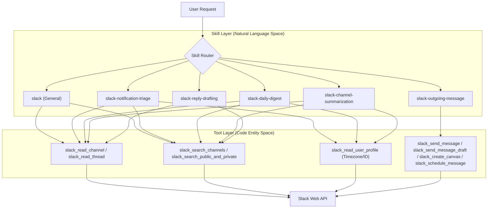
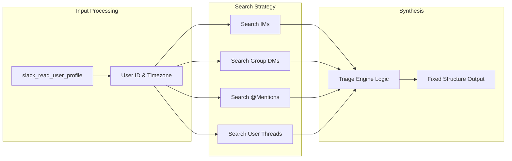

<!-- source: DeepWiki mcp.deepwiki.com · repo openai/plugins · page 3.2 Slack Plugin · fetched 2026-10-26 -->

# Slack Plugin

<details>
<summary>Relevant source files</summary>

The following files were used as context for generating this wiki page:

- [plugins/canva/.codex-plugin/plugin.json](plugins/canva/.codex-plugin/plugin.json)
- [plugins/gmail/.codex-plugin/plugin.json](plugins/gmail/.codex-plugin/plugin.json)
- [plugins/slack/.app.json](plugins/slack/.app.json)
- [plugins/slack/.codex-plugin/plugin.json](plugins/slack/.codex-plugin/plugin.json)
- [plugins/slack/skills/slack-channel-summarization/SKILL.md](plugins/slack/skills/slack-channel-summarization/SKILL.md)
- [plugins/slack/skills/slack-channel-summarization/agents/openai.yaml](plugins/slack/skills/slack-channel-summarization/agents/openai.yaml)
- [plugins/slack/skills/slack-channel-summarization/assets/slack-small.svg](plugins/slack/skills/slack-channel-summarization/assets/slack-small.svg)
- [plugins/slack/skills/slack-channel-summarization/assets/slack.png](plugins/slack/skills/slack-channel-summarization/assets/slack.png)
- [plugins/slack/skills/slack-daily-digest/SKILL.md](plugins/slack/skills/slack-daily-digest/SKILL.md)
- [plugins/slack/skills/slack-daily-digest/agents/openai.yaml](plugins/slack/skills/slack-daily-digest/agents/openai.yaml)
- [plugins/slack/skills/slack-daily-digest/assets/slack-small.svg](plugins/slack/skills/slack-daily-digest/assets/slack-small.svg)
- [plugins/slack/skills/slack-daily-digest/assets/slack.png](plugins/slack/skills/slack-daily-digest/assets/slack.png)
- [plugins/slack/skills/slack-notification-triage/SKILL.md](plugins/slack/skills/slack-notification-triage/SKILL.md)
- [plugins/slack/skills/slack-notification-triage/agents/openai.yaml](plugins/slack/skills/slack-notification-triage/agents/openai.yaml)
- [plugins/slack/skills/slack-notification-triage/assets/slack-small.svg](plugins/slack/skills/slack-notification-triage/assets/slack-small.svg)
- [plugins/slack/skills/slack-notification-triage/assets/slack.png](plugins/slack/skills/slack-notification-triage/assets/slack.png)
- [plugins/slack/skills/slack-outgoing-message/SKILL.md](plugins/slack/skills/slack-outgoing-message/SKILL.md)
- [plugins/slack/skills/slack-outgoing-message/agents/openai.yaml](plugins/slack/skills/slack-outgoing-message/agents/openai.yaml)
- [plugins/slack/skills/slack-outgoing-message/assets/slack-small.svg](plugins/slack/skills/slack-outgoing-message/assets/slack-small.svg)
- [plugins/slack/skills/slack-reply-drafting/SKILL.md](plugins/slack/skills/slack-reply-drafting/SKILL.md)
- [plugins/slack/skills/slack-reply-drafting/agents/openai.yaml](plugins/slack/skills/slack-reply-drafting/agents/openai.yaml)
- [plugins/slack/skills/slack/SKILL.md](plugins/slack/skills/slack/SKILL.md)
- [plugins/slack/skills/slack/agents/openai.yaml](plugins/slack/skills/slack/agents/openai.yaml)
- [plugins/slack/skills/slack/references/markdown.md](plugins/slack/skills/slack/references/markdown.md)

</details>


The Slack plugin provides a comprehensive suite of skills for reading, summarizing, and interacting with Slack workspaces. It is designed to handle high-volume communication by providing specialized engines for triage, daily digests, and channel-specific summarization while maintaining strict **Write Safety** and formatting standards for outgoing messages.

## 1. Plugin Architecture

The Slack plugin is an app-backed connector defined in `plugins/slack/.codex-plugin/plugin.json` [plugins/slack/.codex-plugin/plugin.json:1-41](). It leverages the `.app.json` pattern for OAuth-based authentication [plugins/slack/.codex-plugin/plugin.json:19]().

### Skill Handoff Pattern
A core architectural principle of this plugin is the separation of **Read/Analysis** from **Write/Composition**. While skills like `slack-channel-summarization` or `slack-daily-digest` gather and process data, any task resulting in outgoing text is instructed to hand off to the `slack-outgoing-message` skill to ensure final formatting and safety checks are applied [plugins/slack/skills/slack/SKILL.md:10-11](), [plugins/slack/skills/slack-outgoing-message/SKILL.md:10-11]().

### Data Flow: Natural Language to Tool Execution
The following diagram illustrates how a user request flows through the Slack skills into the underlying Tool Layer.

**Diagram: Slack Skill Execution Flow**

**Sources:** [plugins/slack/skills/slack/SKILL.md:15-21](), [plugins/slack/skills/slack-notification-triage/SKILL.md:15-30](), [plugins/slack/skills/slack-outgoing-message/SKILL.md:1-4](), [plugins/slack/skills/slack-outgoing-message/SKILL.md:40-43]()

---

## 2. Core Skills

The plugin implements six distinct skills, each with a specialized prompt and workflow.

| Skill | Purpose | Key Tools Used |
| :--- | :--- | :--- |
| `slack` | General entry point for thread summaries and post drafting. | `slack_read_channel`, `slack_read_thread` |
| `slack-outgoing-message` | Final composition and safety gate for all outbound text. | `slack_send_message_draft`, `slack_send_message`, `slack_schedule_message` |
| `slack-notification-triage` | Personal priority queue for the user. | `slack_search_public_and_private`, `slack_read_user_profile` |
| `slack-daily-digest` | Recaps activity across multiple channels/topics. | `slack_read_channel`, `slack_read_user_profile` |
| `slack-channel-summarization` | Deep dive into a single channel's activity. | `slack_search_channels`, `slack_create_canvas` |
| `slack-reply-drafting` | Identifies messages needing response and drafts them. | `slack_read_thread`, `slack_search_public_and_private` |

**Sources:** [plugins/slack/skills/slack/agents/openai.yaml:7](), [plugins/slack/skills/slack-outgoing-message/agents/openai.yaml:7](), [plugins/slack/skills/slack-notification-triage/SKILL.md:15-30](), [plugins/slack/skills/slack-daily-digest/SKILL.md:15-20](), [plugins/slack/skills/slack-channel-summarization/SKILL.md:22-26](), [plugins/slack/skills/slack-reply-drafting/SKILL.md:33-45]()

---

## 3. The Triage and Digest Engines

The plugin features specialized logic for processing high-volume data into structured summaries.

### Triage Engine (`slack-notification-triage`)
This engine prioritizes messages directed at the user. It resolves the user's identity via `slack_read_user_profile` and performs a multi-stage search [plugins/slack/skills/slack-notification-triage/SKILL.md:17-23]():
1. **Unanswered DMs:** Searches `channel_types="im"`.
2. **Unanswered Group DMs:** Searches `channel_types="mpim"`.
3. **Mentions:** Searches for `<@USER_ID>`.
4. **Participated Threads:** Searches `from:<@USER_ID> is:thread`.

### Digest Generator (`slack-daily-digest`)
Generates recaps based on topics or channels. It uses the user's timezone to calculate "today" and filters for high-signal events like blockers, incidents, and ownership changes [plugins/slack/skills/slack-daily-digest/SKILL.md:18-21]().

**Diagram: Triage Data Aggregation**

**Sources:** [plugins/slack/skills/slack-notification-triage/SKILL.md:15-33]()

---

## 4. Write Safety and Guardrails

The `slack-outgoing-message` skill enforces "Write Safety" to prevent accidental mass notifications or data overwrites.

### Guardrail Rules:
*   **Draft-First Policy:** The system defaults to `slack_send_message_draft` only when the user explicitly asks for a draft or review-first workflow. Direct write actions are performed if the user asks to "send" or "post" [plugins/slack/skills/slack-outgoing-message/SKILL.md:15-16]().
*   **Draft Overwrite Protection:** If `slack_send_message_draft` returns `draft_already_exists`, the skill stops and informs the user rather than attempting to force an update [plugins/slack/skills/slack-outgoing-message/SKILL.md:53]().
*   **High-Impact Warnings:** Explicit warnings must be issued before using broad mentions like `@channel`, `@here`, or `@everyone` [plugins/slack/skills/slack-outgoing-message/SKILL.md:59]().
*   **Membership Validation:** If the user wants to tag someone not currently in the destination channel, the skill must warn the user that the person will not be notified [plugins/slack/skills/slack-outgoing-message/SKILL.md:58]().
*   **Parameter Guardrails:** The `thread_ts` parameter is valid only for replies in an existing thread and must be omitted for new posts or DMs [plugins/slack/skills/slack-outgoing-message/SKILL.md:49]().
*   **Rate Limiting:** Tools are bucketed into `search`, `read`, and `write` categories. If a 429 is received, the system follows `Retry-After` headers or applies exponential backoff [plugins/slack/skills/slack/SKILL.md:44-48]().

**Sources:** [plugins/slack/skills/slack-outgoing-message/SKILL.md:46-66](), [plugins/slack/skills/slack/SKILL.md:44-48]()

---

## 5. Formatting and Markdown Rules

The Slack plugin adheres to strict `mrkdwn` formatting rules to ensure messages render correctly in the Slack UI. These rules are centralized in `plugins/slack/skills/slack/references/markdown.md` [plugins/slack/skills/slack/SKILL.md:27]().

### Core Formatting Requirements:
*   **Mentions:** Must use the syntax `<@U123456>` for users and `<!subteam^S123456>` for user groups [plugins/slack/skills/slack-outgoing-message/SKILL.md:63-64]().
*   **Channels:** Resolved channels should be rendered as `<#CHANNEL_ID>` to make them clickable [plugins/slack/skills/slack-daily-digest/SKILL.md:22]().
*   **Structure:** Summaries must follow a rigid Markdown structure with headers like `**Overview**`, `**Tasks for you**`, and `**Notes**` [plugins/slack/skills/slack-notification-triage/SKILL.md:43-59](), [plugins/slack/skills/slack-daily-digest/SKILL.md:34-56]().

### Summary Output Contract
```md
**Channel Summary - <channel>**
**Overview**
<1-2 sentence summary>

**Topic: <topic 1>**
- Bullet 1
- Bullet 2

**Notes**
- <gaps or caveats>
```
**Sources:** [plugins/slack/skills/slack-channel-summarization/SKILL.md:44-59](), [plugins/slack/skills/slack-outgoing-message/SKILL.md:28-35]()

---

