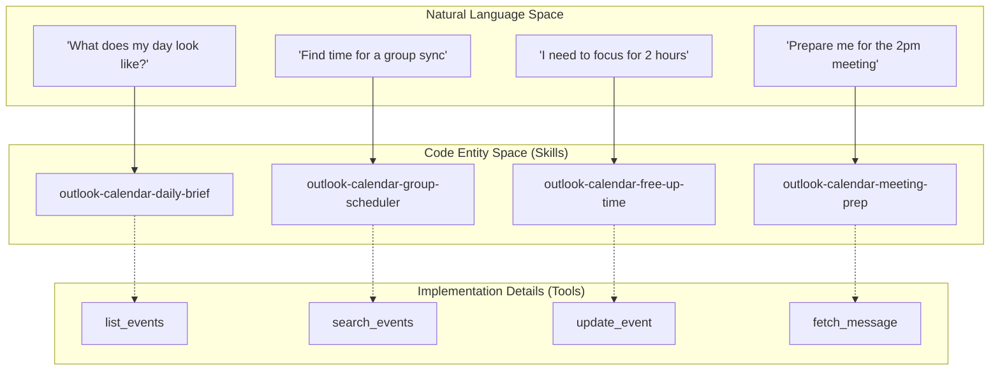
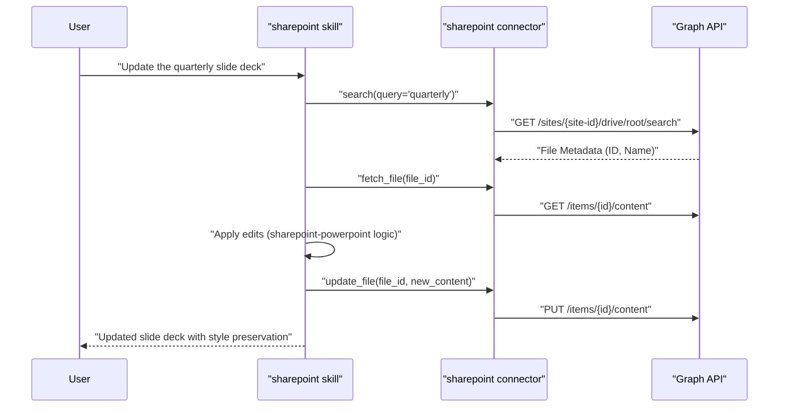

<!-- source: DeepWiki mcp.deepwiki.com · repo openai/plugins · page 3.3 Microsoft 365 Plugins (Outlook, Teams, SharePoint) · fetched 2026-10-26 -->

# Microsoft 365 Plugins (Outlook, Teams, SharePoint)

Relevant source files

The following files were used as context for generating this wiki page:

- [plugins/gmail/skills/gmail/SKILL.md](plugins/gmail/skills/gmail/SKILL.md)
- [plugins/gmail/skills/gmail/evals/evals.json](plugins/gmail/skills/gmail/evals/evals.json)
- [plugins/gmail/skills/gmail/references/pasted-link-workflow.md](plugins/gmail/skills/gmail/references/pasted-link-workflow.md)
- [plugins/gmail/skills/gmail/references/reply-workflow.md](plugins/gmail/skills/gmail/references/reply-workflow.md)
- [plugins/gmail/skills/gmail/references/self-delivery.md](plugins/gmail/skills/gmail/references/self-delivery.md)
- [plugins/outlook-calendar/.codex-plugin/plugin.json](plugins/outlook-calendar/.codex-plugin/plugin.json)
- [plugins/outlook-calendar/skills/outlook-calendar-daily-brief/SKILL.md](plugins/outlook-calendar/skills/outlook-calendar-daily-brief/SKILL.md)
- [plugins/outlook-calendar/skills/outlook-calendar-free-up-time/SKILL.md](plugins/outlook-calendar/skills/outlook-calendar-free-up-time/SKILL.md)
- [plugins/outlook-calendar/skills/outlook-calendar-group-scheduler/SKILL.md](plugins/outlook-calendar/skills/outlook-calendar-group-scheduler/SKILL.md)
- [plugins/outlook-calendar/skills/outlook-calendar-meeting-prep/SKILL.md](plugins/outlook-calendar/skills/outlook-calendar-meeting-prep/SKILL.md)
- [plugins/outlook-calendar/skills/outlook-calendar/SKILL.md](plugins/outlook-calendar/skills/outlook-calendar/SKILL.md)
- [plugins/outlook-calendar/skills/outlook-calendar/agents/openai.yaml](plugins/outlook-calendar/skills/outlook-calendar/agents/openai.yaml)
- [plugins/outlook-calendar/skills/outlook-calendar/resources/availability-response.md](plugins/outlook-calendar/skills/outlook-calendar/resources/availability-response.md)
- [plugins/outlook-calendar/skills/outlook-calendar/resources/recurring-meetings.md](plugins/outlook-calendar/skills/outlook-calendar/resources/recurring-meetings.md)
- [plugins/outlook-calendar/skills/outlook-calendar/resources/reminder-planning.md](plugins/outlook-calendar/skills/outlook-calendar/resources/reminder-planning.md)
- [plugins/outlook-calendar/skills/outlook-calendar/resources/travel-coordination.md](plugins/outlook-calendar/skills/outlook-calendar/resources/travel-coordination.md)
- [plugins/outlook-email/skills/outlook-email-inbox-triage/SKILL.md](plugins/outlook-email/skills/outlook-email-inbox-triage/SKILL.md)
- [plugins/outlook-email/skills/outlook-email-inbox-triage/agents/openai.yaml](plugins/outlook-email/skills/outlook-email-inbox-triage/agents/openai.yaml)
- [plugins/outlook-email/skills/outlook-email-reply-drafting/SKILL.md](plugins/outlook-email/skills/outlook-email-reply-drafting/SKILL.md)
- [plugins/outlook-email/skills/outlook-email-reply-drafting/agents/openai.yaml](plugins/outlook-email/skills/outlook-email-reply-drafting/agents/openai.yaml)
- [plugins/outlook-email/skills/outlook-email-subscription-cleanup/SKILL.md](plugins/outlook-email/skills/outlook-email-subscription-cleanup/SKILL.md)
- [plugins/outlook-email/skills/outlook-email-subscription-cleanup/agents/openai.yaml](plugins/outlook-email/skills/outlook-email-subscription-cleanup/agents/openai.yaml)
- [plugins/outlook-email/skills/outlook-email-task-extraction/SKILL.md](plugins/outlook-email/skills/outlook-email-task-extraction/SKILL.md)
- [plugins/outlook-email/skills/outlook-email-task-extraction/agents/openai.yaml](plugins/outlook-email/skills/outlook-email-task-extraction/agents/openai.yaml)
- [plugins/outlook-email/skills/outlook-email/SKILL.md](plugins/outlook-email/skills/outlook-email/SKILL.md)
- [plugins/outlook-email/skills/outlook-email/agents/openai.yaml](plugins/outlook-email/skills/outlook-email/agents/openai.yaml)
- [plugins/sharepoint/skills/sharepoint-powerpoint/SKILL.md](plugins/sharepoint/skills/sharepoint-powerpoint/SKILL.md)
- [plugins/sharepoint/skills/sharepoint-powerpoint/agents/openai.yaml](plugins/sharepoint/skills/sharepoint-powerpoint/agents/openai.yaml)
- [plugins/sharepoint/skills/sharepoint-shared-doc-maintenance/SKILL.md](plugins/sharepoint/skills/sharepoint-shared-doc-maintenance/SKILL.md)
- [plugins/sharepoint/skills/sharepoint-shared-doc-maintenance/agents/openai.yaml](plugins/sharepoint/skills/sharepoint-shared-doc-maintenance/agents/openai.yaml)
- [plugins/sharepoint/skills/sharepoint-spreadsheet-formula-builder/SKILL.md](plugins/sharepoint/skills/sharepoint-spreadsheet-formula-builder/SKILL.md)
- [plugins/sharepoint/skills/sharepoint-spreadsheet-formula-builder/agents/openai.yaml](plugins/sharepoint/skills/sharepoint-spreadsheet-formula-builder/agents/openai.yaml)
- [plugins/sharepoint/skills/sharepoint-spreadsheet-formula-builder/references/formula-patterns.md](plugins/sharepoint/skills/sharepoint-spreadsheet-formula-builder/references/formula-patterns.md)
- [plugins/sharepoint/skills/sharepoint-spreadsheets/SKILL.md](plugins/sharepoint/skills/sharepoint-spreadsheets/SKILL.md)
- [plugins/sharepoint/skills/sharepoint-spreadsheets/agents/openai.yaml](plugins/sharepoint/skills/sharepoint-spreadsheets/agents/openai.yaml)
- [plugins/sharepoint/skills/sharepoint-word-docs/SKILL.md](plugins/sharepoint/skills/sharepoint-word-docs/SKILL.md)
- [plugins/sharepoint/skills/sharepoint-word-docs/agents/openai.yaml](plugins/sharepoint/skills/sharepoint-word-docs/agents/openai.yaml)
- [plugins/sharepoint/skills/sharepoint/SKILL.md](plugins/sharepoint/skills/sharepoint/SKILL.md)
- [plugins/teams/skills/teams-channel-summarization/SKILL.md](plugins/teams/skills/teams-channel-summarization/SKILL.md)
- [plugins/teams/skills/teams-channel-summarization/agents/openai.yaml](plugins/teams/skills/teams-channel-summarization/agents/openai.yaml)
- [plugins/teams/skills/teams-daily-digest/SKILL.md](plugins/teams/skills/teams-daily-digest/SKILL.md)
- [plugins/teams/skills/teams-daily-digest/agents/openai.yaml](plugins/teams/skills/teams-daily-digest/agents/openai.yaml)
- [plugins/teams/skills/teams-messages/SKILL.md](plugins/teams/skills/teams-messages/SKILL.md)
- [plugins/teams/skills/teams-messages/agents/openai.yaml](plugins/teams/skills/teams-messages/agents/openai.yaml)
- [plugins/teams/skills/teams-notification-triage/SKILL.md](plugins/teams/skills/teams-notification-triage/SKILL.md)
- [plugins/teams/skills/teams-notification-triage/agents/openai.yaml](plugins/teams/skills/teams-notification-triage/agents/openai.yaml)
- [plugins/teams/skills/teams-planner-task-management/SKILL.md](plugins/teams/skills/teams-planner-task-management/SKILL.md)
- [plugins/teams/skills/teams-planner-task-management/agents/openai.yaml](plugins/teams/skills/teams-planner-task-management/agents/openai.yaml)
- [plugins/teams/skills/teams-reply-drafting/SKILL.md](plugins/teams/skills/teams-reply-drafting/SKILL.md)
- [plugins/teams/skills/teams-reply-drafting/agents/openai.yaml](plugins/teams/skills/teams-reply-drafting/agents/openai.yaml)
- [plugins/teams/skills/teams/SKILL.md](plugins/teams/skills/teams/SKILL.md)
- [plugins/teams/skills/teams/agents/openai.yaml](plugins/teams/skills/teams/agents/openai.yaml)

The Microsoft 365 plugin suite provides deep integration with the Microsoft productivity ecosystem, enabling automated triage, drafting, and management across Outlook (Email and Calendar), Teams, and SharePoint. These plugins leverage specialized skills to handle high-stakes operations like scheduling, inbox cleanup, and document editing with specific "Write Safety" guardrails.

## 1. Outlook Email Plugin

The Outlook Email plugin focuses on transforming noisy inboxes into actionable summaries and drafts. It is architected to prefer "Read-before-Write" patterns to ensure context is preserved.

### Core Architecture and Triage
The plugin uses a hierarchical skill structure where `outlook-email` serves as the base entry point, delegating specific workflows to sub-skills.

| Workflow | Skill | Purpose |
| --- | --- | --- |
| Base Entry | `outlook-email` | Triage, search, thread summarization, and follow-up planning. [plugins/outlook-email/skills/outlook-email/SKILL.md:2-3]() |
| Triage | `outlook-email-inbox-triage` | Urgency ranking and reply-needed detection. [plugins/outlook-email/skills/outlook-email/SKILL.md:27-27]() |
| Drafting | `outlook-email-reply-drafting` | Drafting replies with "draft-first" safety. [plugins/outlook-email/skills/outlook-email/SKILL.md:28-28]() |
| Extraction | `outlook-email-task-extraction` | Extracting commitments and deadlines from threads. [plugins/outlook-email/skills/outlook-email/SKILL.md:29-29]() |
| Cleanup | `outlook-email-subscription-cleanup` | Newsletter management and unsubscription. [plugins/outlook-email/skills/outlook-email/SKILL.md:30-30]() |
| Shared | `outlook-email-shared-mailboxes` | Delegated mailbox reads and sends. [plugins/outlook-email/skills/outlook-email/SKILL.md:31-31]() |

### Outlook Reading and Writing Patterns
The plugin enforces a strict reading pattern to minimize token usage while maintaining accuracy:
1.  **Shortlist**: Use `list_messages` or `search_messages` to build the first-pass shortlist. [plugins/outlook-email/skills/outlook-email/SKILL.md:35-35]()
2.  **Expansion**: Use `fetch_message` or `fetch_messages_batch` only when full body content is required. [plugins/outlook-email/skills/outlook-email/SKILL.md:36-36]()
3.  **Drafting**: Outbound Outlook email writes are **plain-text only**. The system explicitly translates rich formatting requests into clear plain-text equivalents. [plugins/outlook-email/skills/outlook-email/SKILL.md:12-12]()
4.  **Unsubscribe**: For newsletter cleanup, the system inspects `get_unsubscribe_info` before attempting `unsubscribe_via_mailto`. [plugins/outlook-email/skills/outlook-email/SKILL.md:41-41]()

**Sources:** [plugins/outlook-email/skills/outlook-email/SKILL.md:1-80](), [plugins/outlook-email/skills/outlook-email-reply-drafting/SKILL.md:1-43]()

---

## 2. Outlook Calendar Plugin

The Calendar plugin manages scheduling, availability, and meeting preparation. It uses a timezone-aware logic to handle complex rescheduling and group coordination.

### Functional Mapping: Natural Language to Code Entities

This diagram maps user intent to the specific Skill entities and their associated tool logic.

**Title: Outlook Calendar Intent Mapping**

**Sources:** [plugins/outlook-calendar/skills/outlook-calendar/SKILL.md:19-23](), [plugins/outlook-calendar/skills/outlook-calendar/SKILL.md:70-75]()

### Scheduling Guardrails
*   **Grounding**: The system must read the mailbox profile context first to establish the user's locale and timezone. [plugins/outlook-calendar/skills/outlook-calendar/SKILL.md:43-43]()
*   **Conflict Resolution**: It must surface conflicts (overlaps, travel gaps, double bookings) before proposing a create or update. [plugins/outlook-calendar/skills/outlook-calendar/SKILL.md:50-50]()
*   **Write Confirmation**: Before any create or reschedule write, the model must restate the interpreted weekday, date, local clock time, and timezone. [plugins/outlook-calendar/skills/outlook-calendar/SKILL.md:64-64]()
*   **Specialized Logic**: Recurrence cadence is governed by `resources/recurring-meetings.md`, while travel logistics use `resources/travel-coordination.md`. [plugins/outlook-calendar/skills/outlook-calendar/SKILL.md:12-13]()

---

## 3. Microsoft Teams Plugin

The Teams plugin facilitates communication across chats and channels, along with task management via Microsoft Planner.

### Component Overview
The Teams integration is divided into specialized interfaces defined in `agents/openai.yaml` files and `SKILL.md` workflows:

| Interface | Code Entity (Skill Name) | Functionality |
| --- | --- | --- |
| **Messages** | `teams-messages` | Composing, routing, and sending chat/channel messages. [plugins/teams/skills/teams/SKILL.md:16-16]() |
| **Daily Digest** | `teams-daily-digest` | Building a daily digest across selected chats/channels. [plugins/teams/skills/teams/SKILL.md:18-18]() |
| **Notification Triage** | `teams-notification-triage` | Triage of mentions and unread noise. [plugins/teams/skills/teams/SKILL.md:20-20]() |
| **Channel Summarization**| `teams-channel-summarization`| Deep-dive into specific channel history. [plugins/teams/skills/teams/SKILL.md:17-17]() |
| **Reply Drafting** | `teams-reply-drafting` | Identifying messages needing response and drafting. [plugins/teams/skills/teams/SKILL.md:19-19]() |
| **Planner** | `teams-planner-task-management`| CRUD operations on Planner tasks from Teams. [plugins/teams/skills/teams/SKILL.md:21-21]() |

### DM Routing and Fallbacks
When creating new direct chats, the system uses `create_chat(chat_type='oneOnOne')`. If this fails due to contract mismatches, it falls back to creating a two-person `group` chat containing the caller and recipient. [plugins/teams/skills/teams/SKILL.md:46-47]()

**Sources:** [plugins/teams/skills/teams/SKILL.md:1-76](), [plugins/teams/skills/teams-planner-task-management/SKILL.md:1-48]()

---

## 4. SharePoint Plugin

The SharePoint plugin manages documents, spreadsheets, and presentations. It is designed to interact with the Office Open XML formats while maintaining document integrity.

### Skill Specialization
*   **PowerPoint (`sharepoint-powerpoint`)**: Edits decks while preserving existing slide styles and master layouts. [plugins/sharepoint/skills/sharepoint/SKILL.md:29-29]()
*   **Word Docs (`sharepoint-word-docs`)**: Handles document editing and content extraction while preserving `.docx` structure. [plugins/sharepoint/skills/sharepoint/SKILL.md:26-26]()
*   **Spreadsheets (`sharepoint-spreadsheets`)**: Edits workbooks; includes a specialized `sharepoint-spreadsheet-formula-builder` for design and repair. [plugins/sharepoint/skills/sharepoint/SKILL.md:27-28]()
*   **Discovery**: `sharepoint-site-discovery` resolves the correct site, library, or folder before file operations using `get_site` and `list_site_drives`. [plugins/sharepoint/skills/sharepoint/SKILL.md:25-39]()

### Data Flow: Document Interaction

**Title: SharePoint Document Processing Flow**

**Sources:** [plugins/sharepoint/skills/sharepoint/SKILL.md:33-68]()

---

## 5. Write Safety and Guardrails

Across all M365 plugins, a set of "Write Safety" rules are enforced to prevent destructive actions:

1.  **Draft-First**: For Outlook, the system defaults to creating drafts (`create_reply_draft`) rather than sending (`reply_to_email`) unless explicit intent is provided. [plugins/outlook-email/skills/outlook-email/SKILL.md:49-49]()
2.  **No Hallucination of Facts**: The model is forbidden from inventing meeting acceptance, availability, or status updates not established in the thread. [plugins/outlook-email/skills/outlook-email/SKILL.md:51-51]()
3.  **Recipient Validation**: When forwarding in Outlook, recipients must be passed as structured objects rather than raw strings. [plugins/outlook-email/skills/outlook-email/SKILL.md:58-58]()
4.  **Recurrence Safety**: Edits to recurring calendar series require explicit confirmation of scope (one instance vs. series). [plugins/outlook-calendar/skills/outlook-calendar/SKILL.md:53-53]()
5.  **Teams Mentions**: Real outbound mentions require structured mention inputs with exact Entra user IDs; plain `@name` text is insufficient. [plugins/teams/skills/teams/SKILL.md:38-38]()
6.  **SharePoint Verification**: After any write, the system re-fetches the file to verify content and fidelity (headings, spacing, theme). [plugins/sharepoint/skills/sharepoint/SKILL.md:61-64]()

**Sources:** [plugins/outlook-email/skills/outlook-email/SKILL.md:44-62](), [plugins/outlook-calendar/skills/outlook-calendar/SKILL.md:56-66](), [plugins/teams/skills/teams/SKILL.md:32-41](), [plugins/sharepoint/skills/sharepoint/SKILL.md:70-79]()

---

