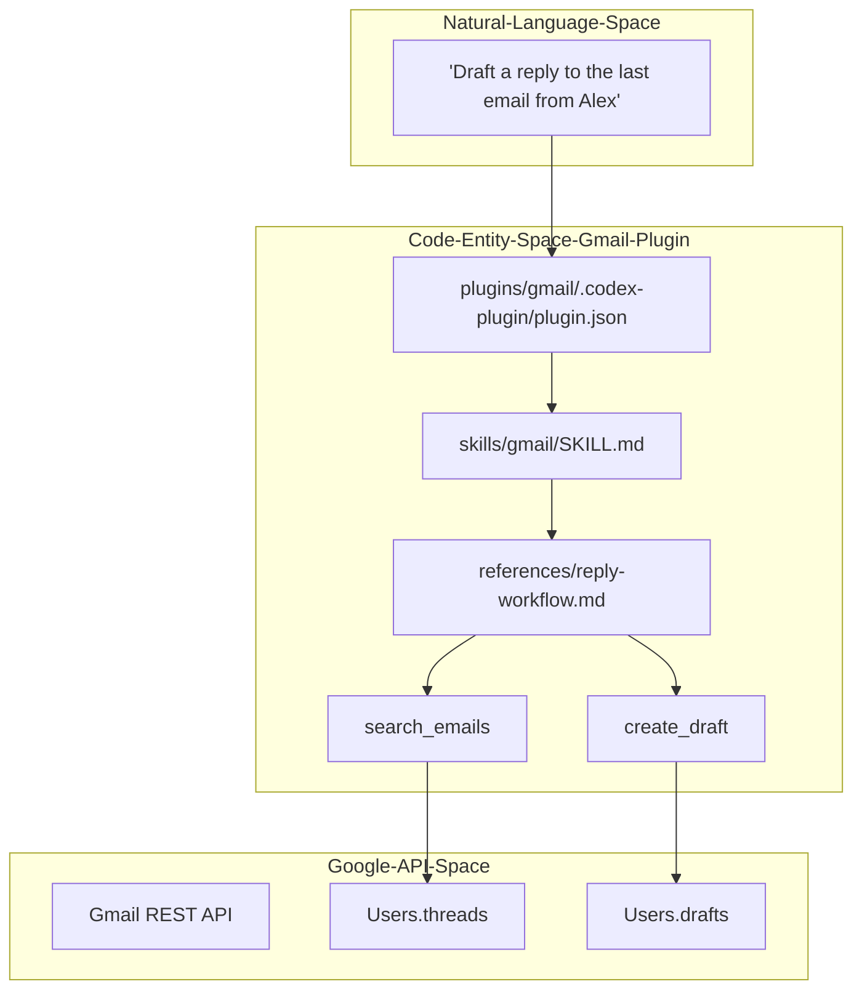
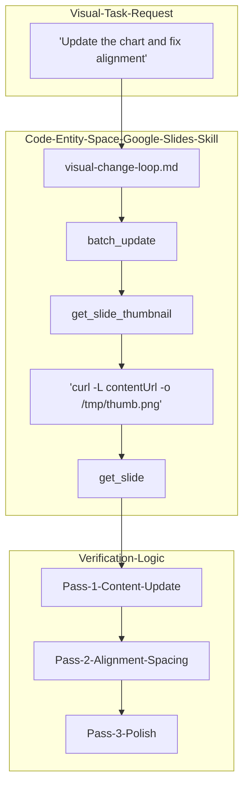

<!-- source: DeepWiki mcp.deepwiki.com · repo openai/plugins · page 3.4 Google Workspace Plugins (Gmail, Calendar, Drive, Docs, Sheets, Slides) · fetched 2026-10-26 -->

# Google Workspace Plugins (Gmail, Calendar, Drive, Docs, Sheets, Slides)

Relevant source files

The following files were used as context for generating this wiki page:

- [plugins/gmail/skills/gmail-inbox-triage/SKILL.md](plugins/gmail/skills/gmail-inbox-triage/SKILL.md)
- [plugins/gmail/skills/gmail-inbox-triage/agents/openai.yaml](plugins/gmail/skills/gmail-inbox-triage/agents/openai.yaml)
- [plugins/gmail/skills/gmail/SKILL.md](plugins/gmail/skills/gmail/SKILL.md)
- [plugins/gmail/skills/gmail/evals/evals.json](plugins/gmail/skills/gmail/evals/evals.json)
- [plugins/gmail/skills/gmail/references/forward-workflow.md](plugins/gmail/skills/gmail/references/forward-workflow.md)
- [plugins/gmail/skills/gmail/references/label-actions.md](plugins/gmail/skills/gmail/references/label-actions.md)
- [plugins/gmail/skills/gmail/references/pasted-link-workflow.md](plugins/gmail/skills/gmail/references/pasted-link-workflow.md)
- [plugins/gmail/skills/gmail/references/reply-workflow.md](plugins/gmail/skills/gmail/references/reply-workflow.md)
- [plugins/gmail/skills/gmail/references/search-workflow.md](plugins/gmail/skills/gmail/references/search-workflow.md)
- [plugins/gmail/skills/gmail/references/self-delivery.md](plugins/gmail/skills/gmail/references/self-delivery.md)
- [plugins/google-calendar/.app.json](plugins/google-calendar/.app.json)
- [plugins/google-calendar/.codex-plugin/plugin.json](plugins/google-calendar/.codex-plugin/plugin.json)
- [plugins/google-calendar/assets/icon.png](plugins/google-calendar/assets/icon.png)
- [plugins/google-calendar/assets/logo.png](plugins/google-calendar/assets/logo.png)
- [plugins/google-calendar/skills/google-calendar-daily-brief/SKILL.md](plugins/google-calendar/skills/google-calendar-daily-brief/SKILL.md)
- [plugins/google-calendar/skills/google-calendar-daily-brief/agents/openai.yaml](plugins/google-calendar/skills/google-calendar-daily-brief/agents/openai.yaml)
- [plugins/google-calendar/skills/google-calendar-daily-brief/scripts/render_day_brief.py](plugins/google-calendar/skills/google-calendar-daily-brief/scripts/render_day_brief.py)
- [plugins/google-calendar/skills/google-calendar-free-up-time/SKILL.md](plugins/google-calendar/skills/google-calendar-free-up-time/SKILL.md)
- [plugins/google-calendar/skills/google-calendar-free-up-time/agents/openai.yaml](plugins/google-calendar/skills/google-calendar-free-up-time/agents/openai.yaml)
- [plugins/google-calendar/skills/google-calendar-group-scheduler/SKILL.md](plugins/google-calendar/skills/google-calendar-group-scheduler/SKILL.md)
- [plugins/google-calendar/skills/google-calendar-group-scheduler/agents/openai.yaml](plugins/google-calendar/skills/google-calendar-group-scheduler/agents/openai.yaml)
- [plugins/google-calendar/skills/google-calendar-meeting-prep/SKILL.md](plugins/google-calendar/skills/google-calendar-meeting-prep/SKILL.md)
- [plugins/google-calendar/skills/google-calendar-meeting-prep/agents/openai.yaml](plugins/google-calendar/skills/google-calendar-meeting-prep/agents/openai.yaml)
- [plugins/google-calendar/skills/google-calendar/SKILL.md](plugins/google-calendar/skills/google-calendar/SKILL.md)
- [plugins/google-calendar/skills/google-calendar/agents/openai.yaml](plugins/google-calendar/skills/google-calendar/agents/openai.yaml)
- [plugins/google-drive/.codex-plugin/plugin.json](plugins/google-drive/.codex-plugin/plugin.json)
- [plugins/google-drive/skills/google-docs/SKILL.md](plugins/google-drive/skills/google-docs/SKILL.md)
- [plugins/google-drive/skills/google-docs/agents/openai.yaml](plugins/google-drive/skills/google-docs/agents/openai.yaml)
- [plugins/google-drive/skills/google-docs/references/reference-connector-runtime-and-safety.md](plugins/google-drive/skills/google-docs/references/reference-connector-runtime-and-safety.md)
- [plugins/google-drive/skills/google-docs/references/reference-direct-request-composition.md](plugins/google-drive/skills/google-docs/references/reference-direct-request-composition.md)
- [plugins/google-drive/skills/google-docs/references/reference-figures-and-image-insertion.md](plugins/google-drive/skills/google-docs/references/reference-figures-and-image-insertion.md)
- [plugins/google-drive/skills/google-docs/references/reference-foreground-guard.md](plugins/google-drive/skills/google-docs/references/reference-foreground-guard.md)
- [plugins/google-drive/skills/google-docs/references/reference-import-docx-to-native-docs.md](plugins/google-drive/skills/google-docs/references/reference-import-docx-to-native-docs.md)
- [plugins/google-drive/skills/google-docs/references/reference-native-create-direct.md](plugins/google-drive/skills/google-docs/references/reference-native-create-direct.md)
- [plugins/google-drive/skills/google-docs/references/reference-pdf-export-visual-qa.md](plugins/google-drive/skills/google-docs/references/reference-pdf-export-visual-qa.md)
- [plugins/google-drive/skills/google-docs/references/reference-request-shapes-and-write-safety.md](plugins/google-drive/skills/google-docs/references/reference-request-shapes-and-write-safety.md)
- [plugins/google-drive/skills/google-docs/references/reference-response-and-list-format.md](plugins/google-drive/skills/google-docs/references/reference-response-and-list-format.md)
- [plugins/google-drive/skills/google-docs/references/reference-section-completeness-and-final-pass.md](plugins/google-drive/skills/google-docs/references/reference-section-completeness-and-final-pass.md)
- [plugins/google-drive/skills/google-docs/references/reference-table-formatting-deep-dive.md](plugins/google-drive/skills/google-docs/references/reference-table-formatting-deep-dive.md)
- [plugins/google-drive/skills/google-drive-comments/SKILL.md](plugins/google-drive/skills/google-drive-comments/SKILL.md)
- [plugins/google-drive/skills/google-drive/SKILL.md](plugins/google-drive/skills/google-drive/SKILL.md)
- [plugins/google-drive/skills/google-drive/agents/openai.yaml](plugins/google-drive/skills/google-drive/agents/openai.yaml)
- [plugins/google-drive/skills/google-drive/references/slides/chart-refresh-workflows.md](plugins/google-drive/skills/google-drive/references/slides/chart-refresh-workflows.md)
- [plugins/google-drive/skills/google-drive/references/slides/deck-scope-verification.md](plugins/google-drive/skills/google-drive/references/slides/deck-scope-verification.md)
- [plugins/google-drive/skills/google-drive/references/slides/sheets-chart-replacement.md](plugins/google-drive/skills/google-drive/references/slides/sheets-chart-replacement.md)
- [plugins/google-drive/skills/google-drive/references/slides/visual-change-loop.md](plugins/google-drive/skills/google-drive/references/slides/visual-change-loop.md)
- [plugins/google-drive/skills/google-sheets/SKILL.md](plugins/google-drive/skills/google-sheets/SKILL.md)
- [plugins/google-drive/skills/google-sheets/references/reference-batch-update-recipes.md](plugins/google-drive/skills/google-sheets/references/reference-batch-update-recipes.md)
- [plugins/google-drive/skills/google-sheets/references/reference-import-spreadsheet-to-native-sheets.md](plugins/google-drive/skills/google-sheets/references/reference-import-spreadsheet-to-native-sheets.md)
- [plugins/google-drive/skills/google-sheets/references/reference-live-read-search-safety.md](plugins/google-drive/skills/google-sheets/references/reference-live-read-search-safety.md)
- [plugins/google-drive/skills/google-sheets/references/style-profiles.md](plugins/google-drive/skills/google-sheets/references/style-profiles.md)
- [plugins/google-drive/skills/google-slides/SKILL.md](plugins/google-drive/skills/google-slides/SKILL.md)
- [plugins/google-drive/skills/google-slides/agents/openai.yaml](plugins/google-drive/skills/google-slides/agents/openai.yaml)
- [plugins/google-drive/skills/google-slides/references/reference-batch-update-recipes.md](plugins/google-drive/skills/google-slides/references/reference-batch-update-recipes.md)
- [plugins/google-drive/skills/google-slides/references/reference-chart-workflows.md](plugins/google-drive/skills/google-slides/references/reference-chart-workflows.md)
- [plugins/google-drive/skills/google-slides/references/reference-import-presentation.md](plugins/google-drive/skills/google-slides/references/reference-import-presentation.md)
- [plugins/google-drive/skills/google-slides/references/reference-new-deck-and-final-pass.md](plugins/google-drive/skills/google-slides/references/reference-new-deck-and-final-pass.md)
- [plugins/google-drive/skills/google-slides/references/reference-request-shapes-and-write-safety.md](plugins/google-drive/skills/google-slides/references/reference-request-shapes-and-write-safety.md)
- [plugins/google-drive/skills/google-slides/references/reference-slide-archetype-mapping.md](plugins/google-drive/skills/google-slides/references/reference-slide-archetype-mapping.md)
- [plugins/google-drive/skills/google-slides/references/reference-template-migration.md](plugins/google-drive/skills/google-slides/references/reference-template-migration.md)
- [plugins/google-drive/skills/google-slides/references/reference-template-reference-deck-copy-workflow.md](plugins/google-drive/skills/google-slides/references/reference-template-reference-deck-copy-workflow.md)
- [plugins/google-drive/skills/google-slides/references/reference-thumbnail-visual-verification.md](plugins/google-drive/skills/google-slides/references/reference-thumbnail-visual-verification.md)
- [plugins/google-drive/skills/google-slides/references/reference-visual-iteration.md](plugins/google-drive/skills/google-slides/references/reference-visual-iteration.md)
- [plugins/outlook-email/skills/outlook-email-reply-drafting/SKILL.md](plugins/outlook-email/skills/outlook-email-reply-drafting/SKILL.md)
- [plugins/outlook-email/skills/outlook-email/SKILL.md](plugins/outlook-email/skills/outlook-email/SKILL.md)

The Google Workspace suite provides a deep integration into productivity workflows, enabling automated inbox management, calendar scheduling, and collaborative document editing. These plugins are built as **App Connectors**, leveraging OAuth-based authentication defined in `.app.json` files to interact with Google's REST APIs [plugins/google-drive/.codex-plugin/plugin.json:21-21]().

## Gmail Plugin

The Gmail plugin focuses on turning high-volume email traffic into actionable intelligence. It supports complex search queries, thread summarization, and safe drafting of replies and forwards [plugins/gmail/skills/gmail/SKILL.md:3-4]().

### Technical Implementation and Data Flow
Gmail interactions follow a "Read-Analyze-Draft" pattern. The plugin prioritizes `search_emails` over `search_email_ids` because the former returns message-level summaries in a single round-trip [plugins/gmail/skills/gmail/SKILL.md:41-42]().

### Gmail Search and Triage Logic
The plugin utilizes Gmail's native query syntax (e.g., `label:foo`, `in:anywhere`) to filter messages [plugins/gmail/skills/gmail/SKILL.md:44-45](). Triage is performed by scanning the most recent messages and categorizing them into buckets: `urgent`, `waiting`, and `FYI` [plugins/gmail/skills/gmail/SKILL.md:60-61](). Common system labels like `INBOX`, `STARRED`, and `UNREAD` are passed as a `list[str]` in the `tags` parameter [plugins/gmail/skills/gmail/SKILL.md:43-45]().

### Reply and Forward Workflow
Drafting is the default behavior for all write requests unless "send" is explicitly authorized [plugins/gmail/skills/gmail/SKILL.md:53-54]().
*   **Tone Matching:** The system inspects the latest message to match formality and warmth [plugins/gmail/skills/gmail/SKILL.md:32-32]().
*   **Reply-All Logic:** The plugin does not default to reply-all; it evaluates if the response materially affects the wider recipient set [plugins/gmail/skills/gmail/SKILL.md:55-56]().
*   **Forwarding:** Requires identifying a unique source message and recipient before execution [plugins/gmail/skills/gmail/SKILL.md:33-33]().

**Sources:** [plugins/gmail/skills/gmail/SKILL.md:1-80](), [plugins/gmail/skills/gmail/references/reply-workflow.md:1-36]()

---

## Google Calendar Plugin

The Google Calendar plugin manages schedules, checks availability, and prepares users for meetings [plugins/google-calendar/skills/google-calendar/SKILL.md:2-3]().

### Core Capabilities
*   **Daily Brief:** Summarizes the day's agenda, highlighting conflicts and free windows [plugins/google-calendar/skills/google-calendar-daily-brief/SKILL.md:2-3]().
*   **Group Scheduler:** Compares multiple calendars to find optimal meeting times [plugins/google-calendar/skills/google-calendar-group-scheduler/SKILL.md:2-3]().
*   **Meeting Prep:** Gathers context for upcoming events by inspecting event payloads, descriptions, and attachments [plugins/google-calendar/skills/google-calendar/SKILL.md:33-33]().

### Write Safety and Recurring Events
For recurring series, the plugin must read the master series details before editing. It uses `update_event` with an `update_scope` set to `this_instance`, `entire_series`, or `this_and_following` [plugins/google-calendar/skills/google-calendar/SKILL.md:29-30](). For reminder writes, it prefers the structured `reminders` object with `use_default` and `overrides` [plugins/google-calendar/skills/google-calendar/SKILL.md:42-42]().

### Calendar Data Flow: Natural Language to Code Entities

| User Intent | Code Skill / Function | Target API Entity |
| :--- | :--- | :--- |
| "What's my day look like?" | `google-calendar-daily-brief` | `Events.list` |
| "Find time for us to meet" | `google-calendar-group-scheduler` | `Freebusy.query` |
| "Cancel my afternoon" | `google-calendar-free-up-time` | `Events.delete` / `Events.patch` |
| "Add a 1-hour reminder" | `update_event` | `reminders` object [plugins/google-calendar/skills/google-calendar/SKILL.md:42-42]() |

**Sources:** [plugins/google-calendar/.codex-plugin/plugin.json:1-44](), [plugins/google-calendar/skills/google-calendar/SKILL.md:1-66](), [plugins/google-calendar/skills/google-calendar-daily-brief/agents/openai.yaml:1-6]()

---

## Google Drive and Editors (Docs, Sheets, Slides)

The Google Drive plugin serves as a unified entry point for all Workspace file work [plugins/google-drive/skills/google-drive/SKILL.md:3-4](). It handles file discovery, lifecycle tasks (move, copy, delete), and revision history [plugins/google-drive/skills/google-drive/SKILL.md:18-22]().

### Google Docs: Local-to-Native Workflow
For net-new Google Docs, the plugin uses a specialized routing:
1.  **Local Creation:** Uses `[@documents](plugin://documents@openai-primary-runtime)` to create a local `.docx` file first for polished deliverables [plugins/google-drive/skills/google-docs/SKILL.md:29-29]().
2.  **Import:** Uploads and converts the `.docx` to a native Google Doc using `upload_mode: "native_google_docs"` [plugins/google-drive/skills/google-docs/SKILL.md:29-29]().
3.  **Existing Edits:** Uses the Google Docs connector for index-aware `batchUpdate` requests [plugins/google-drive/skills/google-docs/SKILL.md:28-28]().

### Google Sheets: Range Precision and Import
Similar to Docs, new Sheets are created as local `.xlsx` files via the `[@spreadsheets](plugin://spreadsheets@openai-primary-runtime)` plugin before being imported to Drive [plugins/google-drive/skills/google-sheets/SKILL.md:24-25]().
*   **Formula Building:** The plugin follows `references/reference-formula-patterns.md` for design and repair [plugins/google-drive/skills/google-sheets/SKILL.md:87-87]().
*   **Chart Creation:** Uses `references/reference-chart-recipes.md` for creation and repositioning [plugins/google-drive/skills/google-sheets/SKILL.md:88-88]().

### Google Slides: Visual Iteration Loop
Slides workflows rely on a **Visual Change Loop** to ensure presentation-ready output [plugins/google-drive/skills/google-drive/references/slides/visual-change-loop.md:1-3]().
*   **Verification:** After a write, the plugin MUST fetch a `LARGE` thumbnail and curl the `contentUrl` to a local PNG for inspection [plugins/google-drive/skills/google-slides/SKILL.md:54-55]().
*   **Linked Charts:** The plugin identifies linked chart metadata. If found, it uses `batch_update` to refresh the chart object ID [plugins/google-drive/skills/google-drive/references/slides/chart-refresh-workflows.md:24-26]().
*   **Template Migration:** Uses `references/reference-template-reference-deck-copy-workflow.md` to copy and update existing native decks [plugins/google-drive/skills/google-slides/SKILL.md:35-35]().

**Sources:** [plugins/google-drive/skills/google-drive/SKILL.md:1-58](), [plugins/google-drive/skills/google-docs/SKILL.md:1-80](), [plugins/google-drive/skills/google-sheets/SKILL.md:1-89](), [plugins/google-drive/skills/google-slides/SKILL.md:1-90](), [plugins/google-drive/skills/google-drive/references/slides/visual-change-loop.md:1-72]()

---

## Architecture: Workspace Integration Diagram

This diagram illustrates how Natural Language requests are routed through the Plugin Manifest to specific Skill implementations and their corresponding Google API calls.

**Sources:** [plugins/gmail/skills/gmail/SKILL.md:1-80](), [plugins/gmail/skills/gmail/references/reply-workflow.md:1-36]()

---

## Code Entity Mapping: Slides Visual Loop

This diagram maps the visual verification requirements from the `google-slides` skill to the underlying code operations.

**Sources:** [plugins/google-drive/skills/google-drive/references/slides/visual-change-loop.md:1-72](), [plugins/google-drive/skills/google-slides/SKILL.md:54-56]()

---

## Common Batch Update Patterns (Sheets & Docs)

Both Sheets and Docs rely on structured batch updates rather than simple `PUT` requests to ensure atomicity and preserve formatting.

| Request Type | Plugin | Use Case | Key Parameters |
| :--- | :--- | :--- | :--- |
| `updateCells` | Sheets | Writing data/formulas | `range`, `rows`, `fields: 'userEnteredValue'` |
| `repeatCell` | Sheets | Formatting a header | `range`, `cell.userEnteredFormat` |
| `insertText` | Docs | Adding content | `location.index`, `text` |
| `updateTextStyle` | Docs | Bold/Italic/Link | `range`, `textStyle`, `fields` |
| `refreshSheetsChart` | Slides | Data synchronization | `chartId` [plugins/google-drive/skills/google-drive/references/slides/chart-refresh-workflows.md:26-26]() |

**Sources:** [plugins/google-drive/skills/google-sheets/references/reference-batch-update-recipes.md:1-150](), [plugins/google-drive/skills/google-docs/SKILL.md:28-28](), [plugins/google-drive/skills/google-drive/references/slides/chart-refresh-workflows.md:1-60]()

---

