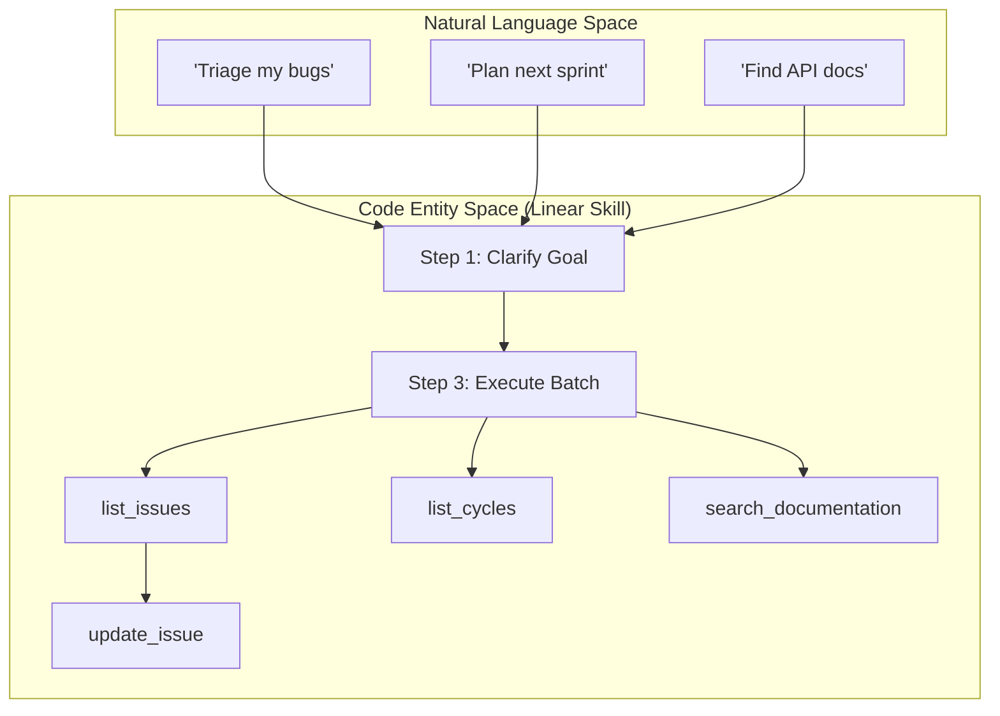
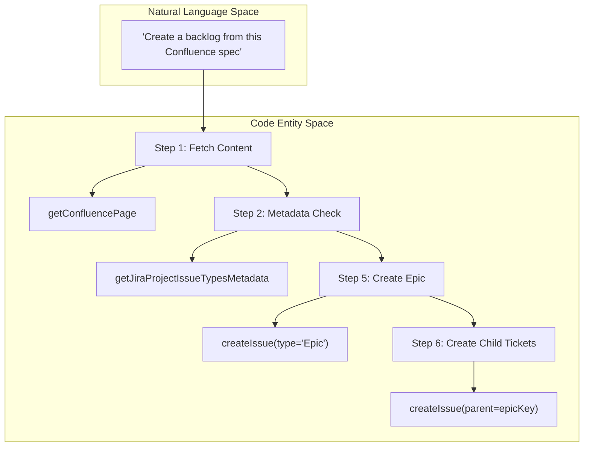
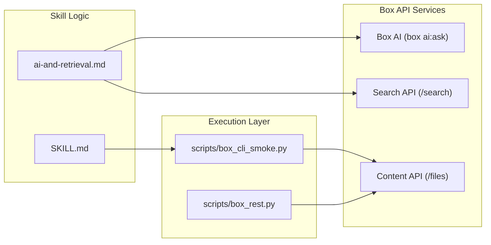

<!-- source: DeepWiki mcp.deepwiki.com · repo openai/plugins · page 3.5 Project Management Plugins (Linear, Atlassian Rovo, Box) · fetched 2026-10-26 -->

# Project Management Plugins (Linear, Atlassian Rovo, Box)

Relevant source files

The following files were used as context for generating this wiki page:

- [plugins/atlassian-rovo/skills/capture-tasks-from-meeting-notes/SKILL.md](plugins/atlassian-rovo/skills/capture-tasks-from-meeting-notes/SKILL.md)
- [plugins/atlassian-rovo/skills/capture-tasks-from-meeting-notes/references/action-item-patterns.md](plugins/atlassian-rovo/skills/capture-tasks-from-meeting-notes/references/action-item-patterns.md)
- [plugins/atlassian-rovo/skills/generate-status-report/SKILL.md](plugins/atlassian-rovo/skills/generate-status-report/SKILL.md)
- [plugins/atlassian-rovo/skills/generate-status-report/references/jql-patterns.md](plugins/atlassian-rovo/skills/generate-status-report/references/jql-patterns.md)
- [plugins/atlassian-rovo/skills/generate-status-report/references/report-templates.md](plugins/atlassian-rovo/skills/generate-status-report/references/report-templates.md)
- [plugins/atlassian-rovo/skills/generate-status-report/scripts/jql_builder.py](plugins/atlassian-rovo/skills/generate-status-report/scripts/jql_builder.py)
- [plugins/atlassian-rovo/skills/search-company-knowledge/SKILL.md](plugins/atlassian-rovo/skills/search-company-knowledge/SKILL.md)
- [plugins/atlassian-rovo/skills/spec-to-backlog/SKILL.md](plugins/atlassian-rovo/skills/spec-to-backlog/SKILL.md)
- [plugins/atlassian-rovo/skills/spec-to-backlog/references/breakdown-examples.md](plugins/atlassian-rovo/skills/spec-to-backlog/references/breakdown-examples.md)
- [plugins/atlassian-rovo/skills/spec-to-backlog/references/epic-templates.md](plugins/atlassian-rovo/skills/spec-to-backlog/references/epic-templates.md)
- [plugins/box/.app.json](plugins/box/.app.json)
- [plugins/box/.codex-plugin/plugin.json](plugins/box/.codex-plugin/plugin.json)
- [plugins/box/assets/box-small.svg](plugins/box/assets/box-small.svg)
- [plugins/box/assets/box.svg](plugins/box/assets/box.svg)
- [plugins/box/skills/box/README.md](plugins/box/skills/box/README.md)
- [plugins/box/skills/box/SKILL.md](plugins/box/skills/box/SKILL.md)
- [plugins/box/skills/box/agents/openai.yaml](plugins/box/skills/box/agents/openai.yaml)
- [plugins/box/skills/box/examples/box-content-api-prompts.md](plugins/box/skills/box/examples/box-content-api-prompts.md)
- [plugins/box/skills/box/references/ai-and-retrieval.md](plugins/box/skills/box/references/ai-and-retrieval.md)
- [plugins/box/skills/box/references/auth-and-setup.md](plugins/box/skills/box/references/auth-and-setup.md)
- [plugins/box/skills/box/references/box-cli.md](plugins/box/skills/box/references/box-cli.md)
- [plugins/box/skills/box/references/troubleshooting.md](plugins/box/skills/box/references/troubleshooting.md)
- [plugins/linear/.app.json](plugins/linear/.app.json)
- [plugins/linear/.codex-plugin/plugin.json](plugins/linear/.codex-plugin/plugin.json)
- [plugins/linear/.mcp.json](plugins/linear/.mcp.json)
- [plugins/linear/skills/linear/LICENSE.txt](plugins/linear/skills/linear/LICENSE.txt)
- [plugins/linear/skills/linear/SKILL.md](plugins/linear/skills/linear/SKILL.md)
- [plugins/linear/skills/linear/agents/openai.yaml](plugins/linear/skills/linear/agents/openai.yaml)
- [plugins/linear/skills/linear/assets/linear-small.svg](plugins/linear/skills/linear/assets/linear-small.svg)
- [plugins/linear/skills/linear/assets/linear.png](plugins/linear/skills/linear/assets/linear.png)
- [plugins/motherduck/.app.json](plugins/motherduck/.app.json)
- [plugins/motherduck/.codex-plugin/plugin.json](plugins/motherduck/.codex-plugin/plugin.json)

This section documents the integration and implementation details for project management and content collaboration plugins. These plugins enable structured workflows for issue tracking (Linear), enterprise knowledge synthesis (Atlassian Rovo), and secure content lifecycle management (Box).

## Linear Plugin

The Linear plugin provides a comprehensive interface for managing issues, projects, and team workflows. It is built as an app-connector plugin, relying on OAuth-based authentication to interact with the Linear workspace.

### Core Architecture and Data Flow

The plugin follows a strictly tiered triage and planning pipeline. It utilizes the `asdk_app_69a089a326dc8191b32a3f2553f5be2c` identifier for its application connection [plugins/linear/.app.json:4-4](). It also connects to a dedicated MCP server at `https://mcp.linear.app/mcp` [plugins/linear/.mcp.json:5-6]().

**Linear Workflow Execution**
The `linear` skill [plugins/linear/skills/linear/SKILL.md:2-3]() enforces a 5-step execution model:

| Step | Action | Description |
| :--- | :--- | :--- |
| **0** | **Auth Check** | Verifies tool availability and prompts for OAuth if `list_issues` or similar tools are inaccessible [plugins/linear/skills/linear/SKILL.md:20-29](). |
| **1** | **Scope Definition** | Clarifies team/project identifiers and priority levels [plugins/linear/skills/linear/SKILL.md:30-32](). |
| **2** | **Workflow Selection** | Identifies specific tools needed (e.g., `list_cycles` for sprint planning) [plugins/linear/skills/linear/SKILL.md:33-35](). |
| **3** | **Execution** | Executes tool calls in logical batches: Read first (context), then Create/Update [plugins/linear/skills/linear/SKILL.md:36-41](). |
| **4** | **Summarization** | Proposes next actions and highlights blockers [plugins/linear/skills/linear/SKILL.md:42-44](). |

### Tool Categories
The plugin exposes tools across three functional domains [plugins/linear/skills/linear/SKILL.md:47-52]():
*   **Issue Management**: `list_issues`, `get_issue`, `create_issue`, `update_issue`, `list_my_issues`, `list_issue_statuses`, `list_issue_labels`, `create_issue_label`.
*   **Project & Team**: `list_projects`, `get_project`, `create_project`, `update_project`, `list_teams`, `get_team`, `list_users`.
*   **Documentation & Collaboration**: `list_documents`, `get_document`, `search_documentation`, `list_comments`, `create_comment`, `list_cycles`.

### Natural Language to Tool Mapping
The following diagram maps user intents to the underlying Linear toolset and execution logic.

**Linear Intent Mapping**

Sources: [plugins/linear/skills/linear/SKILL.md:30-64](), [plugins/linear/skills/linear/SKILL.md:47-52]()

---

## Atlassian Rovo Plugin

Atlassian Rovo focuses on knowledge synthesis and task generation across Jira and Confluence. It is designed to bridge the gap between documentation (specs) and execution (backlogs).

### Specialized Skills
The Rovo plugin implements four distinct skill sets:

1.  **Spec-to-Backlog**: Transforms high-level requirements or Confluence specs into actionable Jira issues and epics [plugins/atlassian-rovo/skills/spec-to-backlog/SKILL.md:2-4]().
2.  **Search Company Knowledge**: Unified search across the Atlassian ecosystem to find relevant documentation and historical context [plugins/atlassian-rovo/skills/search-company-knowledge/SKILL.md:1-1]().
3.  **Generate Status Report**: Aggregates Jira ticket data using JQL (Jira Query Language) to create executive summaries [plugins/atlassian-rovo/skills/generate-status-report/SKILL.md:1-1]().
4.  **Capture Tasks from Meeting Notes**: Parses meeting transcripts or notes to identify action items and sync them to Jira [plugins/atlassian-rovo/skills/capture-tasks-from-meeting-notes/SKILL.md:1-1]().

### Technical Implementation: JQL Builder
The status reporting capability utilizes a dedicated script, `jql_builder.py`, to dynamically construct queries for filtering issues. Key functions include `build_project_query` [plugins/atlassian-rovo/skills/generate-status-report/scripts/jql_builder.py:52-60]() and `build_risk_query` [plugins/atlassian-rovo/skills/generate-status-report/scripts/jql_builder.py:164-167]().

**Atlassian Rovo: Spec-to-Backlog Pipeline**

Sources: [plugins/atlassian-rovo/skills/spec-to-backlog/SKILL.md:14-25](), [plugins/atlassian-rovo/skills/spec-to-backlog/SKILL.md:53-60](), [plugins/atlassian-rovo/skills/spec-to-backlog/SKILL.md:85-91]()

---

## Box Plugin

The Box plugin (`box-content-api`) provides tools for building and troubleshooting Box integrations, including file uploads, metadata management, and AI-powered retrieval. It uses the application ID `asdk_app_695bfc98071c8191bac7bc479aa27de7` [plugins/box/.app.json:4-4]().

### Content Retrieval and AI Strategy
The Box plugin prioritizes server-side operations to minimize data transfer. It implements a "Search-First" strategy [plugins/box/skills/box/references/ai-and-retrieval.md:12-16]().

**Content Understanding Preference Order:**
1.  **Box AI (Q&A/Extract)**: Native server-side processing using commands like `box ai:ask` [plugins/box/skills/box/references/ai-and-retrieval.md:22-22](), [plugins/box/skills/box/references/ai-and-retrieval.md:47-51]().
2.  **Metadata Inspection**: Checking existing properties or templates [plugins/box/skills/box/references/ai-and-retrieval.md:23-23]().
3.  **Previews/Thumbnails**: Visual inspection without full download via `get_file_preview` [plugins/box/skills/box/references/ai-and-retrieval.md:24-24](), [plugins/box/skills/box/SKILL.md:59-59]().
4.  **Local Analysis**: OCR or parsing (last resort) [plugins/box/skills/box/references/ai-and-retrieval.md:25-25]().

### Verification and Troubleshooting
The plugin includes paths for debugging common failures such as 401/403 (Auth), 404 (Missing Object), and 429 (Rate Limits) [plugins/box/skills/box/references/troubleshooting.md:30-56]().
*   **CLI-First**: Uses `scripts/box_cli_smoke.py` to wrap the official Box CLI for local testing [plugins/box/skills/box/SKILL.md:16-16]().
*   **REST Fallback**: Uses `scripts/box_rest.py` for direct API interaction [plugins/box/skills/box/SKILL.md:42-42]().

**Box Content Workflow Architecture**

Sources: [plugins/box/skills/box/references/ai-and-retrieval.md:12-25](), [plugins/box/skills/box/SKILL.md:41-43]()

### Key Implementation Guardrails
*   **Idempotency**: Webhook and event consumers must be idempotent to handle duplicate deliveries [plugins/box/skills/box/SKILL.md:62-62]().
*   **Concurrency**: Box CLI commands must be run strictly one at a time to avoid auth conflicts [plugins/box/skills/box/SKILL.md:61-61]().
*   **AI Pacing**: Box AI calls should be paced at least 1–2 seconds apart to avoid rate limits [plugins/box/skills/box/references/ai-and-retrieval.md:73-75]().

Sources: [plugins/box/skills/box/SKILL.md:61-62](), [plugins/box/skills/box/references/ai-and-retrieval.md:73-75]()

---

