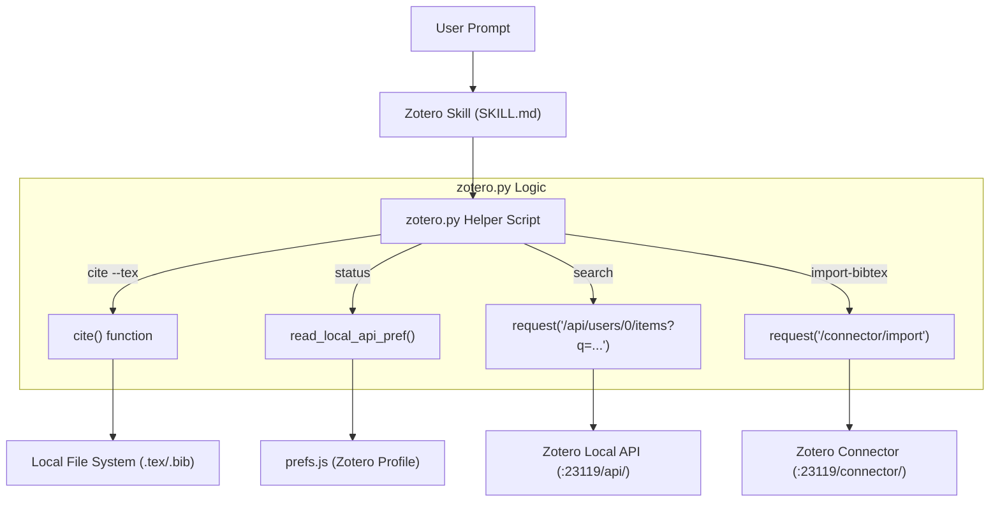
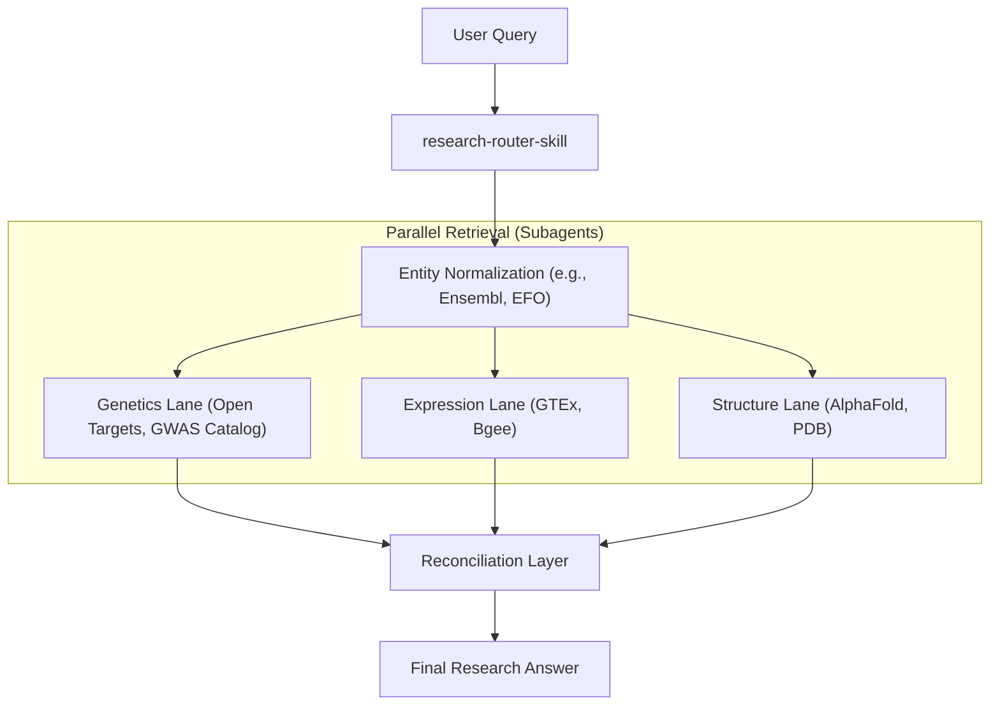
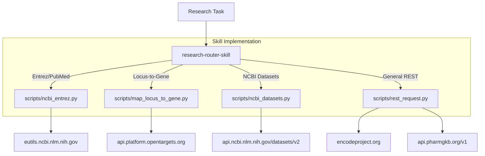

<!-- source: DeepWiki mcp.deepwiki.com · repo openai/plugins · page 3.6 Research and Reference Plugins (Zotero, Life Science Research, Boltz, NGS Analysis) · fetched 2026-10-26 -->

# Research and Reference Plugins (Zotero, Life Science Research, Boltz, NGS Analysis)

Relevant source files

The following files were used as context for generating this wiki page:

- [plugins/life-science-research/.codex-plugin/plugin.json](plugins/life-science-research/.codex-plugin/plugin.json)
- [plugins/life-science-research/README.md](plugins/life-science-research/README.md)
- [plugins/life-science-research/skills/encode-skill/SKILL.md](plugins/life-science-research/skills/encode-skill/SKILL.md)
- [plugins/life-science-research/skills/eqtl-catalogue-skill/SKILL.md](plugins/life-science-research/skills/eqtl-catalogue-skill/SKILL.md)
- [plugins/life-science-research/skills/locus-to-gene-mapper-skill/SKILL.md](plugins/life-science-research/skills/locus-to-gene-mapper-skill/SKILL.md)
- [plugins/life-science-research/skills/locus-to-gene-mapper-skill/scripts/map_locus_to_gene.py](plugins/life-science-research/skills/locus-to-gene-mapper-skill/scripts/map_locus_to_gene.py)
- [plugins/life-science-research/skills/locus-to-gene-mapper-skill/scripts/test_map_locus_to_gene.py](plugins/life-science-research/skills/locus-to-gene-mapper-skill/scripts/test_map_locus_to_gene.py)
- [plugins/life-science-research/skills/ncbi-datasets-skill/SKILL.md](plugins/life-science-research/skills/ncbi-datasets-skill/SKILL.md)
- [plugins/life-science-research/skills/ncbi-entrez-skill/SKILL.md](plugins/life-science-research/skills/ncbi-entrez-skill/SKILL.md)
- [plugins/life-science-research/skills/pharmgkb-skill/SKILL.md](plugins/life-science-research/skills/pharmgkb-skill/SKILL.md)
- [plugins/life-science-research/skills/quickgo-skill/SKILL.md](plugins/life-science-research/skills/quickgo-skill/SKILL.md)
- [plugins/life-science-research/skills/rnacentral-skill/SKILL.md](plugins/life-science-research/skills/rnacentral-skill/SKILL.md)
- [plugins/zotero/.codex-plugin/plugin.json](plugins/zotero/.codex-plugin/plugin.json)
- [plugins/zotero/assets/icon.png](plugins/zotero/assets/icon.png)
- [plugins/zotero/skills/zotero/SKILL.md](plugins/zotero/skills/zotero/SKILL.md)
- [plugins/zotero/skills/zotero/agents/openai.yaml](plugins/zotero/skills/zotero/agents/openai.yaml)
- [plugins/zotero/skills/zotero/assets/icon.png](plugins/zotero/skills/zotero/assets/icon.png)
- [plugins/zotero/skills/zotero/references/local-api-routes.md](plugins/zotero/skills/zotero/references/local-api-routes.md)
- [plugins/zotero/skills/zotero/scripts/zotero.py](plugins/zotero/skills/zotero/scripts/zotero.py)

This page documents the specialized research and reference plugins within the `openai/plugins` repository. These tools enable Codex to interact with local academic libraries, perform complex orchestration across life science data sources, predict protein structures, and manage Next-Generation Sequencing (NGS) workflows.

## 1. Zotero Plugin

The Zotero plugin allows Codex to interface with a user's local **Zotero Desktop** application. It facilitates searching personal libraries, exporting bibliographies, and automating the insertion of citations into documents.

### 1.1 Implementation and Data Flow

The plugin operates via a local HTTP server provided by the Zotero Desktop app (typically on port `23119`). It uses a dependency-free Python helper script to bridge the gap between Codex commands and the Zotero API.

**Key Components:**
*   **Helper Script**: `zotero.py` handles all logic for profile discovery, preference modification, and API requests `[plugins/zotero/skills/zotero/scripts/zotero.py:1-7]()`.
*   **Local API**: Implements a local version of the Zotero Web API v3 for read operations `[plugins/zotero/skills/zotero/references/local-api-routes.md:7-13]()`.
*   **Connector Server**: Handles write operations, such as importing BibTeX or RIS records `[plugins/zotero/skills/zotero/references/local-api-routes.md:48-50]()`.

### 1.2 System Architecture: Natural Language to Code Entities

The following diagram illustrates how natural language requests are mapped to specific functions within the `zotero.py` helper and the underlying Zotero API routes.

**Zotero Command Mapping**

Sources: `[plugins/zotero/skills/zotero/SKILL.md:47-90]()`, `[plugins/zotero/skills/zotero/scripts/zotero.py:139-179]()`, `[plugins/zotero/skills/zotero/references/local-api-routes.md:1-63]()`

### 1.3 Key Functions and Configuration

| Feature | Code Entity / Command | Description |
| :--- | :--- | :--- |
| **Profile Discovery** | `profile_dir()` | Locates the Zotero `profiles.ini` and identifies the active profile path `[plugins/zotero/skills/zotero/scripts/zotero.py:94-124]()`. |
| **API Activation** | `set_local_api_pref()` | Programmatically enables `extensions.zotero.httpServer.localAPI.enabled` in `prefs.js` `[plugins/zotero/skills/zotero/scripts/zotero.py:149-166]()`. |
| **BibTeX Sync** | `export-bibtex` | Fetches library items in BibTeX format and writes to a local `.bib` file `[plugins/zotero/skills/zotero/SKILL.md:38-39]()`. |
| **Citation Injection** | `cite` | Replaces placeholders (e.g., `<cite>`) in Markdown or LaTeX with actual BibTeX keys `[plugins/zotero/skills/zotero/SKILL.md:43-45]()`. |

Sources: `[plugins/zotero/skills/zotero/scripts/zotero.py:1-200]()`, `[plugins/zotero/skills/zotero/SKILL.md:1-102]()`

---

## 2. Life Science Research Plugin

The Life Science Research plugin is a high-capability orchestration layer designed for bioinformatics and drug discovery workflows. It manages 50 specialized skills covering genetics, chemistry, and clinical data `[plugins/life-science-research/README.md:3-7]()`.

### 2.1 Orchestration Layer: Research Router

The `research-router-skill` serves as the primary entry point. It is responsible for:
1.  **Entity Normalization**: Resolving ambiguous names (e.g., "TREM2") into canonical IDs (HGNC, UniProt, etc.) `[plugins/life-science-research/README.md:15-16]()`.
2.  **Skill Selection**: Identifying which of the 50 skills (e.g., `opentargets-skill`, `alphafold-skill`) are required `[plugins/life-science-research/README.md:46-48]()`.
3.  **Subagent Dispatch**: Utilizing parallel subagents for independent evidence lanes (e.g., one agent for "Genetics" and another for "Protein Structure") `[plugins/life-science-research/README.md:143-150]()`.

### 2.2 Skill Families

The plugin organizes its capabilities into research-domain families:

| Family | Key Skills |
| :--- | :--- |
| **Human Genetics** | `gwas-catalog-skill`, `gnomad-graphql-skill`, `finngen-phewas-skill` |
| **Functional Genomics** | `gtex-eqtl-skill`, `cellxgene-skill`, `human-protein-atlas-skill` |
| **Structure & Biology** | `alphafold-skill`, `rcsb-pdb-skill`, `uniprot-skill`, `reactome-skill` |
| **Chemistry & Pharma** | `chembl-skill`, `pubchem-pug-skill`, `bindingdb-skill` |
| **Clinical Evidence** | `clinicaltrials-skill`, `cbioportal-skill`, `civic-skill` |

Sources: `[plugins/life-science-research/README.md:50-119]()`

### 2.3 Data Flow and Parallel Retrieval

The plugin follows a "Gather-Reconcile-Synthesize" pattern. It prioritizes orthogonal evidence—comparing genetic association data with expression profiles to validate targets `[plugins/life-science-research/README.md:21-25]()`.

**Life Science Research Flow**

Sources: `[plugins/life-science-research/README.md:120-140]()`, `[plugins/life-science-research/README.md:151-160]()`

### 2.4 Locus-to-Gene Mapping
A critical workflow within the plugin is the `locus-to-gene-mapper-skill`, which executes a deterministic multi-skill chain via `scripts/map_locus_to_gene.py` `[plugins/life-science-research/skills/locus-to-gene-mapper-skill/SKILL.md:48-54]()`.

**Mapping Logic:**
1.  **RefSNP Resolution**: Uses `resolve_refsnp_coordinates` to map rsIDs to GRCh37/38 coordinates `[plugins/life-science-research/skills/locus-to-gene-mapper-skill/scripts/map_locus_to_gene.py:258-263]()`.
2.  **Evidence Chaining**: Sequentially queries `gwas-catalog`, `opentargets`, `gtex-eqtl`, and `genebass` `[plugins/life-science-research/skills/locus-to-gene-mapper-skill/SKILL.md:111-135]()`.
3.  **Scoring**: Ranks candidate genes based on L2G scores and colocalisation evidence `[plugins/life-science-research/skills/locus-to-gene-mapper-skill/SKILL.md:168-180]()`.

Sources: `[plugins/life-science-research/skills/locus-to-gene-mapper-skill/SKILL.md:1-180]()`, `[plugins/life-science-research/skills/locus-to-gene-mapper-skill/scripts/map_locus_to_gene.py:1-200]()`

---

## 3. Boltz Plugin

The Boltz plugin provides a specialized interface for deep learning-based molecular modeling. It focuses on protein structure prediction, molecular screening, and binder design.

### 3.1 Core Capabilities
The plugin interfaces with the Boltz model via a Go-based CLI to perform:
*   **Structure Prediction**: Folding protein sequences and complexes.
*   **Molecular Screening**: Evaluating small molecule interactions with protein targets.
*   **Binder Design**: Optimizing protein sequences to bind specific targets.

---

## 4. NGS Analysis Plugin

The NGS Analysis plugin manages the lifecycle of Next-Generation Sequencing data, from raw instrument output to biological interpretation.

### 4.1 Workflow Orchestration
The plugin guides the user through several standard bioinformatics pipelines:
*   **Intake & Routing**: Processing BCL (Binary Base Call) files into FASTQ format.
*   **Variant Calling**: Identifying SNPs and Indels from DNA-seq data.
*   **Transcriptomics**: RNA-seq workflows for differential expression analysis.
*   **Single-Cell & Epigenomics**: Specialized pipelines for scRNA-seq and chromatin accessibility (ATAC-seq).

### 4.2 Code Entity Mapping for Life Science Skills

The following diagram maps specific life science research tasks to the Python scripts and REST endpoints used by the skills.

**Life Science Entity Mapping**

Sources: `[plugins/life-science-research/skills/ncbi-entrez-skill/SKILL.md:7-8]()`, `[plugins/life-science-research/skills/ncbi-datasets-skill/SKILL.md:7-8]()`, `[plugins/life-science-research/skills/encode-skill/SKILL.md:7-8]()`, `[plugins/life-science-research/skills/pharmgkb-skill/SKILL.md:7-8]()`

---

