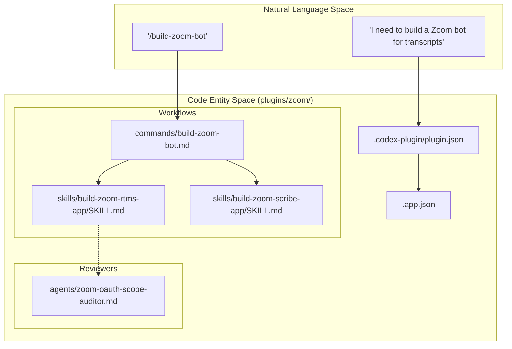
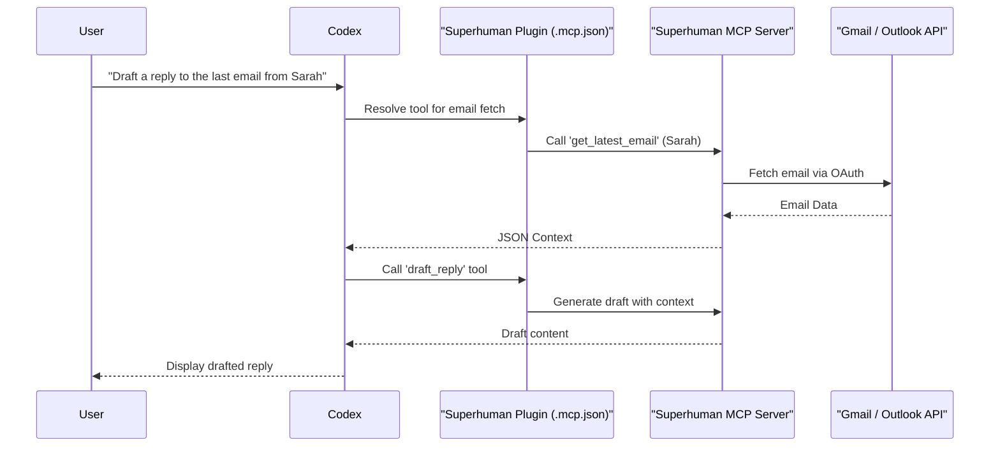

<!-- source: DeepWiki mcp.deepwiki.com · repo openai/plugins · page 3.7 Communication Plugins (Zoom, Superhuman Mail) · fetched 2026-10-26 -->

# Communication Plugins (Zoom, Superhuman Mail)

Relevant source files

The following files were used as context for generating this wiki page:

- [plugins/zoom/.app.json](plugins/zoom/.app.json)
- [plugins/zoom/.codex-plugin/plugin.json](plugins/zoom/.codex-plugin/plugin.json)
- [plugins/zoom/.gitignore](plugins/zoom/.gitignore)
- [plugins/zoom/AGENTS.md](plugins/zoom/AGENTS.md)
- [plugins/zoom/CHANGELOG.md](plugins/zoom/CHANGELOG.md)
- [plugins/zoom/CONTRIBUTING.md](plugins/zoom/CONTRIBUTING.md)
- [plugins/zoom/LICENSE](plugins/zoom/LICENSE)
- [plugins/zoom/README.md](plugins/zoom/README.md)
- [plugins/zoom/assets/app-icon.svg](plugins/zoom/assets/app-icon.svg)
- [plugins/zoom/assets/screenshot-1.png](plugins/zoom/assets/screenshot-1.png)

Communication plugins bridge the gap between natural language reasoning and the specific protocols required to interact with meeting platforms and email clients. The **Zoom** plugin is a comprehensive developer-centric integration for building and debugging Zoom apps, while the **Superhuman Mail** plugin focuses on high-velocity email and calendar orchestration via the Model Context Protocol (MCP).

## Zoom Plugin

The Zoom plugin is a large-scale integration (791 files) designed to connect Codex to live meeting contexts and provide a complete development environment for Zoom's product ecosystem [plugins/zoom/.codex-plugin/plugin.json:1-4](). It utilizes an app-connector pattern for authentication and context retrieval, supplemented by a rich library of skills and slash commands for technical implementation [plugins/zoom/README.md:5-16]().

### Architectural Components
The plugin is structured into several functional layers that handle different aspects of the Zoom developer experience:

1.  **App Connector**: Defined in `.app.json`, it maps the plugin to a specific Zoom application ID (`asdk_app_69373a13116c819189d046aea1278836`) to manage OAuth flows and meeting data access [plugins/zoom/.app.json:1-7]().
2.  **Slash Commands**: Deterministic workflows for common tasks like planning, debugging, and setup. These are located in `commands/` [plugins/zoom/README.md:52-65]().
3.  **Developer Skills**: Explicit-only workflows (invoked via `$skill-name`) that guide the implementation of specific SDKs or APIs [plugins/zoom/README.md:98-106]().
4.  **Reviewer Agents**: Specialized sub-agents for auditing code, such as the `zoom-oauth-scope-auditor` [plugins/zoom/README.md:89-97]().

### Technical Implementation Flow

The following diagram illustrates how a natural language request for a Zoom integration is routed through the plugin's code entities.

**Zoom Plugin: Natural Language to Code Entity Mapping**

**Sources:** [plugins/zoom/.codex-plugin/plugin.json:1-57](), [plugins/zoom/README.md:68-87](), [plugins/zoom/README.md:89-97]()

### Supported Product Surfaces
The plugin provides implementation guidance for the following Zoom technologies:
*   **REST API & Webhooks**: Core data integration and event-driven architectures [plugins/zoom/README.md:59-60]().
*   **Meeting & Video SDKs**: Embedding Zoom video and meeting controls directly into third-party apps [plugins/zoom/README.md:74-76]().
*   **RTMS & Scribe**: Real-time media streaming and transcription pipelines [plugins/zoom/README.md:81-82]().
*   **Team Chat & Phone**: Messaging and telephony integrations [plugins/zoom/README.md:84-85]().
*   **Zoom Apps SDK**: Building apps that run inside the Zoom client [plugins/zoom/README.md:73]().

**Sources:** [plugins/zoom/README.md:50-87](), [plugins/zoom/CONTRIBUTING.md:90-97]()

---

## Superhuman Mail Plugin

The Superhuman Mail plugin provides a high-performance interface for Gmail and Outlook workflows. Unlike the Zoom plugin's heavy focus on developer scaffolding, Superhuman is optimized for user-facing productivity tasks such as inbox triage, reply drafting, and calendar scheduling.

### Implementation Pattern
Superhuman is implemented as an **MCP-backed plugin** (Model Context Protocol). This allows the plugin to expose a standardized set of tools to the model for interacting with email and calendar providers without requiring provider-specific logic in the top-level manifest.

### Key Workflows
| Workflow | Description |
| :--- | :--- |
| **Inbox Triage** | Filtering and prioritizing messages based on importance and read status. |
| **Reply Drafting** | Generating context-aware email responses using Superhuman's tone and style. |
| **Read-Status Checks** | Verifying if recipients have opened specific emails. |
| **Meeting Scheduling** | Coordinating time slots across Gmail and Outlook calendars. |

### Data Flow and MCP Integration

The diagram below shows the interaction between the Codex model, the Superhuman plugin manifest, and the underlying MCP server.

**Superhuman MCP Data Flow**

**Sources:** [plugins/zoom/.codex-plugin/plugin.json:27-28]() (Reference for standard manifest structure), [plugins/zoom/README.md:37-46]() (Reference for app-connector vs skill flow)

### Plugin Comparison

| Feature | Zoom Plugin | Superhuman Mail Plugin |
| :--- | :--- | :--- |
| **Primary Category** | Communication / Developer Tools | Communication / Productivity |
| **Architecture** | App Connector + Skills + Commands | MCP (Model Context Protocol) |
| **Auth Model** | OAuth (via `.app.json`) | OAuth (via MCP Server) |
| **Primary Use Case** | Building Zoom Integrations | Managing Email & Calendar |
| **File Count** | 791 files | Minimal (MCP-heavy) |

**Sources:** [plugins/zoom/.codex-plugin/plugin.json:1-39](), [plugins/zoom/README.md:5-16](), [plugins/zoom/README.md:31-34]()

---

