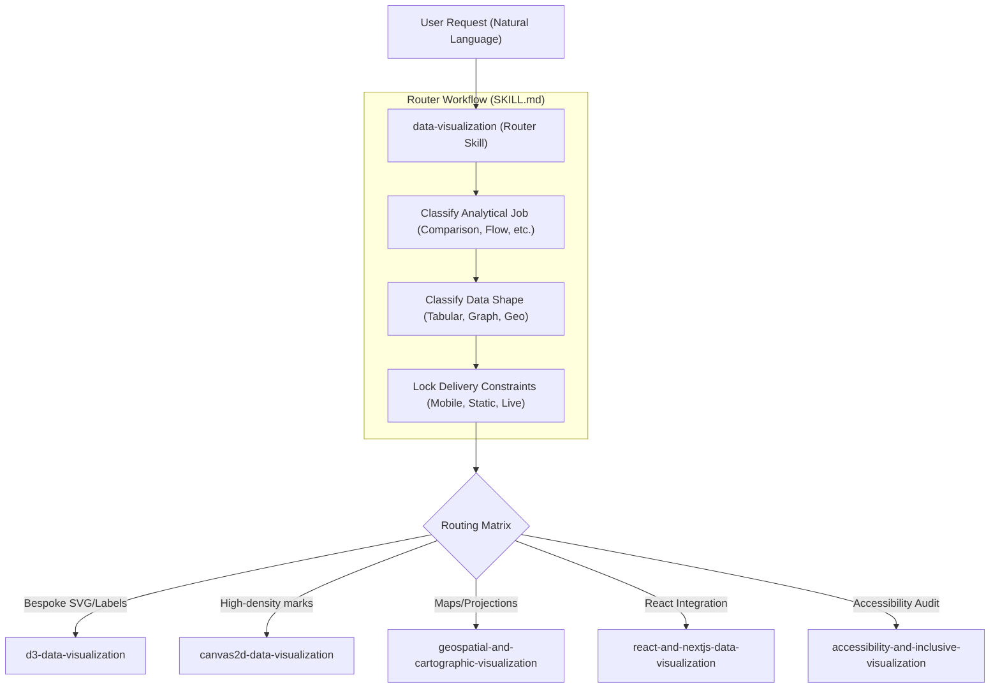
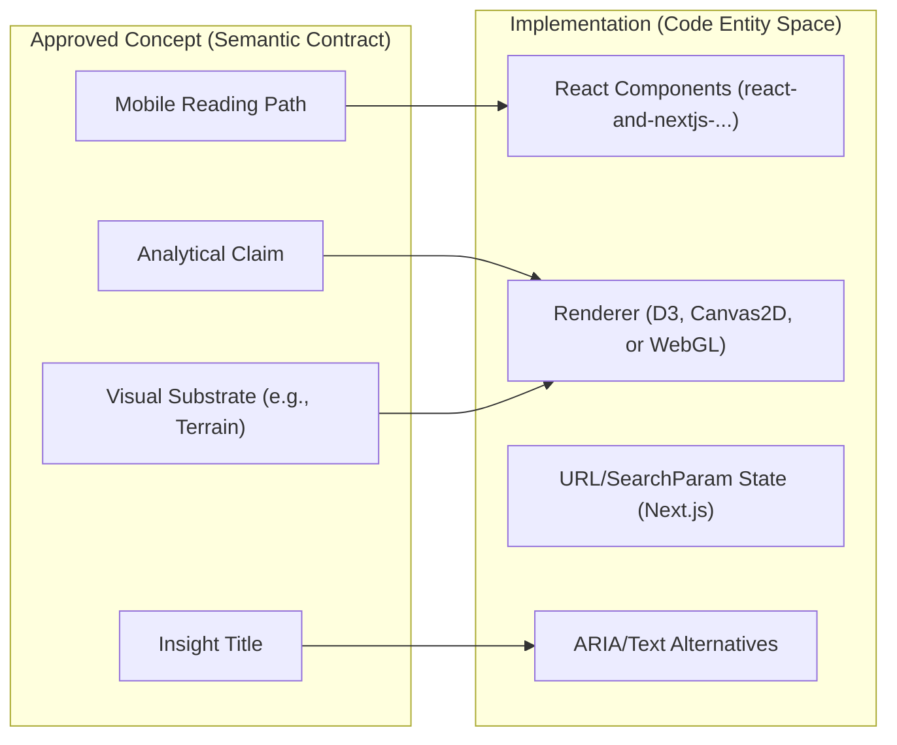

<!-- source: DeepWiki mcp.deepwiki.com · repo openai/plugins · page 4.10 Data Visualization Plugin (build-web-data-visualization) · fetched 2026-10-26 -->

# Data Visualization Plugin (build-web-data-visualization)

Relevant source files

The following files were used as context for generating this wiki page:

- [plugins/build-web-data-visualization/assets/templates/human-visual-review-checklist.md](plugins/build-web-data-visualization/assets/templates/human-visual-review-checklist.md)
- [plugins/build-web-data-visualization/references/foundations/meaning-preserving-visual-design-workflow.md](plugins/build-web-data-visualization/references/foundations/meaning-preserving-visual-design-workflow.md)
- [plugins/build-web-data-visualization/skills/accessibility-and-inclusive-visualization/agents/openai.yaml](plugins/build-web-data-visualization/skills/accessibility-and-inclusive-visualization/agents/openai.yaml)
- [plugins/build-web-data-visualization/skills/canvas2d-data-visualization/agents/openai.yaml](plugins/build-web-data-visualization/skills/canvas2d-data-visualization/agents/openai.yaml)
- [plugins/build-web-data-visualization/skills/d3-data-visualization/agents/openai.yaml](plugins/build-web-data-visualization/skills/d3-data-visualization/agents/openai.yaml)
- [plugins/build-web-data-visualization/skills/dashboards-and-real-time-visualization/agents/openai.yaml](plugins/build-web-data-visualization/skills/dashboards-and-real-time-visualization/agents/openai.yaml)
- [plugins/build-web-data-visualization/skills/data-visualization/SKILL.md](plugins/build-web-data-visualization/skills/data-visualization/SKILL.md)
- [plugins/build-web-data-visualization/skills/gantt-chart-visualization/agents/openai.yaml](plugins/build-web-data-visualization/skills/gantt-chart-visualization/agents/openai.yaml)
- [plugins/build-web-data-visualization/skills/geospatial-and-cartographic-visualization/agents/openai.yaml](plugins/build-web-data-visualization/skills/geospatial-and-cartographic-visualization/agents/openai.yaml)
- [plugins/build-web-data-visualization/skills/grammar-of-graphics-and-declarative-visualization/agents/openai.yaml](plugins/build-web-data-visualization/skills/grammar-of-graphics-and-declarative-visualization/agents/openai.yaml)
- [plugins/build-web-data-visualization/skills/node-link-and-diagram-layout/agents/openai.yaml](plugins/build-web-data-visualization/skills/node-link-and-diagram-layout/agents/openai.yaml)
- [plugins/build-web-data-visualization/skills/react-and-nextjs-data-visualization/agents/openai.yaml](plugins/build-web-data-visualization/skills/react-and-nextjs-data-visualization/agents/openai.yaml)
- [plugins/build-web-data-visualization/skills/reports-pdfs-and-slide-automation/agents/openai.yaml](plugins/build-web-data-visualization/skills/reports-pdfs-and-slide-automation/agents/openai.yaml)
- [plugins/build-web-data-visualization/skills/scrollytelling-and-parallax-data-visualization/agents/openai.yaml](plugins/build-web-data-visualization/skills/scrollytelling-and-parallax-data-visualization/agents/openai.yaml)

The `build-web-data-visualization` plugin provides a comprehensive suite of specialized skills for designing, implementing, and auditing web-based data visualizations. It covers the full lifecycle from analytical classification and visual concepting to technical implementation using D3, React, Canvas2D, and declarative grammars. The plugin emphasizes "meaning-preserving visual design," ensuring that aesthetic choices (like motion or 3D) carry analytical weight rather than being purely decorative.

## System Architecture and Skill Routing

The plugin operates via a central orchestrator skill, `data-visualization`, which classifies the user's analytical needs and routes them to one of 11 specialized skills. This architecture ensures that complex tasks—such as geospatial mapping or real-time dashboarding—are handled by the narrowest appropriate specialist.

### Specialist Skills Matrix

| Skill Name | Purpose | Key Technologies/Concepts |
|:---|:---|:---|
| `grammar-of-graphics-and-declarative-visualization` | Standard tabular charts and rapid prototyping | Vega-Lite, Vega, Observable Plot |
| `d3-data-visualization` | Bespoke SVG geometry, direct labels, and custom transitions | D3.js, SVG, DOM geometry |
| `react-and-nextjs-data-visualization` | Component lifecycle, hydration, and route-based state | Next.js, Client/Server boundaries |
| `canvas2d-data-visualization` | Dense flat marks and high-frequency redraws | HTML5 Canvas, Sparklines |
| `dashboards-and-real-time-visualization` | Monitoring, coordinated views, and stale/offline states | WebSockets, Alerting, Streams |
| `node-link-and-diagram-layout` | Graph auto-layout and software architecture diagrams | Force-directed, C4, Mermaid, UML |
| `geospatial-and-cartographic-visualization` | Maps, projections, and thematic layers | Deck.gl, CesiumJS, Slippy maps |
| `accessibility-and-inclusive-visualization` | Screen-reader paths, contrast, and reduced motion | WCAG 2.2, ARIA, Redundant encoding |
| `scrollytelling-and-parallax-data-visualization` | Scroll-driven state and sticky graphics | Scrollama, GSAP, Parallax |
| `gantt-chart-visualization` | Project schedules, dependencies, and critical paths | Milestones, Baselines, PM imports |
| `reports-pdfs-and-slide-automation` | Exporting assets and document embedding | PDF, PPTX, Google Slides, Figures |

**Sources:**
- [plugins/build-web-data-visualization/skills/data-visualization/SKILL.md:2-49]()
- [plugins/build-web-data-visualization/skills/d3-data-visualization/agents/openai.yaml:1-5]()
- [plugins/build-web-data-visualization/skills/react-and-nextjs-data-visualization/agents/openai.yaml:1-5]()

### Data Flow: Natural Language to Specialist Routing

The following diagram illustrates how a natural language request is processed by the `data-visualization` skill to determine the appropriate implementation path.

**Skill Orchestration Flow**

**Sources:**
- [plugins/build-web-data-visualization/skills/data-visualization/SKILL.md:18-49]()

## Meaning-Preserving Visual Design Workflow

A core principle of this plugin is the **Meaning-Preserving Visual Design Workflow**. This workflow is mandatory for editorial infographics, scrollytelling, and complex composite layouts. It requires Codex to generate visual design concepts (large-screen and mobile) and obtain user approval before any implementation code is written.

### Design Contract Lifecycle

1.  **Evidence Lock**: Before concepting, the system must lock the "takeaway," dataset fields, and "truth invariants" that the design must not violate.
2.  **Artifact Brief**: Selection of the substrate (e.g., cartographic flow field vs. 3D surface) based on its evidence-bearing role.
3.  **Concept Generation**: Generation of a paired Large-Screen and Mobile Portrait concept set.
4.  **Approval Gate**: The user must approve the design direction. The approved concept becomes a binding semantic design contract.
5.  **Implementation**: Implementation code must preserve the evidence hierarchy and reading path defined in the concept.

**Sources:**
- [plugins/build-web-data-visualization/references/foundations/meaning-preserving-visual-design-workflow.md:1-58]()
- [plugins/build-web-data-visualization/references/foundations/meaning-preserving-visual-design-workflow.md:88-101]()

### Concept to Code Mapping

This diagram bridges the visual design concepts to the technical entities used during implementation.

**Design Contract to Implementation Mapping**

**Sources:**
- [plugins/build-web-data-visualization/references/foundations/meaning-preserving-visual-design-workflow.md:7-43]()
- [plugins/build-web-data-visualization/skills/data-visualization/SKILL.md:52-62]()

## Human Visual Review Checklist

The plugin includes a `human-visual-review-checklist.md` template to audit outputs for technical correctness and editorial judgment.

### Key Audit Categories

*   **Story and Evidence**: Ensures the strongest visual encoding is assigned to the main comparison and that annotations explain significance rather than just repeating values.
*   **Art Direction**: Validates that imagery and motion carry analytical meaning. Explicitly prohibits "generic AI atmosphere" like wispy ribbons or decorative gradients.
*   **Mobile Experience**: Verifies that the mobile portrait view preserves the same claim and source context as the desktop view, rather than just stacking DOM elements.
*   **Accessibility**: Checks for color-deficiency resilience, contrast ratios, and touch target sizing (WCAG 2.2).
*   **SVG Polish**: Specific technical standards for typography (e.g., direct labels at 11-13.5px) and line weights (e.g., gridlines at 0.5-1px).

**Sources:**
- [plugins/build-web-data-visualization/assets/templates/human-visual-review-checklist.md:13-30]()
- [plugins/build-web-data-visualization/assets/templates/human-visual-review-checklist.md:72-84]()
- [plugins/build-web-data-visualization/assets/templates/human-visual-review-checklist.md:95-101]()

## Implementation Standards

The plugin enforces specific technical stances to ensure performance and maintainability:
*   **Declarative First**: Prefer declarative grammars (Vega-Lite) over D3 for standard charts.
*   **D3 over Canvas**: Prefer D3/SVG when labels and axes dominate the view.
*   **Canvas over WebGL**: Prefer Canvas for simple dense flat marks; use WebGL only when scale or shaders are required.
*   **State Management**: Use URL-backed filters and persistence (IndexedDB/Remote) for shareable visualization states.

**Sources:**
- [plugins/build-web-data-visualization/skills/data-visualization/SKILL.md:24-27]()
- [plugins/build-web-data-visualization/skills/data-visualization/SKILL.md:61-62]()

---

