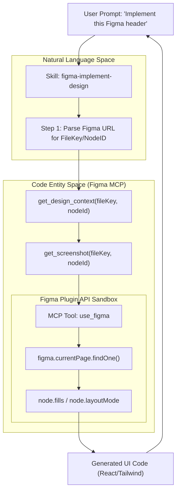
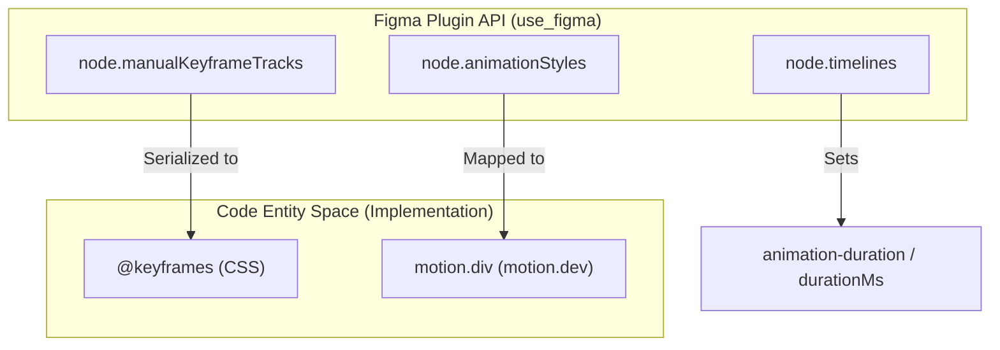

<!-- source: DeepWiki mcp.deepwiki.com · repo openai/plugins · page 4.2 Figma Plugin · fetched 2026-10-26 -->

# Figma Plugin

Relevant source files

The following files were used as context for generating this wiki page:

- [plugins/figma/.app.json](plugins/figma/.app.json)
- [plugins/figma/LICENSE.txt](plugins/figma/LICENSE.txt)
- [plugins/figma/README.md](plugins/figma/README.md)
- [plugins/figma/agents/figma-code-connect-agent.md](plugins/figma/agents/figma-code-connect-agent.md)
- [plugins/figma/agents/openai.yaml](plugins/figma/agents/openai.yaml)
- [plugins/figma/commands/connect-figma-components.md](plugins/figma/commands/connect-figma-components.md)
- [plugins/figma/plugin.lock.json](plugins/figma/plugin.lock.json)
- [plugins/figma/skills/figma-generate-design/SKILL.md](plugins/figma/skills/figma-generate-design/SKILL.md)
- [plugins/figma/skills/figma-generate-design/references/componentization.md](plugins/figma/skills/figma-generate-design/references/componentization.md)
- [plugins/figma/skills/figma-generate-design/references/discover-product-font.md](plugins/figma/skills/figma-generate-design/references/discover-product-font.md)
- [plugins/figma/skills/figma-generate-library/SKILL.md](plugins/figma/skills/figma-generate-library/SKILL.md)
- [plugins/figma/skills/figma-generate-library/references/code-connect-setup.md](plugins/figma/skills/figma-generate-library/references/code-connect-setup.md)
- [plugins/figma/skills/figma-generate-library/references/component-creation.md](plugins/figma/skills/figma-generate-library/references/component-creation.md)
- [plugins/figma/skills/figma-generate-library/references/discovery-phase.md](plugins/figma/skills/figma-generate-library/references/discovery-phase.md)
- [plugins/figma/skills/figma-generate-library/references/documentation-creation.md](plugins/figma/skills/figma-generate-library/references/documentation-creation.md)
- [plugins/figma/skills/figma-generate-library/references/error-recovery.md](plugins/figma/skills/figma-generate-library/references/error-recovery.md)
- [plugins/figma/skills/figma-generate-library/scripts/cleanupOrphans.js](plugins/figma/skills/figma-generate-library/scripts/cleanupOrphans.js)
- [plugins/figma/skills/figma-generate-library/scripts/createDocumentationPage.js](plugins/figma/skills/figma-generate-library/scripts/createDocumentationPage.js)
- [plugins/figma/skills/figma-generate-library/scripts/inspectFileStructure.js](plugins/figma/skills/figma-generate-library/scripts/inspectFileStructure.js)
- [plugins/figma/skills/figma-generate-library/scripts/rehydrateState.js](plugins/figma/skills/figma-generate-library/scripts/rehydrateState.js)
- [plugins/figma/skills/figma-implement-motion/SKILL.md](plugins/figma/skills/figma-implement-motion/SKILL.md)
- [plugins/figma/skills/figma-implement-motion/references/examples-and-anti-examples.md](plugins/figma/skills/figma-implement-motion/references/examples-and-anti-examples.md)
- [plugins/figma/skills/figma-implement-motion/references/framework-recommendations.md](plugins/figma/skills/figma-implement-motion/references/framework-recommendations.md)
- [plugins/figma/skills/figma-implement-motion/references/gotchas.md](plugins/figma/skills/figma-implement-motion/references/gotchas.md)
- [plugins/figma/skills/figma-implement-motion/references/motion-lint-rules.md](plugins/figma/skills/figma-implement-motion/references/motion-lint-rules.md)
- [plugins/figma/skills/figma-implement-motion/references/svg-and-path-motion.md](plugins/figma/skills/figma-implement-motion/references/svg-and-path-motion.md)
- [plugins/figma/skills/figma-use-figjam/SKILL.md](plugins/figma/skills/figma-use-figjam/SKILL.md)
- [plugins/figma/skills/figma-use-figjam/references/batch-modify.md](plugins/figma/skills/figma-use-figjam/references/batch-modify.md)
- [plugins/figma/skills/figma-use-figjam/references/edit-text.md](plugins/figma/skills/figma-use-figjam/references/edit-text.md)
- [plugins/figma/skills/figma-use-motion/SKILL.md](plugins/figma/skills/figma-use-motion/SKILL.md)
- [plugins/figma/skills/figma-use-motion/references/motion-patterns.md](plugins/figma/skills/figma-use-motion/references/motion-patterns.md)
- [plugins/figma/skills/figma-use-slides/SKILL.md](plugins/figma/skills/figma-use-slides/SKILL.md)
- [plugins/figma/skills/figma-use-slides/references/slide-content.md](plugins/figma/skills/figma-use-slides/references/slide-content.md)
- [plugins/figma/skills/figma-use-slides/references/slide-gotchas.md](plugins/figma/skills/figma-use-slides/references/slide-gotchas.md)
- [plugins/figma/skills/figma-use-slides/references/slide-properties.md](plugins/figma/skills/figma-use-slides/references/slide-properties.md)
- [plugins/figma/skills/figma-use/SKILL.md](plugins/figma/skills/figma-use/SKILL.md)
- [plugins/figma/skills/figma-use/references/api-reference.md](plugins/figma/skills/figma-use/references/api-reference.md)
- [plugins/figma/skills/figma-use/references/common-patterns.md](plugins/figma/skills/figma-use/references/common-patterns.md)
- [plugins/figma/skills/figma-use/references/component-patterns.md](plugins/figma/skills/figma-use/references/component-patterns.md)
- [plugins/figma/skills/figma-use/references/gotchas.md](plugins/figma/skills/figma-use/references/gotchas.md)
- [plugins/figma/skills/figma-use/references/plugin-api-patterns.md](plugins/figma/skills/figma-use/references/plugin-api-patterns.md)

The Figma plugin enables bidirectional design-to-code workflows, allowing agents to inspect Figma designs, implement them in production-ready code, and synchronize design systems between codebases and Figma files. It leverages the Figma Plugin API via a specialized Model Context Protocol (MCP) tool to perform programmatic manipulations of Figma nodes, variables, and styles.

## Overview and Scope

The plugin is located in `plugins/figma/` and is structured as an app-backed plugin [plugins/figma/README.md:25-31](). It provides a suite of skills that automate the translation of Figma frames into UI components, the generation of Code Connect mappings, and the creation of design system libraries from existing codebases.

### Key Capabilities
- **Design Inspection**: Programmatic reading of Figma node trees and metadata [plugins/figma/README.md:18-19]().
- **UI Implementation**: Translating Figma visual designs into frontend code (React, Tailwind, etc.) [plugins/figma/README.md:65-66]().
- **Motion Implementation**: Translating Figma keyframes and easing into CSS or motion.dev code [plugins/figma/skills/figma-implement-motion/SKILL.md:11-16]().
- **Code Connect**: Establishing formal links between Figma components and source code via parserless templates [plugins/figma/README.md:20-21]().
- **Design System Sync**: Generating Figma variables, styles, and components from code tokens [plugins/figma/skills/figma-generate-library/SKILL.md:7-9]().
- **Canvas Operations**: Creating and updating nodes, variables, and auto-layout structures directly in Figma files [plugins/figma/skills/figma-use/SKILL.md:1-5]().

**Sources:** [plugins/figma/README.md:1-74](), [plugins/figma/skills/figma-use/SKILL.md:1-20]()

---

## Plugin Architecture

The Figma plugin follows the standard OpenAI plugin structure but is distinguished by its heavy reliance on the `use_figma` MCP tool for API execution.

### Data Flow: Natural Language to Figma API
The following diagram illustrates how a user request for design implementation moves from natural language into the Figma Plugin API space, specifically mapping the `figma-implement-design` skill to its internal execution steps.

**Figma Design-to-Code Execution Flow**

**Sources:** [plugins/figma/skills/figma-generate-design/SKILL.md:30-40](), [plugins/figma/skills/figma-use/SKILL.md:7-15]()

### Component Structure
The plugin manifest `plugin.json` defines the interface and points to the skill directory. Authentication and connection to the Figma service are handled via `.app.json` [plugins/figma/.app.json:1-7]().

| File | Role |
| :--- | :--- |
| `.codex-plugin/plugin.json` | Main manifest defining capabilities (Read, Write, Interactive) and category (Design). |
| `.app.json` | Defines the Figma App Connector for OAuth [plugins/figma/.app.json:3-5](). |
| `skills/` | Contains logic for specific workflows like `figma-generate-library` and `figma-implement-motion` [plugins/figma/README.md:45-49](). |
| `agents/openai.yaml` | Plugin-level metadata for the OpenAI interface [plugins/figma/agents/openai.yaml:1-6](). |

**Sources:** [plugins/figma/.app.json:1-7](), [plugins/figma/README.md:25-55]()

---

## The `use_figma` MCP Tool

The core of the plugin's functionality is the `use_figma` tool. It executes JavaScript directly within the Figma sandbox via the Plugin API.

### Execution Model
1. **Plain JavaScript**: The tool accepts top-level `await` and `return` statements. Code is automatically wrapped in an async context [plugins/figma/skills/figma-use/SKILL.md:25-26]().
2. **Return Value**: Only data explicitly returned via `return` is JSON-serialized. `console.log()` is NOT returned [plugins/figma/skills/figma-use/SKILL.md:25-29]().
3. **Incremental Work**: Large operations must be broken into multiple `use_figma` calls to avoid timeouts and bugs [plugins/figma/skills/figma-use/SKILL.md:30]().
4. **Page Persistence**: The sync setter `figma.currentPage = page` does **NOT** work; scripts must use `await figma.setCurrentPageAsync(page)` [plugins/figma/skills/figma-use/SKILL.md:34]().

### Critical Constraints
- **Color Range**: Figma uses a 0–1 scale for RGB values (e.g., `{r: 1, g: 0, b: 0}` for red) [plugins/figma/skills/figma-use/SKILL.md:31]().
- **Font Loading**: Fonts must be explicitly loaded using `await figma.loadFontAsync()` before any text node modification. Skipping this throws a "Cannot write to node with unloaded font" error [plugins/figma/skills/figma-use/SKILL.md:33]().
- **Layout Timing**: `layoutSizingHorizontal/Vertical` values like `HUG` and `FILL` are structural. A node must be appended to an auto-layout parent BEFORE setting these values [plugins/figma/skills/figma-use/SKILL.md:37-39]().
- **Coordinate Shift (Slides)**: In Slides files, `appendChild` must happen **BEFORE** setting `x/y` to avoid a `(-240, -240)` coordinate shift caused by the slide grid padding [plugins/figma/skills/figma-use-slides/SKILL.md:32]().

**Sources:** [plugins/figma/skills/figma-use/SKILL.md:23-40](), [plugins/figma/skills/figma-use-slides/SKILL.md:29-38]()

---

## Motion Implementation (`figma-implement-motion`)

This skill translates Figma animations into production code. It relies on a specific coordination between design and motion contexts.

### Tool Roles in Motion
| Tool | Role |
| :--- | :--- |
| `get_motion_context` | Authoritative source for `codeSnippets` (CSS/motion.dev), timing, and easing [plugins/figma/skills/figma-implement-motion/SKILL.md:15](). |
| `get_design_context` | Provides the static structure, layout, and placement markers like `data-node-id` [plugins/figma/skills/figma-implement-motion/SKILL.md:16](). |

### Motion Data Mapping
**Motion Entity Mapping**

### Key Constraints
- **Hold Easing**: Must be implemented as `steps(1, jump-end)` in CSS, not a linear approximation [plugins/figma/skills/figma-implement-motion/references/gotchas.md:9-15]().
- **Display Contents**: Do not attach motion transforms to elements with `display: contents` as they lack a rendered layout box. Replace with a real positioned wrapper if the group itself animates [plugins/figma/skills/figma-implement-motion/references/gotchas.md:35-43]().

**Sources:** [plugins/figma/skills/figma-implement-motion/SKILL.md:9-80](), [plugins/figma/skills/figma-implement-motion/references/gotchas.md:1-75]()

---

## Design System Generation (`figma-generate-library`)

The `figma-generate-library` skill manages the multi-phase process of building a Figma design system from a codebase.

### The Phased Workflow
This skill enforces a strict sequence to ensure structural integrity [plugins/figma/skills/figma-generate-library/SKILL.md:59-62]().

| Phase | Description | Key Code Actions |
| :--- | :--- | :--- |
| **0: Discovery** | Analyze codebase and lock scope. | Extract tokens, `search_design_system` [plugins/figma/skills/figma-generate-library/SKILL.md:63-70](). |
| **1: Foundations** | Creation of variables and styles. | `createVariableCollection`, `createVariable` [plugins/figma/skills/figma-generate-library/SKILL.md:72-82](). |
| **2: Structure** | Setting up the file page skeleton. | `figma.createPage()` [plugins/figma/skills/figma-generate-library/SKILL.md:84-89](). |
| **3: Components** | Building components one by one. | `combineAsVariants`, `addComponentProperty` [plugins/figma/skills/figma-generate-library/SKILL.md:91-103](). |
| **4: Integration** | QA and Code Connect. | Finalize mappings, accessibility audit [plugins/figma/skills/figma-generate-library/SKILL.md:105-111](). |

**Sources:** [plugins/figma/skills/figma-generate-library/SKILL.md:1-115](), [plugins/figma/skills/figma-use/references/gotchas.md:58-75]()

---

## Design Implementation and Screen Building

The `figma-generate-design` and `figma-implement-design` skills facilitate the transition between visual frames and code entities.

### Web App Parallel Workflow
For web applications, the plugin utilizes a hybrid approach:
1. **`use_figma`**: Assembles the screen using proper design system component instances discovered via `search_design_system` [plugins/figma/skills/figma-generate-design/SKILL.md:33]().
2. **`generate_figma_design`**: Captures a pixel-perfect screenshot of the running web app into the Figma file [plugins/figma/skills/figma-generate-design/SKILL.md:34]().
3. **Reconciliation**: The `use_figma` output is adjusted to match the capture's exact spacing. This is mandatory when images are present to copy `imageHash` values [plugins/figma/skills/figma-generate-design/SKILL.md:35-40]().

**Sources:** [plugins/figma/skills/figma-generate-design/SKILL.md:30-43](), [plugins/figma/skills/figma-generate-design/references/discover-product-font.md:1-20]()

---

