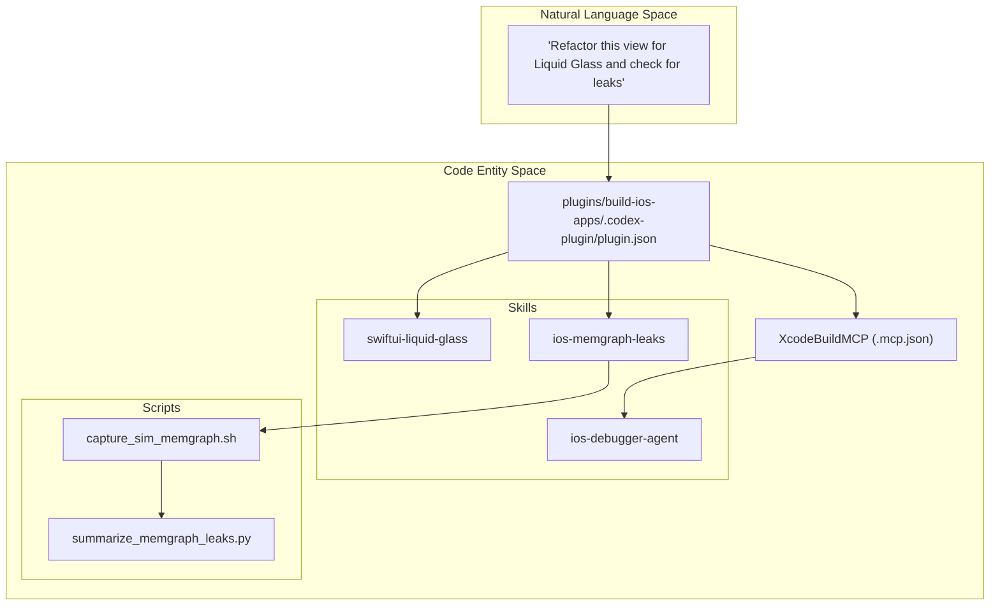
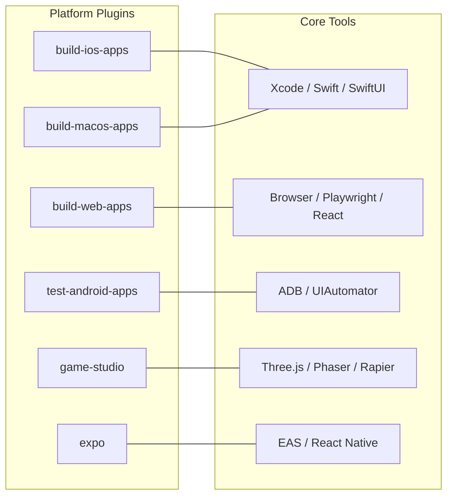

<!-- source: DeepWiki mcp.deepwiki.com · repo openai/plugins · page 4.3 App Building Plugins (iOS, macOS, Web, Android, Game Studio, Expo) · fetched 2026-10-26 -->

# App Building Plugins (iOS, macOS, Web, Android, Game Studio, Expo)

Relevant source files

The following files were used as context for generating this wiki page:

- [.gitignore](.gitignore)
- [README.md](README.md)
- [plugins/box/assets/app-icon.png](plugins/box/assets/app-icon.png)
- [plugins/build-ios-apps/.codex-plugin/plugin.json](plugins/build-ios-apps/.codex-plugin/plugin.json)
- [plugins/build-ios-apps/.mcp.json](plugins/build-ios-apps/.mcp.json)
- [plugins/build-ios-apps/README.md](plugins/build-ios-apps/README.md)
- [plugins/build-ios-apps/agents/openai.yaml](plugins/build-ios-apps/agents/openai.yaml)
- [plugins/build-ios-apps/assets/app-icon.png](plugins/build-ios-apps/assets/app-icon.png)
- [plugins/build-ios-apps/skills/ios-app-intents/SKILL.md](plugins/build-ios-apps/skills/ios-app-intents/SKILL.md)
- [plugins/build-ios-apps/skills/ios-debugger-agent/SKILL.md](plugins/build-ios-apps/skills/ios-debugger-agent/SKILL.md)
- [plugins/build-ios-apps/skills/ios-ettrace-performance/SKILL.md](plugins/build-ios-apps/skills/ios-ettrace-performance/SKILL.md)
- [plugins/build-ios-apps/skills/ios-ettrace-performance/agents/openai.yaml](plugins/build-ios-apps/skills/ios-ettrace-performance/agents/openai.yaml)
- [plugins/build-ios-apps/skills/ios-ettrace-performance/scripts/analyze_flamegraph_json.py](plugins/build-ios-apps/skills/ios-ettrace-performance/scripts/analyze_flamegraph_json.py)
- [plugins/build-ios-apps/skills/ios-ettrace-performance/scripts/collect_ios_dsyms.sh](plugins/build-ios-apps/skills/ios-ettrace-performance/scripts/collect_ios_dsyms.sh)
- [plugins/build-ios-apps/skills/ios-memgraph-leaks/SKILL.md](plugins/build-ios-apps/skills/ios-memgraph-leaks/SKILL.md)
- [plugins/build-ios-apps/skills/ios-memgraph-leaks/agents/openai.yaml](plugins/build-ios-apps/skills/ios-memgraph-leaks/agents/openai.yaml)
- [plugins/build-ios-apps/skills/ios-memgraph-leaks/scripts/capture_sim_memgraph.sh](plugins/build-ios-apps/skills/ios-memgraph-leaks/scripts/capture_sim_memgraph.sh)
- [plugins/build-ios-apps/skills/ios-memgraph-leaks/scripts/summarize_memgraph_leaks.py](plugins/build-ios-apps/skills/ios-memgraph-leaks/scripts/summarize_memgraph_leaks.py)
- [plugins/build-ios-apps/skills/ios-simulator-browser/SKILL.md](plugins/build-ios-apps/skills/ios-simulator-browser/SKILL.md)
- [plugins/build-ios-apps/skills/ios-simulator-browser/agents/openai.yaml](plugins/build-ios-apps/skills/ios-simulator-browser/agents/openai.yaml)
- [plugins/build-ios-apps/skills/ios-simulator-browser/scripts/lib/xcode-project.mjs](plugins/build-ios-apps/skills/ios-simulator-browser/scripts/lib/xcode-project.mjs)
- [plugins/build-ios-apps/skills/ios-simulator-browser/scripts/swiftui-preview-browser.mjs](plugins/build-ios-apps/skills/ios-simulator-browser/scripts/swiftui-preview-browser.mjs)
- [plugins/build-ios-apps/skills/ios-simulator-browser/scripts/templates/FocusedPreviewApp.swift](plugins/build-ios-apps/skills/ios-simulator-browser/scripts/templates/FocusedPreviewApp.swift)
- [plugins/build-ios-apps/skills/ios-simulator-browser/scripts/templates/FocusedPreviewHotReloadRuntime.swift](plugins/build-ios-apps/skills/ios-simulator-browser/scripts/templates/FocusedPreviewHotReloadRuntime.swift)
- [plugins/build-ios-apps/skills/ios-simulator-browser/scripts/templates/PreviewBrowserEntries.swift](plugins/build-ios-apps/skills/ios-simulator-browser/scripts/templates/PreviewBrowserEntries.swift)
- [plugins/build-ios-apps/skills/swiftui-liquid-glass/SKILL.md](plugins/build-ios-apps/skills/swiftui-liquid-glass/SKILL.md)
- [plugins/build-ios-apps/skills/swiftui-performance-audit/SKILL.md](plugins/build-ios-apps/skills/swiftui-performance-audit/SKILL.md)
- [plugins/build-ios-apps/skills/swiftui-ui-patterns/SKILL.md](plugins/build-ios-apps/skills/swiftui-ui-patterns/SKILL.md)
- [plugins/build-ios-apps/skills/swiftui-view-refactor/SKILL.md](plugins/build-ios-apps/skills/swiftui-view-refactor/SKILL.md)
- [plugins/build-macos-apps/.codex-plugin/plugin.json](plugins/build-macos-apps/.codex-plugin/plugin.json)
- [plugins/build-macos-apps/agents/openai.yaml](plugins/build-macos-apps/agents/openai.yaml)
- [plugins/build-macos-apps/skills/appkit-interop/SKILL.md](plugins/build-macos-apps/skills/appkit-interop/SKILL.md)
- [plugins/build-macos-apps/skills/build-run-debug/SKILL.md](plugins/build-macos-apps/skills/build-run-debug/SKILL.md)
- [plugins/build-macos-apps/skills/liquid-glass/SKILL.md](plugins/build-macos-apps/skills/liquid-glass/SKILL.md)
- [plugins/build-macos-apps/skills/packaging-notarization/SKILL.md](plugins/build-macos-apps/skills/packaging-notarization/SKILL.md)
- [plugins/build-macos-apps/skills/signing-entitlements/SKILL.md](plugins/build-macos-apps/skills/signing-entitlements/SKILL.md)
- [plugins/build-macos-apps/skills/swiftpm-macos/SKILL.md](plugins/build-macos-apps/skills/swiftpm-macos/SKILL.md)
- [plugins/build-macos-apps/skills/swiftui-patterns/SKILL.md](plugins/build-macos-apps/skills/swiftui-patterns/SKILL.md)
- [plugins/build-macos-apps/skills/swiftui-patterns/references/split-inspectors.md](plugins/build-macos-apps/skills/swiftui-patterns/references/split-inspectors.md)
- [plugins/build-macos-apps/skills/telemetry/SKILL.md](plugins/build-macos-apps/skills/telemetry/SKILL.md)
- [plugins/build-web-apps/.codex-plugin/plugin.json](plugins/build-web-apps/.codex-plugin/plugin.json)
- [plugins/build-web-apps/README.md](plugins/build-web-apps/README.md)
- [plugins/build-web-apps/agents/openai.yaml](plugins/build-web-apps/agents/openai.yaml)
- [plugins/build-web-apps/assets/app-icon.png](plugins/build-web-apps/assets/app-icon.png)
- [plugins/build-web-apps/skills/frontend-app-builder/SKILL.md](plugins/build-web-apps/skills/frontend-app-builder/SKILL.md)
- [plugins/build-web-apps/skills/frontend-app-builder/agents/openai.yaml](plugins/build-web-apps/skills/frontend-app-builder/agents/openai.yaml)
- [plugins/build-web-apps/skills/frontend-app-builder/references/imagegen-website-concepts.md](plugins/build-web-apps/skills/frontend-app-builder/references/imagegen-website-concepts.md)
- [plugins/build-web-apps/skills/frontend-testing-debugging/SKILL.md](plugins/build-web-apps/skills/frontend-testing-debugging/SKILL.md)
- [plugins/build-web-apps/skills/frontend-testing-debugging/agents/openai.yaml](plugins/build-web-apps/skills/frontend-testing-debugging/agents/openai.yaml)
- [plugins/expo/LICENSE](plugins/expo/LICENSE)
- [plugins/expo/README.md](plugins/expo/README.md)
- [plugins/expo/agents/openai.yaml](plugins/expo/agents/openai.yaml)
- [plugins/expo/assets/expo.png](plugins/expo/assets/expo.png)
- [plugins/expo/commands/setup-codex-run-actions.md](plugins/expo/commands/setup-codex-run-actions.md)
- [plugins/expo/skills/building-native-ui/SKILL.md](plugins/expo/skills/building-native-ui/SKILL.md)
- [plugins/expo/skills/building-native-ui/agents/openai.yaml](plugins/expo/skills/building-native-ui/agents/openai.yaml)
- [plugins/expo/skills/building-native-ui/references/animations.md](plugins/expo/skills/building-native-ui/references/animations.md)
- [plugins/game-studio/.codex-plugin/plugin.json](plugins/game-studio/.codex-plugin/plugin.json)
- [plugins/game-studio/assets/app-icon.png](plugins/game-studio/assets/app-icon.png)
- [plugins/jam/assets/app-icon.png](plugins/jam/assets/app-icon.png)
- [plugins/test-android-apps/.codex-plugin/plugin.json](plugins/test-android-apps/.codex-plugin/plugin.json)
- [plugins/test-android-apps/agents/openai.yaml](plugins/test-android-apps/agents/openai.yaml)
- [plugins/test-android-apps/assets/app-icon.png](plugins/test-android-apps/assets/app-icon.png)

This section covers specialized development plugins designed to assist engineers in building, testing, and deploying applications across mobile, desktop, web, and gaming platforms. These plugins integrate with platform-specific tools like Xcode, ADB, and browser-based testing engines to automate design, implementation, and QA workflows.

## 1. Build iOS Apps

The `build-ios-apps` plugin focuses on SwiftUI development, performance engineering, and Xcode-integrated workflows [plugins/build-ios-apps/.codex-plugin/plugin.json:2-4]().

### Core Capabilities
*   **SwiftUI Refactoring**: Automated refactors to adopt modern patterns like `swiftui-liquid-glass` and `swiftui-view-refactor` [plugins/build-ios-apps/README.md:12-15]().
*   **Performance & Memory**: Includes specialized scripts for capturing `ETTrace` profiles (`ios-ettrace-performance`) and `memgraph` leaks (`ios-memgraph-leaks`) [plugins/build-ios-apps/README.md:9-10]().
*   **XcodeBuildMCP**: Integration with an MCP server defined in `.mcp.json` to drive simulator build/run/debug loops [plugins/build-ios-apps/README.md:41-43]().
*   **App Intents**: Designing system-level integrations for Siri, Spotlight, and Shortcuts via the `ios-app-intents` skill [plugins/build-ios-apps/skills/ios-app-intents/SKILL.md:6-9]().
*   **Simulator Mirroring**: Hot-reloading package-backed SwiftUI previews in the Codex in-app browser [plugins/build-ios-apps/README.md:26-26]().

### Technical Architecture

Sources: [plugins/build-ios-apps/README.md:1-52](), [plugins/build-ios-apps/.codex-plugin/plugin.json:26-31](), [plugins/build-ios-apps/skills/ios-app-intents/SKILL.md:1-77]()

---

## 2. Build macOS Apps

The `build-macos-apps` plugin handles desktop-specific SwiftUI and AppKit workflows, extending mobile patterns to the desktop environment [README.md:19-19]().

### Key Workflows
*   **Build/Run/Debug Loops**: Optimized cycles for macOS targets including specialized `build-run-debug` skills.
*   **AppKit Interop**: Guidance on bridging SwiftUI with legacy AppKit components via the `appkit-interop` skill.
*   **Packaging & Notarization**: Automated workflows for signing, entitlements, and preparing apps for distribution [plugins/build-macos-apps/skills/packaging-notarization/SKILL.md]().
*   **Window Management**: Support for multi-window architectures and macOS-specific `Liquid Glass` APIs [plugins/build-macos-apps/skills/liquid-glass/SKILL.md]().

Sources: [README.md:19-19](), [plugins/build-macos-apps/.codex-plugin/plugin.json:1-20]()

---

## 3. Build Web Apps

The `build-web-apps` plugin is a high-fidelity frontend development assistant that emphasizes design-to-code agency-level signoff [plugins/build-web-apps/skills/frontend-app-builder/SKILL.md:6-30]().

### The Design-First Workflow
The `frontend-app-builder` skill enforces a strict "Image Gen" design phase before any code is written [plugins/build-web-apps/skills/frontend-app-builder/SKILL.md:18-23]().

1.  **Concepting**: Uses the `@imagegen` skill and `imagegen-website-concepts.md` guidance to create high-taste UI mockups [plugins/build-web-apps/skills/frontend-app-builder/SKILL.md:38-41]().
2.  **System Extraction**: Extracts tokens, typography, and component families from the accepted image [plugins/build-web-apps/skills/frontend-app-builder/SKILL.md:25-25]().
3.  **Implementation**: Defaults to React + Vite with `shadcn/ui` [plugins/build-web-apps/skills/frontend-app-builder/SKILL.md:26-27]().
4.  **Visual QA**: Uses `view_image` to compare the browser screenshot against the original design concept for 10/10 fidelity [plugins/build-web-apps/skills/frontend-app-builder/SKILL.md:29-29]().

### Integration Skills
The plugin bundles specialized guidance for full-stack capabilities:
*   **Stripe**: `stripe-best-practices` for payment flow instrumentation [plugins/build-web-apps/README.md:11-11]().
*   **Supabase**: `supabase-best-practices` for Postgres data flows and RLS policies [plugins/build-web-apps/README.md:12-12]().
*   **Testing**: `frontend-testing-debugging` using the Browser plugin or Playwright [plugins/build-web-apps/README.md:8-8]().

Sources: [plugins/build-web-apps/skills/frontend-app-builder/SKILL.md:1-54](), [plugins/build-web-apps/README.md:1-16](), [plugins/build-web-apps/.codex-plugin/plugin.json:28-31]()

---

## 4. Test Android Apps

The `test-android-apps` plugin provides a reproduction-heavy interface for Android emulators, focusing on performance profiling and UI inspection [plugins/test-android-apps/.codex-plugin/plugin.json:1-31]().

### Capabilities
*   **UI Tree Summarization**: Uses `uiautomator` to dump and summarize the UI hierarchy for the model to navigate.
*   **Performance Profiling**: Integration with `Simpleperf` and `Perfetto` for frame-rate and memory analysis.
*   **Log Triage**: Automated `logcat` analysis for crash reproduction and debugging.

Sources: [plugins/test-android-apps/.codex-plugin/plugin.json:1-31]()

---

## 5. Game Studio

The `game-studio` plugin facilitates the design and prototyping of 2D and 3D browser-based games [plugins/game-studio/.codex-plugin/plugin.json:1-12]().

### Engine Ecosystem
*   **Phaser 2D**: Workflows for sprite-based gameplay and physics.
*   **Three.js / React-Three-Fiber (R3F)**: Declarative 3D spatial environments.
*   **Asset Pipeline**: GLTF pipeline for 3D models and automated asset management [plugins/game-studio/.codex-plugin/plugin.json:13-22]().
*   **Physics**: Integration with the `Rapier` physics engine for high-performance simulations.

Sources: [plugins/game-studio/.codex-plugin/plugin.json:1-22]()

---

## 6. Expo Plugin

The `expo` plugin manages React Native lifecycles, focusing on EAS (Expo Application Services) and SDK maintenance [README.md:21-21]().

*   **EAS Build & Hosting**: Triggers and monitors cloud builds and deployments.
*   **SDK Upgrades**: Automates the migration of Expo SDK versions and dependency resolution.
*   **Codex Run Actions**: Executes native-adjacent development actions within the Codex environment.

Sources: [README.md:21-21]()

---

## Summary of App Building Capabilities

Sources: [plugins/build-ios-apps/.codex-plugin/plugin.json:14-23](), [plugins/build-web-apps/.codex-plugin/plugin.json:13-25](), [README.md:1-22]()

---

