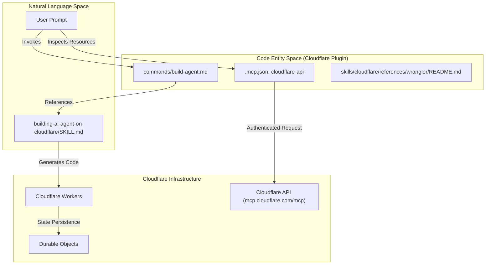
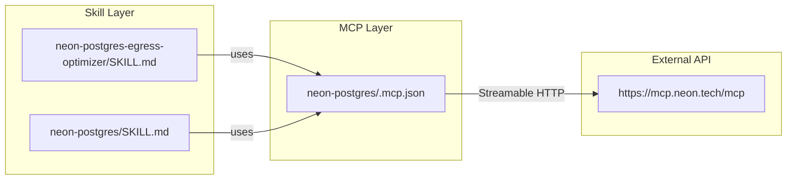

<!-- source: DeepWiki mcp.deepwiki.com · repo openai/plugins · page 4.4 Cloud Deployment Plugins (Cloudflare, Vercel, Netlify, Render, Neon Postgres, Supabase) · fetched 2026-10-26 -->

# Cloud Deployment Plugins (Cloudflare, Vercel, Netlify, Render, Neon Postgres, Supabase)

Relevant source files

The following files were used as context for generating this wiki page:

- [plugins/cloudflare/README.md](plugins/cloudflare/README.md)
- [plugins/cloudflare/commands/build-mcp.md](plugins/cloudflare/commands/build-mcp.md)
- [plugins/cloudflare/skills/building-mcp-server-on-cloudflare/SKILL.md](plugins/cloudflare/skills/building-mcp-server-on-cloudflare/SKILL.md)
- [plugins/cloudflare/skills/building-mcp-server-on-cloudflare/references/examples.md](plugins/cloudflare/skills/building-mcp-server-on-cloudflare/references/examples.md)
- [plugins/cloudflare/skills/building-mcp-server-on-cloudflare/references/oauth-setup.md](plugins/cloudflare/skills/building-mcp-server-on-cloudflare/references/oauth-setup.md)
- [plugins/cloudflare/skills/cloudflare/references/ai-gateway/dynamic-routing.md](plugins/cloudflare/skills/cloudflare/references/ai-gateway/dynamic-routing.md)
- [plugins/cloudflare/skills/sandbox-sdk/references/examples.md](plugins/cloudflare/skills/sandbox-sdk/references/examples.md)
- [plugins/coderabbit/.codex-plugin/plugin.json](plugins/coderabbit/.codex-plugin/plugin.json)
- [plugins/coderabbit/assets/coderabbit-small.png](plugins/coderabbit/assets/coderabbit-small.png)
- [plugins/coderabbit/assets/coderabbit.png](plugins/coderabbit/assets/coderabbit.png)
- [plugins/coderabbit/skills/coderabbit-review/SKILL.md](plugins/coderabbit/skills/coderabbit-review/SKILL.md)
- [plugins/neon-postgres/.codex-plugin/plugin.json](plugins/neon-postgres/.codex-plugin/plugin.json)
- [plugins/neon-postgres/assets/neon-small.svg](plugins/neon-postgres/assets/neon-small.svg)
- [plugins/neon-postgres/assets/neon.jpg](plugins/neon-postgres/assets/neon.jpg)
- [plugins/neon-postgres/skills/neon-postgres-egress-optimizer/SKILL.md](plugins/neon-postgres/skills/neon-postgres-egress-optimizer/SKILL.md)
- [plugins/neon-postgres/skills/neon-postgres-egress-optimizer/agents/openai.yaml](plugins/neon-postgres/skills/neon-postgres-egress-optimizer/agents/openai.yaml)
- [plugins/neon-postgres/skills/neon-postgres-egress-optimizer/assets/neon-small.svg](plugins/neon-postgres/skills/neon-postgres-egress-optimizer/assets/neon-small.svg)
- [plugins/neon-postgres/skills/neon-postgres-egress-optimizer/assets/neon.jpg](plugins/neon-postgres/skills/neon-postgres-egress-optimizer/assets/neon.jpg)
- [plugins/neon-postgres/skills/neon-postgres/SKILL.md](plugins/neon-postgres/skills/neon-postgres/SKILL.md)
- [plugins/neon-postgres/skills/neon-postgres/agents/openai.yaml](plugins/neon-postgres/skills/neon-postgres/agents/openai.yaml)
- [plugins/neon-postgres/skills/neon-postgres/assets/neon-small.svg](plugins/neon-postgres/skills/neon-postgres/assets/neon-small.svg)
- [plugins/supabase/skills/supabase/SKILL.md](plugins/supabase/skills/supabase/SKILL.md)

This section documents the suite of cloud infrastructure and deployment plugins. These plugins bridge the gap between local development and production environments by providing Model Context Protocol (MCP) servers for live resource management and specialized skills for platform-specific best practices, SDK usage, and deployment workflows.

## Cloudflare Plugin

The Cloudflare plugin provides a comprehensive toolkit for building, deploying, and managing edge-based applications. It integrates the Cloudflare API via MCP and provides specialized skills for the Cloudflare Agents SDK and Durable Objects.

### Architecture and Data Flow

The plugin uses a hybrid approach: an MCP server for live account interactions and Markdown-based skills for architectural guidance and code generation.

**Cloudflare System Interaction**

### Key Components
*   **Cloudflare API MCP**: Located at `https://mcp.cloudflare.com/mcp`, it provides token-efficient access to Workers, Pages, storage, and networking services `[plugins/cloudflare/.mcp.json:3-7]()`.
*   **Agents SDK**: Detailed in `building-ai-agent-on-cloudflare/SKILL.md`, it defines the lifecycle for stateful edge agents using `onStart()`, `onConnect()`, and `onMessage()` `[plugins/cloudflare/skills/building-ai-agent-on-cloudflare/SKILL.md:84-111]()`.
*   **State Management**: Agents use `this.setState()` for real-time sync (under 1MB) and `this.sql` (SQLite) for large historical datasets `[plugins/cloudflare/skills/building-ai-agent-on-cloudflare/references/state-patterns.md:25-54]()`.
*   **Wrangler Integration**: Provides reference documentation for configuring `wrangler.toml` with Durable Object bindings and migrations `[plugins/cloudflare/skills/building-ai-agent-on-cloudflare/SKILL.md:175-191]()`.

**Sources:** `[plugins/cloudflare/.codex-plugin/plugin.json]()`, `[plugins/cloudflare/.mcp.json]()`, `[plugins/cloudflare/skills/building-ai-agent-on-cloudflare/SKILL.md]()`, `[plugins/cloudflare/skills/building-ai-agent-on-cloudflare/references/state-patterns.md]()`, `[plugins/cloudflare/commands/build-agent.md]()`.

---

## Vercel Plugin

The Vercel plugin is a high-capability "Write" plugin designed for the Next.js and Vercel AI SDK ecosystem. It focuses on deployment risk auditing and workflow automation.

### Plugin Configuration
The plugin defines 50+ skills (referenced via the `./skills/` directory) covering the breadth of the Vercel platform `[plugins/vercel/.codex-plugin/plugin.json:28]()`.

| Feature | Description |
| :--- | :--- |
| **Category** | Coding `[plugins/vercel/.codex-plugin/plugin.json:35]()` |
| **Capabilities** | Interactive, Write `[plugins/vercel/.codex-plugin/plugin.json:36]()` |
| **Primary Tools** | Official Vercel MCP server `[plugins/vercel/.codex-plugin/plugin.json:33]()` |
| **Key Keywords** | `nextjs`, `ai-sdk`, `turborepo`, `edge-functions` `[plugins/vercel/.codex-plugin/plugin.json:14-20]()` |

**Sources:** `[plugins/vercel/.codex-plugin/plugin.json]()`.

---

## Neon Postgres Plugin

The Neon plugin manages serverless Postgres instances, specifically focusing on branching workflows and cost optimization through egress analysis.

### MCP Integration and Skills
Neon utilizes two primary skills that both depend on the same `neon` MCP server transport `[plugins/neon-postgres/skills/neon-postgres/agents/openai.yaml:11-15]()`.

1.  **Neon Postgres Skill**: Handles database creation, SQL execution, and branch management `[plugins/neon-postgres/skills/neon-postgres/agents/openai.yaml:2-7]()`.
2.  **Egress Optimizer Skill**: A specialized diagnostic agent that analyzes codebase query patterns to reduce data transfer costs `[plugins/neon-postgres/skills/neon-postgres-egress-optimizer/SKILL.md:14-16]()`.

**Neon Postgres Entity Mapping**

### Egress Optimization Workflow
The `neon-postgres-egress-optimizer` skill follows a three-step process:
1.  **Diagnose**: Uses `pg_stat_statements` to identify queries returning the most total rows or most rows per execution `[plugins/neon-postgres/skills/neon-postgres-egress-optimizer/SKILL.md:18-57]()`.
2.  **Analyze**: Inspects the codebase for anti-patterns like `SELECT *`, missing pagination, or application-side aggregation `[plugins/neon-postgres/skills/neon-postgres-egress-optimizer/SKILL.md:99-108]()`.
3.  **Fix**: Guides the user through pushing aggregations into SQL or adding `LIMIT` clauses `[plugins/neon-postgres/skills/neon-postgres-egress-optimizer/SKILL.md:109-177]()`.

**Sources:** `[plugins/neon-postgres/.codex-plugin/plugin.json]()`, `[plugins/neon-postgres/skills/neon-postgres/agents/openai.yaml]()`, `[plugins/neon-postgres/skills/neon-postgres-egress-optimizer/agents/openai.yaml]()`, `[plugins/neon-postgres/skills/neon-postgres-egress-optimizer/SKILL.md]()`.

---

## Supabase Plugin

The Supabase plugin provides deep integration for the Supabase ecosystem, emphasizing security best practices and Row Level Security (RLS).

### Security and RLS Principles
The `supabase` skill enforces a strict security checklist to prevent common vulnerabilities:
*   **JWT Authorization**: Warns against using `user_metadata` for authorization as it is user-editable; `app_metadata` is preferred `[plugins/supabase/skills/supabase/SKILL.md:37]()`.
*   **Data API Exposure**: Explains that tables created via SQL may need explicit `GRANT` to `anon` or `authenticated` roles to appear in the REST API `[plugins/supabase/skills/supabase/SKILL.md:24-28]()`.
*   **View Security**: Recommends `security_invoker = true` for views to ensure they do not bypass RLS `[plugins/supabase/skills/supabase/SKILL.md:44-46]()`.

### Supabase MCP Server
The plugin connects to `https://mcp.supabase.com/mcp` `[plugins/supabase/skills/supabase/SKILL.md:79]()`. It supports:
*   **`search_docs`**: Preferred tool for retrieving current documentation snippets `[plugins/supabase/skills/supabase/SKILL.md:92]()`.
*   **`execute_sql`**: Fallback for running queries when the CLI version is insufficient `[plugins/supabase/skills/supabase/SKILL.md:66]()`.

**Sources:** `[plugins/supabase/skills/supabase/SKILL.md]()`, `[plugins/supabase/.codex-plugin/plugin.json]()`.

---

## Netlify and Render Plugins

These plugins provide streamlined deployment skills for their respective platforms.

### Netlify
The Netlify plugin focuses on the `netlify-deploy` skill, which manages the transition between preview and production environments. It is categorized under "Coding" and supports "Interactive" and "Write" capabilities.

### Render
The Render plugin provides deployment templates for Go, Next.js, and Docker-based services. It utilizes a `deploy` skill to automate the creation and update of Render services via their API. It also includes diagnostic skills like `render-debug` and `render-monitor`.

**Sources:** `[plugins/netlify/.codex-plugin/plugin.json]()`, `[plugins/render/.codex-plugin/plugin.json]()`, `[plugins/render/skills/render-deploy/SKILL.md]()`.

---

## Summary of Cloud Plugin Capabilities

| Plugin | Primary MCP / Tool | Key Skill / Capability |
| :--- | :--- | :--- |
| **Cloudflare** | `cloudflare-api` `[plugins/cloudflare/.mcp.json:3]()` | Edge Agent SDK & Durable Objects `[plugins/cloudflare/skills/building-ai-agent-on-cloudflare/SKILL.md:84]()` |
| **Vercel** | Vercel Official MCP `[plugins/vercel/.codex-plugin/plugin.json:33]()` | AI SDK & Next.js Deployment Audit `[plugins/vercel/.codex-plugin/plugin.json:44]()` |
| **Neon** | `neon` MCP Server `[plugins/neon-postgres/skills/neon-postgres/agents/openai.yaml:12]()` | Egress Cost Optimization `[plugins/neon-postgres/skills/neon-postgres-egress-optimizer/SKILL.md:4]()` |
| **Supabase** | `supabase` MCP Server `[plugins/supabase/skills/supabase/SKILL.md:79]()` | RLS Policy Auditing & Auth Security `[plugins/supabase/skills/supabase/SKILL.md:31-34]()` |
| **Render** | `render-deploy` | Blueprint Spec & Template Deployment `[plugins/render/skills/render-deploy/SKILL.md:1]()` |

**Sources:** `[plugins/cloudflare/.mcp.json]()`, `[plugins/vercel/.codex-plugin/plugin.json]()`, `[plugins/neon-postgres/skills/neon-postgres/agents/openai.yaml]()`, `[plugins/supabase/skills/supabase/SKILL.md]()`, `[plugins/render/skills/render-deploy/SKILL.md]()`.

---

