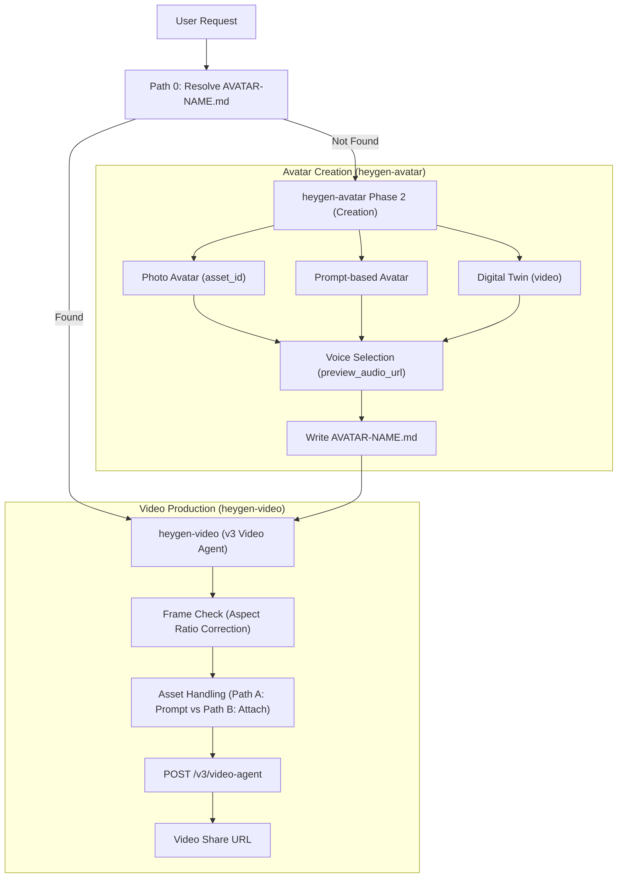
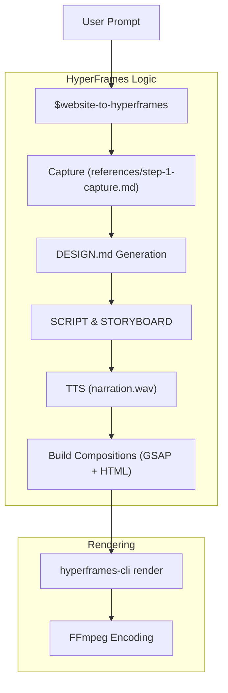
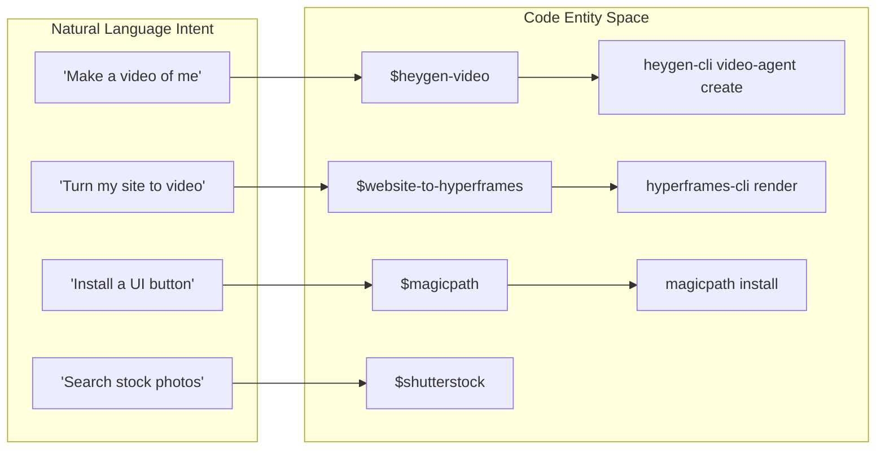

<!-- source: DeepWiki mcp.deepwiki.com · repo openai/plugins · page 4.5 Design and Creative Plugins (Canva, Hugging Face, HyperFrames, Remotion, HeyGen, MagicPath) · fetched 2026-10-26 -->

# Design and Creative Plugins (Canva, Hugging Face, HyperFrames, Remotion, HeyGen, MagicPath)

Relevant source files

The following files were used as context for generating this wiki page:

- [plugins/base44/assets/logo-padded.png](plugins/base44/assets/logo-padded.png)
- [plugins/canva/assets/canva-small.svg](plugins/canva/assets/canva-small.svg)
- [plugins/canva/assets/canva.svg](plugins/canva/assets/canva.svg)
- [plugins/canva/skills/canva-branded-presentation/SKILL.md](plugins/canva/skills/canva-branded-presentation/SKILL.md)
- [plugins/canva/skills/canva-branded-presentation/agents/openai.yaml](plugins/canva/skills/canva-branded-presentation/agents/openai.yaml)
- [plugins/canva/skills/canva-branded-presentation/assets/canva-small.svg](plugins/canva/skills/canva-branded-presentation/assets/canva-small.svg)
- [plugins/canva/skills/canva-branded-presentation/assets/canva.svg](plugins/canva/skills/canva-branded-presentation/assets/canva.svg)
- [plugins/canva/skills/canva-resize-for-all-social-media/SKILL.md](plugins/canva/skills/canva-resize-for-all-social-media/SKILL.md)
- [plugins/canva/skills/canva-resize-for-all-social-media/agents/openai.yaml](plugins/canva/skills/canva-resize-for-all-social-media/agents/openai.yaml)
- [plugins/canva/skills/canva-resize-for-all-social-media/assets/canva-small.svg](plugins/canva/skills/canva-resize-for-all-social-media/assets/canva-small.svg)
- [plugins/canva/skills/canva-resize-for-all-social-media/assets/canva.svg](plugins/canva/skills/canva-resize-for-all-social-media/assets/canva.svg)
- [plugins/canva/skills/canva-translate-design/SKILL.md](plugins/canva/skills/canva-translate-design/SKILL.md)
- [plugins/canva/skills/canva-translate-design/agents/openai.yaml](plugins/canva/skills/canva-translate-design/agents/openai.yaml)
- [plugins/fal/.codex-plugin/plugin.json](plugins/fal/.codex-plugin/plugin.json)
- [plugins/figma/assets/logo-padded.png](plugins/figma/assets/logo-padded.png)
- [plugins/heygen/.app.json](plugins/heygen/.app.json)
- [plugins/heygen/.codex-plugin/plugin.json](plugins/heygen/.codex-plugin/plugin.json)
- [plugins/heygen/README.md](plugins/heygen/README.md)
- [plugins/heygen/assets/PRISM_ORB.svg](plugins/heygen/assets/PRISM_ORB.svg)
- [plugins/heygen/assets/icon.png](plugins/heygen/assets/icon.png)
- [plugins/heygen/assets/logo.png](plugins/heygen/assets/logo.png)
- [plugins/heygen/skills/heygen-avatar/SKILL.md](plugins/heygen/skills/heygen-avatar/SKILL.md)
- [plugins/heygen/skills/heygen-avatar/references/asset-routing.md](plugins/heygen/skills/heygen-avatar/references/asset-routing.md)
- [plugins/heygen/skills/heygen-avatar/references/avatar-creation.md](plugins/heygen/skills/heygen-avatar/references/avatar-creation.md)
- [plugins/heygen/skills/heygen-avatar/references/troubleshooting.md](plugins/heygen/skills/heygen-avatar/references/troubleshooting.md)
- [plugins/heygen/skills/heygen-video/SKILL.md](plugins/heygen/skills/heygen-video/SKILL.md)
- [plugins/heygen/skills/heygen-video/references/asset-routing.md](plugins/heygen/skills/heygen-video/references/asset-routing.md)
- [plugins/heygen/skills/heygen-video/references/avatar-discovery.md](plugins/heygen/skills/heygen-video/references/avatar-discovery.md)
- [plugins/heygen/skills/heygen-video/references/troubleshooting.md](plugins/heygen/skills/heygen-video/references/troubleshooting.md)
- [plugins/hyperframes/.codex-plugin/plugin.json](plugins/hyperframes/.codex-plugin/plugin.json)
- [plugins/hyperframes/README.md](plugins/hyperframes/README.md)
- [plugins/hyperframes/assets/icon.png](plugins/hyperframes/assets/icon.png)
- [plugins/hyperframes/assets/logo.png](plugins/hyperframes/assets/logo.png)
- [plugins/hyperframes/skills/gsap/SKILL.md](plugins/hyperframes/skills/gsap/SKILL.md)
- [plugins/hyperframes/skills/gsap/agents/openai.yaml](plugins/hyperframes/skills/gsap/agents/openai.yaml)
- [plugins/hyperframes/skills/gsap/references/effects.md](plugins/hyperframes/skills/gsap/references/effects.md)
- [plugins/hyperframes/skills/gsap/scripts/extract-audio-data.py](plugins/hyperframes/skills/gsap/scripts/extract-audio-data.py)
- [plugins/hyperframes/skills/hyperframes-cli/SKILL.md](plugins/hyperframes/skills/hyperframes-cli/SKILL.md)
- [plugins/hyperframes/skills/hyperframes-cli/agents/openai.yaml](plugins/hyperframes/skills/hyperframes-cli/agents/openai.yaml)
- [plugins/hyperframes/skills/hyperframes-registry/SKILL.md](plugins/hyperframes/skills/hyperframes-registry/SKILL.md)
- [plugins/hyperframes/skills/hyperframes-registry/agents/openai.yaml](plugins/hyperframes/skills/hyperframes-registry/agents/openai.yaml)
- [plugins/hyperframes/skills/hyperframes-registry/examples/add-block.md](plugins/hyperframes/skills/hyperframes-registry/examples/add-block.md)
- [plugins/hyperframes/skills/hyperframes/SKILL.md](plugins/hyperframes/skills/hyperframes/SKILL.md)
- [plugins/hyperframes/skills/hyperframes/agents/openai.yaml](plugins/hyperframes/skills/hyperframes/agents/openai.yaml)
- [plugins/hyperframes/skills/website-to-hyperframes/SKILL.md](plugins/hyperframes/skills/website-to-hyperframes/SKILL.md)
- [plugins/hyperframes/skills/website-to-hyperframes/agents/openai.yaml](plugins/hyperframes/skills/website-to-hyperframes/agents/openai.yaml)
- [plugins/hyperframes/skills/website-to-hyperframes/references/step-6-build.md](plugins/hyperframes/skills/website-to-hyperframes/references/step-6-build.md)
- [plugins/hyperframes/skills/website-to-hyperframes/references/step-7-validate.md](plugins/hyperframes/skills/website-to-hyperframes/references/step-7-validate.md)
- [plugins/magicpath/.codex-plugin/plugin.json](plugins/magicpath/.codex-plugin/plugin.json)
- [plugins/magicpath/README.md](plugins/magicpath/README.md)
- [plugins/magicpath/assets/magicpath.png](plugins/magicpath/assets/magicpath.png)
- [plugins/magicpath/skills/magicpath/SKILL.md](plugins/magicpath/skills/magicpath/SKILL.md)
- [plugins/magicpath/skills/magicpath/references/cli-reference.md](plugins/magicpath/skills/magicpath/references/cli-reference.md)
- [plugins/magicpath/skills/magicpath/references/working-with-embedded-browsers.md](plugins/magicpath/skills/magicpath/references/working-with-embedded-browsers.md)
- [plugins/magicpath/skills/magicpath/references/working-with-repositories.md](plugins/magicpath/skills/magicpath/references/working-with-repositories.md)
- [plugins/picsart/.codex-plugin/plugin.json](plugins/picsart/.codex-plugin/plugin.json)
- [plugins/shutterstock/.codex-plugin/plugin.json](plugins/shutterstock/.codex-plugin/plugin.json)

This page documents the integration of design, creative, and video production plugins within the OpenAI plugins ecosystem. These plugins enable users to bridge natural language descriptions with visual assets, machine learning models, programmatic video rendering, and UI component authoring.

## Canva Plugin

The Canva plugin provides high-level skills for design creation, adaptation, and localization. It focuses on branded outputs and automated resizing across social platforms.

### Core Skills
Canva implements three primary skills:
1.  **Branded Presentation**: Converts briefs or Canva docs into on-brand slide decks [plugins/canva/skills/canva-branded-presentation/SKILL.md:1-10]().
2.  **Social Resize**: Automates the transformation of a single design into variants for Facebook, Instagram, and LinkedIn [plugins/canva/skills/canva-resize-for-all-social-media/SKILL.md:1-10]().
3.  **Translate Design**: Generates localized copies of existing designs in different languages [plugins/canva/skills/canva-translate-design/SKILL.md:1-10]().

**Sources:** [plugins/canva/skills/canva-branded-presentation/SKILL.md:1-10](), [plugins/canva/skills/canva-resize-for-all-social-media/SKILL.md:1-10](), [plugins/canva/skills/canva-translate-design/SKILL.md:1-10]()

---

## Hugging Face Plugin

The Hugging Face integration allows the model to interact with the broader machine learning ecosystem, including models, datasets, and training infrastructure.

### Key Capabilities
*   **Model/Dataset Discovery**: Querying the Hugging Face Hub for specific architectures or data domains.
*   **Training & Fine-tuning**: Skills like `llm-trainer` for triggering and monitoring training runs [plugins/hugging-face/skills/llm-trainer/SKILL.md:1-15]().
*   **Community & Evals**: Accessing community evaluations, Gradio Spaces, and paper publications.
*   **Client-side ML**: Facilitating tasks via `Transformers.js` and vision trainers.

**Sources:** [plugins/hugging-face/skills/llm-trainer/SKILL.md:1-15]()

---

## HeyGen (Standalone & Video Agent)

The HeyGen plugin provides a sophisticated pipeline for creating AI avatar videos and personalized video messages. It operates through two primary skills: `heygen-avatar` and `heygen-video`.

### Implementation Architecture
HeyGen uses an "Identity-First" approach where an avatar is created or resolved before video generation. It supports both a dedicated App Connector (OAuth) and a CLI-based fallback [plugins/heygen/skills/heygen-video/SKILL.md:78-89]().

**HeyGen Video Pipeline**

**Sources:** [plugins/heygen/skills/heygen-video/SKILL.md:1-55](), [plugins/heygen/skills/heygen-avatar/SKILL.md:1-27](), [plugins/heygen/skills/heygen-avatar/references/avatar-creation.md:14-23](), [plugins/heygen/skills/heygen-video/references/asset-routing.md:5-12]()

### Asset Classification Engine
HeyGen classifies assets into two routes:
*   **Path A (Contextualize)**: Content is read and woven into the script (e.g., research docs) [plugins/heygen/skills/heygen-video/references/asset-routing.md:46-50]().
*   **Path B (Attach)**: Files are uploaded as `asset_id` and used as B-roll or frames (e.g., logos, screenshots) [plugins/heygen/skills/heygen-video/references/asset-routing.md:52-60]().

**Sources:** [plugins/heygen/skills/heygen-video/references/asset-routing.md:5-43]()

---

## HyperFrames by HeyGen

HyperFrames is a programmatic video framework that renders HTML/CSS/JS into video using GSAP animations. It includes a 7-step pipeline for converting existing websites into professional video promos.

### Technical Workflow
The plugin relies on the `hyperframes-cli` for orchestration [plugins/hyperframes/skills/hyperframes-cli/SKILL.md:3-3]().

**HyperFrames Pipeline**

**Sources:** [plugins/hyperframes/skills/website-to-hyperframes/SKILL.md:17-91](), [plugins/hyperframes/skills/hyperframes-cli/SKILL.md:1-20]()

---

## MagicPath

MagicPath provides a system for searching, installing, and authoring UI components via the `magicpath-ai` CLI.

### Core Skill: `magicpath`
*   **Component Search**: Finding UI components within a registry [plugins/magicpath/skills/magicpath/SKILL.md:1-10]().
*   **Installation**: Adding components to a local repository using `magicpath install <component-name>` [plugins/magicpath/skills/magicpath/references/cli-reference.md:5-15]().
*   **Authoring**: Creating new components that follow the MagicPath schema.

**Sources:** [plugins/magicpath/skills/magicpath/SKILL.md:1-15](), [plugins/magicpath/skills/magicpath/references/cli-reference.md:1-20]()

---

## Remotion and Creative Media Plugins

*   **Remotion**: Enables video creation using React components, allowing for complex 3D transitions and programmatic audio syncing.
*   **Picsart**: Interface for generating high-quality images, videos, and audio from 140+ AI models [plugins/picsart/.codex-plugin/plugin.json:14-20]().
*   **Shutterstock**: Search-only interface for stock media libraries (images, videos, music) [plugins/shutterstock/.codex-plugin/plugin.json:14-17]().
*   **Fal**: Orchestrates image, video, and 3D generation using specialized model recommendations and async job management [plugins/fal/.codex-plugin/plugin.json:14-17]().

---

## Natural Language to Code Entity Mapping

This diagram bridges user intent to the specific technical entities in the codebase.

**Natural Language to Code Entity Mapping**

**Sources:** [plugins/heygen/skills/heygen-video/SKILL.md:3-15](), [plugins/hyperframes/skills/website-to-hyperframes/SKILL.md:1-5](), [plugins/magicpath/skills/magicpath/SKILL.md:1-5](), [plugins/shutterstock/.codex-plugin/plugin.json:14-17]()

## Technical Reference Table

| Plugin | Category | Key Skill / Tool | Primary Implementation File |
| :--- | :--- | :--- | :--- |
| **Canva** | Design | `canva-branded-presentation` | `plugins/canva/.codex-plugin/plugin.json` |
| **HeyGen** | AI Video | `heygen-video` | `plugins/heygen/skills/heygen-video/SKILL.md` |
| **HyperFrames** | Programmatic Video | `website-to-hyperframes` | `plugins/hyperframes/skills/website-to-hyperframes/SKILL.md` |
| **MagicPath** | UI/Code | `magicpath` | `plugins/magicpath/skills/magicpath/SKILL.md` |
| **Picsart** | Creative AI | `picsart` | `plugins/picsart/.codex-plugin/plugin.json` |
| **Fal** | Media Gen | `fal` | `plugins/fal/.codex-plugin/plugin.json` |

**Sources:** [plugins/heygen/.codex-plugin/plugin.json:25-30](), [plugins/hyperframes/.codex-plugin/plugin.json:1-43](), [plugins/magicpath/.codex-plugin/plugin.json:1-20](), [plugins/picsart/.codex-plugin/plugin.json:1-32](), [plugins/fal/.codex-plugin/plugin.json:1-32]()

---

