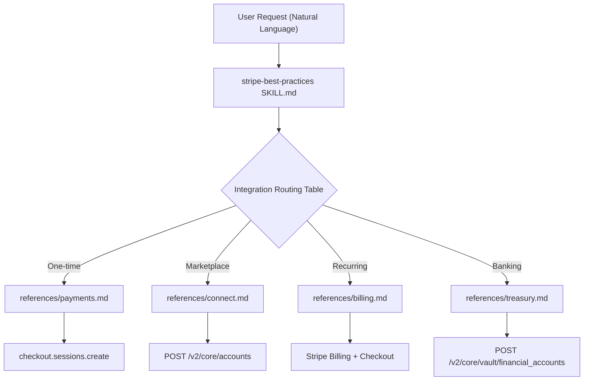
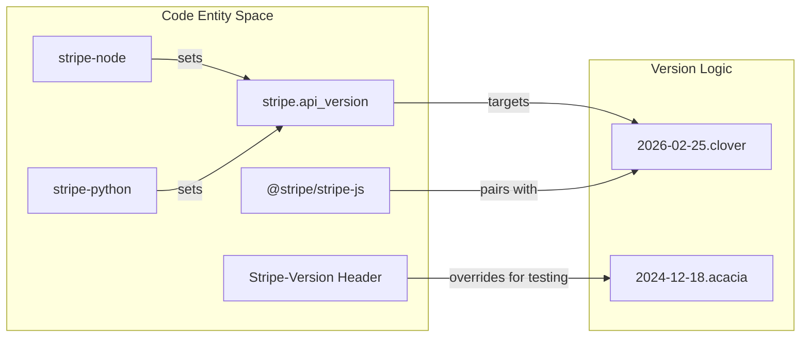

<!-- source: DeepWiki mcp.deepwiki.com · repo openai/plugins · page 4.6 Payments and Finance Plugins (Stripe, Ramp) · fetched 2026-10-26 -->

# Payments and Finance Plugins (Stripe, Ramp)

Relevant source files

The following files were used as context for generating this wiki page:

- [plugins/stripe/.app.json](plugins/stripe/.app.json)
- [plugins/stripe/.codex-plugin/plugin.json](plugins/stripe/.codex-plugin/plugin.json)
- [plugins/stripe/skills/stripe-best-practices/SKILL.md](plugins/stripe/skills/stripe-best-practices/SKILL.md)
- [plugins/stripe/skills/stripe-best-practices/references/billing.md](plugins/stripe/skills/stripe-best-practices/references/billing.md)
- [plugins/stripe/skills/stripe-best-practices/references/connect.md](plugins/stripe/skills/stripe-best-practices/references/connect.md)
- [plugins/stripe/skills/stripe-best-practices/references/payments.md](plugins/stripe/skills/stripe-best-practices/references/payments.md)
- [plugins/stripe/skills/stripe-best-practices/references/treasury.md](plugins/stripe/skills/stripe-best-practices/references/treasury.md)
- [plugins/stripe/skills/upgrade-stripe/SKILL.md](plugins/stripe/skills/upgrade-stripe/SKILL.md)

The payments and finance plugins provide a comprehensive suite of tools and reference architectures for integrating payments, billing, marketplaces, and financial services into applications. This section focuses on the Stripe plugin—which guides developers toward modern API standards like Accounts v2 and Checkout Sessions—and the Ramp integration for corporate finance workflows.

## Stripe Plugin Overview

The Stripe plugin is categorized under **Finance** and serves as a high-level wrapper for Stripe's business tools [plugins/stripe/.codex-plugin/plugin.json:1-20](). It utilizes a Skill-based architecture to provide domain-specific guidance and implementation support. It is associated with the app identifier `asdk_app_6983c208e5f8819196b7511519f97993` [plugins/stripe/.app.json:4]().

### Key Components
- **`stripe-best-practices` Skill**: A reference-heavy skill that routes users to the correct Stripe APIs based on business requirements such as one-time payments, marketplaces, or banking [plugins/stripe/skills/stripe-best-practices/SKILL.md:2-18]().
- **`upgrade-stripe` Skill**: An automation-focused skill for managing API versioning, SDK updates, and breaking change migrations [plugins/stripe/skills/upgrade-stripe/SKILL.md:2-11]().
- **Reference Documentation**: A curated set of Markdown files within the skill directory containing "traps to avoid" and modern implementation patterns [plugins/stripe/skills/stripe-best-practices/references/]() .

**Sources:**
- [plugins/stripe/.codex-plugin/plugin.json]()
- [plugins/stripe/.app.json]()
- [plugins/stripe/skills/stripe-best-practices/SKILL.md]()
- [plugins/stripe/skills/upgrade-stripe/SKILL.md]()

---

## Integration Architecture

The Stripe plugin follows an "Integration Routing" pattern. Instead of a single monolithic tool, it analyzes the user's intent and maps it to specific Stripe API hierarchies and reference documents [plugins/stripe/skills/stripe-best-practices/SKILL.md:8-18]().

### Natural Language to API Mapping

| User Intent | Recommended API / Entity | Reference File |
|---|---|---|
| "Accept a payment" | `checkout.sessions.create` | [payments.md]() |
| "Start a marketplace" | `POST /v2/core/accounts` | [connect.md]() |
| "Create a subscription" | Billing APIs + Checkout | [billing.md]() |
| "Open a bank account" | `POST /v2/core/vault/financial_accounts` | [treasury.md]() |
| "Save a card" | `setup_intents` | [payments.md]() |

### Data Flow: Best Practices Routing
The following diagram illustrates how the `stripe-best-practices` skill processes a request to determine the correct technical path.

Title: Stripe Integration Decision Flow

**Sources:**
- [plugins/stripe/skills/stripe-best-practices/SKILL.md:9-18]()
- [plugins/stripe/skills/stripe-best-practices/references/payments.md:12-19]()
- [plugins/stripe/skills/stripe-best-practices/references/connect.md:9-11]()
- [plugins/stripe/skills/stripe-best-practices/references/billing.md:8-19]()
- [plugins/stripe/skills/stripe-best-practices/references/treasury.md:7-12]()

---

## Implementation Details

### 1. Payments and Checkout
The plugin prioritizes the **Checkout Sessions API** (`checkout.sessions.create`) for on-session payments [plugins/stripe/skills/stripe-best-practices/references/payments.md:14-15]().
- **Deprecated APIs**: The plugin explicitly warns against using the `Charges API`, `Sources API`, or legacy `Card Element` [plugins/stripe/skills/stripe-best-practices/references/payments.md:46-56]().
- **UI Components**: The recommended order of preference is Payment Links > Checkout > Payment Element [plugins/stripe/skills/stripe-best-practices/references/payments.md:22-26]().
- **Dynamic Methods**: Users are advised to enable payment methods in the Stripe Dashboard rather than hardcoding `payment_method_types` [plugins/stripe/skills/stripe-best-practices/references/payments.md:41-44]().

### 2. Connect (Marketplaces)
For new Connect platforms, the plugin enforces the **Accounts v2 API** (`POST /v2/core/accounts`) [plugins/stripe/skills/stripe-best-practices/references/connect.md:9-11]().
- **Controller Properties**: The plugin replaces legacy "Standard/Express/Custom" labels with explicit `controller` properties (e.g., `controller.losses.payments`, `controller.fees.payer`, `controller.stripe_dashboard.type`) to define account behavior [plugins/stripe/skills/stripe-best-practices/references/connect.md:17-30]().
- **Charge Types**: It recommends **Destination Charges** for most platforms where the platform accepts liability for negative balances [plugins/stripe/skills/stripe-best-practices/references/connect.md:34-36]().

### 3. Treasury and Financial Accounts
For embedded financial accounts (banking, routing numbers), the plugin directs users to the **v2 Financial Accounts API** (`POST /v2/core/vault/financial_accounts`) [plugins/stripe/skills/stripe-best-practices/references/treasury.md:7-12](). It specifically warns against using the legacy `v1 Treasury` endpoints for new integrations [plugins/stripe/skills/stripe-best-practices/references/treasury.md:13-15]().

### 4. API Upgrades and Versioning
The `upgrade-stripe` skill manages the lifecycle of Stripe's date-based API versions (e.g., `2026-02-25.clover`) [plugins/stripe/skills/upgrade-stripe/SKILL.md:7-15]().

Title: SDK and Version Management Entities

**Sources:**
- [plugins/stripe/skills/upgrade-stripe/SKILL.md:41-55]()
- [plugins/stripe/skills/upgrade-stripe/SKILL.md:103-110]()
- [plugins/stripe/skills/upgrade-stripe/SKILL.md:155-161]()
- [plugins/stripe/skills/stripe-best-practices/references/connect.md:17-31]()

---

## Technical Reference: Versioning & SDKs

The plugin provides specific implementation patterns for different programming languages to ensure type safety and compatibility during upgrades.

### SDK Version Management
| Language Type | Behavior | Recommendation |
|---|---|---|
| **Dynamically-Typed** (Node, Python, Ruby, PHP) | Flexible version control | Explicitly set `stripe.api_version` or `apiVersion` in global config or per-request [plugins/stripe/skills/upgrade-stripe/SKILL.md:37-55](). |
| **Strongly-Typed** (Java, Go, .NET) | Fixed API version | Update the SDK package version; do not manually override the version string to avoid type mismatches [plugins/stripe/skills/upgrade-stripe/SKILL.md:65-68](). |

### Upgrade Checklist
When the `upgrade-stripe` skill is invoked, it follows a structured migration path:
1. **Review Changelog**: Identify breaking changes between current and target versions [plugins/stripe/skills/upgrade-stripe/SKILL.md:143-144]().
2. **Update Client**: Set the `apiVersion` parameter during client initialization (e.g., `apiVersion: '2026-02-25.clover'`) [plugins/stripe/skills/upgrade-stripe/SKILL.md:146-147]().
3. **Test Headers**: Use the `Stripe-Version` header for testing against new versions without changing account defaults [plugins/stripe/skills/upgrade-stripe/SKILL.md:155-161]().
4. **Database Collation**: Ensure object IDs are stored in databases accommodating up to 255 characters with case-sensitive collation [plugins/stripe/skills/upgrade-stripe/SKILL.md:151]().

**Sources:**
- [plugins/stripe/skills/upgrade-stripe/SKILL.md:37-68]()
- [plugins/stripe/skills/upgrade-stripe/SKILL.md:141-152]()
- [plugins/stripe/skills/upgrade-stripe/SKILL.md:153-170]()

---

## Ramp Integration

While the Stripe plugin focuses on the merchant/platform side of payments, the Ramp integration handles corporate finance and vendor spend analysis. It is an **MCP-backed** plugin that allows the agent to interact with Ramp's financial data.

### MCP-Backed Finance Workflows
Ramp utilizes the Model Context Protocol (MCP) to expose tools for:
- **Vendor Spend Analysis**: Querying and summarizing spend across different vendors.
- **Transaction Retrieval**: Fetching specific transaction details for reconciliation.
- **Finance Automation**: Interacting with Ramp's APIs to manage corporate cards and expenses.

The Ramp integration is defined via a `.mcp.json` configuration, allowing the Codex UI to discover and invoke financial tools directly within the chat context.

**Sources:**
- [Wiki Table of Contents: 2.2, 4.6]()

---

