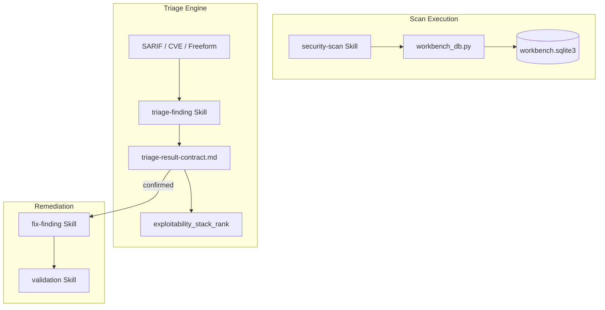
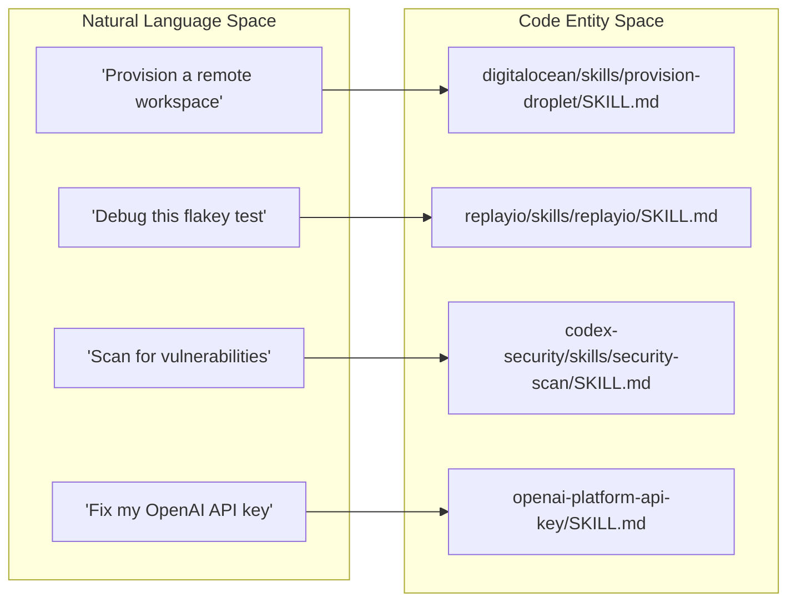

<!-- source: DeepWiki mcp.deepwiki.com · repo openai/plugins · page 4.7 Developer Tools and Infrastructure Plugins (OpenAI Developers, ChatGPT Apps, CodeRabbit, Codex Security, CircleCI, Temporal, Twilio, Sentry, Replay.io, DigitalOcean, OpenAI Ads Conversions) · fetched 2026-10-26 -->

# Developer Tools and Infrastructure Plugins (OpenAI Developers, ChatGPT Apps, CodeRabbit, Codex Security, CircleCI, Temporal, Twilio, Sentry, Replay.io, DigitalOcean, OpenAI Ads Conversions)

Relevant source files

The following files were used as context for generating this wiki page:

- [plugins/circleci/skills/builds/SKILL.md](plugins/circleci/skills/builds/SKILL.md)
- [plugins/circleci/skills/builds/references/transient-vs-deterministic.md](plugins/circleci/skills/builds/references/transient-vs-deterministic.md)
- [plugins/circleci/skills/chunk/SKILL.md](plugins/circleci/skills/chunk/SKILL.md)
- [plugins/circleci/skills/chunk/references/chunk-cli.md](plugins/circleci/skills/chunk/references/chunk-cli.md)
- [plugins/circleci/skills/chunk/references/chunk-ui.md](plugins/circleci/skills/chunk/references/chunk-ui.md)
- [plugins/circleci/skills/cli/SKILL.md](plugins/circleci/skills/cli/SKILL.md)
- [plugins/circleci/skills/config/SKILL.md](plugins/circleci/skills/config/SKILL.md)
- [plugins/circleci/skills/config/references/cache-optimization.md](plugins/circleci/skills/config/references/cache-optimization.md)
- [plugins/circleci/skills/config/references/patterns.md](plugins/circleci/skills/config/references/patterns.md)
- [plugins/cloudflare/README.md](plugins/cloudflare/README.md)
- [plugins/cloudflare/commands/build-mcp.md](plugins/cloudflare/commands/build-mcp.md)
- [plugins/cloudflare/skills/building-mcp-server-on-cloudflare/SKILL.md](plugins/cloudflare/skills/building-mcp-server-on-cloudflare/SKILL.md)
- [plugins/cloudflare/skills/building-mcp-server-on-cloudflare/references/examples.md](plugins/cloudflare/skills/building-mcp-server-on-cloudflare/references/examples.md)
- [plugins/cloudflare/skills/building-mcp-server-on-cloudflare/references/oauth-setup.md](plugins/cloudflare/skills/building-mcp-server-on-cloudflare/references/oauth-setup.md)
- [plugins/cloudflare/skills/cloudflare/references/ai-gateway/dynamic-routing.md](plugins/cloudflare/skills/cloudflare/references/ai-gateway/dynamic-routing.md)
- [plugins/cloudflare/skills/sandbox-sdk/references/examples.md](plugins/cloudflare/skills/sandbox-sdk/references/examples.md)
- [plugins/coderabbit/.codex-plugin/plugin.json](plugins/coderabbit/.codex-plugin/plugin.json)
- [plugins/coderabbit/assets/coderabbit-small.png](plugins/coderabbit/assets/coderabbit-small.png)
- [plugins/coderabbit/assets/coderabbit.png](plugins/coderabbit/assets/coderabbit.png)
- [plugins/coderabbit/skills/coderabbit-review/SKILL.md](plugins/coderabbit/skills/coderabbit-review/SKILL.md)
- [plugins/codex-security/.app.json](plugins/codex-security/.app.json)
- [plugins/codex-security/.codex-plugin/plugin.json](plugins/codex-security/.codex-plugin/plugin.json)
- [plugins/codex-security/.mcp.json](plugins/codex-security/.mcp.json)
- [plugins/codex-security/mcp/mcp-app.html.br](plugins/codex-security/mcp/mcp-app.html.br)
- [plugins/codex-security/mcp/server.mjs.br.part-000](plugins/codex-security/mcp/server.mjs.br.part-000)
- [plugins/codex-security/mcp/server.mjs.br.part-001](plugins/codex-security/mcp/server.mjs.br.part-001)
- [plugins/codex-security/references/config-preflight.md](plugins/codex-security/references/config-preflight.md)
- [plugins/codex-security/references/final-report.md](plugins/codex-security/references/final-report.md)
- [plugins/codex-security/references/finding-detail-fields.md](plugins/codex-security/references/finding-detail-fields.md)
- [plugins/codex-security/references/sarif-adapter.md](plugins/codex-security/references/sarif-adapter.md)
- [plugins/codex-security/references/scan-artifacts.md](plugins/codex-security/references/scan-artifacts.md)
- [plugins/codex-security/scripts/generate_rank_input.py](plugins/codex-security/scripts/generate_rank_input.py)
- [plugins/codex-security/scripts/workbench_db.py](plugins/codex-security/scripts/workbench_db.py)
- [plugins/codex-security/skills/attack-path-analysis/SKILL.md](plugins/codex-security/skills/attack-path-analysis/SKILL.md)
- [plugins/codex-security/skills/attack-path-analysis/references/severity-policy.md](plugins/codex-security/skills/attack-path-analysis/references/severity-policy.md)
- [plugins/codex-security/skills/deep-security-scan/SKILL.md](plugins/codex-security/skills/deep-security-scan/SKILL.md)
- [plugins/codex-security/skills/finding-discovery/SKILL.md](plugins/codex-security/skills/finding-discovery/SKILL.md)
- [plugins/codex-security/skills/security-diff-scan/SKILL.md](plugins/codex-security/skills/security-diff-scan/SKILL.md)
- [plugins/codex-security/skills/security-scan/SKILL.md](plugins/codex-security/skills/security-scan/SKILL.md)
- [plugins/codex-security/skills/security-scan/references/repo-wide-artifacts-and-ledger.md](plugins/codex-security/skills/security-scan/references/repo-wide-artifacts-and-ledger.md)
- [plugins/codex-security/skills/security-scan/references/scan-artifacts-and-ledger.md](plugins/codex-security/skills/security-scan/references/scan-artifacts-and-ledger.md)
- [plugins/codex-security/skills/triage-finding/SKILL.md](plugins/codex-security/skills/triage-finding/SKILL.md)
- [plugins/codex-security/skills/triage-finding/references/ticket-intake.md](plugins/codex-security/skills/triage-finding/references/ticket-intake.md)
- [plugins/codex-security/skills/triage-finding/references/triage-result-contract.md](plugins/codex-security/skills/triage-finding/references/triage-result-contract.md)
- [plugins/codex-security/skills/validation/SKILL.md](plugins/codex-security/skills/validation/SKILL.md)
- [plugins/digitalocean/.app.json](plugins/digitalocean/.app.json)
- [plugins/digitalocean/.codex-plugin/plugin.json](plugins/digitalocean/.codex-plugin/plugin.json)
- [plugins/digitalocean/README.md](plugins/digitalocean/README.md)
- [plugins/digitalocean/assets/logo-dark.png](plugins/digitalocean/assets/logo-dark.png)
- [plugins/digitalocean/assets/logo.png](plugins/digitalocean/assets/logo.png)
- [plugins/digitalocean/skills/provision-droplet/SKILL.md](plugins/digitalocean/skills/provision-droplet/SKILL.md)
- [plugins/digitalocean/skills/provision-droplet/scripts/configure_ssh.py](plugins/digitalocean/skills/provision-droplet/scripts/configure_ssh.py)
- [plugins/digitalocean/skills/provision-droplet/scripts/keygen.py](plugins/digitalocean/skills/provision-droplet/scripts/keygen.py)
- [plugins/digitalocean/skills/provision-droplet/ssh_config.tmpl](plugins/digitalocean/skills/provision-droplet/ssh_config.tmpl)
- [plugins/openai-ads-conversions/.codex-plugin/plugin.json](plugins/openai-ads-conversions/.codex-plugin/plugin.json)
- [plugins/openai-ads-conversions/README.md](plugins/openai-ads-conversions/README.md)
- [plugins/openai-ads-conversions/skills/openai-ads-conversions-setup/SKILL.md](plugins/openai-ads-conversions/skills/openai-ads-conversions-setup/SKILL.md)
- [plugins/openai-ads-conversions/skills/openai-ads-conversions-setup/agents/openai.yaml](plugins/openai-ads-conversions/skills/openai-ads-conversions-setup/agents/openai.yaml)
- [plugins/openai-ads-conversions/skills/openai-ads-conversions-setup/references/conversions-api.md](plugins/openai-ads-conversions/skills/openai-ads-conversions-setup/references/conversions-api.md)
- [plugins/openai-ads-conversions/skills/openai-ads-conversions-setup/references/framework-patterns.md](plugins/openai-ads-conversions/skills/openai-ads-conversions-setup/references/framework-patterns.md)
- [plugins/openai-ads-conversions/skills/openai-ads-conversions-setup/references/measurement-pixel.md](plugins/openai-ads-conversions/skills/openai-ads-conversions-setup/references/measurement-pixel.md)
- [plugins/openai-ads-conversions/skills/openai-ads-conversions-setup/references/report-schema.md](plugins/openai-ads-conversions/skills/openai-ads-conversions-setup/references/report-schema.md)
- [plugins/openai-ads-conversions/skills/openai-ads-conversions-setup/references/verification-checklist.md](plugins/openai-ads-conversions/skills/openai-ads-conversions-setup/references/verification-checklist.md)
- [plugins/openai-developers/.app.json](plugins/openai-developers/.app.json)
- [plugins/openai-developers/.codex-plugin/plugin.json](plugins/openai-developers/.codex-plugin/plugin.json)
- [plugins/openai-developers/.mcp.json](plugins/openai-developers/.mcp.json)
- [plugins/openai-developers/README.md](plugins/openai-developers/README.md)
- [plugins/openai-developers/assets/openai-platform.png](plugins/openai-developers/assets/openai-platform.png)
- [plugins/openai-developers/mcp/server.mjs](plugins/openai-developers/mcp/server.mjs)
- [plugins/openai-developers/scripts/openai-platform-api-key.mjs](plugins/openai-developers/scripts/openai-platform-api-key.mjs)
- [plugins/openai-developers/skills/agents-sdk/SKILL.md](plugins/openai-developers/skills/agents-sdk/SKILL.md)
- [plugins/openai-developers/skills/agents-sdk/agents/openai.yaml](plugins/openai-developers/skills/agents-sdk/agents/openai.yaml)
- [plugins/openai-developers/skills/build-chatgpt-app/LICENSE.txt](plugins/openai-developers/skills/build-chatgpt-app/LICENSE.txt)
- [plugins/openai-developers/skills/build-chatgpt-app/SKILL.md](plugins/openai-developers/skills/build-chatgpt-app/SKILL.md)
- [plugins/openai-developers/skills/build-chatgpt-app/agents/openai.yaml](plugins/openai-developers/skills/build-chatgpt-app/agents/openai.yaml)
- [plugins/openai-developers/skills/build-chatgpt-app/references/app-archetypes.md](plugins/openai-developers/skills/build-chatgpt-app/references/app-archetypes.md)
- [plugins/openai-developers/skills/build-chatgpt-app/references/apps-sdk-docs-workflow.md](plugins/openai-developers/skills/build-chatgpt-app/references/apps-sdk-docs-workflow.md)
- [plugins/openai-developers/skills/build-chatgpt-app/references/interactive-state-sync-patterns.md](plugins/openai-developers/skills/build-chatgpt-app/references/interactive-state-sync-patterns.md)
- [plugins/openai-developers/skills/chatgpt-app-submission/SKILL.md](plugins/openai-developers/skills/chatgpt-app-submission/SKILL.md)
- [plugins/openai-developers/skills/openai-api-troubleshooting/SKILL.md](plugins/openai-developers/skills/openai-api-troubleshooting/SKILL.md)
- [plugins/openai-developers/skills/openai-api-troubleshooting/agents/openai.yaml](plugins/openai-developers/skills/openai-api-troubleshooting/agents/openai.yaml)
- [plugins/openai-developers/skills/openai-api-troubleshooting/references/evals.md](plugins/openai-developers/skills/openai-api-troubleshooting/references/evals.md)
- [plugins/openai-developers/skills/openai-platform-api-key/SKILL.md](plugins/openai-developers/skills/openai-platform-api-key/SKILL.md)
- [plugins/openai-developers/skills/openai-platform-api-key/agents/openai.yaml](plugins/openai-developers/skills/openai-platform-api-key/agents/openai.yaml)
- [plugins/openai-developers/skills/openai-platform-api-key/references/evals.md](plugins/openai-developers/skills/openai-platform-api-key/references/evals.md)
- [plugins/openai-developers/tests/openai-platform-api-key.test.mjs](plugins/openai-developers/tests/openai-platform-api-key.test.mjs)
- [plugins/replayio/.app.json](plugins/replayio/.app.json)
- [plugins/replayio/.codex-plugin/plugin.json](plugins/replayio/.codex-plugin/plugin.json)
- [plugins/replayio/LICENSE](plugins/replayio/LICENSE)
- [plugins/replayio/assets/replayio.svg](plugins/replayio/assets/replayio.svg)
- [plugins/replayio/hooks.json](plugins/replayio/hooks.json)
- [plugins/replayio/scripts/post_bash_upload.sh](plugins/replayio/scripts/post_bash_upload.sh)
- [plugins/replayio/scripts/stop_close_and_upload.sh](plugins/replayio/scripts/stop_close_and_upload.sh)
- [plugins/replayio/skills/replay-qa-api/SKILL.md](plugins/replayio/skills/replay-qa-api/SKILL.md)
- [plugins/replayio/skills/replay-qa-api/agents/openai.yaml](plugins/replayio/skills/replay-qa-api/agents/openai.yaml)
- [plugins/replayio/skills/replayio/SKILL.md](plugins/replayio/skills/replayio/SKILL.md)
- [plugins/replayio/skills/replayio/agents/openai.yaml](plugins/replayio/skills/replayio/agents/openai.yaml)
- [plugins/replayio/skills/replayio/references/cli.md](plugins/replayio/skills/replayio/references/cli.md)
- [plugins/replayio/skills/replayio/references/workflows.md](plugins/replayio/skills/replayio/references/workflows.md)

This section documents the suite of plugins designed to support the software development lifecycle, from API management and app scaffolding to CI/CD orchestration, security auditing, time-travel debugging, and infrastructure provisioning. These plugins bridge the gap between high-level architectural intent and low-level infrastructure execution.

## 1. OpenAI Developers
The `openai-developers` plugin is the central hub for managing OpenAI Platform resources within Codex. It provides tools for secure API key management, runtime troubleshooting, and building with the Agents SDK and ChatGPT Apps SDK [plugins/openai-developers/.codex-plugin/plugin.json:4-4]().

### Implementation and Key Management
The plugin uses a secure local key-generation flow to avoid exposing plaintext secrets. The script `openai-platform-api-key.mjs` implements an RSA-OAEP keypair generation for local encryption/decryption of keys retrieved from the platform [plugins/openai-developers/tests/openai-platform-api-key.test.mjs:83-102]().

The workflow follows a "Step 0" auth-check pattern, ensuring the user is connected via the `openai-platform` app connector before proceeding with sensitive operations [plugins/openai-developers/.app.json]().

### Local Destination Confirmation (MCP)
Unlike standard app-connector plugins, `openai-developers` includes a local MCP server `mcp/server.mjs` that provides a `confirm_openai_api_key_local_destination` tool [plugins/openai-developers/tests/openai-platform-api-key.test.mjs:160-162](). This tool uses an "elicitation/create" mode to present a form to the user, allowing them to confirm or override the `.env` file path where the API key will be stored [plugins/openai-developers/tests/openai-platform-api-key.test.mjs:203-212]().

### Data Flow: Secure Key Provisioning
| Step | Action | Entity |
| :--- | :--- | :--- |
| 1 | Generate RSA-OAEP Keypair | `openai-platform-api-key.mjs prepare` [plugins/openai-developers/tests/openai-platform-api-key.test.mjs:104-106]() |
| 2 | Request Encrypted Key | `openai-platform` App Connector [plugins/openai-developers/.app.json]() |
| 3 | Confirm Path | `confirm_openai_api_key_local_destination` (MCP Tool) [plugins/openai-developers/tests/openai-platform-api-key.test.mjs:183-190]() |
| 4 | Decrypt & Write | `openai-platform-api-key.mjs` writing to `.env.local` [plugins/openai-developers/tests/openai-platform-api-key.test.mjs:108-116]() |

**Sources:** [plugins/openai-developers/README.md](), [plugins/openai-developers/.codex-plugin/plugin.json](), [plugins/openai-developers/tests/openai-platform-api-key.test.mjs](), [plugins/openai-developers/skills/openai-platform-api-key/SKILL.md]().

---

## 2. ChatGPT Apps
The `chatgpt-apps` (bundled within `openai-developers`) plugin provides scaffolding and submission preparation for the ChatGPT Apps SDK. It focuses on converting MCP (Model Context Protocol) servers into deployable ChatGPT Apps.

### App Submission Generation
The `chatgpt-app-submission` skill inspects local MCP server codebases to generate `chatgpt-app-submission.json` [plugins/openai-developers/skills/chatgpt-app-submission/SKILL.md:3-8](). It enforces strict "Hint Rules" for tool annotations:
*   **readOnlyHint**: `true` only for data retrieval [plugins/openai-developers/skills/chatgpt-app-submission/SKILL.md:36-36]().
*   **destructiveHint**: `true` for deletions or irreversible transactions [plugins/openai-developers/skills/chatgpt-app-submission/SKILL.md:37-37]().
*   **openWorldHint**: `true` if the tool affects publicly visible internet state (e.g., sending emails) [plugins/openai-developers/skills/chatgpt-app-submission/SKILL.md:38-38]().

### Tool and CSP Validation
The skill performs static analysis on MCP tool descriptors to ensure `outputSchema` is present and that Content Security Policy (CSP) values are as narrow as possible [plugins/openai-developers/skills/chatgpt-app-submission/SKILL.md:44-59]().

**Sources:** [plugins/openai-developers/skills/chatgpt-app-submission/SKILL.md]().

---

## 3. Codex Security
The `codex-security` plugin provides an end-to-end AppSec workflow, from initial discovery to threat modeling and remediation validation [plugins/codex-security/.codex-plugin/plugin.json:22-24]().

### Workbench and Persistence
The plugin uses a local SQLite database, managed by `workbench_db.py`, to persist scan state, finding triage, and remediation progress [plugins/codex-security/scripts/workbench_db.py:2-15](). It implements OS-level file locking to prevent race conditions during scan completion [plugins/codex-security/scripts/workbench_db.py:128-147]().

### Triage and Finding Contract
The `triage-finding` skill normalizes external finding sources (SARIF, CVE, Bug Bounty reports) into a standard `triage-finding/v0` JSON contract [plugins/codex-security/skills/triage-finding/references/triage-result-contract.md:1-25]().

| Verdict | Description |
| :--- | :--- |
| `confirmed` | Evidence-backed vulnerability found in repo [plugins/codex-security/skills/triage-finding/references/triage-result-contract.md:91-91]() |
| `not_actionable` | False positive or out-of-scope [plugins/codex-security/skills/triage-finding/references/triage-result-contract.md:92-92]() |
| `needs_review` | Boundary case requiring human intervention [plugins/codex-security/skills/triage-finding/references/triage-result-contract.md:93-93]() |

### Code Entity Space: Codex Security Scan Pipeline
Title: Codex Security Scan and Triage Data Flow

**Sources:** [plugins/codex-security/.codex-plugin/plugin.json](), [plugins/codex-security/scripts/workbench_db.py](), [plugins/codex-security/skills/triage-finding/SKILL.md](), [plugins/codex-security/skills/triage-finding/references/triage-result-contract.md]().

---

## 4. Replay.io
The `replayio` plugin enables time-travel debugging by capturing browser and Node.js execution traces [plugins/replayio/.codex-plugin/plugin.json:24-28]().

### Recording Lifecycle
The plugin uses shell scripts to manage the recording lifecycle:
*   `stop_close_and_upload.sh`: Gracefully terminates a recording session and triggers the upload to the Replay cloud [plugins/replayio/scripts/stop_close_and_upload.sh]().
*   `post_bash_upload.sh`: Handles metadata attachment and cleanup after a successful upload [plugins/replayio/scripts/post_bash_upload.sh]().

### Replay QA
The `replay-qa-api` skill allows Codex to query existing Replay sessions for specific events, console logs, or network requests, assisting in automated root-cause analysis [plugins/replayio/skills/replay-qa-api/SKILL.md]().

**Sources:** [plugins/replayio/.codex-plugin/plugin.json](), [plugins/replayio/scripts/stop_close_and_upload.sh](), [plugins/replayio/skills/replay-qa-api/SKILL.md]().

---

## 5. DigitalOcean
The `digitalocean` plugin facilitates the provisioning of cloud infrastructure to serve as remote Codex workspaces [plugins/digitalocean/.codex-plugin/plugin.json:30-30]().

### Droplet Provisioning
The `provision-droplet` skill automates the creation of DigitalOcean Droplets and configures them for secure access:
*   `keygen.py`: Generates ephemeral SSH keypairs for the session [plugins/digitalocean/skills/provision-droplet/scripts/keygen.py]().
*   `configure_ssh.py`: Updates the local `~/.ssh/config` using the `ssh_config.tmpl` template to allow seamless `ssh codex-remote` access [plugins/digitalocean/skills/provision-droplet/scripts/configure_ssh.py](), [plugins/digitalocean/skills/provision-droplet/ssh_config.tmpl]().

**Sources:** [plugins/digitalocean/.codex-plugin/plugin.json](), [plugins/digitalocean/skills/provision-droplet/SKILL.md]().

---

## 6. Infrastructure and CI/CD (CircleCI, Temporal, Twilio, Sentry, OpenAI Ads)

### CircleCI
Focuses on CI/CD pipeline management through specialized skills for config optimization and build monitoring [plugins/circleci/skills/config/SKILL.md]().

### Temporal
Supports durable workflow development across Python, TypeScript, Go, and Java SDKs, focusing on fault-tolerant distributed systems [plugins/temporal/skills/temporal-developer/references/core/ai-patterns.md]().

### Twilio Developer Kit
Provides a unified interface for Twilio Messaging, Voice, and SendGrid, including A2P 10DLC compliance workflows [plugins/twilio-developer-kit/.codex-plugin/plugin.json]().

### Sentry
Facilitates production monitoring by allowing the agent to inspect issues and triage events directly from the Codex interface.

### OpenAI Ads Conversions
Automates the instrumentation of the OpenAI Measurement Pixel and Conversions API. It includes logic for event deduplication and attribution mapping [plugins/openai-ads-conversions/skills/openai-ads-conversions-setup/references/conversions-api.md]().

---

## 7. System Mapping: Natural Language to Code Entities

Title: Developer Tools Capability Map

**Sources:** [plugins/digitalocean/skills/provision-droplet/SKILL.md](), [plugins/replayio/skills/replayio/SKILL.md](), [plugins/codex-security/skills/security-scan/SKILL.md](), [plugins/openai-developers/skills/openai-platform-api-key/SKILL.md]().

---

