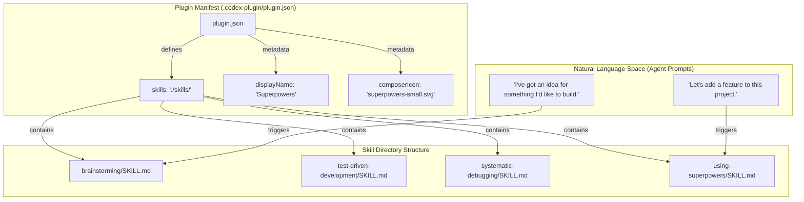
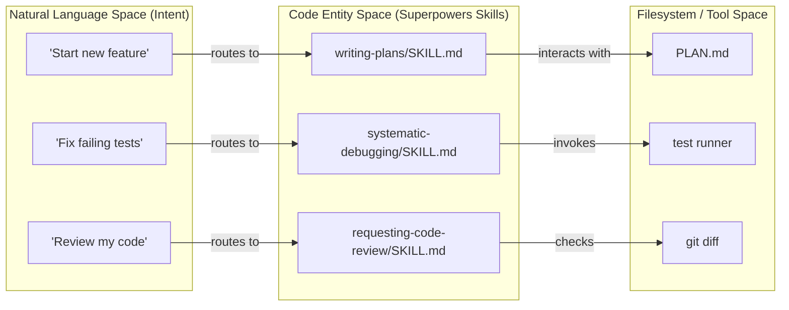

<!-- source: DeepWiki mcp.deepwiki.com · repo openai/plugins · page 4.8 Superpowers Plugin (Agent Development Methodology) · fetched 2026-10-26 -->

# Superpowers Plugin (Agent Development Methodology)

<details>
<summary>Relevant source files</summary>

The following files were used as context for generating this wiki page:

- [plugins/circleci/.codex-plugin/plugin.json](plugins/circleci/.codex-plugin/plugin.json)
- [plugins/common-room/.codex-plugin/plugin.json](plugins/common-room/.codex-plugin/plugin.json)
- [plugins/daloopa/.codex-plugin/plugin.json](plugins/daloopa/.codex-plugin/plugin.json)
- [plugins/finn/.codex-plugin/plugin.json](plugins/finn/.codex-plugin/plugin.json)
- [plugins/marcopolo/.codex-plugin/plugin.json](plugins/marcopolo/.codex-plugin/plugin.json)
- [plugins/network-solutions/.codex-plugin/plugin.json](plugins/network-solutions/.codex-plugin/plugin.json)
- [plugins/omni-analytics/.codex-plugin/plugin.json](plugins/omni-analytics/.codex-plugin/plugin.json)
- [plugins/omni-analytics/assets/logo.png](plugins/omni-analytics/assets/logo.png)
- [plugins/rox/.codex-plugin/plugin.json](plugins/rox/.codex-plugin/plugin.json)
- [plugins/superpowers/.codex-plugin/plugin.json](plugins/superpowers/.codex-plugin/plugin.json)
- [plugins/superpowers/assets/app-icon.png](plugins/superpowers/assets/app-icon.png)
- [plugins/superpowers/assets/superpowers-small.svg](plugins/superpowers/assets/superpowers-small.svg)

</details>


The **Superpowers** plugin is a comprehensive agentic skills framework and software development methodology designed to enforce engineering discipline in AI coding agents. It moves beyond simple "code generation" into a structured lifecycle encompassing brainstorming, implementation planning, Test-Driven Development (TDD), systematic debugging, and multi-agent orchestration [plugins/superpowers/.codex-plugin/plugin.json:1-4]().

## Core Philosophy and Principles

Superpowers is built on a "process over guesswork" philosophy. It enforces three primary engineering pillars:
*   **Test-Driven Development (TDD):** Red-Green-Refactor cycles where code is only written to make a failing test pass.
*   **YAGNI (You Aren't Gonna Need It):** Preventing over-engineering by focusing strictly on the validated design.
*   **DRY (Don't Repeat Yourself):** Emphasizing code reuse and modularity during the refactoring phase.

The plugin is categorized as a **Developer Tool** and requests **Interactive**, **Read**, and **Write** capabilities to manage the full development lifecycle [plugins/superpowers/.codex-plugin/plugin.json:29-34]().

## The 14 Essential Skills

The plugin provides 14 distinct skills discovered via the `./skills/` directory defined in the manifest [plugins/superpowers/.codex-plugin/plugin.json:23](). These skills guide the agent through every phase of the development lifecycle.

| Category | Skill Name | Purpose |
| :--- | :--- | :--- |
| **Design** | `brainstorming` | Socratic refinement of ideas into a validated design document. |
| **Workflow** | `using-git-worktrees` | Setup of isolated workspaces to protect the main branch. |
| **Planning** | `writing-plans` | Breaking designs into bite-sized (2-5 min) engineering tasks. |
| **Execution** | `subagent-driven-development` | Orchestrating subagents with two-stage review (spec vs quality). |
| **Execution** | `executing-plans` | Sequential task execution with human checkpoints. |
| **Execution** | `dispatching-parallel-agents` | Running concurrent subagents for independent problem domains. |
| **Quality** | `test-driven-development` | Mandatory Red-Green-Refactor cycle. |
| **Debugging** | `systematic-debugging` | 4-phase root cause analysis (Investigation → Analysis → Hypothesis → Fix). |
| **Debugging** | `verification-before-completion` | Ensuring fixes are validated by tests before concluding. |
| **Review** | `requesting-code-review` | Automated pre-review checklists against the implementation plan. |
| **Review** | `receiving-code-review` | Technical evaluation of feedback (rigor over social agreement). |
| **Delivery** | `finishing-a-development-branch` | Final verification and merge/PR decision workflow. |
| **Meta** | `writing-skills` | Framework for creating new project-specific skills. |
| **Meta** | `using-superpowers` | Global entry point and instruction override logic. |

**Sources:** [plugins/superpowers/.codex-plugin/plugin.json:13-23](), [plugins/superpowers/.codex-plugin/plugin.json:26-27]()

## Technical Architecture and Data Flow

Superpowers operates as a high-priority instruction layer that intercepts user requests and routes them through specific skills based on the task context.

### Skill Invocation Flow
The `using-superpowers` skill establishes a strict mandate: if there is even a "1% chance" a skill applies, the agent must invoke the `Skill` tool before responding.

### Visual Brainstorming System
The `brainstorming` skill includes a visual component that bridges the terminal and the browser for UI/UX design.

Title: Superpowers Skill Discovery and Interface Mapping

**Sources:** [plugins/superpowers/.codex-plugin/plugin.json:23-44]()

## Implementation Methodology

### 1. Isolated Workspace (`using-git-worktrees`)
Before any code is written, the agent detects if it is already in a worktree. If not, it creates a project-local worktree to ensure the user's current branch remains untouched.

### 2. Systematic Debugging
The `systematic-debugging` skill mandates a 4-phase process to prevent "symptom-fixing".

Title: Systematic Debugging Logic
```mermaid
graph TD
    "Bug Reported" --> P1["Phase 1: Investigation (Trace & Reproduce)"]
    P1 --> P2["Phase 2: Pattern Analysis (Find Root Cause)"]
    P2 --> P3["Phase 3: Hypothesis (Single Solution)"]
    P3 --> P4["Phase 4: Implementation (TDD Fix)"]
    P4 --> V["Verification"]
    V -- "Fail" --> P2
    V -- "Pass" --> "Complete"
```

### 3. Multi-Agent Dispatch
Superpowers supports parallel execution through `dispatching-parallel-agents`. This is used when facing multiple independent failures (e.g., different test files).

Title: Agent to Code Entity Space Mapping

**Sources:** [plugins/superpowers/.codex-plugin/plugin.json:4-27]()

## Multi-Harness Installation

Superpowers is designed to be portable across different agent environments. The plugin uses standard manifest fields like `keywords` to aid discovery in various marketplaces [plugins/superpowers/.codex-plugin/plugin.json:13-22]().

*   **Codex CLI / App:** Installed via the marketplace using the `name` "superpowers" [plugins/superpowers/.codex-plugin/plugin.json:2]().
*   **Cursor / Claude Code / Gemini CLI:** Supports installation via the repository URL provided in the manifest [plugins/superpowers/.codex-plugin/plugin.json:11]().

## Instruction Priority
Superpowers establishes a clear hierarchy for resolving instruction conflicts:
1.  **User's explicit instructions** — Highest priority.
2.  **Superpowers skills** — Overrides default system behavior via the `defaultPrompt` [plugins/superpowers/.codex-plugin/plugin.json:35-38]().
3.  **Default system prompt** — Lowest priority.

**Sources:** [plugins/superpowers/.codex-plugin/plugin.json:24-46]()

---

