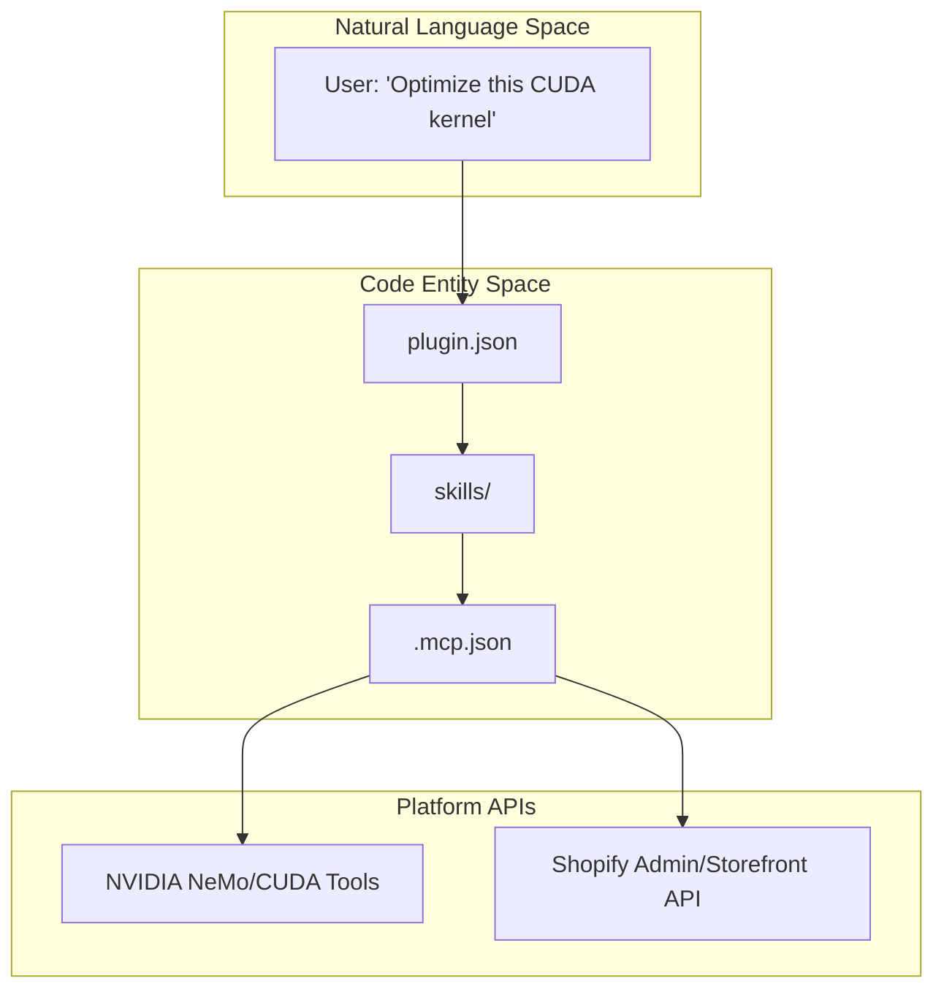
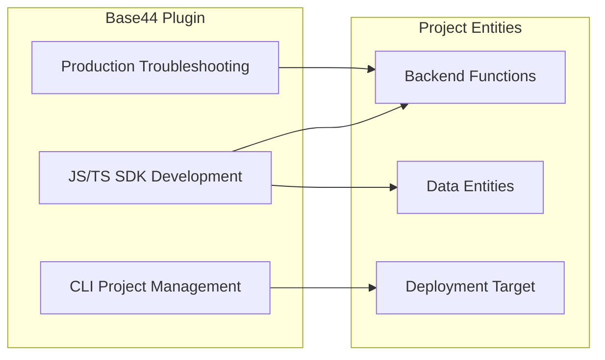

<!-- source: DeepWiki mcp.deepwiki.com · repo openai/plugins · page 4.9 Platform-Specific Developer Plugins (Shopify, Wix, NVIDIA, Base44) · fetched 2026-10-26 -->

# Platform-Specific Developer Plugins (Shopify, Wix, NVIDIA, Base44)

Relevant source files

The following files were used as context for generating this wiki page:

- [.agents/plugins/api_marketplace.json](.agents/plugins/api_marketplace.json)
- [plugins/base44/.codex-plugin/plugin.json](plugins/base44/.codex-plugin/plugin.json)
- [plugins/circleci/.codex-plugin/plugin.json](plugins/circleci/.codex-plugin/plugin.json)
- [plugins/common-room/.codex-plugin/plugin.json](plugins/common-room/.codex-plugin/plugin.json)
- [plugins/daloopa/.codex-plugin/plugin.json](plugins/daloopa/.codex-plugin/plugin.json)
- [plugins/figma/.codex-plugin/plugin.json](plugins/figma/.codex-plugin/plugin.json)
- [plugins/figma/.mcp.json](plugins/figma/.mcp.json)
- [plugins/finn/.codex-plugin/plugin.json](plugins/finn/.codex-plugin/plugin.json)
- [plugins/github/.codex-plugin/plugin.json](plugins/github/.codex-plugin/plugin.json)
- [plugins/github/.mcp.json](plugins/github/.mcp.json)
- [plugins/github/README.md](plugins/github/README.md)
- [plugins/github/assets/logo.png](plugins/github/assets/logo.png)
- [plugins/marcopolo/.codex-plugin/plugin.json](plugins/marcopolo/.codex-plugin/plugin.json)
- [plugins/network-solutions/.codex-plugin/plugin.json](plugins/network-solutions/.codex-plugin/plugin.json)
- [plugins/omni-analytics/.codex-plugin/plugin.json](plugins/omni-analytics/.codex-plugin/plugin.json)
- [plugins/omni-analytics/assets/logo.png](plugins/omni-analytics/assets/logo.png)
- [plugins/rox/.codex-plugin/plugin.json](plugins/rox/.codex-plugin/plugin.json)
- [plugins/shopify/.codex-plugin/plugin.json](plugins/shopify/.codex-plugin/plugin.json)
- [plugins/supabase/.codex-plugin/plugin.json](plugins/supabase/.codex-plugin/plugin.json)
- [plugins/superpowers/.codex-plugin/plugin.json](plugins/superpowers/.codex-plugin/plugin.json)
- [plugins/superpowers/assets/app-icon.png](plugins/superpowers/assets/app-icon.png)
- [plugins/superpowers/assets/superpowers-small.svg](plugins/superpowers/assets/superpowers-small.svg)
- [plugins/vercel/.codex-plugin/plugin.json](plugins/vercel/.codex-plugin/plugin.json)

This section documents the large-scale platform-specific developer plugins within the Codex ecosystem. These plugins provide deep integration into specific vendor platforms, offering specialized skills for API interaction, framework-specific development (e.g., Liquid, Hydrogen, Wix Headless), and hardware-accelerated computing.

## Shopify Plugin

The Shopify plugin is a comprehensive toolkit for building apps, themes, and storefronts within the Shopify ecosystem. It integrates documentation search, GraphQL generation, and CLI troubleshooting.

### Key Capabilities
*   **API Development**: Generating and validating operations for the Admin API and Storefront GraphQL [plugins/shopify/.codex-plugin/plugin.json:15-18]().
*   **Theme & Storefront**: Support for Liquid templating, Hydrogen (Remix-based) development, and Shopify Functions [plugins/shopify/.codex-plugin/plugin.json:24-25]().
*   **UI Extensions**: Workflows for building Polaris-based UI extensions and merchant onboarding experiences [plugins/shopify/.codex-plugin/plugin.json:24-25]().
*   **Tooling**: Integration with Shopify CLI for running or troubleshooting store workflows [plugins/shopify/.codex-plugin/plugin.json:38-38]().

### Telemetry Notice
Skill scripts in the Shopify plugin send usage telemetry to `shopify.dev` by default. Developers can disable this by setting `OPT_OUT_INSTRUMENTATION=true` [plugins/shopify/.codex-plugin/plugin.json:25-25]().

**Sources:**
* [plugins/shopify/.codex-plugin/plugin.json:1-45]()

---

## Wix Plugin

The Wix plugin facilitates development across the Wix ecosystem, ranging from dashboard extensions to headless implementations. It is registered in the marketplace as a developer-focused tool [.agents/plugins/api_marketplace.json:287-295]().

### Development Domains
*   **Dashboard & Backend**: Building dashboard extensions, backend APIs, and service plugins.
*   **Site Elements**: Creating site widgets and managing Wix Data collections.
*   **Wix Headless**: Support for integrating Wix services (eCommerce, Bookings, CMS, Events, Members) into external frameworks like Astro.
*   **CLI Integration**: Automated workflows for the Wix CLI.

**Sources:**
* [.agents/plugins/api_marketplace.json:287-295]() (Referencing marketplace entry for Wix/NVIDIA context)

---

## NVIDIA Plugin

The NVIDIA plugin provides skills for GPU-accelerated computing, AI agent development, and simulation workflows. It targets developers working with Physical AI and digital twins.

### Technical Focus Areas
*   **Core AI & Inference**: Support for CUDA, NeMo (conversational AI), and Dynamo.
*   **Robotics & Simulation**: Integration with NVIDIA Omniverse for simulation and digital twin creation.
*   **Physical AI**: Tools for building AI agents that interact with the physical world through GPU acceleration.

### System Architecture: Platform Integration
The following diagram illustrates how platform-specific plugins like NVIDIA and Shopify bridge natural language requests to specific developer tools and APIs.

**Platform Plugin Flow**

**Sources:**
* [.agents/plugins/api_marketplace.json:287-295]()
* [plugins/shopify/.codex-plugin/plugin.json:20-23]()
* [plugins/shopify/.mcp.json]() (Implicit structure from manifest)

---

## Base44 Plugin

The Base44 plugin is designed for building and deploying full-stack applications using the Base44 platform. It focuses on project management via CLI and SDK development.

### Implementation Details
*   **SDK Support**: Specialized skills for JavaScript and TypeScript SDK development [plugins/base44/.codex-plugin/plugin.json:12-12]().
*   **Project Lifecycle**: Covers creation, deployment, and production troubleshooting of backend functions and entities [plugins/base44/.codex-plugin/plugin.json:18-18]().
*   **Skill Set**:
    *   `base44-create-app`: Scaffolding new projects [plugins/base44/.codex-plugin/plugin.json:24-24]().
    *   `base44-debug`: Troubleshooting backend function errors [plugins/base44/.codex-plugin/plugin.json:26-26]().

### Base44 Entity Relationship
This diagram shows the relationship between the Base44 plugin skills and the underlying project entities.

**Base44 Skill-to-Entity Mapping**

**Sources:**
* [plugins/base44/.codex-plugin/plugin.json:1-32]()

---

## Plugin Comparison Table

| Feature | Shopify | Wix | NVIDIA | Base44 |
| :--- | :--- | :--- | :--- | :--- |
| **Primary Category** | Developer Tools | Developer Tools | Developer Tools | Developer Tools |
| **Key Languages** | Liquid, GraphQL, JS | JS, TypeScript | CUDA, Python | JS, TypeScript |
| **Auth Policy** | ON_INSTALL | ON_INSTALL | ON_INSTALL | ON_INSTALL |
| **Capabilities** | Read, Write | Read, Write | Read, Write | Interactive, Read, Write |
| **Main Tooling** | Shopify CLI | Wix CLI | Omniverse/CUDA | Base44 CLI |

**Sources:**
* [plugins/shopify/.codex-plugin/plugin.json:27-31]()
* [plugins/base44/.codex-plugin/plugin.json:20-21]()
* [.agents/plugins/api_marketplace.json:292-295]()

---

