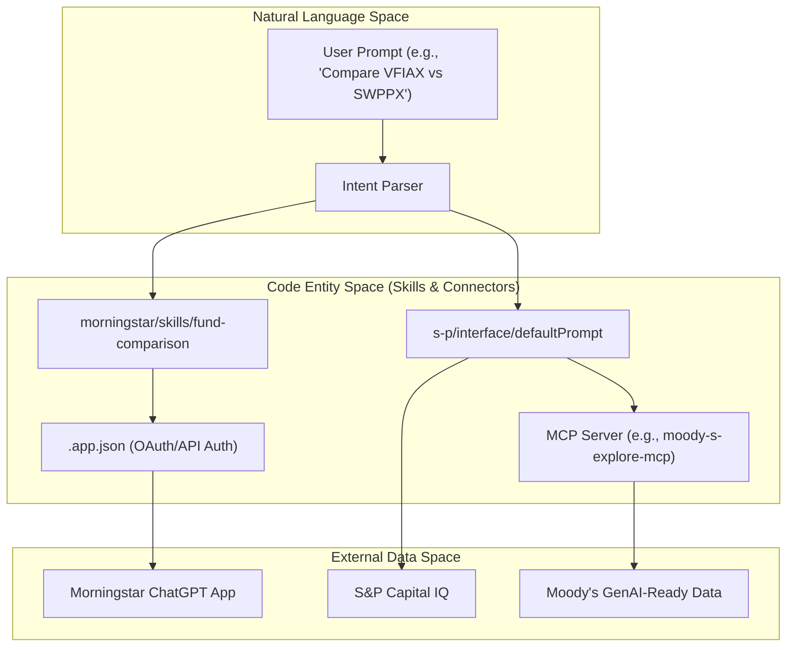
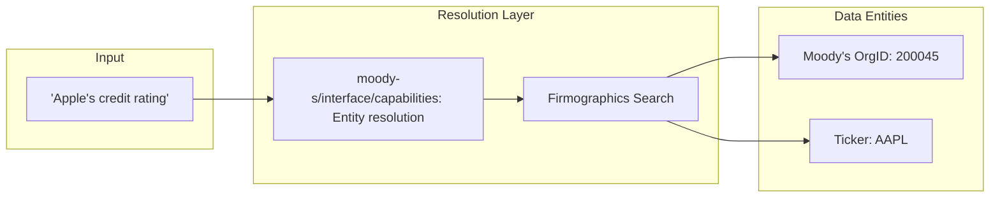

<!-- source: DeepWiki mcp.deepwiki.com · repo openai/plugins · page 5 Finance, Analytics, and Research Plugins · fetched 2026-10-26 -->

# Finance, Analytics, and Research Plugins

Relevant source files

The following files were used as context for generating this wiki page:

- [plugins/aiera/.codex-plugin/plugin.json](plugins/aiera/.codex-plugin/plugin.json)
- [plugins/amplitude/.codex-plugin/plugin.json](plugins/amplitude/.codex-plugin/plugin.json)
- [plugins/amplitude/assets/app-icon.png](plugins/amplitude/assets/app-icon.png)
- [plugins/apollo/.codex-plugin/plugin.json](plugins/apollo/.codex-plugin/plugin.json)
- [plugins/close/.codex-plugin/plugin.json](plugins/close/.codex-plugin/plugin.json)
- [plugins/factset/.codex-plugin/plugin.json](plugins/factset/.codex-plugin/plugin.json)
- [plugins/lseg/.codex-plugin/plugin.json](plugins/lseg/.codex-plugin/plugin.json)
- [plugins/midpage/.codex-plugin/plugin.json](plugins/midpage/.codex-plugin/plugin.json)
- [plugins/moody-s/.codex-plugin/plugin.json](plugins/moody-s/.codex-plugin/plugin.json)
- [plugins/moody-s/assets/app-icon.png](plugins/moody-s/assets/app-icon.png)
- [plugins/moody-s/skills/moody-s-company-analysis/SKILL.md](plugins/moody-s/skills/moody-s-company-analysis/SKILL.md)
- [plugins/moody-s/skills/moody-s-company-analysis/agents/openai.yaml](plugins/moody-s/skills/moody-s-company-analysis/agents/openai.yaml)
- [plugins/moody-s/skills/moody-s-explore-mcp/SKILL.md](plugins/moody-s/skills/moody-s-explore-mcp/SKILL.md)
- [plugins/moody-s/skills/moody-s-explore-mcp/agents/openai.yaml](plugins/moody-s/skills/moody-s-explore-mcp/agents/openai.yaml)
- [plugins/morningstar/.codex-plugin/plugin.json](plugins/morningstar/.codex-plugin/plugin.json)
- [plugins/morningstar/assets/app-icon.png](plugins/morningstar/assets/app-icon.png)
- [plugins/quartr/.codex-plugin/plugin.json](plugins/quartr/.codex-plugin/plugin.json)
- [plugins/s-p/.codex-plugin/plugin.json](plugins/s-p/.codex-plugin/plugin.json)
- [plugins/similarweb/.codex-plugin/plugin.json](plugins/similarweb/.codex-plugin/plugin.json)
- [plugins/thoughtspot/.codex-plugin/plugin.json](plugins/thoughtspot/.codex-plugin/plugin.json)
- [plugins/zoominfo/.codex-plugin/plugin.json](plugins/zoominfo/.codex-plugin/plugin.json)

This section provides an overview of the specialized plugins designed for institutional-grade financial analysis, product analytics, legal research, and scientific computing. These plugins bridge the gap between natural language queries and complex data structures, such as credit rating scorecards, M&A data rooms, and high-performance data warehouses.

## Overview of Financial Data Providers

The repository contains a dense collection of plugins from major financial data providers. These integrations typically leverage the **Model Context Protocol (MCP)** or **App Connectors** to provide real-time access to market data, earnings transcripts, and credit research.

| Plugin | Key Capabilities | Source |
| :--- | :--- | :--- |
| **Moody's** | Credit ratings, entity resolution, ESG considerations, and peer analysis. | [plugins/moody-s/.codex-plugin/plugin.json:37-58]() |
| **S&P Global** | Capital IQ financials, transcripts, and historical market data. | [plugins/s-p/.codex-plugin/plugin.json:14-17]() |
| **Morningstar** | Fund screening (Gold-rated, etc.), returns analysis, and fund comparisons. | [plugins/morningstar/.codex-plugin/plugin.json:22-31]() |
| **Quartr** | Live/recorded earnings calls and speaker-identified transcripts for 14,500+ companies. | [plugins/quartr/.codex-plugin/plugin.json:14-16]() |
| **LSEG** | Multi-asset class market data and valuation tools. | [plugins/lseg/.codex-plugin/plugin.json:14-17]() |
| **FactSet** | Consensus estimates, broker research sentiment, and workstation workflows. | [plugins/factset/.codex-plugin/plugin.json:14-17]() |
| **Aiera** | Institutional corporate events, filings, and broker research. | [plugins/aiera/.codex-plugin/plugin.json:14-17]() |

For technical implementation details, including the `moody-s-explore-mcp` skill and Morningstar's fund screener, see **[Financial Data and Analytics Plugins (Moody's, Morningstar, Daloopa, S&P, DNB)](#5.1)**.

## Private Capital and M&A

These plugins facilitate highly sensitive workflows in private equity and legal research. They focus on secure document handling and citation-heavy analysis.

*   **Chronograph (LP & GP):** Specialized tools for private capital teams to monitor portfolio KPIs, track commitments, and perform company-level valuations.
*   **Datasite:** Manages virtual data rooms (VDR) for M&A. Includes skills for deal room readiness audits and semantic search across thousands of due diligence documents.
*   **Midpage:** A legal research plugin that provides cited case law and hyperlinked sources, enabling the drafting of research memos with verifiable legal opinions.

For details on VDR management and legal research workflows, see **[Private Capital and M&A Plugins (Chronograph, Datasite, Midpage)](#5.2)**.

## Analytics and Business Intelligence (BI)

This category covers product-focused analytics and data science environments. These plugins allow users to transition from "asking a question" to "generating a visualization" or "running a query."

### Product & Market Intelligence
*   **Amplitude:** Focuses on product analytics and funnel trends [plugins/amplitude/.codex-plugin/plugin.json:13-17]().
*   **PostHog:** Provides event tracking and user behavior analysis.
*   **Similarweb:** Offers market intelligence, competitor traffic breakdown, and keyword ranking [plugins/similarweb/.codex-plugin/plugin.json:14-17]().

### Data Warehousing & Notebooks
*   **MotherDuck:** Connects to DuckDB-powered warehouses for natural language querying and interactive visualizations.
*   **Deepnote & Hex:** Collaborative notebook environments that allow for data execution and workspace summarization.

For details on data warehouse integration and notebook execution, see **[Analytics and BI Plugins (PostHog, Deepnote, Hex, Amplitude, MotherDuck)](#5.3)**.

## System Architecture: Financial Research Flow

The following diagram illustrates how a financial query is routed through the skill layer to institutional data providers.

### Financial Research Orchestration

**Sources:** [plugins/morningstar/.codex-plugin/plugin.json:35-39](), [plugins/moody-s/.codex-plugin/plugin.json:34-39](), [plugins/s-p/.codex-plugin/plugin.json:12-25]()

## Entity Resolution and Firmographics

A core requirement for finance plugins is **Entity Resolution**—mapping a user's natural language mention of a company to a unique identifier (e.g., CUSIP, ISIN, or Moody's OrgID).

### Entity Resolution Logic

**Sources:** [plugins/moody-s/.codex-plugin/plugin.json:43-45](), [plugins/s-p/.codex-plugin/plugin.json:21-22]()

## Child Pages
*   **[Financial Data and Analytics Plugins (Moody's, Morningstar, Daloopa, S&P, DNB)](#5.1)**
*   **[Private Capital and M&A Plugins (Chronograph, Datasite, Midpage)](#5.2)**
*   **[Analytics and BI Plugins (PostHog, Deepnote, Hex, Amplitude, MotherDuck)](#5.3)**

---

