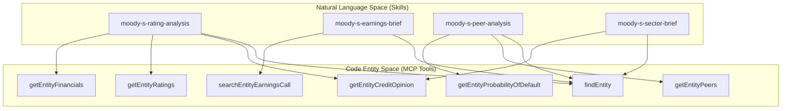
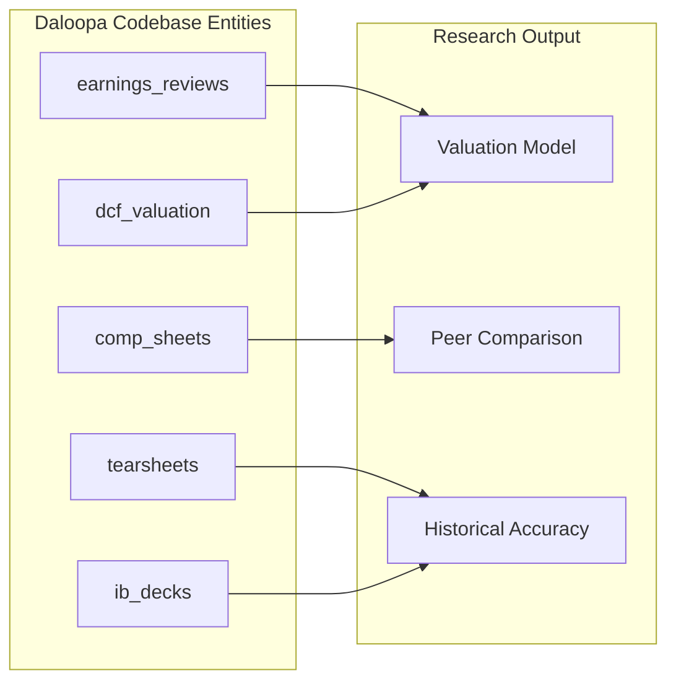

<!-- source: DeepWiki mcp.deepwiki.com · repo openai/plugins · page 5.1 Financial Data and Analytics Plugins (Moody's, Morningstar, Daloopa, S&P, DNB) · fetched 2026-10-26 -->

# Financial Data and Analytics Plugins (Moody's, Morningstar, Daloopa, S&P, DNB)

Relevant source files

The following files were used as context for generating this wiki page:

- [plugins/aiera/.codex-plugin/plugin.json](plugins/aiera/.codex-plugin/plugin.json)
- [plugins/amplitude/.codex-plugin/plugin.json](plugins/amplitude/.codex-plugin/plugin.json)
- [plugins/amplitude/assets/app-icon.png](plugins/amplitude/assets/app-icon.png)
- [plugins/apollo/.codex-plugin/plugin.json](plugins/apollo/.codex-plugin/plugin.json)
- [plugins/close/.codex-plugin/plugin.json](plugins/close/.codex-plugin/plugin.json)
- [plugins/dnb-finance-analytics/.app.json](plugins/dnb-finance-analytics/.app.json)
- [plugins/dnb-finance-analytics/.codex-plugin/plugin.json](plugins/dnb-finance-analytics/.codex-plugin/plugin.json)
- [plugins/dnb-finance-analytics/assets/app-icon.png](plugins/dnb-finance-analytics/assets/app-icon.png)
- [plugins/dnb-finance-analytics/skills/fa-jobs-to-be-done/SKILL.md](plugins/dnb-finance-analytics/skills/fa-jobs-to-be-done/SKILL.md)
- [plugins/dnb-finance-analytics/skills/fa-jobs-to-be-done/agents/openai.yaml](plugins/dnb-finance-analytics/skills/fa-jobs-to-be-done/agents/openai.yaml)
- [plugins/dnb-finance-analytics/skills/fa-jobs-to-be-done/assets/icon-large.png](plugins/dnb-finance-analytics/skills/fa-jobs-to-be-done/assets/icon-large.png)
- [plugins/dnb-finance-analytics/skills/fa-jobs-to-be-done/assets/icon-small.png](plugins/dnb-finance-analytics/skills/fa-jobs-to-be-done/assets/icon-small.png)
- [plugins/dnb-finance-analytics/skills/fa-jobs-to-be-done/fa-skills/references/fa-alerts-monitoring.md](plugins/dnb-finance-analytics/skills/fa-jobs-to-be-done/fa-skills/references/fa-alerts-monitoring.md)
- [plugins/dnb-finance-analytics/skills/fa-jobs-to-be-done/fa-skills/references/fa-credit-decisioning.md](plugins/dnb-finance-analytics/skills/fa-jobs-to-be-done/fa-skills/references/fa-credit-decisioning.md)
- [plugins/dnb-finance-analytics/skills/fa-jobs-to-be-done/fa-skills/references/fa-credit-validation.md](plugins/dnb-finance-analytics/skills/fa-jobs-to-be-done/fa-skills/references/fa-credit-validation.md)
- [plugins/dnb-finance-analytics/skills/fa-jobs-to-be-done/fa-skills/references/fa-onboarding-workflow.md](plugins/dnb-finance-analytics/skills/fa-jobs-to-be-done/fa-skills/references/fa-onboarding-workflow.md)
- [plugins/dnb-finance-analytics/skills/fa-jobs-to-be-done/fa-skills/references/fa-plain-language.md](plugins/dnb-finance-analytics/skills/fa-jobs-to-be-done/fa-skills/references/fa-plain-language.md)
- [plugins/factset/.codex-plugin/plugin.json](plugins/factset/.codex-plugin/plugin.json)
- [plugins/lseg/.codex-plugin/plugin.json](plugins/lseg/.codex-plugin/plugin.json)
- [plugins/midpage/.codex-plugin/plugin.json](plugins/midpage/.codex-plugin/plugin.json)
- [plugins/moody-s/.codex-plugin/plugin.json](plugins/moody-s/.codex-plugin/plugin.json)
- [plugins/moody-s/assets/app-icon.png](plugins/moody-s/assets/app-icon.png)
- [plugins/moody-s/skills/moody-s-company-analysis/SKILL.md](plugins/moody-s/skills/moody-s-company-analysis/SKILL.md)
- [plugins/moody-s/skills/moody-s-company-analysis/agents/openai.yaml](plugins/moody-s/skills/moody-s-company-analysis/agents/openai.yaml)
- [plugins/moody-s/skills/moody-s-earnings-brief/SKILL.md](plugins/moody-s/skills/moody-s-earnings-brief/SKILL.md)
- [plugins/moody-s/skills/moody-s-earnings-brief/agents/openai.yaml](plugins/moody-s/skills/moody-s-earnings-brief/agents/openai.yaml)
- [plugins/moody-s/skills/moody-s-earnings-brief/assets/cover_img_0.png](plugins/moody-s/skills/moody-s-earnings-brief/assets/cover_img_0.png)
- [plugins/moody-s/skills/moody-s-earnings-brief/assets/cover_img_1.png](plugins/moody-s/skills/moody-s-earnings-brief/assets/cover_img_1.png)
- [plugins/moody-s/skills/moody-s-earnings-brief/assets/cover_img_2.png](plugins/moody-s/skills/moody-s-earnings-brief/assets/cover_img_2.png)
- [plugins/moody-s/skills/moody-s-earnings-brief/assets/template.html](plugins/moody-s/skills/moody-s-earnings-brief/assets/template.html)
- [plugins/moody-s/skills/moody-s-earnings-brief/evals/evals.json](plugins/moody-s/skills/moody-s-earnings-brief/evals/evals.json)
- [plugins/moody-s/skills/moody-s-explore-mcp/SKILL.md](plugins/moody-s/skills/moody-s-explore-mcp/SKILL.md)
- [plugins/moody-s/skills/moody-s-explore-mcp/agents/openai.yaml](plugins/moody-s/skills/moody-s-explore-mcp/agents/openai.yaml)
- [plugins/moody-s/skills/moody-s-issuer-brief/SKILL.md](plugins/moody-s/skills/moody-s-issuer-brief/SKILL.md)
- [plugins/moody-s/skills/moody-s-issuer-brief/agents/openai.yaml](plugins/moody-s/skills/moody-s-issuer-brief/agents/openai.yaml)
- [plugins/moody-s/skills/moody-s-issuer-brief/assets/template.html](plugins/moody-s/skills/moody-s-issuer-brief/assets/template.html)
- [plugins/moody-s/skills/moody-s-issuer-brief/evals/evals.json](plugins/moody-s/skills/moody-s-issuer-brief/evals/evals.json)
- [plugins/moody-s/skills/moody-s-peer-analysis/SKILL.md](plugins/moody-s/skills/moody-s-peer-analysis/SKILL.md)
- [plugins/moody-s/skills/moody-s-peer-analysis/agents/openai.yaml](plugins/moody-s/skills/moody-s-peer-analysis/agents/openai.yaml)
- [plugins/moody-s/skills/moody-s-peer-analysis/assets/template.html](plugins/moody-s/skills/moody-s-peer-analysis/assets/template.html)
- [plugins/moody-s/skills/moody-s-rating-analysis/SKILL.md](plugins/moody-s/skills/moody-s-rating-analysis/SKILL.md)
- [plugins/moody-s/skills/moody-s-rating-analysis/agents/openai.yaml](plugins/moody-s/skills/moody-s-rating-analysis/agents/openai.yaml)
- [plugins/moody-s/skills/moody-s-rating-analysis/evals/evals.json](plugins/moody-s/skills/moody-s-rating-analysis/evals/evals.json)
- [plugins/moody-s/skills/moody-s-rating-analysis/scripts/requirements.txt](plugins/moody-s/skills/moody-s-rating-analysis/scripts/requirements.txt)
- [plugins/moody-s/skills/moody-s-sector-brief/SKILL.md](plugins/moody-s/skills/moody-s-sector-brief/SKILL.md)
- [plugins/moody-s/skills/shared/citations/SKILL.md](plugins/moody-s/skills/shared/citations/SKILL.md)
- [plugins/moody-s/skills/shared/citations/assets/template.html](plugins/moody-s/skills/shared/citations/assets/template.html)
- [plugins/moody-s/skills/shared/template/SKILL.md](plugins/moody-s/skills/shared/template/SKILL.md)
- [plugins/moody-s/skills/shared/template/assets/template.html](plugins/moody-s/skills/shared/template/assets/template.html)
- [plugins/morningstar/.codex-plugin/plugin.json](plugins/morningstar/.codex-plugin/plugin.json)
- [plugins/morningstar/assets/app-icon.png](plugins/morningstar/assets/app-icon.png)
- [plugins/quartr/.codex-plugin/plugin.json](plugins/quartr/.codex-plugin/plugin.json)
- [plugins/s-p/.codex-plugin/plugin.json](plugins/s-p/.codex-plugin/plugin.json)
- [plugins/similarweb/.codex-plugin/plugin.json](plugins/similarweb/.codex-plugin/plugin.json)
- [plugins/thoughtspot/.codex-plugin/plugin.json](plugins/thoughtspot/.codex-plugin/plugin.json)
- [plugins/zoominfo/.codex-plugin/plugin.json](plugins/zoominfo/.codex-plugin/plugin.json)

This section documents the integration of institutional-grade financial data providers into the Codex ecosystem. These plugins provide specialized capabilities for credit risk analysis, equity research, fund screening, and commercial identity verification through a combination of Model Context Protocol (MCP) servers, App Connectors, and sophisticated HTML report generation skills.

## Moody's Analytics

The Moody's plugin is a high-fidelity reporting engine that leverages a suite of MCP tools to generate professional, brand-aligned financial artifacts. It utilizes a shared asset system for consistent styling and citation management across multiple specialized skills.

### Architecture and Data Flow

The Moody's implementation relies on the `Moodys MCP server` for core data retrieval. The system follows a "Gather-Synthesize-Emit" pattern where data is collected via parallel MCP calls, processed into a JSON payload, and then rendered into a standalone HTML report.

#### Moody's Tool Integration Diagram
This diagram illustrates the relationship between the Natural Language Space (Skills) and the Code Entity Space (MCP Tools).

Sources: [plugins/moody-s/skills/moody-s-rating-analysis/SKILL.md:38-45](), [plugins/moody-s/skills/moody-s-earnings-brief/SKILL.md:43-50](), [plugins/moody-s/skills/moody-s-peer-analysis/SKILL.md:39-50]()

### Key Skills and Implementation Details

| Skill Name | Purpose | Delivery Mechanism |
| :--- | :--- | :--- |
| `moody-s-rating-analysis` | Generates a comprehensive HTML rating pitch covering SWOT, financials, and ESG. | Runs `scripts/build_html.py` to save `.html` to disk. |
| `moody-s-earnings-brief` | Summarizes earnings call transcripts for 2–5 companies. | Single-artifact file delivery via `present_files`. |
| `moody-s-peer-analysis` | Compares a target company against credit peers with scorecard tables. | Single-artifact file delivery to `/mnt/user-data/outputs/`. |
| `moody-s-sector-brief` | Deep-dive research into specific industry sectors. | Streams complete HTML as a fenced code block. |

### Shared Assets and Citations
To maintain brand consistency, the plugin uses a shared layer for CSS and HTML snippets:
*   **Template Layer:** Defined in `skills/shared/template/`, providing canonical CSS for headers, footers, and "outlook-badges" (stable, positive, negative) [plugins/moody-s/skills/shared/template/SKILL.md:1-20]().
*   **Citation Layer:** Managed via `skills/shared/citations/`, enforcing a strict visual contract for inline references `[n]` and end-of-document bibliography blocks [plugins/moody-s/skills/shared/citations/assets/template.html:33-66]().

Sources: [plugins/moody-s/skills/moody-s-rating-analysis/SKILL.md:13-36](), [plugins/moody-s/skills/moody-s-earnings-brief/SKILL.md:10-41](), [plugins/moody-s/skills/moody-s-peer-analysis/SKILL.md:11-37](), [plugins/moody-s/skills/moody-s-sector-brief/SKILL.md:12-32]()

## D&B Finance Analytics

The Dun & Bradstreet (DNB) plugin focuses on commercial credit origination and risk management. It utilizes the D&B Commercial Graph to provide firmographic data and credit decisioning logic.

### Capability Model
The plugin is configured with specific capabilities in its manifest:
*   **Portfolio Management:** Search, filtering, and aggregation of company portfolios [plugins/dnb-finance-analytics/.codex-plugin/plugin.json:33-38]().
*   **Credit Risk:** Generation of detailed risk reports including payment history and failure scores [plugins/dnb-finance-analytics/.codex-plugin/plugin.json:35-47]().
*   **Corporate Linkage:** Mapping parent-subsidiary relationships and ownership trees [plugins/dnb-finance-analytics/.codex-plugin/plugin.json:36-48]().

### Workflow References
DNB provides specialized reference documentation for various credit workflows:
*   `fa-credit-decisioning.md`: Logic for evaluating applications and setting limits.
*   `fa-onboarding-workflow.md`: Steps for new customer identity validation.
*   `fa-plain-language.md`: Standards for reporting risk data in non-technical terms.

Sources: [plugins/dnb-finance-analytics/.codex-plugin/plugin.json:26-54](), [plugins/dnb-finance-analytics/skills/fa-jobs-to-be-done/SKILL.md:1-15]()

## S&P Global

The S&P Global plugin provides natural language access to the S&P Capital IQ Financials datasets.

### Data Access and Interface
The plugin is primarily a data retrieval interface [plugins/s-p/.codex-plugin/plugin.json:13-19](). Key data points include:
*   **Company Financials:** Detailed income statements, balance sheets, and cash flow data.
*   **Transcripts:** Access to historical earnings call transcripts.
*   **Market Data:** Historical pricing and global securities information.

The interface is designed for "Step 0" prompts that allow users to pull financials for a specific ticker or compare valuation multiples across a peer group [plugins/s-p/.codex-plugin/plugin.json:21-25]().

Sources: [plugins/s-p/.codex-plugin/plugin.json:1-32]()

## Morningstar

The Morningstar plugin is implemented as an App Connector for the ChatGPT ecosystem. It provides three primary functional pillars:
1.  **Fund Screener:** Filtering investment vehicles based on Morningstar ratings, fees, and performance metrics.
2.  **Fund Summarizer:** Distilling complex prospectuses into high-level summaries.
3.  **Fund Comparison:** Side-by-side analysis of multiple funds to highlight differences in strategy and risk.

Sources: [plugins/morningstar/.codex-plugin/plugin.json:1-15]()

## Daloopa

Daloopa provides institutional-grade equity research tools, focusing on the accuracy of historical data and the automation of valuation models.

### Research Workflow Diagram
This diagram maps the Daloopa research components to the data flow required for equity analysis.

### Key Functions
*   **Earnings Reviews:** Automated extraction of key performance indicators (KPIs) from earnings releases.
*   **DCF Valuation:** Discounted Cash Flow models populated with verified historical data.
*   **Supply Chain Analysis:** Mapping of company dependencies and customer/vendor relationships.

Sources: [plugins/plugins.json: (Daloopa entry)]() (Note: Daloopa is described as providing institutional-grade equity research including tearsheets, earnings reviews, and DCF valuation).

---

