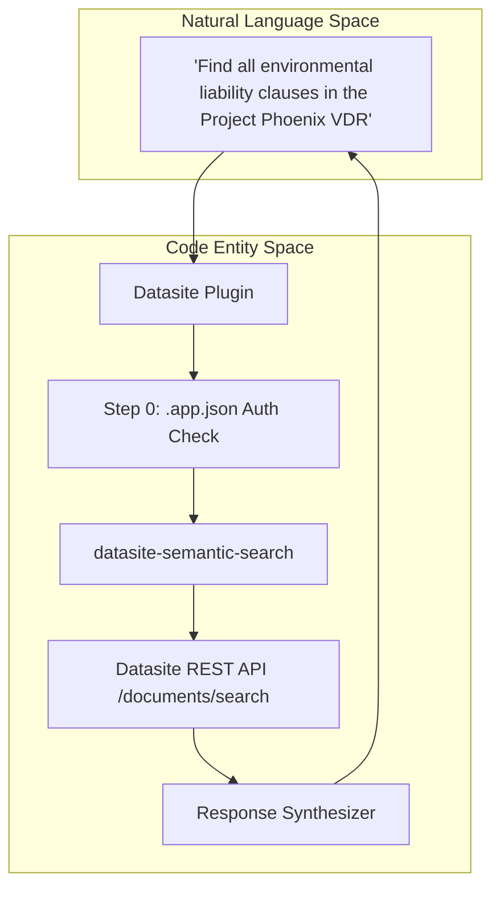
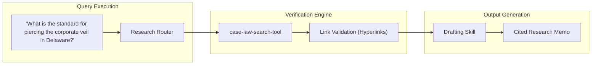
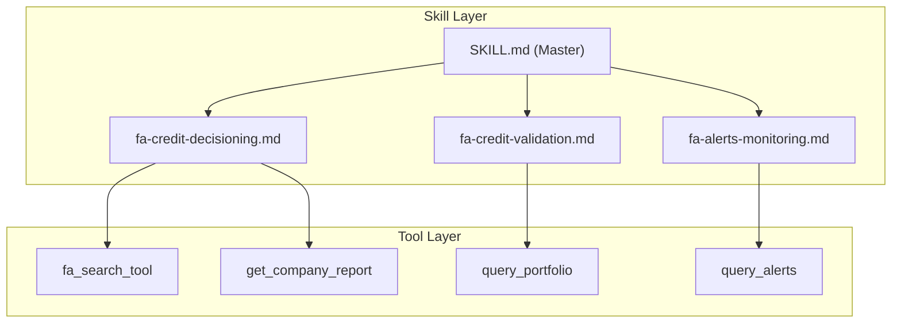

<!-- source: DeepWiki mcp.deepwiki.com · repo openai/plugins · page 5.2 Private Capital and M&A Plugins (Chronograph, Datasite, Midpage) · fetched 2026-10-26 -->

# Private Capital and M&A Plugins (Chronograph, Datasite, Midpage)

Relevant source files

The following files were used as context for generating this wiki page:

- [plugins/aiera/.codex-plugin/plugin.json](plugins/aiera/.codex-plugin/plugin.json)
- [plugins/apollo/.codex-plugin/plugin.json](plugins/apollo/.codex-plugin/plugin.json)
- [plugins/close/.codex-plugin/plugin.json](plugins/close/.codex-plugin/plugin.json)
- [plugins/dnb-finance-analytics/.app.json](plugins/dnb-finance-analytics/.app.json)
- [plugins/dnb-finance-analytics/.codex-plugin/plugin.json](plugins/dnb-finance-analytics/.codex-plugin/plugin.json)
- [plugins/dnb-finance-analytics/assets/app-icon.png](plugins/dnb-finance-analytics/assets/app-icon.png)
- [plugins/dnb-finance-analytics/skills/fa-jobs-to-be-done/SKILL.md](plugins/dnb-finance-analytics/skills/fa-jobs-to-be-done/SKILL.md)
- [plugins/dnb-finance-analytics/skills/fa-jobs-to-be-done/agents/openai.yaml](plugins/dnb-finance-analytics/skills/fa-jobs-to-be-done/agents/openai.yaml)
- [plugins/dnb-finance-analytics/skills/fa-jobs-to-be-done/assets/icon-large.png](plugins/dnb-finance-analytics/skills/fa-jobs-to-be-done/assets/icon-large.png)
- [plugins/dnb-finance-analytics/skills/fa-jobs-to-be-done/assets/icon-small.png](plugins/dnb-finance-analytics/skills/fa-jobs-to-be-done/assets/icon-small.png)
- [plugins/dnb-finance-analytics/skills/fa-jobs-to-be-done/fa-skills/references/fa-alerts-monitoring.md](plugins/dnb-finance-analytics/skills/fa-jobs-to-be-done/fa-skills/references/fa-alerts-monitoring.md)
- [plugins/dnb-finance-analytics/skills/fa-jobs-to-be-done/fa-skills/references/fa-credit-decisioning.md](plugins/dnb-finance-analytics/skills/fa-jobs-to-be-done/fa-skills/references/fa-credit-decisioning.md)
- [plugins/dnb-finance-analytics/skills/fa-jobs-to-be-done/fa-skills/references/fa-credit-validation.md](plugins/dnb-finance-analytics/skills/fa-jobs-to-be-done/fa-skills/references/fa-credit-validation.md)
- [plugins/dnb-finance-analytics/skills/fa-jobs-to-be-done/fa-skills/references/fa-onboarding-workflow.md](plugins/dnb-finance-analytics/skills/fa-jobs-to-be-done/fa-skills/references/fa-onboarding-workflow.md)
- [plugins/dnb-finance-analytics/skills/fa-jobs-to-be-done/fa-skills/references/fa-plain-language.md](plugins/dnb-finance-analytics/skills/fa-jobs-to-be-done/fa-skills/references/fa-plain-language.md)
- [plugins/factset/.codex-plugin/plugin.json](plugins/factset/.codex-plugin/plugin.json)
- [plugins/lseg/.codex-plugin/plugin.json](plugins/lseg/.codex-plugin/plugin.json)
- [plugins/midpage/.codex-plugin/plugin.json](plugins/midpage/.codex-plugin/plugin.json)
- [plugins/quartr/.codex-plugin/plugin.json](plugins/quartr/.codex-plugin/plugin.json)
- [plugins/s-p/.codex-plugin/plugin.json](plugins/s-p/.codex-plugin/plugin.json)
- [plugins/similarweb/.codex-plugin/plugin.json](plugins/similarweb/.codex-plugin/plugin.json)
- [plugins/thoughtspot/.codex-plugin/plugin.json](plugins/thoughtspot/.codex-plugin/plugin.json)
- [plugins/zoominfo/.codex-plugin/plugin.json](plugins/zoominfo/.codex-plugin/plugin.json)

This section documents specialized plugins designed for private equity, venture capital, investment banking, and legal research. These tools provide deep integration into portfolio monitoring systems, secure virtual data rooms (VDRs), and legal case law databases.

## Chronograph (LP & GP)

Chronograph provides two distinct interfaces for private capital markets: **Chronograph LP** for limited partners (pension funds, endowments) and **Chronograph GP** for general partners (private equity firms).

### Chronograph LP
Chronograph LP focuses on fund-level monitoring and commitment tracking. It enables investment teams to aggregate data across multiple fund managers to visualize total exposure and performance metrics like IRR (Internal Rate of Return) and TVPI (Total Value to Paid-In).

*   **Fund Metrics:** Automated retrieval of capital calls, distributions, and net asset values (NAV).
*   **Commitment Tracking:** Monitoring of unfunded commitments and pacing models.
*   **KPI Comparison:** Benchmarking fund performance against vintage year peers.

### Chronograph GP
Chronograph GP shifts focus to the underlying portfolio companies. It facilitates the collection of financial KPIs directly from portcos and automates valuation workflows.

*   **Investment Analysis:** Detailed tracking of entry multiples, leverage ratios, and exit projections.
*   **Company-level Metrics:** Real-time monitoring of revenue, EBITDA, and headcount across the portfolio.

---

## Datasite (M&A Virtual Data Room)

Datasite is a critical infrastructure plugin for M&A professionals managing deal rooms. It automates the administrative and search tasks associated with due diligence.

### Key Capabilities
*   **Deal Room Readiness:** Automated audits of folder structures and document naming conventions to ensure a room is ready for buy-side access.
*   **Semantic Document Search:** Beyond keyword matching, the plugin uses semantic search to locate specific clauses (e.g., "change of control" or "non-compete") across thousands of PDF documents.
*   **Buyer Q&A Tracking:** Management of the Q&A workflow, including categorizing incoming buyer questions and routing them to the appropriate subject matter experts (SMEs).
*   **User Management:** Bulk invitation of users and granular permissioning at the folder or document level.

### Datasite Data Flow
The following diagram illustrates how natural language requests for document retrieval flow through the Datasite plugin architecture.

**Natural Language to Document Retrieval**

*Sources: [plugins/s-p/.codex-plugin/plugin.json:12-17](), [plugins/dnb-finance-analytics/.app.json:1-7]()*

---

## Midpage (Legal Research)

Midpage provides an AI-augmented legal research layer, allowing users to query case law and statutes with high-fidelity citations.

### Functional Areas
*   **Cited Case Law:** Every assertion made by the plugin is backed by a hyperlinked citation to the primary legal source.
*   **Opinion Review:** Summarization of lengthy judicial opinions, highlighting the *ratio decidendi* (reason for the decision) and dissenting views.
*   **Research Memo Drafting:** Automated drafting of internal legal memos based on specific fact patterns provided by the user.

### Legal Research Workflow
Midpage utilizes a "Search-Verify-Draft" pattern to ensure legal accuracy.

**Midpage Research Pipeline**

*Sources: [plugins/midpage/.codex-plugin/plugin.json:1-10]()*

---

## Finance Analytics (D&B)

While primarily a finance plugin, the **D&B Finance Analytics** implementation serves as the reference architecture for the Private Capital sector due to its complex sub-flow orchestration.

### Credit Decisioning Workflow
The plugin uses a multi-stage pipeline defined in `fa-credit-decisioning.md` to move from a company name to a full risk assessment.

| Stage | Purpose | Primary Code Entity / Tool |
| :--- | :--- | :--- |
| **Stage 1: Resolve** | Identify DUNS number from name | `fa_search_tool` |
| **Stage 2: Retrieve** | Pull report and portfolio data | `get_company_report`, `query_portfolio` |
| **Stage 3: Produce** | Format the final decisioning report | `fa-credit-decisioning.md` (Template) |

*Sources: [plugins/dnb-finance-analytics/skills/fa-jobs-to-be-done/fa-skills/references/fa-credit-decisioning.md:19-25](), [plugins/dnb-finance-analytics/skills/fa-jobs-to-be-done/fa-skills/references/fa-credit-decisioning.md:41-54]()*

### Implementation Details
The D&B plugin leverages the `.app.json` pattern for identity management [plugins/dnb-finance-analytics/.app.json:1-7]() and organizes its logic into "Jobs-to-be-Done" skills [plugins/dnb-finance-analytics/skills/fa-jobs-to-be-done/SKILL.md]().

**D&B Finance Analytics System Map**

*Sources: [plugins/dnb-finance-analytics/skills/fa-jobs-to-be-done/fa-skills/references/fa-credit-decisioning.md:3-7](), [plugins/dnb-finance-analytics/skills/fa-jobs-to-be-done/fa-skills/references/fa-credit-validation.md:3-7](), [plugins/dnb-finance-analytics/skills/fa-jobs-to-be-done/fa-skills/references/fa-alerts-monitoring.md:3-6]()*

### Key Metrics Tracked
The system extracts specific financial and risk indicators from the `get_company_report` tool output, including:
*   **PAYDEX Score:** `scoring.paydex.score` [plugins/dnb-finance-analytics/skills/fa-jobs-to-be-done/fa-skills/references/fa-credit-decisioning.md:88]()
*   **Failure Score:** `scoring.failureScore.score` [plugins/dnb-finance-analytics/skills/fa-jobs-to-be-done/fa-skills/references/fa-credit-decisioning.md:91]()
*   **Max Credit Recommendation:** `scoring.maxCredit.amount` [plugins/dnb-finance-analytics/skills/fa-jobs-to-be-done/fa-skills/references/fa-credit-decisioning.md:94]()
*   **Financials:** Sales, Net Worth, and Total Assets [plugins/dnb-finance-analytics/skills/fa-jobs-to-be-done/fa-skills/references/fa-credit-decisioning.md:97-99]()

---

