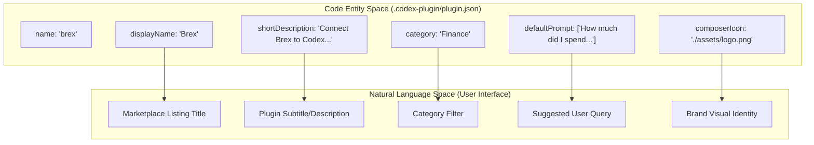
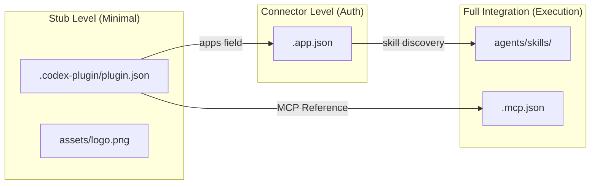

<!-- source: DeepWiki mcp.deepwiki.com · repo openai/plugins · page 6 Marketplace Plugins (Third-Party and Stub Entries) · fetched 2026-10-26 -->

# Marketplace Plugins (Third-Party and Stub Entries)

<details>
<summary>Relevant source files</summary>

The following files were used as context for generating this wiki page:

- [.agents/plugins/marketplace.json](.agents/plugins/marketplace.json)
- [plugins/brex/.codex-plugin/plugin.json](plugins/brex/.codex-plugin/plugin.json)
- [plugins/carta-crm/.codex-plugin/plugin.json](plugins/carta-crm/.codex-plugin/plugin.json)
- [plugins/cogedim/.codex-plugin/plugin.json](plugins/cogedim/.codex-plugin/plugin.json)
- [plugins/cube/.codex-plugin/plugin.json](plugins/cube/.codex-plugin/plugin.json)
- [plugins/demandbase/.codex-plugin/plugin.json](plugins/demandbase/.codex-plugin/plugin.json)
- [plugins/intercom/.codex-plugin/plugin.json](plugins/intercom/.codex-plugin/plugin.json)
- [plugins/keybid-puls/.codex-plugin/plugin.json](plugins/keybid-puls/.codex-plugin/plugin.json)
- [plugins/mt-newswires/.codex-plugin/plugin.json](plugins/mt-newswires/.codex-plugin/plugin.json)
- [plugins/otter-ai/.codex-plugin/plugin.json](plugins/otter-ai/.codex-plugin/plugin.json)
- [plugins/particl-market-research/.codex-plugin/plugin.json](plugins/particl-market-research/.codex-plugin/plugin.json)
- [plugins/windsor-ai/.codex-plugin/plugin.json](plugins/windsor-ai/.codex-plugin/plugin.json)

</details>


This page provides an overview of the large collection of third-party and stub plugins registered in the marketplace. While many plugins in the repository contain full logic (Skills, MCP servers, or App connectors), a significant portion consists of **Stub Entries**—minimalistic definitions that register a brand's presence and metadata in the ecosystem without hosting local execution logic.

## The Minimal Plugin Pattern

The majority of marketplace entries follow a standardized "stub" pattern. This pattern allows the OpenAI ecosystem to recognize and display third-party services with minimal overhead. A typical stub plugin consists of only two primary components:

1.  **`plugin.json`**: The manifest containing metadata, display information, and category assignments.
2.  **`app-icon.png`** (or `logo.png`): The brand asset used for the `composerIcon` and `logo` fields.

### Manifest Structure
Stub entries utilize the `interface` block in `plugin.json` to define how they appear to the user. Key fields include `displayName`, `shortDescription`, `category`, and `defaultPrompt`. For example, the **Intercom** entry defines its role in customer support workflows:

```json
{
  "name": "intercom",
  "interface": {
    "displayName": "Intercom",
    "shortDescription": "Customer conversations, contacts, tickets, and support workflows from Intercom",
    "category": "Business & Operations",
    "defaultPrompt": [
      "Search Intercom for open billing conversations and summarize top issues."
    ],
    "composerIcon": "./assets/logo.png"
  }
}
```
Sources: [plugins/intercom/.codex-plugin/plugin.json:1-35]()

### Marketplace Metadata to UI Mapping
The following diagram illustrates how the code entities in a stub's `plugin.json` map to the "Natural Language Space" of the user interface.

**Diagram: Stub Manifest to UI Mapping**

Sources: [plugins/brex/.codex-plugin/plugin.json:1-32]()

---

## Categories and Industry Coverage

The marketplace plugins are registered in the global registry located at `.agents/plugins/marketplace.json` [.agents/plugins/marketplace.json:1-300](). These entries provide a bridge for users to interact with external platforms via natural language across various industry buckets.

| Category | Examples | Purpose |
| :--- | :--- | :--- |
| **Business & Operations** | Intercom, Demandbase, Carta CRM | CRM, customer support, and GTM intelligence. |
| **Finance** | Brex, Stripe, Cube, KeyBid Puls | Corporate spend, payments, and financial analytics. |
| **Communication** | Otter.ai, Gmail, Slack | Meeting intelligence, email, and chat. |
| **Data & Analytics** | Windsor.ai, Deepnote | Marketing data attribution and collaborative notebooks. |
| **Education & Research** | Particl Market Research | E-commerce market intelligence and research. |

Sources: [plugins/intercom/.codex-plugin/plugin.json:19](), [plugins/demandbase/.codex-plugin/plugin.json:19](), [plugins/brex/.codex-plugin/plugin.json:19](), [plugins/windsor-ai/.codex-plugin/plugin.json:18](), [plugins/particl-market-research/.codex-plugin/plugin.json:18]()

---

## Interpreting Stub vs. Full Plugin Entries

When navigating the `plugins/` directory, the presence of specific files and manifest fields distinguishes a "Stub" from a "Full" integration.

### Integration Levels
*   **Pure Stub**: Contains only `.codex-plugin/plugin.json` and `assets/`. These often have empty `capabilities` arrays.
    *   *Examples*: `cogedim` [plugins/cogedim/.codex-plugin/plugin.json:19](), `mt-newswires` [plugins/mt-newswires/.codex-plugin/plugin.json:19]().
*   **App Connector**: Includes an `apps` field pointing to a `.app.json` file. This indicates the plugin supports OAuth or specific app-level authentication.
    *   *Examples*: `intercom` [plugins/intercom/.codex-plugin/plugin.json:13](), `demandbase` [plugins/demandbase/.codex-plugin/plugin.json:13](), `otter-ai` [plugins/otter-ai/.codex-plugin/plugin.json:20]().
*   **MCP-Backed**: References a Model Context Protocol server. This is often described in the `longDescription` or configured via `.mcp.json`.
    *   *Example*: `cube` explicitly mentions the "Cube MCP Server" for querying live financial data [plugins/cube/.codex-plugin/plugin.json:17]().

**Diagram: Plugin Complexity Hierarchy**

Sources: [plugins/otter-ai/.codex-plugin/plugin.json:20-35](), [plugins/cube/.codex-plugin/plugin.json:16-17]()

---

## Marketplace Registration

Plugins are registered in the marketplace via `.agents/plugins/marketplace.json`. This registry defines the source path, installation policy, and authentication requirements for every plugin available in the Codex UI [.agents/plugins/marketplace.json:6-295]().

*   **Installation Policy**: Typically `AVAILABLE` for third-party entries [.agents/plugins/marketplace.json:14]().
*   **Authentication Policy**: Usually `ON_INSTALL` for plugins requiring an account connection [.agents/plugins/marketplace.json:15]().

For technical details on the registry schema, see the [Marketplace Registry](#1.3) section.

## Child Pages

For detailed catalogs of specific third-party plugins and their manifest configurations, refer to the following sub-sections:

*   **[Travel and Lifestyle Plugins](#6.1)**: Catalogs travel (Expedia, Booking.com), food delivery (Uber Eats, DoorDash), and lifestyle (Peloton, MyFitnessPal) stubs.
*   **[Business, Finance, and Productivity Stub Plugins](#6.2)**: Catalogs business-oriented entries (Datadog, Monday.com, HubSpot, Salesforce) and financial tools (Brex, PayPal, Kraken).

Sources: [.agents/plugins/marketplace.json:1-300](), [plugins/intercom/.codex-plugin/plugin.json:1-35]()

---

