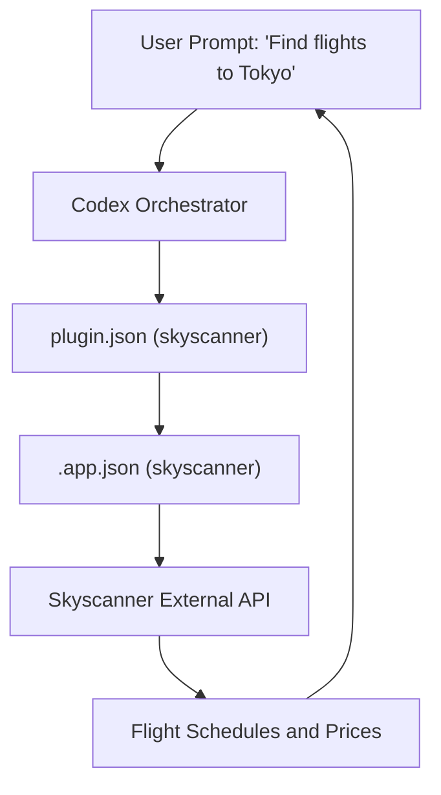
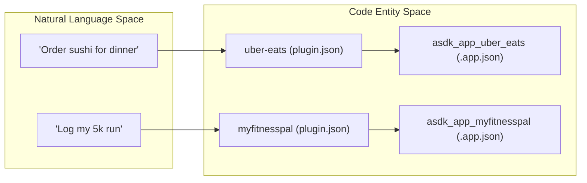

<!-- source: DeepWiki mcp.deepwiki.com · repo openai/plugins · page 6.1 Travel and Lifestyle Plugins · fetched 2026-10-26 -->

# Travel and Lifestyle Plugins

Relevant source files

The following files were used as context for generating this wiki page:

- [.agents/plugins/marketplace.json](.agents/plugins/marketplace.json)

This page catalogs the travel, hospitality, food delivery, and lifestyle plugins within the `openai/plugins` repository. These plugins typically follow a "Stub" or "App Connector" pattern, providing a bridge between natural language queries and external service providers for booking, searching, and logistics.

## Overview of Plugin Structure

The plugins in this category are characterized by a minimal manifest structure. They primarily consist of a `.codex-plugin/plugin.json` manifest and often an associated `.app.json` file for authentication and API connectivity. Unlike high-logic plugins (like GitHub or Notion), these plugins often rely on the external service's API to handle the heavy lifting of search and booking logic.

### Standard Manifest Pattern
Most travel and lifestyle plugins implement the following fields in their `plugin.json`:
*   **`apps`**: Points to the `./.app.json` file which defines the external application connector [.agents/skills/plugin-creator/references/plugin-json-spec.md:20-22]().
*   **`interface.category`**: Most are assigned to categories like `Productivity` or `Lifestyle` [.agents/skills/plugin-creator/references/plugin-json-spec.md:26-26]().
*   **`interface.capabilities`**: Usually defined as `["Interactive"]` or left empty, as they function as pass-through connectors [.agents/skills/plugin-creator/references/plugin-json-spec.md:27-27]().

---

## Travel and Hospitality Plugins

These plugins focus on transportation (trains, buses, flights) and accommodation (hotels, homes).

### Expedia, Booking.com, and Skyscanner
These plugins serve as the primary entry points for travel planning. They utilize the marketplace registry to define their availability and authentication policies. For instance, most travel stubs are set to `AVAILABLE` with `ON_INSTALL` authentication [.agents/plugins/marketplace.json:14-15]().

### Data Flow: Travel Search
The following diagram illustrates how a natural language request for travel is routed through the plugin manifest to the external provider.

**Travel Request Routing**

*Sources: [.agents/skills/plugin-creator/references/plugin-json-spec.md:3-45](), [.agents/plugins/marketplace.json:6-120]()*

### Travel Plugin Catalog
| Plugin Name | Category | Policy | Source |
| :--- | :--- | :--- | :--- |
| `expedia` | Productivity | AVAILABLE | [.agents/plugins/marketplace.json:1-120]() |
| `booking-com` | Productivity | AVAILABLE | [.agents/plugins/marketplace.json:1-120]() |
| `skyscanner` | Productivity | AVAILABLE | [.agents/plugins/marketplace.json:1-120]() |
| `tripadvisor` | Productivity | AVAILABLE | [.agents/plugins/marketplace.json:1-120]() |

---

## Lifestyle, Food, and Fitness Plugins

These plugins facilitate local lifestyle needs, including food delivery, grocery shopping, and fitness tracking.

### Food Delivery and Groceries
Plugins like `Uber Eats`, `DoorDash`, and `Instacart` allow users to interact with delivery services. These are registered in the marketplace with standard metadata to ensure they appear in the correct UI buckets [.agents/plugins/marketplace.json:17-17]().

### Fitness and Wellness
`Peloton`, `MyFitnessPal`, and `Zumba` provide lifestyle integration, allowing Codex to surface workout data or health tracking information via their respective app connectors.

**Entity Mapping: Lifestyle Integration**

*Sources: [.agents/skills/plugin-creator/references/plugin-json-spec.md:20-27](), [.agents/plugins/marketplace.json:7-20]()*

---

## Technical Implementation Details

### The Plugin Scaffolding Process
New travel and lifestyle stubs are generated using the `create_basic_plugin.py` script. This script ensures that the `plugin.json` follows the required schema, including the `interface` block for UI presentation.

**Key Scaffolding Functions:**
*   `normalize_plugin_name`: Ensures names like "Uber Eats" become `uber-eats` [.agents/skills/plugin-creator/scripts/create_basic_plugin.py:24-30]().
*   `build_plugin_json`: Generates the manifest with placeholders for `displayName`, `shortDescription`, and `category` [.agents/skills/plugin-creator/scripts/create_basic_plugin.py:43-85]().
*   `update_marketplace_json`: Adds the plugin to the central registry at `.agents/plugins/marketplace.json` [.agents/skills/plugin-creator/scripts/create_basic_plugin.py:129-166]().

### Manifest Metadata Requirements
To be registered in the marketplace, these plugins must provide:
1.  **Icons**: Both `composerIcon` and `logo` are required, typically located in `./assets/` [.agents/skills/plugin-creator/references/plugin-json-spec.md:37-38]().
2.  **Default Prompts**: A list of `defaultPrompt` strings (max 3) that appear in the UI [.agents/skills/plugin-creator/references/plugin-json-spec.md:31-35]().
3.  **Legal URLs**: `privacyPolicyURL` and `termsOfServiceURL` are mandatory [.agents/skills/plugin-creator/references/plugin-json-spec.md:29-30]().

*Sources: [.agents/skills/plugin-creator/scripts/create_basic_plugin.py:1-186](), [.agents/skills/plugin-creator/references/plugin-json-spec.md:1-159]()*

---

