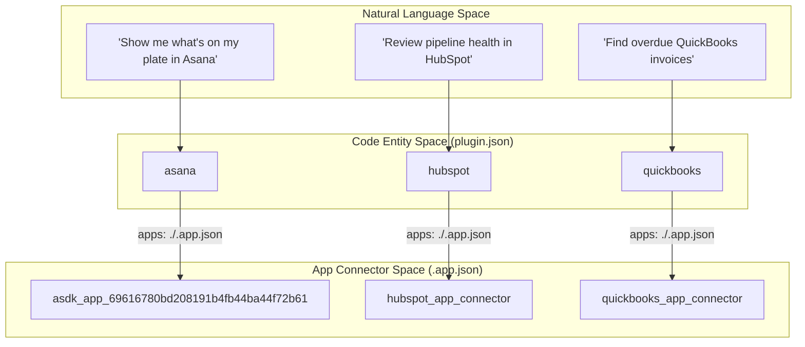
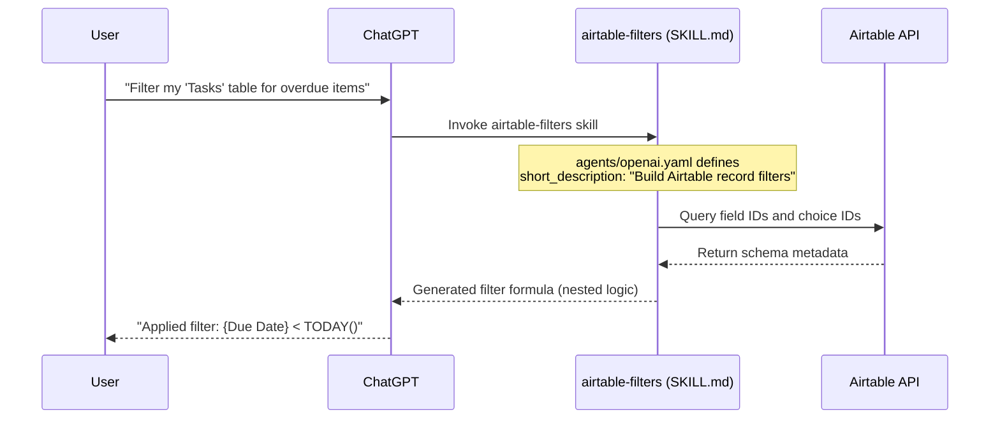
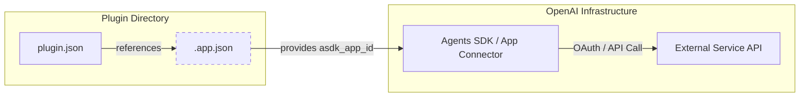

<!-- source: DeepWiki mcp.deepwiki.com · repo openai/plugins · page 6.2 Business, Finance, and Productivity Stub Plugins · fetched 2026-10-26 -->

# Business, Finance, and Productivity Stub Plugins

Relevant source files

The following files were used as context for generating this wiki page:

- [plugins/airtable/.app.json](plugins/airtable/.app.json)
- [plugins/airtable/.codex-plugin/plugin.json](plugins/airtable/.codex-plugin/plugin.json)
- [plugins/airtable/agents/openai.yaml](plugins/airtable/agents/openai.yaml)
- [plugins/airtable/assets/icon.svg](plugins/airtable/assets/icon.svg)
- [plugins/airtable/assets/logo.png](plugins/airtable/assets/logo.png)
- [plugins/airtable/skills/airtable-cli/SKILL.md](plugins/airtable/skills/airtable-cli/SKILL.md)
- [plugins/airtable/skills/airtable-cli/agents/openai.yaml](plugins/airtable/skills/airtable-cli/agents/openai.yaml)
- [plugins/airtable/skills/airtable-filters/SKILL.md](plugins/airtable/skills/airtable-filters/SKILL.md)
- [plugins/airtable/skills/airtable-filters/agents/openai.yaml](plugins/airtable/skills/airtable-filters/agents/openai.yaml)
- [plugins/airtable/skills/airtable-overview/SKILL.md](plugins/airtable/skills/airtable-overview/SKILL.md)
- [plugins/asana/.app.json](plugins/asana/.app.json)
- [plugins/asana/.codex-plugin/plugin.json](plugins/asana/.codex-plugin/plugin.json)
- [plugins/asana/assets/logo.png](plugins/asana/assets/logo.png)
- [plugins/base44/.app.json](plugins/base44/.app.json)
- [plugins/clickup/.codex-plugin/plugin.json](plugins/clickup/.codex-plugin/plugin.json)
- [plugins/datadog/.app.json](plugins/datadog/.app.json)
- [plugins/datadog/.codex-plugin/plugin.json](plugins/datadog/.codex-plugin/plugin.json)
- [plugins/datadog/assets/app-icon.png](plugins/datadog/assets/app-icon.png)
- [plugins/datadog/assets/logo.png](plugins/datadog/assets/logo.png)
- [plugins/hubspot/.codex-plugin/plugin.json](plugins/hubspot/.codex-plugin/plugin.json)
- [plugins/hubspot/skills/hubspot-crm-data-hygiene/SKILL.md](plugins/hubspot/skills/hubspot-crm-data-hygiene/SKILL.md)
- [plugins/hubspot/skills/hubspot-crm-data-hygiene/agents/openai.yaml](plugins/hubspot/skills/hubspot-crm-data-hygiene/agents/openai.yaml)
- [plugins/hubspot/skills/hubspot-customer-prep/SKILL.md](plugins/hubspot/skills/hubspot-customer-prep/SKILL.md)
- [plugins/hubspot/skills/hubspot-customer-prep/agents/openai.yaml](plugins/hubspot/skills/hubspot-customer-prep/agents/openai.yaml)
- [plugins/hubspot/skills/hubspot-pipeline-health/SKILL.md](plugins/hubspot/skills/hubspot-pipeline-health/SKILL.md)
- [plugins/hubspot/skills/hubspot-pipeline-health/agents/openai.yaml](plugins/hubspot/skills/hubspot-pipeline-health/agents/openai.yaml)
- [plugins/hubspot/skills/hubspot/SKILL.md](plugins/hubspot/skills/hubspot/SKILL.md)
- [plugins/hubspot/skills/hubspot/agents/openai.yaml](plugins/hubspot/skills/hubspot/agents/openai.yaml)
- [plugins/outreach/.codex-plugin/plugin.json](plugins/outreach/.codex-plugin/plugin.json)
- [plugins/quickbooks/.codex-plugin/plugin.json](plugins/quickbooks/.codex-plugin/plugin.json)

This page catalogs the business-oriented stub plugins within the `openai/plugins` repository. These plugins represent a mix of full "App Connectors" (using the Agents SDK) and minimal "Stub" entries that provide metadata for the OpenAI Marketplace. These plugins cover domains such as financial research, product analytics, CRM, and project management.

## Overview of Plugin Stubs

Stub plugins in this repository typically consist of a `plugin.json` manifest and an `assets/` directory containing branding. Most include an `.app.json` file, which indicates they are backed by an App Connector in the OpenAI infrastructure, even if the local directory does not contain complex Skill logic.

### Metadata Structure
The `interface` block in `plugin.json` defines how these business tools appear to the user. Key fields include:
- `displayName`: The human-readable name (e.g., "Asana", "HubSpot") [plugins/asana/.codex-plugin/plugin.json:22](), [plugins/hubspot/.codex-plugin/plugin.json:22]().
- `category`: Assigned to `Productivity`, `Business & Operations`, or `Finance` [plugins/asana/.codex-plugin/plugin.json:26](), [plugins/hubspot/.codex-plugin/plugin.json:26](), [plugins/quickbooks/.codex-plugin/plugin.json:19]().
- `defaultPrompt`: A sample natural language invocation to guide the model [plugins/asana/.codex-plugin/plugin.json:34-38](), [plugins/hubspot/.codex-plugin/plugin.json:35-39]().

### Natural Language to Code Entity Mapping
The following diagram illustrates how a user's natural language request is mapped to the underlying plugin identifiers and app connectors.

**Figure 1: Natural Language to Plugin Entity Mapping**

**Sources:** [plugins/asana/.codex-plugin/plugin.json:2-20](), [plugins/asana/.app.json:1-7](), [plugins/hubspot/.codex-plugin/plugin.json:2-20](), [plugins/quickbooks/.codex-plugin/plugin.json:2-13]()

---

## Business Operations and CRM

These plugins facilitate work tracking, customer relationship management, and sales automation.

### HubSpot
The HubSpot plugin manages CRM operations including deals, contacts, and tickets [plugins/hubspot/.codex-plugin/plugin.json:4-24]().
- **Skills:** Includes specialized logic for `hubspot-pipeline-health`, `hubspot-customer-prep`, and `hubspot-crm-data-hygiene` [plugins/hubspot/.codex-plugin/plugin.json:19]().
- **Capabilities:** Supports `Interactive`, `Read`, and `Write` operations [plugins/hubspot/.codex-plugin/plugin.json:27-31]().

### Outreach
Outreach focuses on revenue workflow automation and sales productivity [plugins/outreach/.codex-plugin/plugin.json:4-17]().
- **Default Prompt:** "Find stalled Outreach prospects and summarize the next best follow-up" [plugins/outreach/.codex-plugin/plugin.json:25]().

### Datadog
While categorized under `Developer Tools`, Datadog functions as a business observability stub for monitoring service health and incidents [plugins/datadog/.codex-plugin/plugin.json:4-19]().
- **App ID:** `asdk_app_69e8c7f174a08191a28b6da96c8062c4` [plugins/datadog/.app.json:4]().

---

## Productivity and Project Management

### Asana
The Asana plugin allows users to manage tasks, subtasks, and project priorities [plugins/asana/.codex-plugin/plugin.json:4-24]().
- **Capabilities:** `Interactive` and `Write` [plugins/asana/.codex-plugin/plugin.json:27-30]().
- **App Connector:** Identified by `asdk_app_69616780bd208191b4fb44ba44f72b61` [plugins/asana/.app.json:4]().

### ClickUp
ClickUp serves as a command center for deep workspace search and task management [plugins/clickup/.codex-plugin/plugin.json:10-12]().
- **Default Prompt:** "Flag whether Sprint 14: Simplifying UI is at risk" [plugins/clickup/.codex-plugin/plugin.json:16]().

### Airtable
Airtable acts as a database and operations layer, combining structured data with visual surfaces like kanban and timelines [plugins/airtable/.codex-plugin/plugin.json:4-48]().
- **Skills:** Features `airtable-filters` for building field-specific logic and `airtable-cli` for advanced operations [plugins/airtable/skills/airtable-filters/agents/openai.yaml:1-4](), [plugins/airtable/.codex-plugin/plugin.json:43]().

---

## Financial Intelligence

### QuickBooks
The QuickBooks plugin provides financial insights, profitability analysis, and AR/AP aging reports [plugins/quickbooks/.codex-plugin/plugin.json:17]().
- **Category:** `Finance` [plugins/quickbooks/.codex-plugin/plugin.json:19]().
- **Default Prompt:** "Pull QuickBooks expenses by category this month and flag anomalies" [plugins/quickbooks/.codex-plugin/plugin.json:26]().

**Figure 2: Airtable Filter Generation Flow**

**Sources:** [plugins/airtable/skills/airtable-filters/agents/openai.yaml:1-4](), [plugins/airtable/.codex-plugin/plugin.json:4-48]()

---

## Data Flow for App-Backed Plugins

Plugins containing an `apps` field in `plugin.json` pointing to a local `.app.json` file follow a specific ID-based routing mechanism. The `asdk_app_` prefix identifies the application within the OpenAI developer ecosystem.

**Figure 3: App Connector Routing Logic**

**Example Identifiers:**
- **Asana:** `asdk_app_69616780bd208191b4fb44ba44f72b61` [plugins/asana/.app.json:4]().
- **Datadog:** `asdk_app_69e8c7f174a08191a28b6da96c8062c4` [plugins/datadog/.app.json:4]().
- **Base44:** References `./.app.json` for platform connectivity [plugins/base44/.app.json:1]().

**Sources:** [plugins/asana/.app.json:4](), [plugins/datadog/.app.json:4](), [plugins/hubspot/.codex-plugin/plugin.json:20](), [plugins/airtable/.codex-plugin/plugin.json:44]()

---

