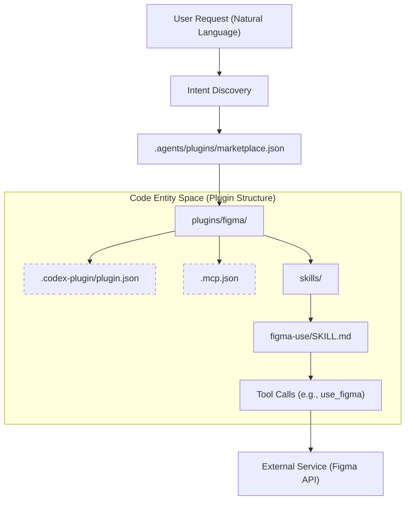
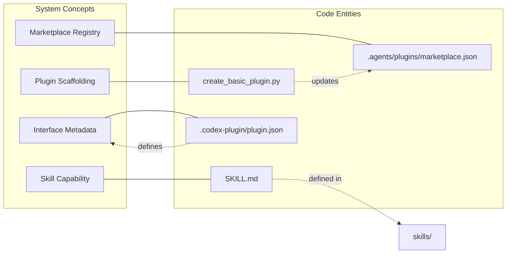

<!-- source: DeepWiki mcp.deepwiki.com · repo openai/plugins · page 7 Glossary · fetched 2026-10-26 -->

# Glossary

Relevant source files

The following files were used as context for generating this wiki page:

- [.agents/plugins/api_marketplace.json](.agents/plugins/api_marketplace.json)
- [.agents/plugins/marketplace.json](.agents/plugins/marketplace.json)
- [.agents/skills/plugin-creator/SKILL.md](.agents/skills/plugin-creator/SKILL.md)
- [.agents/skills/plugin-creator/agents/openai.yaml](.agents/skills/plugin-creator/agents/openai.yaml)
- [.agents/skills/plugin-creator/references/plugin-json-spec.md](.agents/skills/plugin-creator/references/plugin-json-spec.md)
- [.agents/skills/plugin-creator/scripts/create_basic_plugin.py](.agents/skills/plugin-creator/scripts/create_basic_plugin.py)
- [plugins/base44/.codex-plugin/plugin.json](plugins/base44/.codex-plugin/plugin.json)
- [plugins/figma/.codex-plugin/plugin.json](plugins/figma/.codex-plugin/plugin.json)
- [plugins/figma/.mcp.json](plugins/figma/.mcp.json)
- [plugins/github/.codex-plugin/plugin.json](plugins/github/.codex-plugin/plugin.json)
- [plugins/github/.mcp.json](plugins/github/.mcp.json)
- [plugins/github/README.md](plugins/github/README.md)
- [plugins/github/assets/logo.png](plugins/github/assets/logo.png)
- [plugins/google-drive/.codex-plugin/plugin.json](plugins/google-drive/.codex-plugin/plugin.json)
- [plugins/google-drive/skills/google-slides/SKILL.md](plugins/google-drive/skills/google-slides/SKILL.md)
- [plugins/google-drive/skills/google-slides/agents/openai.yaml](plugins/google-drive/skills/google-slides/agents/openai.yaml)
- [plugins/google-drive/skills/google-slides/references/reference-batch-update-recipes.md](plugins/google-drive/skills/google-slides/references/reference-batch-update-recipes.md)
- [plugins/google-drive/skills/google-slides/references/reference-chart-workflows.md](plugins/google-drive/skills/google-slides/references/reference-chart-workflows.md)
- [plugins/google-drive/skills/google-slides/references/reference-import-presentation.md](plugins/google-drive/skills/google-slides/references/reference-import-presentation.md)
- [plugins/google-drive/skills/google-slides/references/reference-new-deck-and-final-pass.md](plugins/google-drive/skills/google-slides/references/reference-new-deck-and-final-pass.md)
- [plugins/google-drive/skills/google-slides/references/reference-request-shapes-and-write-safety.md](plugins/google-drive/skills/google-slides/references/reference-request-shapes-and-write-safety.md)
- [plugins/google-drive/skills/google-slides/references/reference-slide-archetype-mapping.md](plugins/google-drive/skills/google-slides/references/reference-slide-archetype-mapping.md)
- [plugins/google-drive/skills/google-slides/references/reference-template-migration.md](plugins/google-drive/skills/google-slides/references/reference-template-migration.md)
- [plugins/google-drive/skills/google-slides/references/reference-template-reference-deck-copy-workflow.md](plugins/google-drive/skills/google-slides/references/reference-template-reference-deck-copy-workflow.md)
- [plugins/google-drive/skills/google-slides/references/reference-thumbnail-visual-verification.md](plugins/google-drive/skills/google-slides/references/reference-thumbnail-visual-verification.md)
- [plugins/google-drive/skills/google-slides/references/reference-visual-iteration.md](plugins/google-drive/skills/google-slides/references/reference-visual-iteration.md)
- [plugins/openai-developers/.app.json](plugins/openai-developers/.app.json)
- [plugins/openai-developers/.codex-plugin/plugin.json](plugins/openai-developers/.codex-plugin/plugin.json)
- [plugins/openai-developers/.mcp.json](plugins/openai-developers/.mcp.json)
- [plugins/openai-developers/README.md](plugins/openai-developers/README.md)
- [plugins/openai-developers/assets/openai-platform.png](plugins/openai-developers/assets/openai-platform.png)
- [plugins/openai-developers/mcp/server.mjs](plugins/openai-developers/mcp/server.mjs)
- [plugins/openai-developers/scripts/openai-platform-api-key.mjs](plugins/openai-developers/scripts/openai-platform-api-key.mjs)
- [plugins/openai-developers/skills/agents-sdk/SKILL.md](plugins/openai-developers/skills/agents-sdk/SKILL.md)
- [plugins/openai-developers/skills/openai-api-troubleshooting/SKILL.md](plugins/openai-developers/skills/openai-api-troubleshooting/SKILL.md)
- [plugins/openai-developers/skills/openai-api-troubleshooting/references/evals.md](plugins/openai-developers/skills/openai-api-troubleshooting/references/evals.md)
- [plugins/openai-developers/skills/openai-platform-api-key/SKILL.md](plugins/openai-developers/skills/openai-platform-api-key/SKILL.md)
- [plugins/openai-developers/skills/openai-platform-api-key/references/evals.md](plugins/openai-developers/skills/openai-platform-api-key/references/evals.md)
- [plugins/openai-developers/tests/openai-platform-api-key.test.mjs](plugins/openai-developers/tests/openai-platform-api-key.test.mjs)
- [plugins/replayio/.app.json](plugins/replayio/.app.json)
- [plugins/replayio/.codex-plugin/plugin.json](plugins/replayio/.codex-plugin/plugin.json)
- [plugins/replayio/LICENSE](plugins/replayio/LICENSE)
- [plugins/replayio/assets/replayio.svg](plugins/replayio/assets/replayio.svg)
- [plugins/replayio/hooks.json](plugins/replayio/hooks.json)
- [plugins/replayio/scripts/post_bash_upload.sh](plugins/replayio/scripts/post_bash_upload.sh)
- [plugins/replayio/scripts/stop_close_and_upload.sh](plugins/replayio/scripts/stop_close_and_upload.sh)
- [plugins/replayio/skills/replay-qa-api/SKILL.md](plugins/replayio/skills/replay-qa-api/SKILL.md)
- [plugins/replayio/skills/replay-qa-api/agents/openai.yaml](plugins/replayio/skills/replay-qa-api/agents/openai.yaml)
- [plugins/replayio/skills/replayio/SKILL.md](plugins/replayio/skills/replayio/SKILL.md)
- [plugins/shopify/.codex-plugin/plugin.json](plugins/shopify/.codex-plugin/plugin.json)
- [plugins/supabase/.codex-plugin/plugin.json](plugins/supabase/.codex-plugin/plugin.json)
- [plugins/vercel/.codex-plugin/plugin.json](plugins/vercel/.codex-plugin/plugin.json)

This page defines the technical terms, architectural components, and domain-specific jargon used throughout the `openai/plugins` repository. It serves as a reference for onboarding engineers to understand how natural language intents are mapped to executable code and how the plugin ecosystem is structured.

## Core Concepts

### Plugin
The primary unit of extensibility in the Codex ecosystem. A plugin is a directory containing a manifest, assets, and one or more **Skills**. Plugins can be "app-backed" (connected to a third-party service via OAuth) or "MCP-backed" (connected to a Model Context Protocol server).
- **Location**: `plugins/<plugin-name>/`
- **Key File**: `.codex-plugin/plugin.json` [[plugins/figma/.codex-plugin/plugin.json:1-46]()].

### Skill
A specific capability or workflow within a plugin. Each skill is defined by a `SKILL.md` file that provides natural language instructions to the model on how to execute a particular task (e.g., "summarize a Slack channel").
- **Implementation**: Defined in `skills/<skill-name>/SKILL.md` [[plugins/google-drive/skills/google-slides/SKILL.md:1-4]()].
- **Data Flow**: The model reads the `SKILL.md` to understand the protocol, tool dependencies, and formatting rules [[plugins/google-drive/skills/google-slides/SKILL.md:18-29]()].

### Marketplace
A centralized registry that defines the availability, installation policy, and categorization of all plugins.
- **Global Registry**: `.agents/plugins/marketplace.json` [[.agents/plugins/marketplace.json:1-6]()].
- **Policies**: Includes `installation` (e.g., `AVAILABLE`, `INSTALLED_BY_DEFAULT`) and `authentication` (e.g., `ON_INSTALL`, `ON_USE`) [[.agents/skills/plugin-creator/references/plugin-json-spec.md:141-147]()].

---

## Architectural Mapping: Natural Language to Code

The following diagram illustrates how a user's request in natural language is routed through the plugin architecture to specific code entities.

### Intent Routing and Execution Flow

**Sources**: [[.agents/plugins/marketplace.json:128-138](), [plugins/figma/.codex-plugin/plugin.json:1-46](), [plugins/figma/.mcp.json:1-9]()]

---

## Technical Definitions

### App Connector
A configuration that identifies a plugin as being associated with a specific third-party application. This is managed via an `asdk_app_` identifier in `.app.json`.
- **Manifest Field**: `apps` in `plugin.json` points to the `.app.json` file [[plugins/figma/.codex-plugin/plugin.json:21-21]()].
- **Role**: Triggers OAuth flow and enables the "Step 0" auth-check pattern in skills to verify tool availability.

### Model Context Protocol (MCP)
A protocol used to connect plugins to external tool servers. Plugins define their MCP dependencies in a `.mcp.json` file.
- **Manifest Field**: `mcpServers` in `plugin.json` [[plugins/figma/.codex-plugin/plugin.json:22-22]()].
- **Usage Example**: The `openai-developers` plugin uses an MCP server for local destination confirmation of API keys [[plugins/openai-developers/mcp/server.mjs:1-3]()]. The `confirm_openai_api_key_local_destination` tool is registered via MCP [[plugins/openai-developers/tests/openai-platform-api-key.test.mjs:155-162]()].

### Plugin Creator (Scaffolding)
A set of internal scripts used to generate new plugin skeletons and update the marketplace registry.
- **Main Script**: `create_basic_plugin.py` [[.agents/skills/plugin-creator/scripts/create_basic_plugin.py:1-2]()].
- **Normalization**: Ensures plugin names are lowercase and hyphen-case, collapsing consecutive hyphens [[.agents/skills/plugin-creator/scripts/create_basic_plugin.py:24-30]()].

---

## Component Relationship Diagram

This diagram bridges the high-level system names with the specific files and classes that implement them.

### System Components to File Mapping

**Sources**: [[.agents/skills/plugin-creator/scripts/create_basic_plugin.py:129-136](), [plugins/figma/.codex-plugin/plugin.json:23-45](), [plugins/google-drive/skills/google-slides/SKILL.md:1-4]()].

---

## Field Reference Table

Commonly used fields in plugin manifests (`plugin.json`) and their technical implications:

| Field | Type | Description | Code Pointer |
| :--- | :--- | :--- | :--- |
| `name` | `string` | Unique kebab-case identifier for the plugin. | [[.agents/skills/plugin-creator/references/plugin-json-spec.md:52-52]()] |
| `capabilities` | `array` | List of supported modes: `Interactive`, `Read`, `Write`. | [[.agents/skills/plugin-creator/references/plugin-json-spec.md:76-76]()] |
| `defaultPrompt` | `array` | Starter prompts shown in the UI (max 3, <128 chars). | [[.agents/skills/plugin-creator/references/plugin-json-spec.md:80-83]()] |
| `installation` | `enum` | Policy: `AVAILABLE`, `INSTALLED_BY_DEFAULT`, `NOT_AVAILABLE`. | [[.agents/skills/plugin-creator/references/plugin-json-spec.md:142-143]()] |
| `authentication` | `enum` | Timing: `ON_INSTALL` or `ON_USE`. | [[.agents/skills/plugin-creator/references/plugin-json-spec.md:145-146]()]
| `products` | `array` | Optional product gating for a plugin entry. | [[.agents/skills/plugin-creator/references/plugin-json-spec.md:157-157]()]

---

## Domain Jargon

- **Write Safety**: A set of constraints in `SKILL.md` files to prevent accidental or high-impact actions. For Google Slides, this includes strict verification of content and visual layout after batch updates [[plugins/google-drive/skills/google-slides/SKILL.md:51-56]()].
- **Kebab-case**: The naming convention required for all plugin and skill identifiers (e.g., `google-drive`, `google-slides`) [[.agents/skills/plugin-creator/scripts/create_basic_plugin.py:24-30]()].
- **Stub Plugin**: A plugin entry in the marketplace that contains only a manifest and icon, typically used for third-party integrations that are not yet fully implemented as local skills [[.agents/plugins/marketplace.json:6-161]()].
- **Canonical Workflow Bias**: A principle in skill design, particularly for Google Slides, that prefers one simple, proven workflow over a complex tree of recovery branches, to avoid over-analysis of edge cases [[plugins/google-drive/skills/google-slides/SKILL.md:58-63]()].
- **Non-Negotiable Output Invariant**: A strict requirement for output quality, especially in generative tasks. For Google Slides, this means inserted or edited content must match the target deck's existing structure and appear as native content, with specific checks for correctness like fresh post-write thumbnails [[plugins/google-drive/skills/google-slides/SKILL.md:51-56]()].
- **Product Gating**: The `products` field in `marketplace.json` that restricts plugin availability to specific OpenAI products (e.g., `CODEX`) [[.agents/plugins/marketplace.json:208-208](), [.agents/plugins/api_marketplace.json:17-17]()].
- **Replay.io**: A time-travel debugging platform. The `replayio` plugin provides skills for browser session recording and QA workflows, including scripts for post-bash upload and stopping/closing replays [[plugins/replayio/skills/replayio/SKILL.md](), [plugins/replayio/scripts/post_bash_upload.sh](), [plugins/replayio/scripts/stop_close_and_upload.sh]()].
- **Boltz**: A plugin for protein structure prediction, molecular screening, and binder design, often interacting with a Go CLI [[plugins/life-science-research/SKILL.md:1-4]()].
- **NGS Analysis**: A plugin for Next-Generation Sequencing workflows, including guided intake, BCL/FASTQ routing, variant calling, RNA-seq, single-cell, and epigenomics [[plugins/life-science-research/SKILL.md:1-4]()].
- **Daloopa**: A plugin for institutional-grade equity research, providing tools for tearsheets, earnings reviews, DCF valuation, and supply chain analysis [[.agents/plugins/marketplace.json:490-490]()].
- **Datasite**: A plugin for secure M&A virtual data room management, covering folder setup, user invitations, semantic document search, and Q&A tracking [[.agents/plugins/marketplace.json:491-491]()].
- **Chronograph**: A plugin for private capital portfolio monitoring and analytics, with separate skills for LP (Limited Partner) and GP (General Partner) teams [[.agents/plugins/marketplace.json:492-492]()].
- **HeyGen**: A plugin for avatar creation and digital twin generation, including HTML-to-video rendering via HyperFrames [[.agents/plugins/api_marketplace.json:234-234]()].
- **Shopify**: A platform-specific plugin with skills covering Admin API, Storefront GraphQL, Liquid, Hydrogen, Functions, Polaris UI extensions, and merchant onboarding [[plugins/shopify/.codex-plugin/plugin.json:1-45]()].
- **Wix**: A platform-specific plugin for CLI development of dashboard extensions, backend APIs, site widgets, and data collections, supporting Wix Headless for various frameworks [[.agents/plugins/marketplace.json:493-493]()].
- **NVIDIA**: A plugin focused on GPU acceleration, CUDA, AI agents, inference, robotics, and Omniverse for simulation and digital twins [[.agents/plugins/api_marketplace.json:288-288]()].
- **Zoom**: A communication plugin with extensive coverage of the Zoom REST API, Meeting SDK, Video SDK, RTMS, webhooks, and various bot functionalities [[.agents/plugins/marketplace.json:494-494]()].

**Sources**:
- [[.agents/plugins/marketplace.json:1-200]()]
- [[.agents/plugins/api_marketplace.json:1-295]()]
- [[plugins/figma/.codex-plugin/plugin.json:1-46]()]
- [[plugins/figma/.mcp.json:1-9]()]
- [[plugins/google-drive/skills/google-slides/SKILL.md:1-75]()]
- [[.agents/skills/plugin-creator/references/plugin-json-spec.md:1-159]()]
- [[.agents/skills/plugin-creator/scripts/create_basic_plugin.py:1-186]()]
- [[plugins/openai-developers/mcp/server.mjs:1-3]()]
- [[plugins/openai-developers/tests/openai-platform-api-key.test.mjs:155-162]()]
- [[plugins/replayio/skills/replayio/SKILL.md]()]
- [[plugins/replayio/scripts/post_bash_upload.sh]()]
- [[plugins/replayio/scripts/stop_close_and_upload.sh]()]
- [[plugins/shopify/.codex-plugin/plugin.json:1-45]()]