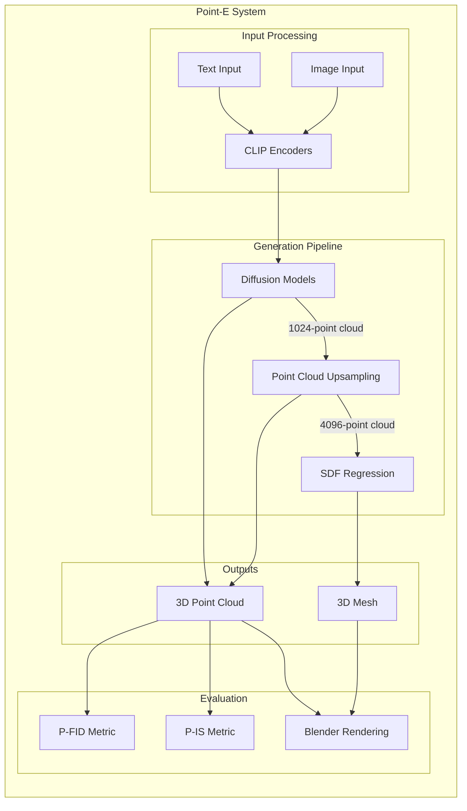
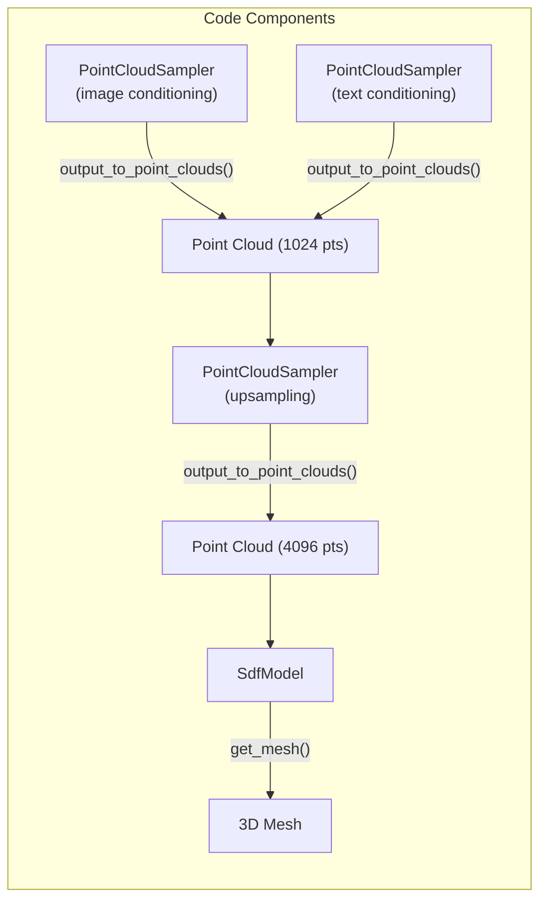
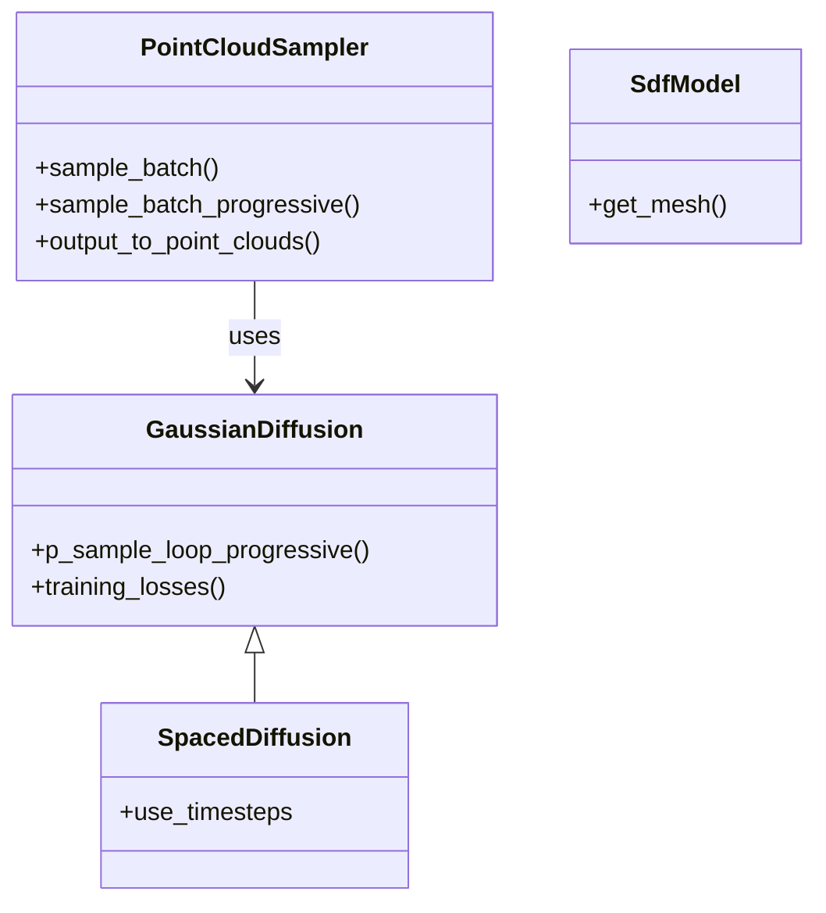
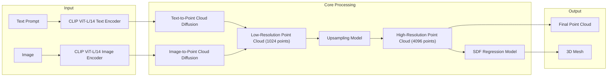
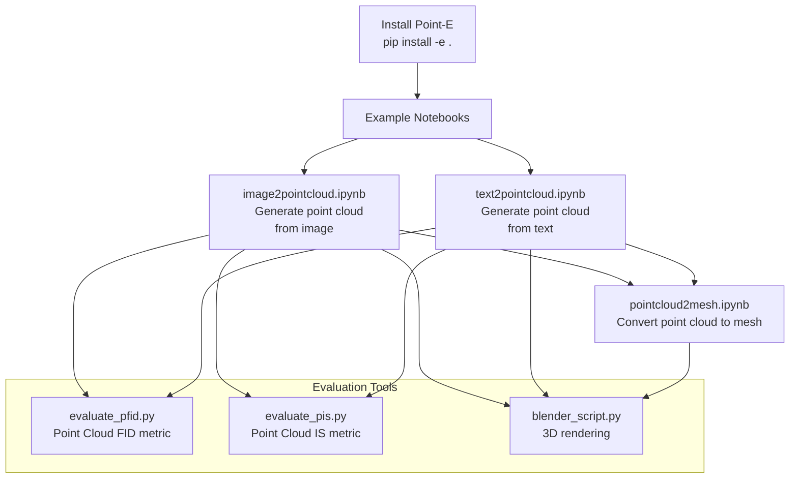
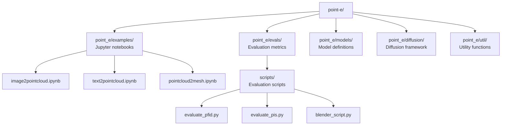

<!-- source: DeepWiki mcp.deepwiki.com · repo openai/point-e · page 1 Point-E Overview · fetched 2026-10-26 -->

# Point-E Overview

Relevant source files

The following files were used as context for generating this wiki page:

- [README.md](README.md)
- [model-card.md](model-card.md)

## Purpose and Scope

Point-E is a system designed to generate 3D point clouds from complex prompts. This overview document serves as an introduction to the Point-E repository, explaining its purpose, architecture, and key capabilities. It covers the high-level components of the system and how they interact to generate 3D content from text or images.

For detailed information about specific components, refer to the following pages:
- For model architecture details, see [Model Architecture](#2)
- For available pre-trained models, see [Available Models](#3)
- For evaluation metrics, see [Evaluation System](#4)
- For usage instructions, see [Usage Guide](#5)

Sources: [README.md:1-5](), [model-card.md:1-4]()

## System Overview

Point-E is a system that enables the generation of 3D point clouds from either text descriptions or image inputs, with the ability to further convert these point clouds into 3D meshes. The system leverages diffusion models trained on a dataset of several million 3D models to progressively generate coherent 3D structures.

Sources: [README.md:5-22](), [model-card.md:8-11](), [model-card.md:38-49]()

## Core Capabilities

Point-E provides three primary capabilities:

1. **Image-to-Point Cloud Generation**: Convert a single rendered image into a coherent 3D point cloud
2. **Text-to-Point Cloud Generation**: Generate 3D point clouds directly from text descriptions
3. **Point Cloud-to-Mesh Conversion**: Transform point clouds into 3D meshes using SDF regression

Sources: [README.md:11-15](), [model-card.md:38-45]()

## Model Variants and Architecture

Point-E comprises multiple model variants with different parameter sizes and conditioning capabilities:

| Model Name | Parameters | Purpose | Conditioning |
|------------|------------|---------|-------------|
| base40M-imagevec | 40M | Image to point cloud | CLIP ViT-L/14 image vector |
| base40M-textvec | 40M | Text to point cloud | CLIP ViT-L/14 text vector |
| base40M | 40M | Image to point cloud | CLIP ViT-L/14 latent grid |
| base300M | 300M | Image to point cloud | CLIP ViT-L/14 latent grid |
| base1B | 1B | Image to point cloud | CLIP ViT-L/14 latent grid |
| upsample | 40M | Point cloud upsampling | Optional image conditioning |
| sdf | Small | Signed distance function | 3D point cloud |

The model architecture is built on diffusion models that progressively transform noise into structured 3D point clouds:

Sources: [model-card.md:16-26]()

## Data Flow and Processing Pipeline

Point-E processes inputs through a series of steps to generate 3D outputs:

Sources: [README.md:11-15](), [model-card.md:38-45]()

## User Workflow

The typical workflow for using Point-E involves:

Sources: [README.md:7-22]()

## Limitations

The current Point-E models have several limitations to be aware of:

1. **Image-conditional models**:
   - May produce incorrect geometry in occluded areas
   - Can generate geometry inconsistent with visible parts of the rendering
   - Output relatively low-resolution point clouds (4096 points)
   - Point clouds may contain defects like outliers or cracks

2. **Text-conditional model**:
   - Works best with simple prompts
   - Limited generalization to complex descriptions or unusual objects
   - May exhibit biases from the training data

3. **Output quality**:
   - Point clouds are often noisy
   - The system tends to produce simplistic, cartoonish 3D objects reflecting the training data

Sources: [model-card.md:46-52](), [model-card.md:54-56]()

## Code Structure

The repository is organized as follows:

Sources: [README.md:11-22]()

---

