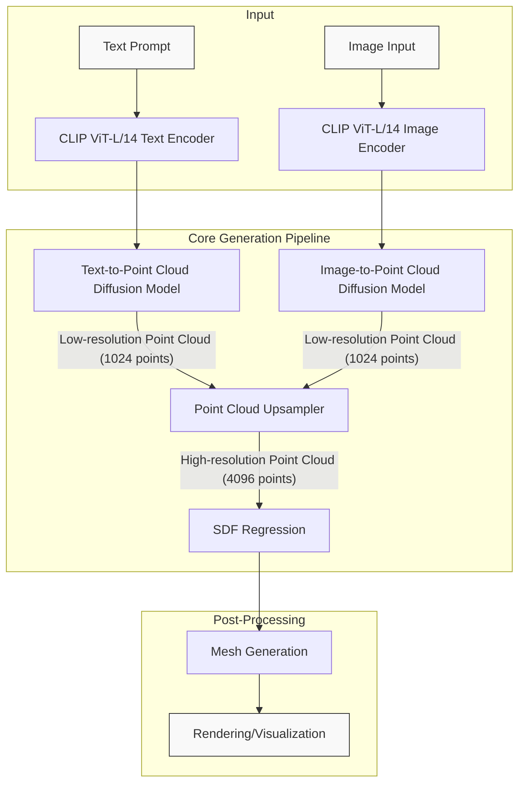
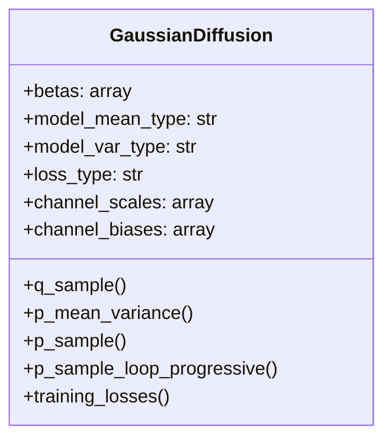
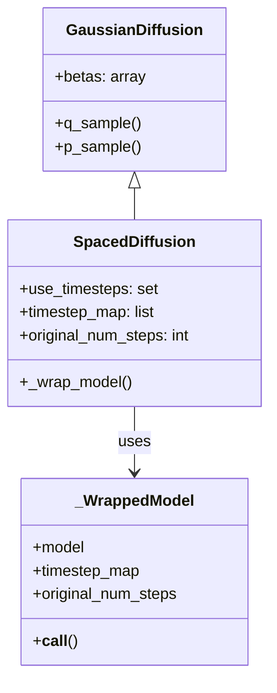
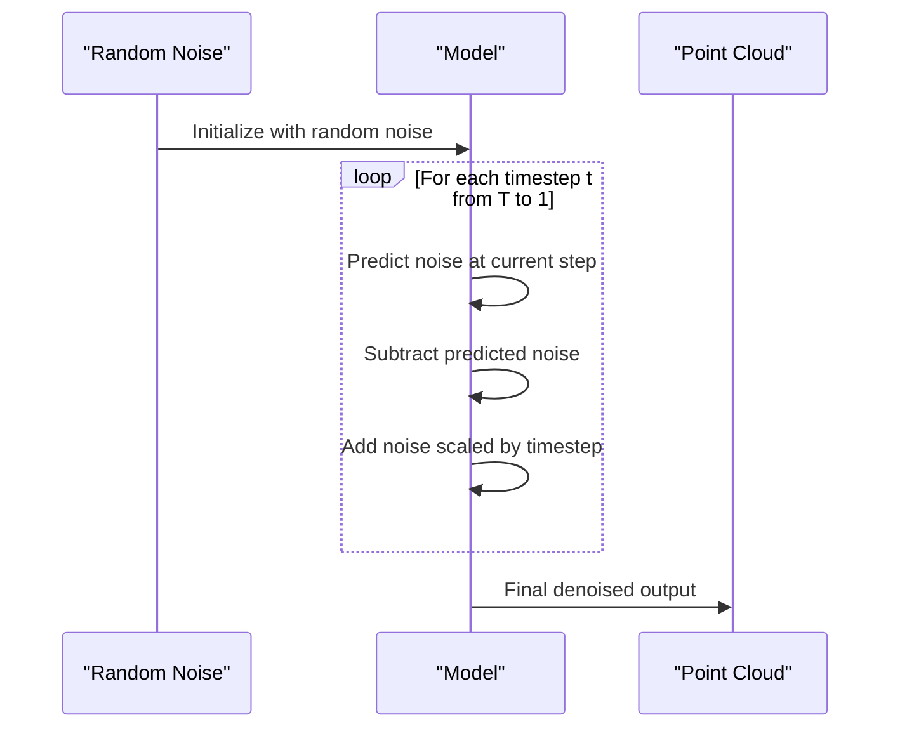
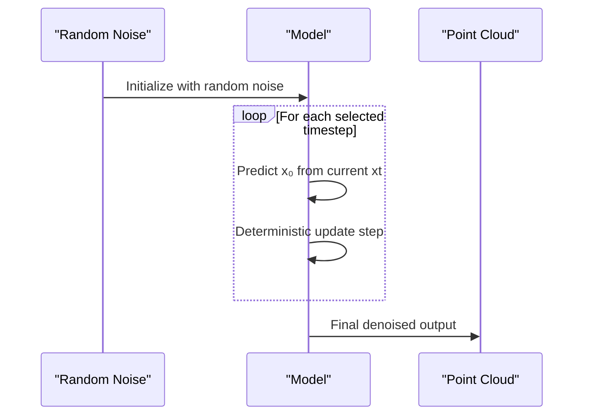
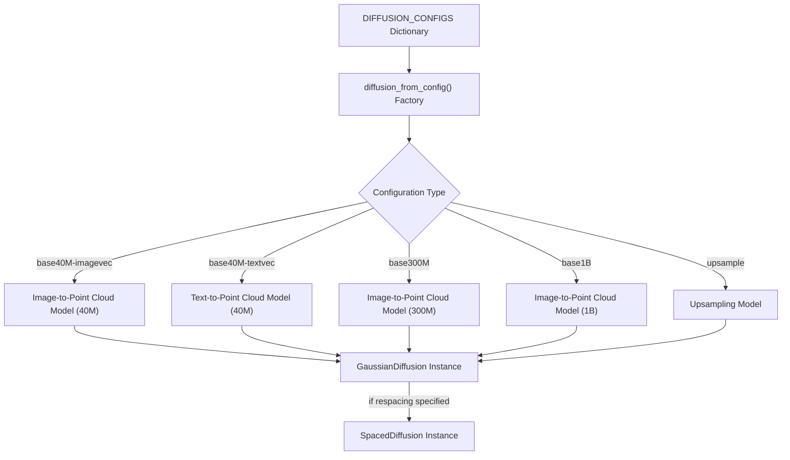
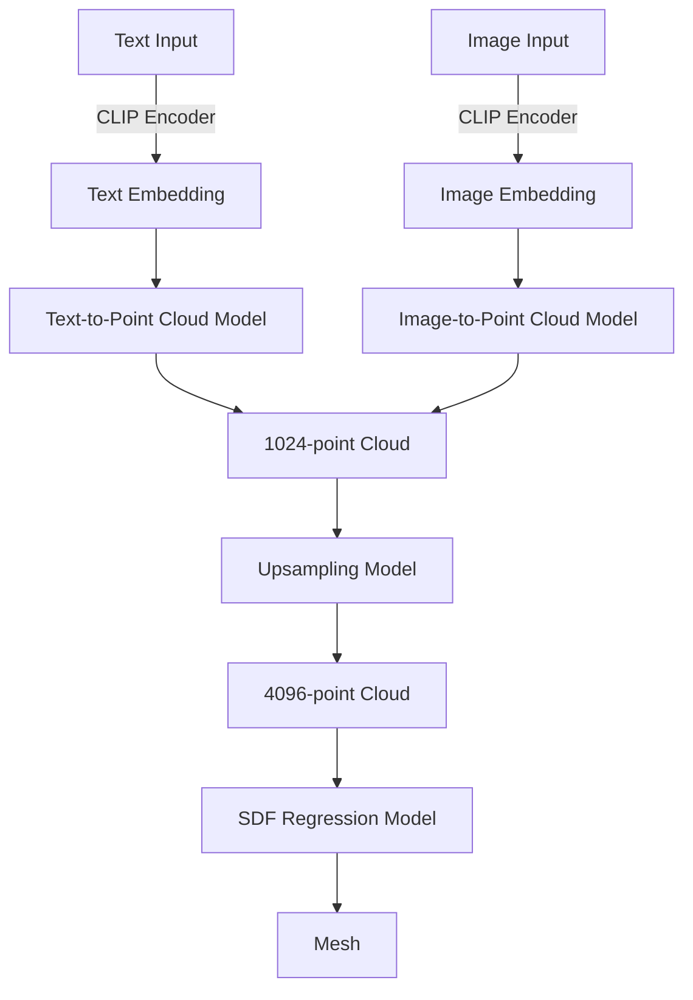
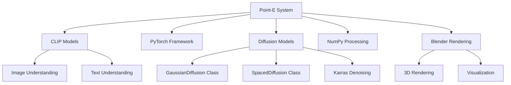

<!-- source: DeepWiki mcp.deepwiki.com · repo openai/point-e · page 2 Model Architecture · fetched 2026-10-26 -->

# Model Architecture

<details>
<summary>Relevant source files</summary>

The following files were used as context for generating this wiki page:

- [README.md](README.md)
- [model-card.md](model-card.md)
- [point_e/diffusion/gaussian_diffusion.py](point_e/diffusion/gaussian_diffusion.py)

</details>


This document provides a technical overview of the core architecture and components that make up the Point-E system. Point-E is a framework for generating 3D point clouds from text or image inputs, with additional capability to convert point clouds to meshes. For specific details about available pre-trained models, see [Available Models](#3), and for usage instructions, see [Usage Guide](#5).

## System Overview

Point-E employs a multi-stage pipeline architecture based on diffusion models. The system can be conceptualized as having three main components:

1. **Input Encoders** - Process text or image inputs using CLIP embeddings
2. **Diffusion Models** - Generate point clouds through iterative denoising
3. **Post-Processing** - Convert point clouds to meshes and perform visualization



Sources: [README.md:1-29](), [model-card.md:1-62]()

## Diffusion Framework

The Point-E system is built on a diffusion-based generative framework. Diffusion models work by gradually adding noise to data and then learning to reverse this process to generate new samples. The core implementation is found in the `GaussianDiffusion` class.

### Gaussian Diffusion Process

The diffusion process consists of forward and reverse processes:

1. **Forward Process**: Gradually adds Gaussian noise to the original data
2. **Reverse Process**: Learns to predict and remove noise to generate new samples

```mermaid
graph LR
    subgraph "Forward Process (Training)"
        X0["x₀ (Clean Point Cloud)"] --> X1["x₁ (Slightly Noisy)"]
        X1 --> X2["x₂"]
        X2 --> Xt["xₜ (Pure Noise)"]

        style X0 fill:#f9f9f9,stroke:#333
        style X1 fill:#f9f9f9,stroke:#333
        style X2 fill:#f9f9f9,stroke:#333
        style Xt fill:#f9f9f9,stroke:#333
    end
    
    subgraph "Reverse Process (Sampling)"
        Y0["x₀ (Generated Point Cloud)"] <-- "Predict & Remove Noise" --- Y1["x₁"]
        Y1 <-- "Predict & Remove Noise" --- Y2["x₂"]
        Y2 <-- "Predict & Remove Noise" --- Yt["xₜ (Pure Noise)"]
        
        style Y0 fill:#f9f9f9,stroke:#333
        style Y1 fill:#f9f9f9,stroke:#333
        style Y2 fill:#f9f9f9,stroke:#333
        style Yt fill:#f9f9f9,stroke:#333
    end
```

Sources: [point_e/diffusion/gaussian_diffusion.py:126-198]()

### GaussianDiffusion Class

The `GaussianDiffusion` class is the core implementation that handles both training and sampling of diffusion models. It calculates the necessary parameters for the forward and reverse diffusion processes.



Key methods in the `GaussianDiffusion` class:

- `q_sample`: Adds noise to samples according to the forward process
- `p_mean_variance`: Calculates predicted mean and variance for the reverse process
- `p_sample`: Samples a single step in the reverse process
- `p_sample_loop_progressive`: Implements the full sampling loop with intermediate results
- `training_losses`: Calculates training objectives for the diffusion model

Sources: [point_e/diffusion/gaussian_diffusion.py:127-949]()

### SpacedDiffusion

`SpacedDiffusion` extends `GaussianDiffusion` to allow for more efficient sampling by skipping steps in the diffusion process:



`SpacedDiffusion` is used for faster inference by selecting a subset of diffusion timesteps while maintaining generation quality.

Sources: [point_e/diffusion/gaussian_diffusion.py:952-1003]()

## Sampling Methods

Point-E implements multiple sampling strategies for point cloud generation:

### Standard Diffusion Sampling

The standard approach involves iteratively denoising from random noise:



Sources: [point_e/diffusion/gaussian_diffusion.py:407-548]()

### DDIM Sampling

Point-E also includes Denoising Diffusion Implicit Models (DDIM) sampling for faster generation with fewer steps:



Sources: [point_e/diffusion/gaussian_diffusion.py:550-724]()

## Model Configuration System

Point-E uses a configuration-based approach to initialize and customize diffusion models:



This system allows for easy switching between different model types and sizes while maintaining a consistent interface.

Sources: [model-card.md:17-26]()

## Multi-Model Pipeline Flow

The complete pipeline often involves multiple models working together:



This multi-stage approach allows for:
1. Initial content generation (text/image to point cloud)
2. Resolution enhancement (upsampling)
3. Surface reconstruction (point cloud to mesh)

The largest models (base1B) tend to produce the highest quality point clouds, but at increased computational cost.

Sources: [model-card.md:1-62](), [README.md:1-29]()

## Model Variants and Parameter Counts

Point-E includes several model variants with different parameter counts and capabilities:

| Model | Parameters | Input Type | Output | Purpose |
|-------|------------|------------|--------|---------|
| base40M-imagevec | 40M | Image vector | 1024-point cloud | Image to point cloud (basic) |
| base40M-textvec | 40M | Text vector | 1024-point cloud | Text to point cloud |
| base40M | 40M | Image grid | 1024-point cloud | Image to point cloud |
| base300M | 300M | Image grid | 1024-point cloud | Image to point cloud (better) |
| base1B | 1B | Image grid | 1024-point cloud | Image to point cloud (best) |
| upsample | 40M | Point cloud + optional image | 4096-point cloud | Resolution enhancement |
| sdf | Small | Point cloud | Signed distance field | Mesh generation |

Sources: [model-card.md:17-26]()

## Technology Stack Integration

Point-E integrates with several key technologies:



Sources: [README.md:1-29]()

## Key Distinctions Between Model Types

The architecture accommodates multiple input modalities and model types:

1. **Image-conditional models** take a rendered image as input and produce a corresponding 3D point cloud
2. **Text-conditional models** generate point clouds directly from text descriptions
3. **Upsampling models** increase the resolution of a point cloud from 1024 to 4096 points
4. **SDF regression models** convert point clouds to meshes via signed distance function prediction

Each model type shares the diffusion framework but differs in its conditioning mechanism and network architecture.

Sources: [model-card.md:8-11](), [model-card.md:17-26]()

---

