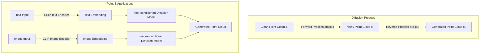
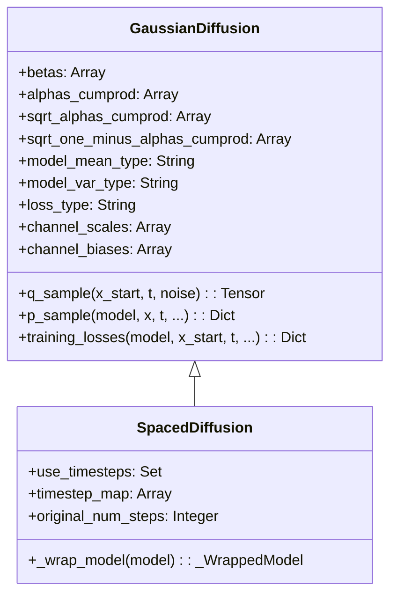
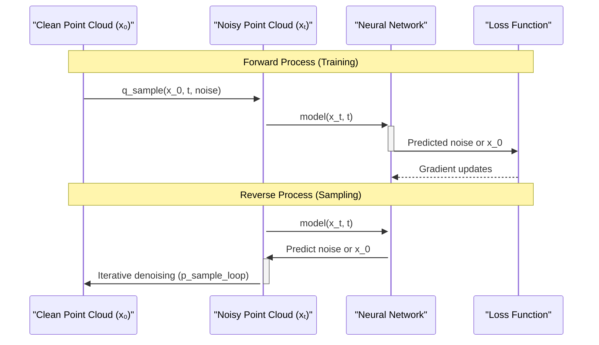
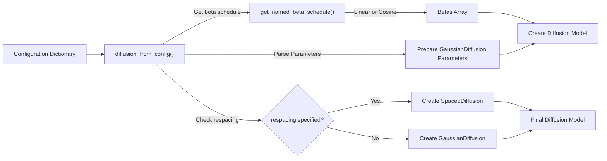
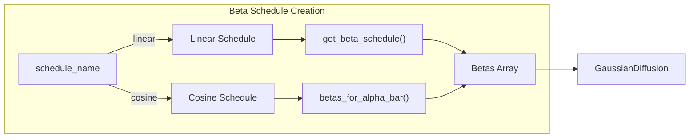
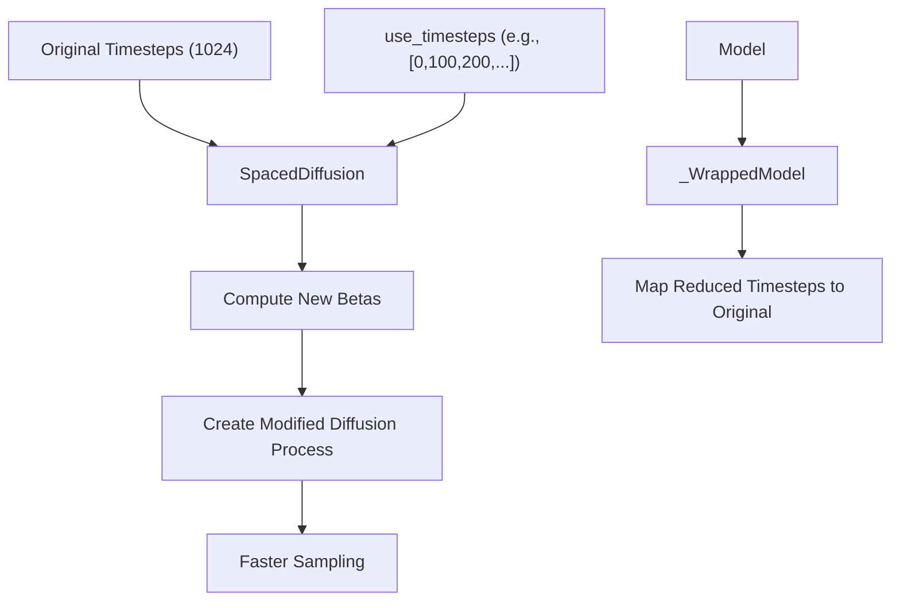
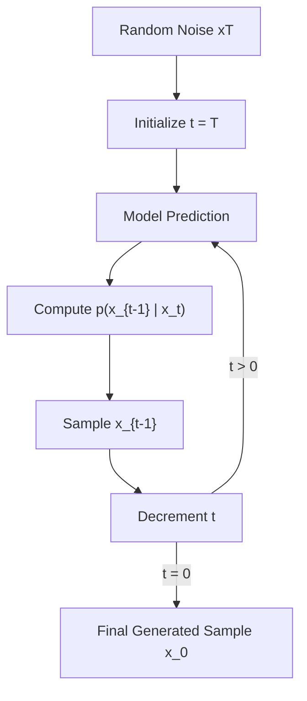
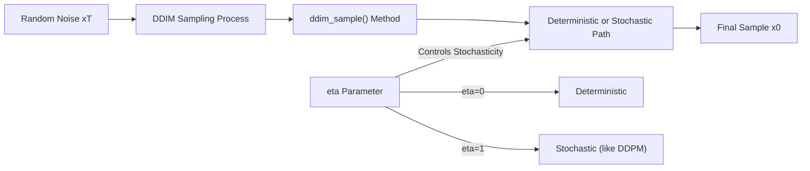

<!-- source: DeepWiki mcp.deepwiki.com · repo openai/point-e · page 2.1 Diffusion Models · fetched 2026-10-26 -->

# Diffusion Models

<details>
<summary>Relevant source files</summary>

The following files were used as context for generating this wiki page:

- [model-card.md](model-card.md)
- [point_e/diffusion/configs.py](point_e/diffusion/configs.py)
- [point_e/diffusion/gaussian_diffusion.py](point_e/diffusion/gaussian_diffusion.py)

</details>


This page documents the diffusion model framework used in Point-E, which forms the foundation of the 3D point cloud generation system. It covers the Gaussian diffusion process implementation, the configuration system for different model variants, and the mathematical principles underlying the generation process. For information about how point clouds are sampled using these diffusion models, see [Point Cloud Sampling](#2.3).

## Overview of Diffusion Models in Point-E

Diffusion models are a class of generative models that work by gradually adding noise to data through a forward process, then learning to reverse this process to generate new samples. In Point-E, diffusion models are used to generate 3D point clouds from either text or image inputs.



Sources: [point_e/diffusion/gaussian_diffusion.py:127-349]()

## Core Implementation: GaussianDiffusion

The `GaussianDiffusion` class is the central implementation of the diffusion process in Point-E. It provides utilities for both training diffusion models and sampling from them. The class implements both the forward noising process and the reverse denoising process.

### Mathematical Foundation

The diffusion process in Point-E is based on a Markovian process that gradually adds Gaussian noise to data according to a variance schedule defined by a sequence of betas (β₁, β₂, ..., βₜ).



Sources: [point_e/diffusion/gaussian_diffusion.py:127-132](), [point_e/diffusion/gaussian_diffusion.py:144-162]()

### Key Methods

The `GaussianDiffusion` class has several important methods:

1. **Forward Process**:
   - `q_sample`: Adds noise to the input data according to the diffusion schedule
   - `q_mean_variance`: Computes the mean and variance of the distribution q(x_t | x_0)

2. **Reverse Process**:
   - `p_sample`: Samples x_{t-1} from the model at the given timestep
   - `p_sample_loop`: Generates samples from the model by iteratively applying `p_sample`
   - `ddim_sample`: Implements the DDIM sampling method for more efficient inference

3. **Training**:
   - `training_losses`: Computes loss terms for training the diffusion model



Sources: [point_e/diffusion/gaussian_diffusion.py:214-231](), [point_e/diffusion/gaussian_diffusion.py:407-498](), [point_e/diffusion/gaussian_diffusion.py:762-847]()

## Diffusion Model Configuration

Point-E uses a configuration system to define different diffusion model variants. These configurations specify parameters like noise schedules, channel scaling, and mean prediction types.

### Configuration Dictionary

The `DIFFUSION_CONFIGS` dictionary contains configurations for different model variants, including both base models and upsampling models:

```
BASE_DIFFUSION_CONFIG = {
    "channel_biases": [0.0, 0.0, 0.0, -1.0, -1.0, -1.0],
    "channel_scales": [2.0, 2.0, 2.0, 0.007843137255, 0.007843137255, 0.007843137255],
    "mean_type": "epsilon",
    "schedule": "cosine",
    "timesteps": 1024,
}

DIFFUSION_CONFIGS = {
    "base40M-imagevec": BASE_DIFFUSION_CONFIG,
    "base40M-textvec": BASE_DIFFUSION_CONFIG,
    "base40M-uncond": BASE_DIFFUSION_CONFIG,
    "base40M": BASE_DIFFUSION_CONFIG,
    "base300M": BASE_DIFFUSION_CONFIG,
    "base1B": BASE_DIFFUSION_CONFIG,
    "upsample": {
        "channel_biases": [0.0, 0.0, 0.0, -1.0, -1.0, -1.0],
        "channel_scales": [2.0, 2.0, 2.0, 0.007843137255, 0.007843137255, 0.007843137255],
        "mean_type": "epsilon",
        "schedule": "linear",
        "timesteps": 1024,
    },
}
```

Sources: [point_e/diffusion/configs.py:16-38]()

### Configuration Parameters

The key configuration parameters include:

| Parameter | Description | Typical Values |
|-----------|-------------|----------------|
| `channel_biases` | Bias values applied to each channel | `[0.0, 0.0, 0.0, -1.0, -1.0, -1.0]` |
| `channel_scales` | Scale factors applied to each channel | `[2.0, 2.0, 2.0, 0.007843137255, ...]` |
| `mean_type` | Method to predict mean in the diffusion process | `"epsilon"` or `"x_start"` |
| `schedule` | Type of noise schedule to use | `"cosine"` or `"linear"` |
| `timesteps` | Number of diffusion steps | `1024` |
| `respacing` | Optional parameter for efficiency (SpacedDiffusion) | Typically not specified |

Sources: [point_e/diffusion/configs.py:41-64]()

### Creating Diffusion Models from Configurations

The `diffusion_from_config` function converts a configuration dictionary into a `GaussianDiffusion` or `SpacedDiffusion` instance:



Sources: [point_e/diffusion/configs.py:41-64](), [point_e/diffusion/gaussian_diffusion.py:26-51]()

## Beta Schedules

The noise schedule (sequence of β values) is critical to the diffusion process. Point-E supports two main schedules:

1. **Linear schedule**: Implements a linearly increasing noise level
2. **Cosine schedule**: Uses a cosine function to create a smoother schedule that maintains signal longer



Sources: [point_e/diffusion/gaussian_diffusion.py:26-71]()

## SpacedDiffusion for Efficient Sampling

The `SpacedDiffusion` class extends `GaussianDiffusion` to support skipping steps in the diffusion process. This allows for faster sampling without significantly compromising quality.



Sources: [point_e/diffusion/gaussian_diffusion.py:952-1003](), [point_e/diffusion/gaussian_diffusion.py:74-124]()

### Timestep Selection

The `space_timesteps` function provides various strategies for selecting a subset of timesteps from the original process:

1. Uniform spacing (e.g., every nth step)
2. Section-based spacing (different densities in different parts)
3. DDIM-style spacing

Sources: [point_e/diffusion/gaussian_diffusion.py:74-124]()

## Training and Sampling Processes

### Forward Process (Training)

During training, the forward process adds noise to the input data and the model learns to predict either the added noise or the original clean data:

1. Scale input data using `channel_scales` and `channel_biases`
2. Add noise to the input using `q_sample`
3. Pass the noisy data to the model
4. Compute loss between model output and target (either noise or clean data)

Sources: [point_e/diffusion/gaussian_diffusion.py:762-847]()

### Reverse Process (Sampling)

During sampling, the model iteratively denoises random noise to generate new samples:

1. Start with random Gaussian noise
2. For each timestep (from T to 0):
   - Predict the denoised data or the noise component
   - Apply the predicted information to take one step of denoising
   - Optionally apply conditioning information



Sources: [point_e/diffusion/gaussian_diffusion.py:407-498](), [point_e/diffusion/gaussian_diffusion.py:499-549]()

### DDIM Sampling

Point-E also supports Denoising Diffusion Implicit Models (DDIM) sampling, which enables more efficient sampling with fewer steps:



Sources: [point_e/diffusion/gaussian_diffusion.py:550-723]()

## Summary

The diffusion model implementation in Point-E provides a flexible framework for generating 3D point clouds. The key components are:

1. The `GaussianDiffusion` class, which implements the core diffusion process
2. The configuration system, which allows for different model variants
3. Beta schedules, which control the noise addition process
4. Sampling methods, including standard diffusion sampling and DDIM
5. The `SpacedDiffusion` class for more efficient sampling

Together, these components enable the generation of high-quality 3D point clouds from text or image inputs, which form the foundation of the Point-E system.

---

