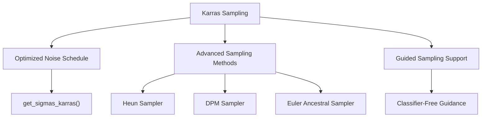
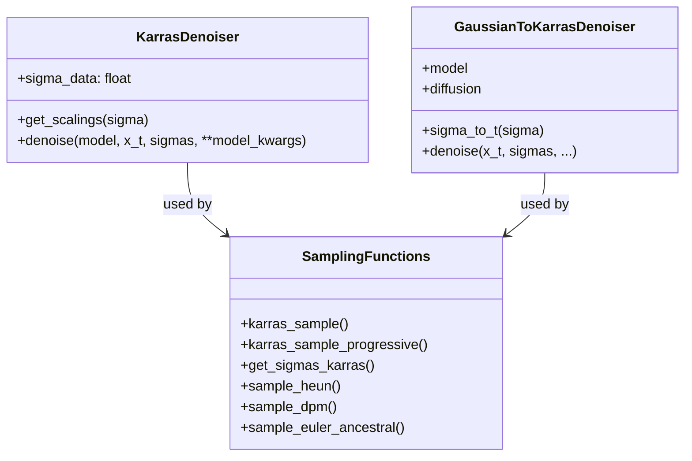
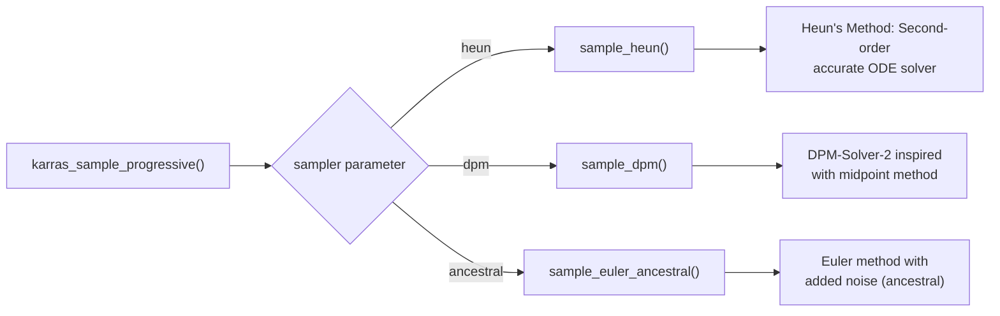
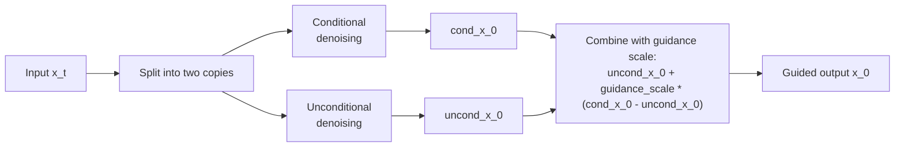

<!-- source: DeepWiki mcp.deepwiki.com · repo openai/point-e · page 2.2 Karras Sampling · fetched 2026-10-26 -->

# Karras Sampling

<details>
<summary>Relevant source files</summary>

The following files were used as context for generating this wiki page:

- [point_e/diffusion/k_diffusion.py](point_e/diffusion/k_diffusion.py)

</details>


This document details the Karras sampling methodology implemented in Point-E for generating high-quality samples from diffusion models. For information about the general diffusion model framework, see [Diffusion Models](#2.1). For details on how point clouds are specifically sampled, see [Point Cloud Sampling](#2.3).

## Purpose and Significance

Karras sampling refers to a specialized sampling strategy for diffusion models introduced by Karras et al. in their paper "Elucidating the Design Space of Diffusion-Based Generative Models" (2022). It offers improved sample quality and efficiency compared to standard diffusion sampling methods, particularly important for generating detailed 3D point clouds.



Sources: [point_e/diffusion/k_diffusion.py:194-200]()

## Core Components

The Karras sampling implementation in Point-E consists of several key classes and functions:



Sources: [point_e/diffusion/k_diffusion.py:31-76](), [point_e/diffusion/k_diffusion.py:79-108]()

### KarrasDenoiser

The `KarrasDenoiser` class provides a native implementation of the Karras denoising process. It parameterizes the denoising process using sigma values (noise levels) rather than timesteps as in traditional diffusion models.

Key methods:
- `get_scalings`: Computes scaling factors for the input, output, and skip connections
- `denoise`: Performs the actual denoising step by applying these scalings

Sources: [point_e/diffusion/k_diffusion.py:31-76]()

### GaussianToKarrasDenoiser

This adapter class allows models trained with the standard Gaussian diffusion approach to be used with Karras sampling. It provides a conversion mechanism between sigma values and diffusion timesteps.

Key methods:
- `sigma_to_t`: Converts sigma values to equivalent timesteps
- `denoise`: Adapts the Gaussian diffusion model to work with the Karras sampling process

Sources: [point_e/diffusion/k_diffusion.py:79-108]()

## Sampling Methods

Point-E implements three primary sampling methods that can be used with Karras denoising:



Sources: [point_e/diffusion/k_diffusion.py:111-115](), [point_e/diffusion/k_diffusion.py:118-191]()

### Heun Sampler

The Heun sampler (`sample_heun`) implements Algorithm 2 from Karras et al. (2022). It's a second-order accurate numerical ODE solver that improves sample quality over first-order methods:

1. First computes a preliminary estimate using Euler's method
2. Then refines the estimate using both the initial and preliminary values

```python
# First step (Euler)
x_2 = x + d * dt

# Second step (refinement)
denoised_2 = denoiser(x_2, sigmas[i + 1] * s_in)
d_2 = to_d(x_2, sigmas[i + 1], denoised_2)
d_prime = (d + d_2) / 2
x = x + d_prime * dt
```

Sources: [point_e/diffusion/k_diffusion.py:238-279]()

### DPM Sampler

The DPM sampler (`sample_dpm`) is inspired by DPM-Solver-2 with adaptations from Karras et al. (2022). It uses a midpoint method where the midpoint is chosen according to a rho=3 Karras schedule:

```python
# Calculate midpoint using a rho=3 Karras schedule
sigma_mid = ((sigma_hat ** (1 / 3) + sigmas[i + 1] ** (1 / 3)) / 2) ** 3
```

Sources: [point_e/diffusion/k_diffusion.py:282-320]()

### Euler Ancestral Sampler

The Euler ancestral sampler (`sample_euler_ancestral`) combines Euler steps with added noise, similar to the approach in traditional diffusion models:

```python
# Calculate noise levels
sigma_down, sigma_up = get_ancestral_step(sigmas[i], sigmas[i + 1])

# Euler step
dt = sigma_down - sigmas[i]
x = x + d * dt

# Add noise
x = x + th.randn_like(x) * sigma_up
```

Sources: [point_e/diffusion/k_diffusion.py:216-235]()

## Optimized Noise Schedule

The Karras sampling approach uses a specialized noise schedule that allocates sampling steps more efficiently than the uniform or geometric schedules commonly used in diffusion models:

```python
def get_sigmas_karras(n, sigma_min, sigma_max, rho=7.0, device="cpu"):
    """Constructs the noise schedule of Karras et al. (2022)."""
    ramp = th.linspace(0, 1, n)
    min_inv_rho = sigma_min ** (1 / rho)
    max_inv_rho = sigma_max ** (1 / rho)
    sigmas = (max_inv_rho + ramp * (min_inv_rho - max_inv_rho)) ** rho
    return append_zero(sigmas).to(device)
```

The parameter `rho` (default: 7.0) controls the distribution of steps, with higher values allocating more steps to lower noise levels.

Sources: [point_e/diffusion/k_diffusion.py:194-200]()

## Advanced Features

### Classifier-Free Guidance

Karras sampling in Point-E supports classifier-free guidance through the `guidance_scale` parameter:



This approach allows for controllable generation by enhancing the difference between conditional and unconditional predictions.

Sources: [point_e/diffusion/k_diffusion.py:168-178]()

### Stochastic Sampling

To improve sample diversity, Karras sampling supports stochastic sampling through these parameters:
- `s_churn`: Controls the amount of additional noise
- `s_tmin` and `s_tmax`: Define the sigma range where additional noise is applied
- `s_noise`: Scaling factor for the added noise

```python
gamma = min(s_churn / (len(sigmas) - 1), 2**0.5 - 1) if s_tmin <= sigmas[i] <= s_tmax else 0.0
eps = th.randn_like(x) * s_noise
sigma_hat = sigmas[i] * (gamma + 1)
if gamma > 0:
    x = x + eps * (sigma_hat**2 - sigmas[i] ** 2) ** 0.5
```

Sources: [point_e/diffusion/k_diffusion.py:258-264]()

## Usage Example

To use Karras sampling in Point-E, you can call either `karras_sample` (for the final result only) or `karras_sample_progressive` (to access intermediate results):

```python
# Single result
final_sample = karras_sample(
    diffusion,
    model,
    shape=(batch_size, *model_shape),
    steps=40,
    clip_denoised=True,
    model_kwargs=model_kwargs,
    device=device,
    sampler="heun"  # Choose from "heun", "dpm", or "ancestral"
)

# Progressive results
for sample_data in karras_sample_progressive(
    diffusion,
    model,
    shape=(batch_size, *model_shape),
    steps=40,
    progress=True,
    model_kwargs=model_kwargs,
    sampler="heun"
):
    # Process intermediate results
    current_x = sample_data["x"]
    current_step = sample_data["i"]
```

Sources: [point_e/diffusion/k_diffusion.py:111-191]()

## Advantages Over Standard Diffusion Sampling

Karras sampling offers several advantages over traditional diffusion sampling approaches:

1. **Improved sample quality** with the same number of steps
2. **Better computational efficiency** by focusing steps where they matter most
3. **More accurate ODE solutions** through higher-order numerical methods like Heun's method
4. **Flexible noise schedule** controlled by the `rho` parameter

Sources: [point_e/diffusion/k_diffusion.py]()

---

