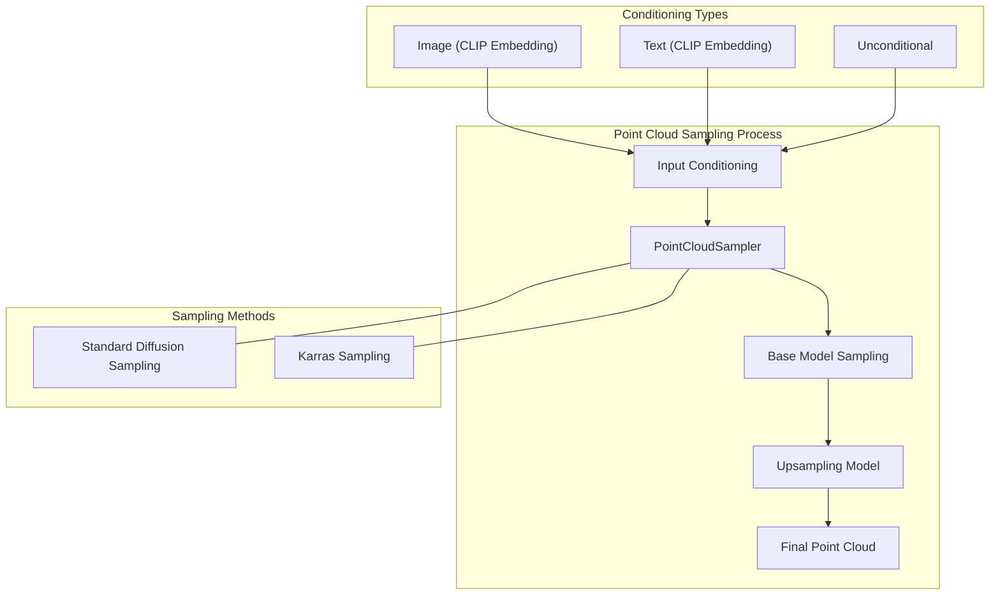
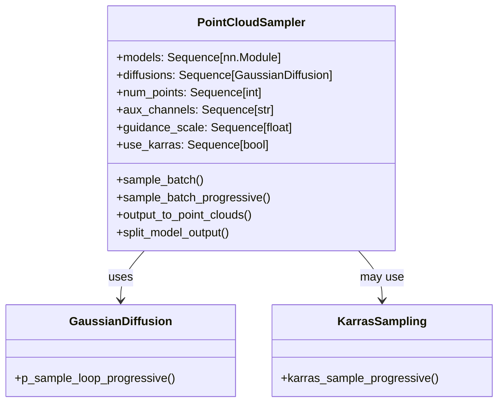
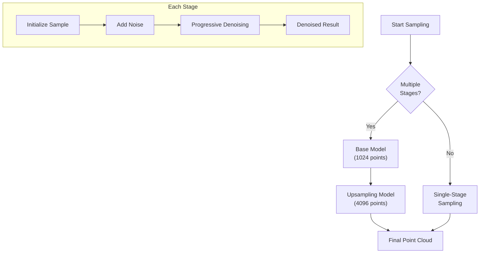
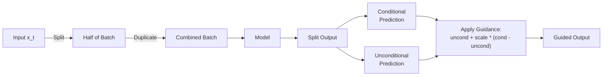
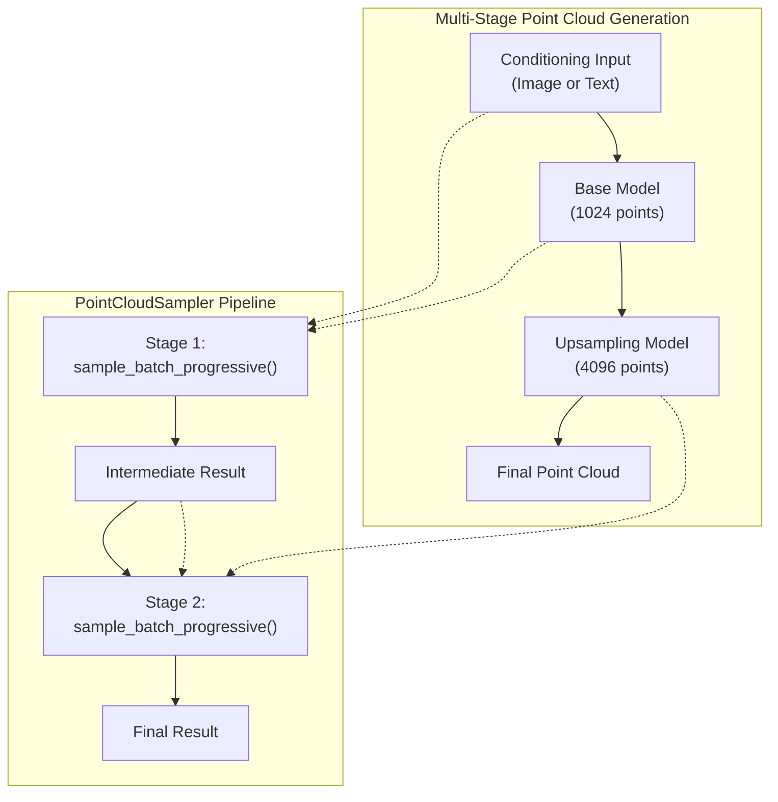
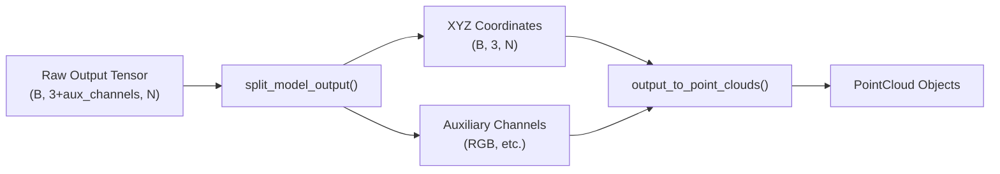

<!-- source: DeepWiki mcp.deepwiki.com · repo openai/point-e · page 2.3 Point Cloud Sampling · fetched 2026-10-26 -->

# Point Cloud Sampling

<details>
<summary>Relevant source files</summary>

The following files were used as context for generating this wiki page:

- [model-card.md](model-card.md)
- [point_e/diffusion/sampler.py](point_e/diffusion/sampler.py)

</details>


This document describes the point cloud sampling system in Point-E, which is responsible for generating 3D point clouds using diffusion models. The sampling system enables generation from text prompts, images, or through unconditional sampling, and supports multi-stage pipelines that combine different models. For information about specific diffusion methods used, see [Diffusion Models](#2.1) and [Karras Sampling](#2.2).

## Overview

The Point-E sampling system provides a flexible framework for generating point clouds through one or more diffusion models. The primary class implementing this functionality is `PointCloudSampler`, which orchestrates the sampling process and manages the transition between multiple models in a generation pipeline.



Sources: [point_e/diffusion/sampler.py:1-26]()

## PointCloudSampler Architecture

The `PointCloudSampler` class is the central component for point cloud generation. It encapsulates one or more diffusion models and their respective sampling parameters.



Sources: [point_e/diffusion/sampler.py:16-85]()

### Key Components

The `PointCloudSampler` is initialized with several key parameters:

| Parameter | Description |
|-----------|-------------|
| `models` | Sequence of neural network models for each stage |
| `diffusions` | Sequence of GaussianDiffusion objects corresponding to each model |
| `num_points` | Number of points to generate at each stage (e.g., 1024, 4096) |
| `aux_channels` | Channel names for auxiliary data (e.g., "R", "G", "B" for colors) |
| `guidance_scale` | Controls classifier-free guidance strength for conditional models |
| `use_karras` | Whether to use Karras sampling algorithm at each stage |
| `karras_steps` | Number of sampling steps when using Karras sampling |
| `sigma_min`, `sigma_max`, `s_churn` | Parameters for Karras sampling configuration |

Sources: [point_e/diffusion/sampler.py:26-85]()

## Sampling Process

The sampling process in Point-E can be performed in a single step or progressively, returning intermediate results during generation.



Sources: [point_e/diffusion/sampler.py:90-169]()

### Standard Sampling

The standard sampling method uses the traditional diffusion reverse process, where noise is gradually removed from a randomly initialized point cloud. This is implemented through the `p_sample_loop_progressive` method of the `GaussianDiffusion` class.

```python
# Conceptual sampling process (simplified)
samples = diffusion.p_sample_loop_progressive(
    model,
    shape=(batch_size, channels, num_points),
    model_kwargs=conditioning,
    device=device,
    clip_denoised=clip_denoised,
)
```

Sources: [point_e/diffusion/sampler.py:156-162]()

### Karras Sampling

For higher quality results, Point-E supports Karras sampling, which follows an alternative sampling trajectory based on research by Karras et al. This method typically produces better results with fewer sampling steps.

```python
# Conceptual Karras sampling (simplified)
samples = karras_sample_progressive(
    diffusion=diffusion,
    model=model,
    shape=sample_shape,
    steps=karras_steps,
    sigma_min=sigma_min,
    sigma_max=sigma_max,
    s_churn=s_churn,
    guidance_scale=guidance_scale,
)
```

Sources: [point_e/diffusion/sampler.py:138-150]()

### Classifier-Free Guidance

Point-E implements classifier-free guidance to improve the quality of conditional samples. This technique combines conditional and unconditional predictions to enhance the influence of conditioning information.



Sources: [point_e/diffusion/sampler.py:192-205]()

## Multi-Stage Sampling Pipeline

One of the key features of the Point-E sampling system is the ability to chain multiple models together in a pipeline, where each stage builds upon the output of the previous stage.



Sources: [point_e/diffusion/sampler.py:96-169]()

A typical two-stage pipeline might include:
1. A base model that generates 1024 points from an image or text prompt
2. An upsampling model that refines the result to 4096 points

For each stage, the sampler handles:
- Filtering relevant model keyword arguments
- Passing previous stage outputs as conditioning
- Applying classifier-free guidance if needed
- Progressively denoising using either standard or Karras sampling

Sources: [point_e/diffusion/sampler.py:96-169](), [model-card.md:17-25]()

## Output Processing

The output of the sampling process is a tensor containing both the 3D coordinates and any auxiliary features like RGB colors. The `PointCloudSampler` provides methods to process this output.



Sources: [point_e/diffusion/sampler.py:207-237]()

The `split_model_output` method separates the positional coordinates from auxiliary channels:
```python
# Conceptual split (simplified)
pos, aux = output[:, :3], output[:, 3:]  # Split XYZ from auxiliary data
```

The `output_to_point_clouds` method converts tensor outputs to `PointCloud` objects, which provide a convenient interface for working with point cloud data and exporting to other formats.

Sources: [point_e/diffusion/sampler.py:207-237]()

## Combining Samplers

For advanced use cases, the `PointCloudSampler` supports combining multiple samplers into a single pipeline using the `combine` class method. This allows for more complex generation pipelines that may use different models or configurations at each stage.

```python
# Conceptual sampler combination (simplified)
combined_sampler = PointCloudSampler.combine(base_sampler, upsampling_sampler)
```

Sources: [point_e/diffusion/sampler.py:171-190]()

## Available Models for Sampling

Point-E provides several pre-trained models that can be used with the sampling system:

| Model | Description | Output Points |
|-------|-------------|--------------|
| `base40M`, `base300M`, `base1B` | Image-to-point cloud diffusion models | 1024 |
| `base40M-textvec` | Text-to-point cloud diffusion model | 1024 |
| `base40M-uncond` | Unconditional point cloud generation | 1024 |
| `upsample` | Point cloud upsampling model | 4096 |

Sources: [model-card.md:17-25]()

For more details about these models, see [Available Models](#3).

---

