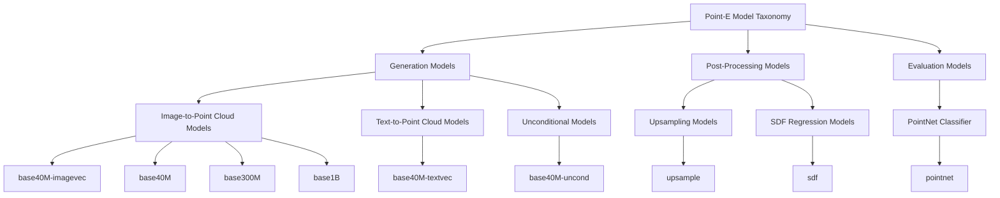
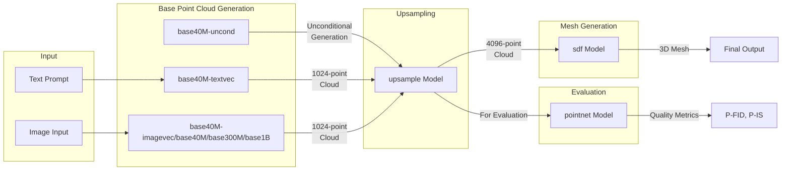
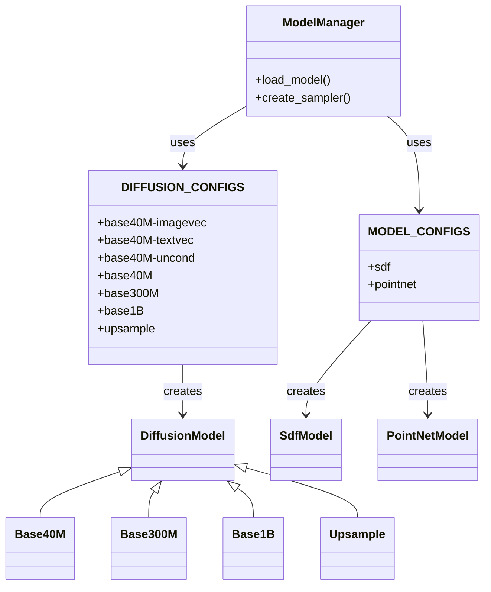

<!-- source: DeepWiki mcp.deepwiki.com · repo openai/point-e · page 3 Available Models · fetched 2026-10-26 -->

# Available Models

Relevant source files

The following files were used as context for generating this wiki page:

- [README.md](README.md)
- [model-card.md](model-card.md)

This page provides a comprehensive overview of the pre-trained models available in the Point-E system. It covers the different model types, their parameters, capabilities, and intended use cases. For details on how these models are architecturally implemented, see [Model Architecture](#2) and for usage instructions, see [Usage Guide](#5).

## Model Categories

Point-E provides several categories of models that form a complete pipeline for 3D generation:

1. **Image-to-Point Cloud Models**: Generate 3D point clouds from input images
2. **Text-to-Point Cloud Models**: Generate 3D point clouds directly from text descriptions
3. **Point Cloud Upsampling Models**: Increase the resolution of point clouds
4. **Point Cloud-to-Mesh Models**: Convert point clouds to 3D meshes
5. **Evaluation Models**: Used for quality assessment metrics

Sources: [model-card.md:17-26]()

## Available Model Versions

The table below provides details on all pre-trained models available in Point-E:

| Model Name | Parameters | Type | Conditioning | Description | Performance |
|------------|------------|------|--------------|-------------|-------------|
| `base40M-imagevec` | 40M | Image-to-Point Cloud | CLIP ViT-L/14 image vector | Generates point clouds from rendered images | Lower quality than grid-based models |
| `base40M-textvec` | 40M | Text-to-Point Cloud | CLIP ViT-L/14 text vector | Generates point clouds directly from text | Works for simple prompts only |
| `base40M-uncond` | 40M | Unconditional | None | Generates unconditional point cloud samples | Baseline model only |
| `base40M` | 40M | Image-to-Point Cloud | CLIP ViT-L/14 latent grid | Generates point clouds from rendered images | Better than vector-based, worse than larger models |
| `base300M` | 300M | Image-to-Point Cloud | CLIP ViT-L/14 latent grid | Generates point clouds from rendered images | Slightly worse than base1B |
| `base1B` | 1B | Image-to-Point Cloud | CLIP ViT-L/14 latent grid | Generates point clouds from rendered images | Best image-conditional model |
| `upsample` | 40M | Point Cloud Upsampling | Optional image conditioning | Upsamples 1024-point clouds to 4096 points | Improves detail and density |
| `sdf` | Small | SDF Regression | None | Predicts signed distance functions from point clouds | Creates watertight meshes |
| `pointnet` | Small | Classification | None | Classifies point clouds | Used for P-FID and P-IS metrics |

Sources: [model-card.md:17-26](), [README.md:11-15]()

## Model Pipeline and Relationships

The models are designed to work together in a pipeline, with different models handling specific stages of the 3D generation process:

Sources: [README.md:11-15](), [model-card.md:38-45]()

## Model Configuration and Loading

The models are accessed through a configuration system that manages loading and initialization. The code uses a registry of predefined model configurations:

Sources: [model-card.md:17-26]()

## Model Selection Guide

Choosing the appropriate model depends on your specific use case:

1. **For image-to-point cloud generation**:
   - For highest quality: Use `base1B`
   - For balanced performance: Use `base300M` 
   - For faster inference with lower memory: Use `base40M`
   - For minimal resource usage: Use `base40M-imagevec`

2. **For text-to-point cloud generation**:
   - Use `base40M-textvec` (works best with simple prompts)

3. **For all point cloud generation**:
   - Follow with the `upsample` model to increase point cloud resolution to 4096 points

4. **For creating meshes**:
   - After generating and upsampling a point cloud, use the `sdf` model

5. **For evaluation**:
   - Use the `pointnet` model for computing quality metrics such as P-FID and P-IS

Sources: [model-card.md:37-49](), [README.md:11-20]()

## Model Limitations

It's important to be aware of the limitations of these models:

- Image-conditional models may produce incorrect geometry where the rendering is occluded
- Text-conditional model performs well only on simple prompts and common objects
- All models produce relatively low-resolution point clouds that may contain noise and defects
- Point clouds often exhibit a cartoonish style due to training data characteristics
- The SDF regression model works best on manifold (watertight) point clouds

Sources: [model-card.md:50-61]()

---

