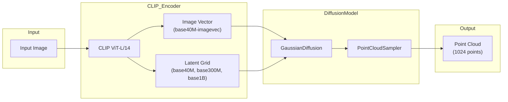
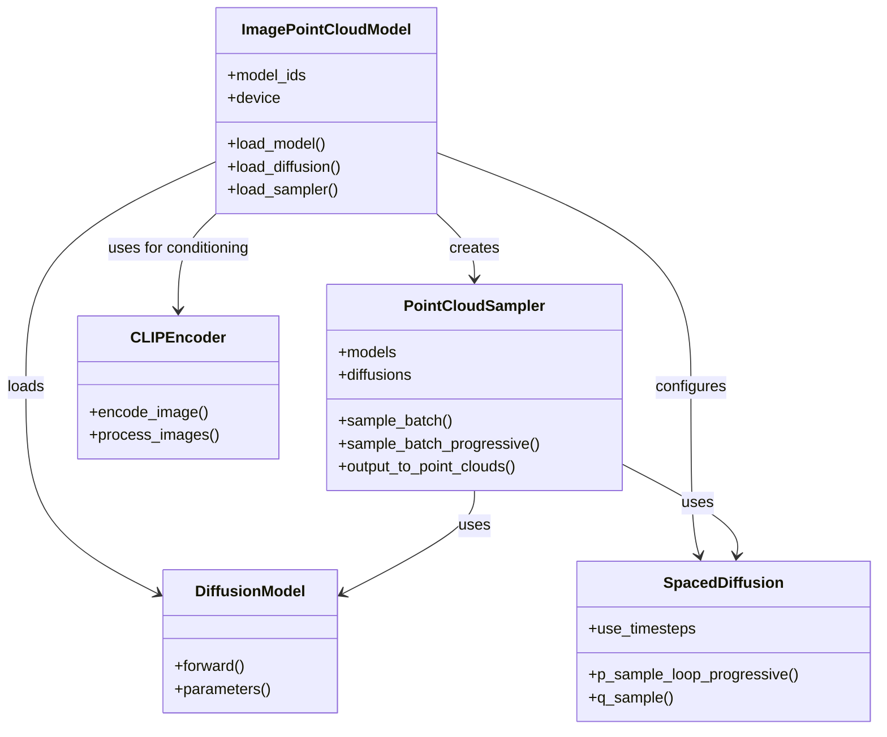
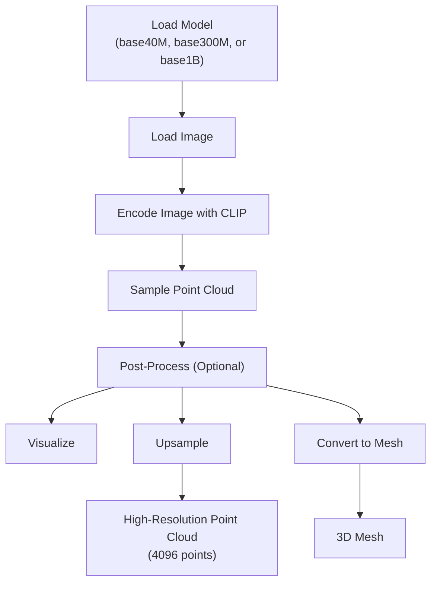

<!-- source: DeepWiki mcp.deepwiki.com · repo openai/point-e · page 3.1 Image-to-Point Cloud Models · fetched 2026-10-26 -->

# Image-to-Point Cloud Models

Relevant source files

The following files were used as context for generating this wiki page:

- [README.md](README.md)
- [model-card.md](model-card.md)

This page documents the image-to-point cloud models in the Point-E system, which generate 3D point clouds from input images. For information about text-to-point cloud generation, see [Text-to-Point Cloud Models](#3.2). For converting point clouds to meshes, see [Point Cloud-to-Mesh Models](#3.3).

## Overview

Image-to-point cloud models form a core component of the Point-E system, enabling the generation of 3D point clouds from single 2D renderings of objects. These models leverage diffusion-based techniques to progressively transform random noise into coherent 3D point clouds that correspond to the input image.

Sources: [README.md:5-15](), [model-card.md:8-10]()

## Available Models

Point-E provides four image-to-point cloud models with varying parameter counts and capabilities:

| Model Name | Parameters | Conditioning | Description |
|------------|------------|--------------|------------|
| base40M-imagevec | 40 million | Single CLIP ViT-L/14 image vector | Basic image-to-point cloud functionality, but with lower quality than other models |
| base40M | 40 million | CLIP ViT-L/14 latent grid | Better quality than base40M-imagevec but not as good as larger models |
| base300M | 300 million | CLIP ViT-L/14 latent grid | High-quality output, slightly worse than base1B |
| base1B | 1 billion | CLIP ViT-L/14 latent grid | Highest quality image-to-point cloud model |

All models produce point clouds with 1,024 points, which can be further processed by the upsampling model to reach 4,096 points.

Sources: [model-card.md:16-26]()

## Architecture and Data Flow

### Image-to-Point Cloud Generation Pipeline

The process begins with an input image that is encoded using CLIP ViT-L/14. Depending on the model variant, either a single image vector (base40M-imagevec) or a latent grid (base40M, base300M, base1B) is used as conditioning for the diffusion model. The diffusion model then generates a point cloud with 1,024 points.

Sources: [model-card.md:16-26]()

### Model Components and Implementation

The image-to-point cloud system consists of several components:

1. `ImagePointCloudModel`: A high-level interface for loading and using the models
2. `PointCloudSampler`: Coordinates the sampling process from the diffusion model
3. `SpacedDiffusion`: Implements the diffusion process with configurable timestep scheduling
4. `DiffusionModel`: The neural network that predicts noise at each diffusion step
5. `CLIPEncoder`: Processes input images to create conditioning information

Sources: [model-card.md:16-26]()

## Model Performance and Quality

The image-to-point cloud models exhibit the following characteristics:

1. **Capabilities**:
   - Generate coherent 3D point clouds from single 2D renderings
   - Capture visible geometry from the input image

2. **Limitations**:
   - May produce incorrect geometry in occluded areas
   - Sometimes generates geometry inconsistent with visible parts
   - Output is relatively low-resolution (1,024 points)
   - Point clouds may contain noise, outliers, or cracks

3. **Quality Progression**:
   - base1B > base300M > base40M > base40M-imagevec (in order of decreasing quality)

Sources: [model-card.md:8-10](), [model-card.md:45-47]()

## Using the Image-to-Point Cloud Models

### Basic Usage Pattern

The Point-E system provides easy access to these models through example notebooks. The `image2pointcloud.ipynb` notebook demonstrates how to use these models to generate point clouds from input images.

Sources: [README.md:11-15]()

### Parameter and Model Selection

When selecting an image-to-point cloud model, consider the following trade-offs:

| Model | Quality | Memory Usage | Inference Speed |
|-------|---------|--------------|----------------|
| base40M-imagevec | Lowest | Low | Fast |
| base40M | Low | Low | Fast |
| base300M | High | Medium | Medium |
| base1B | Highest | High | Slow |

For most applications, the base300M model provides a good balance between quality and computational requirements.

Sources: [model-card.md:16-26]()

## Evaluation

Image-to-point cloud models are evaluated using metrics such as:

1. P-FID (Point-cloud Fréchet Inception Distance)
2. P-IS (Point-cloud Inception Score)
3. CLIP R-Precision

These metrics assess the quality and fidelity of the generated point clouds compared to ground truth data. Evaluation scripts are available in the repository.

Sources: [README.md:17-20]()

## Integration with Other Components

The image-to-point cloud models integrate with other components in the Point-E system:

1. **Upsampling**: The generated 1,024-point clouds can be processed by the upsampling model to create higher-resolution 4,096-point clouds.

2. **Mesh Generation**: Point clouds can be converted to meshes using the SDF regression model.

3. **Visualization**: The Blender rendering code can be used to visualize the generated point clouds.

Sources: [README.md:11-15](), [model-card.md:24-25]()

## Conclusion

The image-to-point cloud models in Point-E represent a powerful set of tools for generating 3D content from 2D images. While they have limitations in terms of resolution and accuracy, they provide a solid foundation for 3D content creation from visual inputs. The range of model sizes allows users to choose the appropriate trade-off between quality and computational resources.

Sources: [model-card.md:8-10](), [model-card.md:45-47]()

---

