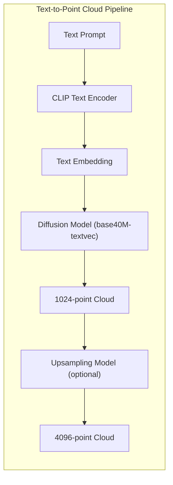
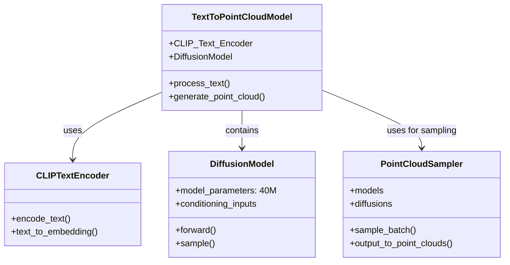
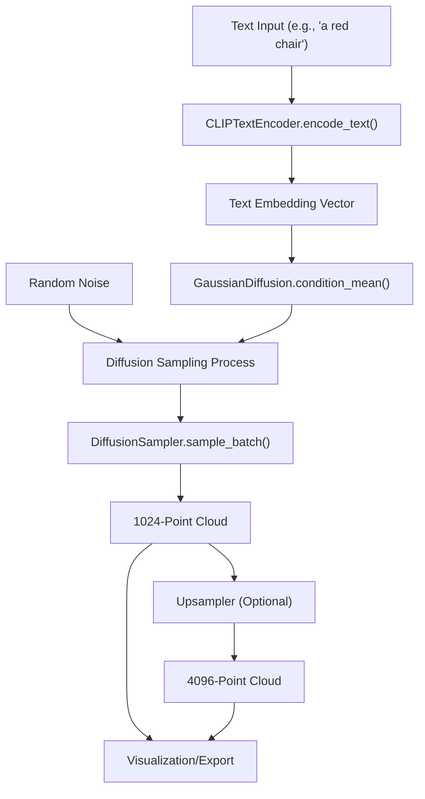
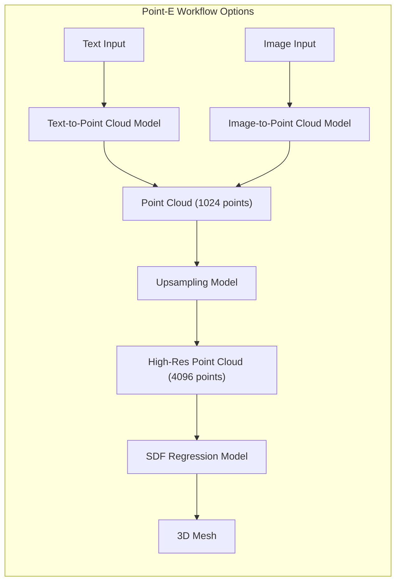

<!-- source: DeepWiki mcp.deepwiki.com · repo openai/point-e · page 3.2 Text-to-Point Cloud Models · fetched 2026-10-26 -->

# Text-to-Point Cloud Models

Relevant source files

The following files were used as context for generating this wiki page:

- [README.md](README.md)
- [model-card.md](model-card.md)

This document provides technical details about the text-to-point cloud models in the Point-E system. These models are designed to generate 3D point clouds directly from text descriptions without requiring any intermediate image generation. For information about image-to-point cloud models, see [Image-to-Point Cloud Models](#3.1), and for converting point clouds to meshes, see [Point Cloud-to-Mesh Models](#3.3).

## Overview

The text-to-point cloud functionality in Point-E is implemented through a specialized diffusion model that processes text embeddings from CLIP and generates corresponding 3D point clouds. While this model is more limited in capabilities compared to the image-conditional models, it provides a direct path from text descriptions to 3D representations.

Sources: [README.md:14-14](), [model-card.md:19-19]()

## Model Architecture

Point-E's text-to-point cloud model is a 40 million parameter diffusion model (`base40M-textvec`) that accepts conditioning from a CLIP ViT-L/14 text encoder. The model processes text descriptions into 3D point clouds containing 1,024 points, which can then be optionally upsampled to 4,096 points using the upsampling model.

Sources: [model-card.md:19-19]()

## Technical Implementation

The text-to-point cloud model utilizes the same diffusion framework as other models in Point-E, but with text embeddings as conditioning inputs instead of image features. The model has been trained to understand the relationship between textual descriptions and 3D shapes.

The model processes input text through these main steps:

1. Text processing via CLIP ViT-L/14 encoder to generate text embeddings
2. Conditioning the diffusion model with these text embeddings
3. Running the diffusion sampling process to generate point clouds
4. Optional upsampling to increase point cloud density

The model is accessed through the configuration system using the identifier `base40M-textvec`.

Sources: [model-card.md:19-19]()

## Capabilities and Limitations

The text-to-point cloud model has several notable capabilities and limitations:

| Capabilities | Limitations |
|--------------|-------------|
| Generates 3D point clouds directly from text | Works best with simple descriptions |
| Understands basic object categories | Limited generalization to complex prompts |
| Recognizes and applies color descriptions | Less effective with unusual objects |
| Can produce recognizable simple shapes | Lower quality than image-conditional models |
| Enables pure text-to-3D workflow | May exhibit biases present in training data |

The model performs best with straightforward descriptions of common objects with simple colors, such as "a red chair" or "a blue car." It struggles with complex spatial relationships, unusual objects, or detailed specifications.

Sources: [model-card.md:10-10](), [model-card.md:48-48]()

## Data Flow and Processing

The following diagram illustrates how text input flows through the system to generate a 3D point cloud:

Sources: [README.md:14-14](), [model-card.md:19-19]()

## Usage Example

The primary way to use the text-to-point cloud model is through the `text2pointcloud.ipynb` notebook provided in the repository. This notebook demonstrates how to load the model, encode text prompts, generate point clouds, and visualize the results.

The basic workflow involves:

1. Loading the `base40M-textvec` model
2. Creating a point cloud sampler
3. Providing a text prompt
4. Running the sampling process
5. Visualizing or exporting the resulting point cloud

Sources: [README.md:14-14]()

## Model Training and Dataset

The text-to-point cloud model was trained on a dataset of several million 3D models and their associated text captions. The dataset was processed and filtered to focus on recognizable objects, with cluster weighting used to avoid overrepresentation of similar objects.

The model was trained to predict clean point clouds from noisy point clouds, conditioned on text embeddings from CLIP. This approach allows the model to learn the mapping between textual descriptions and 3D shapes.

Sources: [model-card.md:33-35]()

## Integration with Other Models

The text-to-point cloud model can be used as part of a larger pipeline within the Point-E system:

The output of the text-to-point cloud model can be:
1. Used directly for visualization or analysis
2. Upsampled to increase resolution
3. Converted to a mesh using the SDF regression model
4. Evaluated using metrics like P-FID or P-IS

Sources: [README.md:11-15](), [model-card.md:42-44]()

## Technical Implementation Details

The text-to-point cloud model implements a Gaussian diffusion process that iteratively denoises a randomly initialized point cloud based on conditioning from text embeddings. The model architecture is similar to other diffusion models in the Point-E system but with specific adaptations for text conditioning.

Key components involved in the text-to-point cloud generation pipeline include:

1. CLIP text encoder for embedding text descriptions
2. Diffusion model for generating point clouds from noise
3. Point cloud sampler for managing the sampling process
4. Optional upsampling model for increasing point density

The model is configured to output 1,024 points in 3D space, each with color information.

Sources: [model-card.md:19-19]()

## Conclusion

The text-to-point cloud model in Point-E provides a direct path from textual descriptions to 3D point clouds. While more limited than the image-conditional models, it offers a valuable tool for generating simple 3D shapes directly from text prompts. The model works best with straightforward descriptions of common objects and can be integrated with other components in the Point-E system to produce higher-resolution point clouds or meshes.

---

