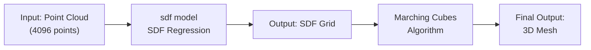
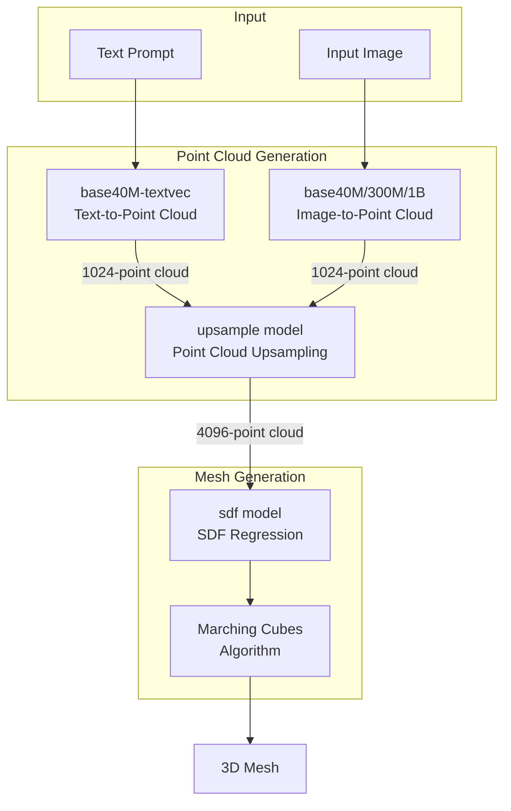
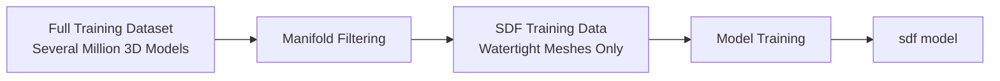
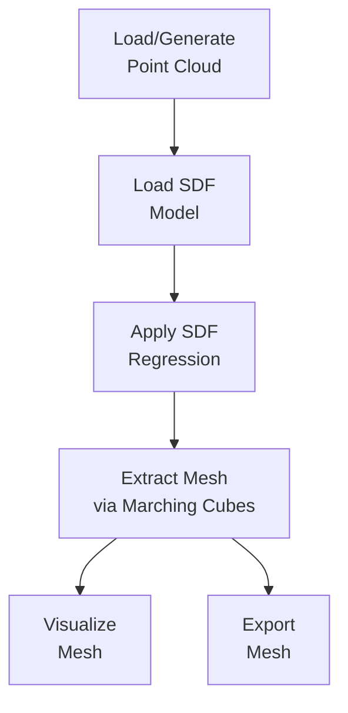
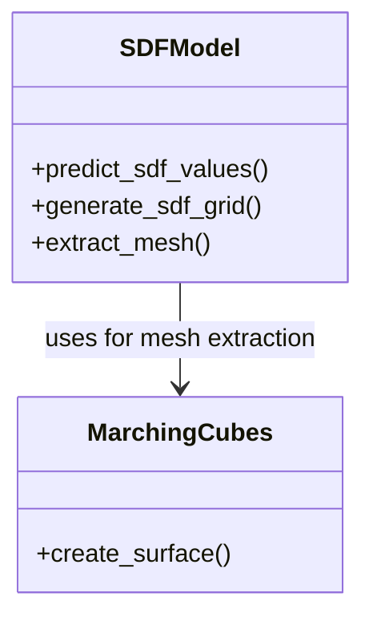

<!-- source: DeepWiki mcp.deepwiki.com · repo openai/point-e · page 3.3 Point Cloud-to-Mesh Models · fetched 2026-10-26 -->

# Point Cloud-to-Mesh Models

Relevant source files

The following files were used as context for generating this wiki page:

- [README.md](README.md)
- [model-card.md](model-card.md)

This document describes the Point Cloud-to-Mesh conversion component in the Point-E system, focusing on the SDF (Signed Distance Function) regression model. This component represents the final stage in the 3D generation pipeline, transforming point clouds into 3D meshes suitable for visualization and fabrication. For information about generating the initial point clouds, see [Image-to-Point Cloud Models](#3.1) or [Text-to-Point Cloud Models](#3.2).

## SDF Regression Approach

The Point-E system employs a specialized SDF regression model for converting point clouds into 3D meshes. Unlike raw point clouds, meshes provide continuous surface representations with several advantages:

- Better visual quality and surface continuity
- Compatibility with standard 3D software and rendering tools
- Support for physical fabrication (3D printing)
- Improved surface normal estimation

### SDF Regression Process

The conversion process follows these steps:
1. The model takes a point cloud (typically 4096 points) as input
2. It predicts signed distance values on a 3D grid (negative inside object, positive outside)
3. The Marching Cubes algorithm extracts a mesh surface at the zero-level set of the SDF
4. The result is a triangulated mesh representing the object surface

Sources: model-card.md

## Integration in Point-E Pipeline

The SDF regression model represents the final stage in the complete Point-E 3D generation pipeline.

The following table summarizes the models involved in the end-to-end pipeline:

| Stage | Model Name | Input | Output | Purpose |
|-------|------------|-------|--------|---------|
| Initial Generation | base40M-textvec | Text | 1024-point cloud | Text-to-point cloud conversion |
| Initial Generation | base40M/300M/1B | Image | 1024-point cloud | Image-to-point cloud conversion |
| Upsampling | upsample | 1024-point cloud | 4096-point cloud | Increase point cloud resolution |
| Mesh Generation | sdf | 4096-point cloud | 3D mesh | Convert point cloud to mesh |

Sources: README.md, model-card.md

## Model Training

The SDF regression model is described as "a small model for predicting signed distance functions from 3D point clouds" in the model card. Its training differs from the other Point-E models in an important way:

Key characteristics of the training process:
- The model was trained only on manifold (watertight and free of singularities) 3D meshes
- This restriction ensures the SDF is well-defined throughout the volume
- Well-formed SDFs are crucial for reliable mesh extraction

Sources: model-card.md

## Usage Example

The Point-E repository includes a dedicated notebook for point cloud to mesh conversion: `pointcloud2mesh.ipynb`. This notebook demonstrates the practical application of the SDF regression model.

The basic workflow involves:
1. Obtaining a point cloud (ideally 4096 points from the upsampling model)
2. Loading the pre-trained SDF regression model
3. Applying the model to predict SDF values
4. Extracting a mesh using Marching Cubes
5. Visualizing or exporting the resulting mesh

Sources: README.md

## Implementation Details

While specific implementation details are limited in the provided information, the SDF model follows a neural network architecture designed to process point clouds and predict signed distance values.

The model provides functionality to:
- Process input point clouds (typically 4096 points)
- Predict SDF values at query points in 3D space
- Generate a complete SDF grid at configurable resolution
- Extract a mesh using the Marching Cubes algorithm

Sources: model-card.md

## Limitations and Considerations

When using the Point Cloud-to-Mesh conversion, several factors should be considered:

1. **Input quality dependence**: The quality of the generated mesh heavily depends on the density and distribution of points in the input point cloud. Upsampled 4096-point clouds generally produce better results than the initial 1024-point outputs.

2. **Resolution trade-offs**: Higher resolution SDF grids capture more detail but require significantly more computation time and memory.

3. **Mesh artifacts**: Generated meshes may contain artifacts such as holes, disconnected components, or noisy surfaces, particularly in areas with sparse point coverage.

4. **Training limitations**: Since the model was trained only on manifold meshes, it may struggle with complex, thin, or non-manifold structures.

5. **Computational requirements**: The mesh generation process is more computationally intensive than working directly with point clouds.

Sources: model-card.md

This wiki page provides a technical overview of the Point Cloud-to-Mesh conversion capabilities in Point-E. For implementation details and practical usage, refer to the `pointcloud2mesh.ipynb` notebook in the repository.

---

