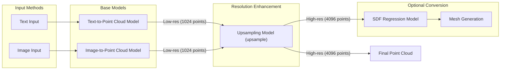
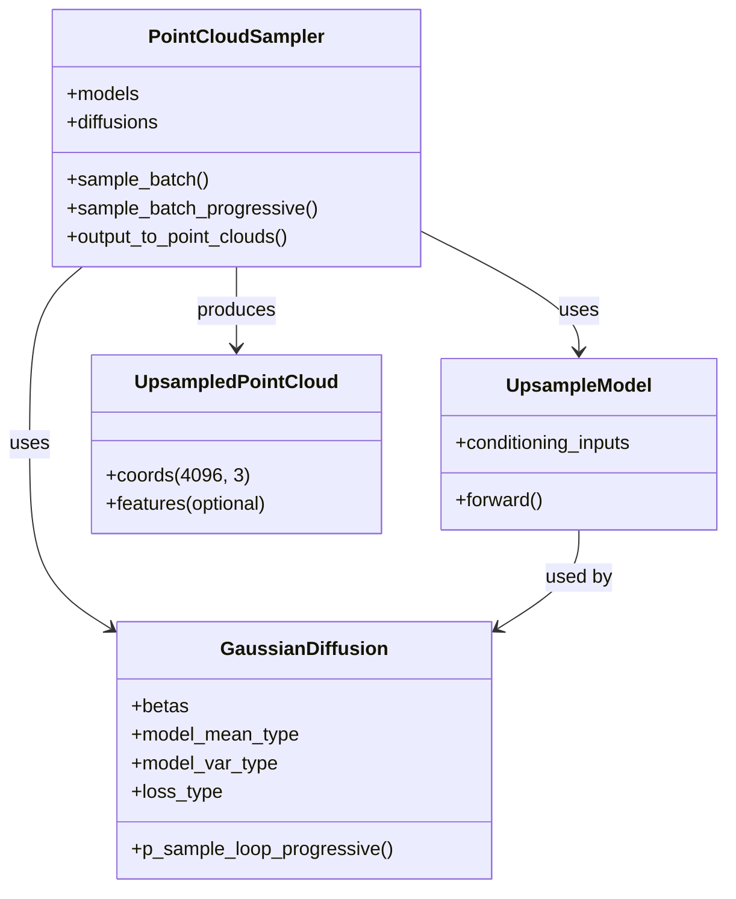
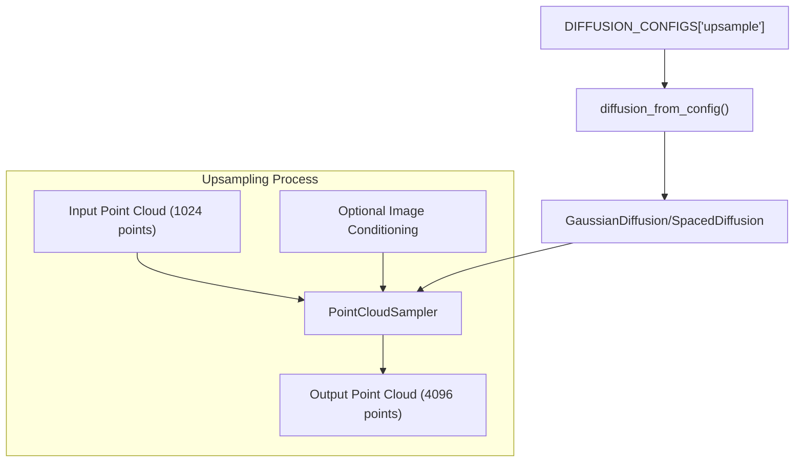
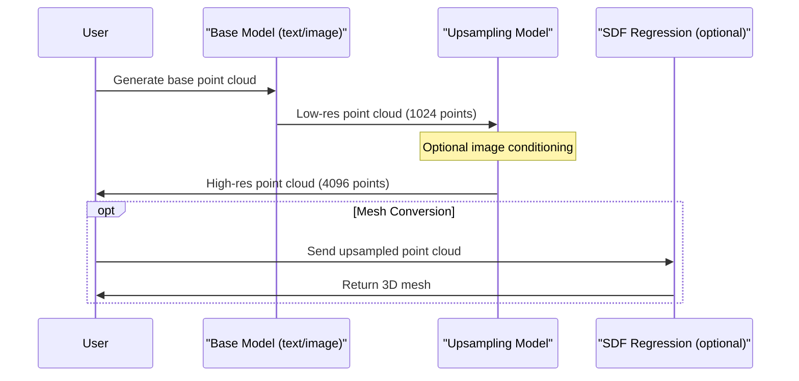
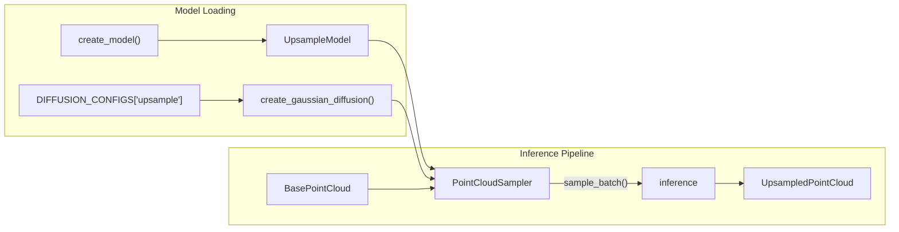

<!-- source: DeepWiki mcp.deepwiki.com · repo openai/point-e · page 3.4 Upsampling Models · fetched 2026-10-26 -->

# Upsampling Models

Relevant source files

The following files were used as context for generating this wiki page:

- [README.md](README.md)
- [model-card.md](model-card.md)

## Purpose and Scope

The upsampling models in Point-E are dedicated to increasing the resolution of point clouds, specifically taking point clouds with 1024 points and upsampling them to 4096 points. This document covers the purpose, architecture, and usage of the upsampling models within the Point-E framework. For information about the base point cloud generation models, see [Image-to-Point Cloud Models](#3.1) and [Text-to-Point Cloud Models](#3.2). For details on converting the upsampled point clouds to meshes, see [Point Cloud-to-Mesh Models](#3.3).

Sources: model-card.md

## Position in the Pipeline

The upsampling model serves as a critical intermediate step in the Point-E generation pipeline, enhancing the resolution of coarse point clouds before optional mesh conversion.

Sources: model-card.md

## Model Specifications

The upsampling model has the following characteristics:

| Parameter | Value |
|-----------|-------|
| Model ID | `upsample` |
| Parameter Count | 40 million |
| Input Size | 1024 points |
| Output Size | 4096 points |
| Conditioning | Optionally image-conditioned |
| Model Type | Diffusion model |

Sources: model-card.md

## Technical Implementation

The upsampling model is implemented as a diffusion model, similar to the base point cloud generation models. It is configured through the `DIFFUSION_CONFIGS` dictionary and created using the diffusion factory system.

Sources: model-card.md

## Model Configuration

The upsampling model is configured with specific diffusion parameters optimized for the task of increasing point cloud resolution while maintaining geometric fidelity.

Sources: model-card.md

## Usage in the Point-E Pipeline

The upsampling model is typically used after generating a base point cloud from either text or image input. It significantly improves the resolution and detail of the point cloud before optional mesh conversion.

Sources: model-card.md

## Integration with Notebooks

The upsampling model is integrated into the example notebooks provided in the Point-E repository, allowing users to easily apply upsampling to their generated point clouds.

| Notebook | Upsampling Usage |
|----------|------------------|
| image2pointcloud.ipynb | Upsamples image-conditional point clouds |
| text2pointcloud.ipynb | Upsamples text-conditional point clouds |
| pointcloud2mesh.ipynb | Uses upsampled point clouds for better mesh generation |

Sources: README.md

## Model Limitations

While the upsampling model significantly improves point cloud resolution, it inherits some limitations:

1. The upsampled point clouds may still contain noise and artifacts
2. The model may struggle with complex geometries or fine details
3. Performance is dependent on the quality of the base point cloud
4. The upsampling process can amplify existing errors in the base point cloud

Sources: model-card.md

## Model Loading and Inference

The upsampling model is loaded and used similarly to other models in the Point-E framework:

Sources: model-card.md

The upsampling model plays a crucial role in the Point-E pipeline by bridging the gap between the lower-resolution outputs of base models and the higher-resolution inputs needed for quality mesh generation and visualization.

---

