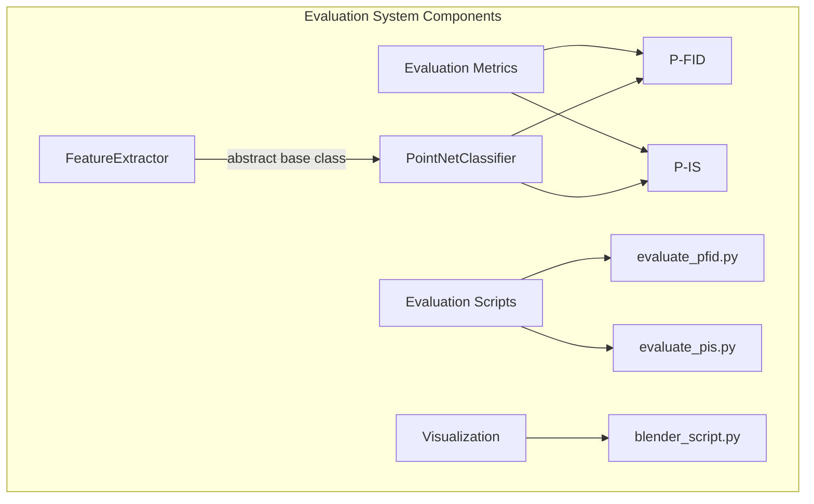
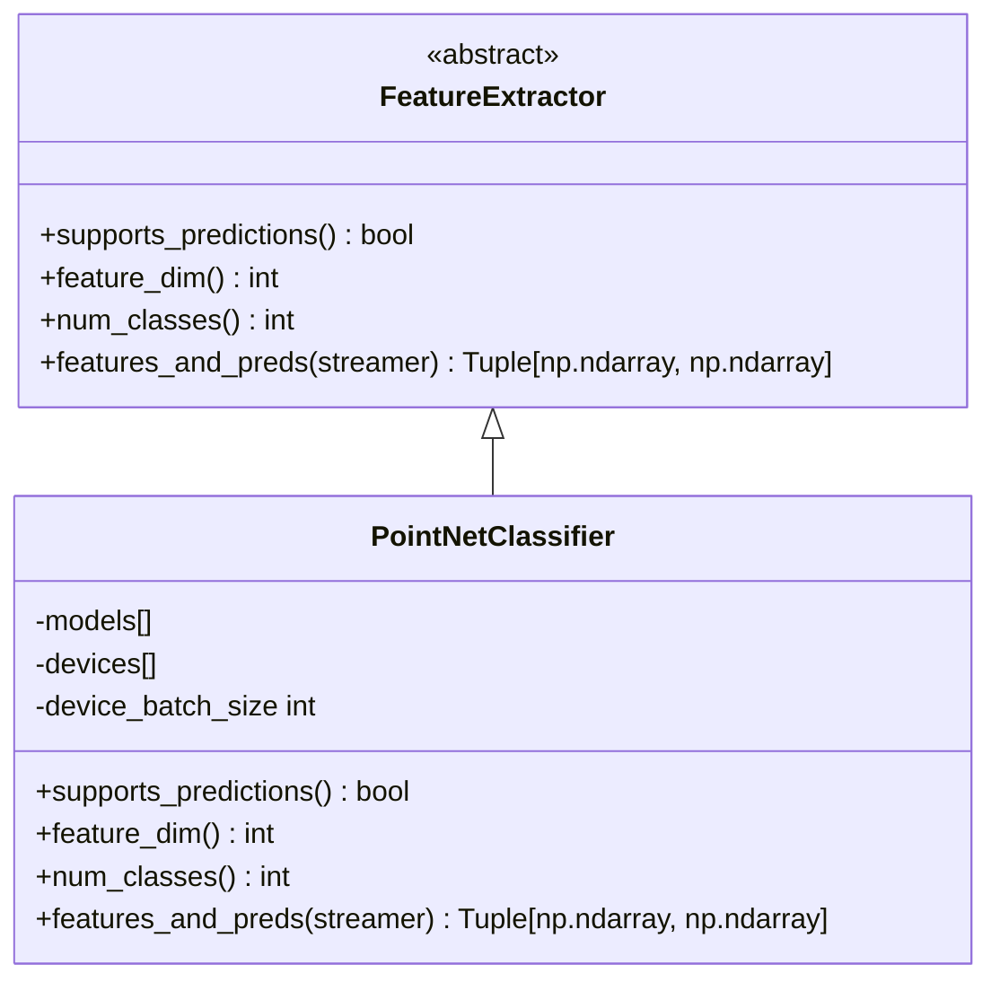
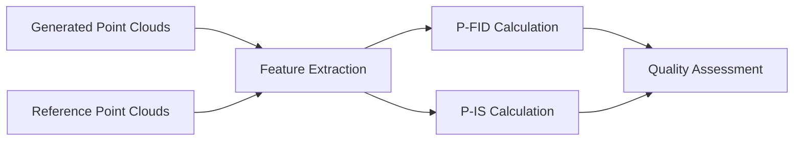
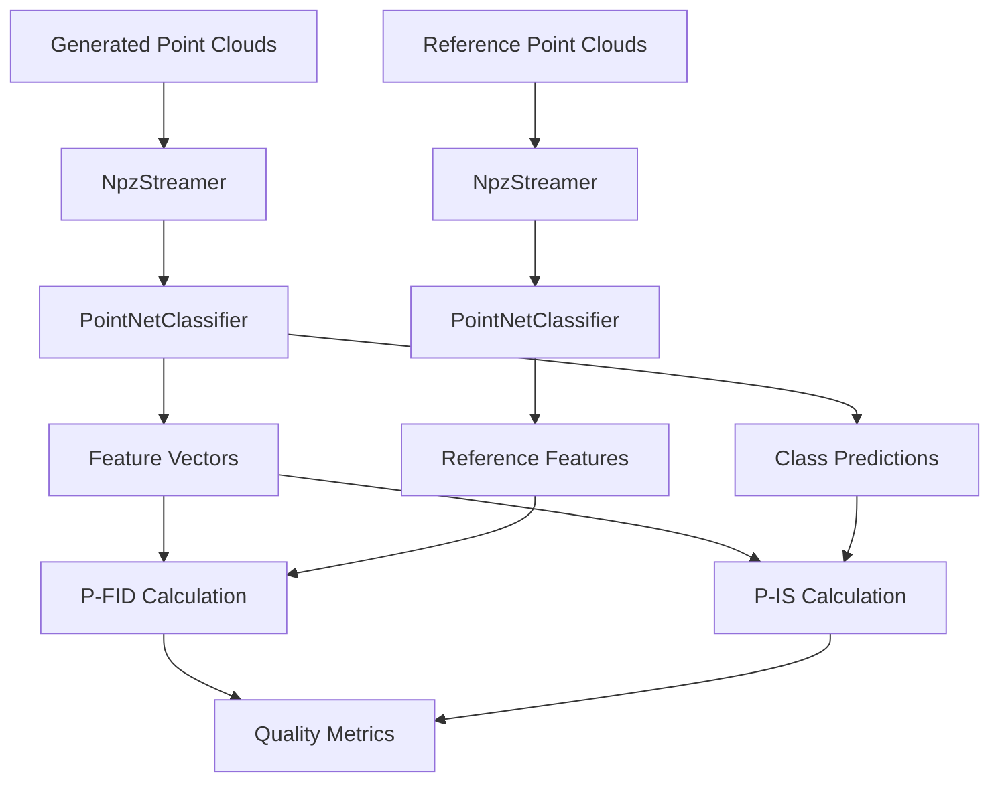
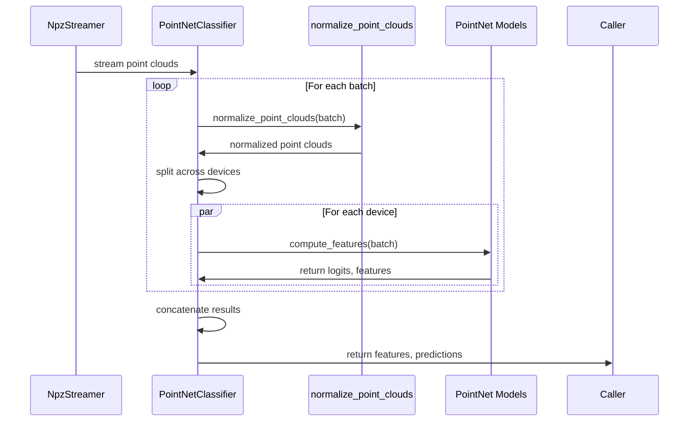
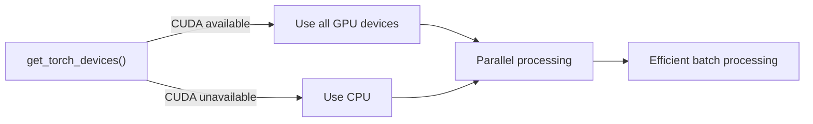
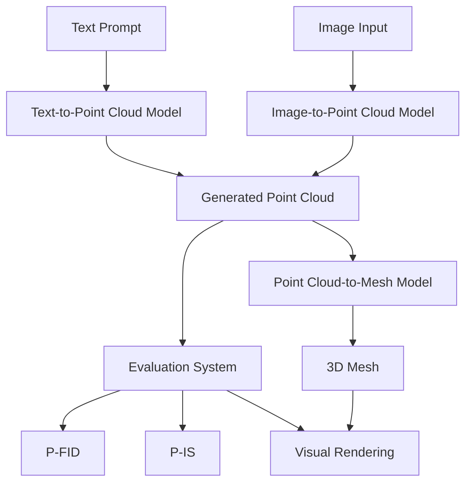

<!-- source: DeepWiki mcp.deepwiki.com · repo openai/point-e · page 4 Evaluation System · fetched 2026-10-26 -->

# Evaluation System

<details>
<summary>Relevant source files</summary>

The following files were used as context for generating this wiki page:

- [README.md](README.md)
- [point_e/evals/__init__.py](point_e/evals/__init__.py)
- [point_e/evals/feature_extractor.py](point_e/evals/feature_extractor.py)

</details>


The Point-E evaluation system provides a framework for assessing the quality of generated 3D point clouds. This page covers the core components, metrics, and tools used to evaluate point cloud quality within the Point-E codebase. For information on generating point clouds from text or images, see [Available Models](#3).

## Overview

The evaluation system consists of feature extraction capabilities, quality metrics, and visualization tools that enable quantitative and qualitative assessment of generated point clouds.



Sources: [point_e/evals/feature_extractor.py:21-49]()(Feature Extractor), [README.md:17-22]()

## Feature Extraction Framework

The feature extraction framework serves as the foundation for point cloud evaluation, providing a consistent way to extract meaningful features from 3D point clouds.

### FeatureExtractor Abstract Class

This abstract base class defines the interface for feature extractors in the Point-E system:



The `FeatureExtractor` defines:
- Abstract properties for determining if the extractor supports predictions, feature dimensions, and number of classes
- An abstract method `features_and_preds()` for computing feature vectors and class predictions from point cloud batches

Sources: [point_e/evals/feature_extractor.py:21-49]()

### PointNetClassifier Implementation

`PointNetClassifier` implements the `FeatureExtractor` interface using PointNet architecture:

- Loads a pre-trained PointNet model with 40 classes
- Operates on multiple devices in parallel using a ThreadPool for efficient processing
- Returns a 256-dimensional feature vector and class predictions for each point cloud

Key implementation aspects:
- Supports multi-device processing for better throughput
- Normalizes point clouds before feature extraction
- Returns both feature vectors and class probabilities

Sources: [point_e/evals/feature_extractor.py:51-111]()

## Evaluation Metrics

Point-E uses two primary metrics to assess the quality of generated point clouds:



### P-FID (Pointcloud Fréchet Inception Distance)

P-FID is an adaptation of the Fréchet Inception Distance (FID) metric for point clouds. It measures the similarity between the distribution of generated point clouds and a reference distribution:

1. Extract features from both generated and reference point clouds using PointNetClassifier
2. Calculate the mean and covariance of the feature distributions
3. Compute the Fréchet distance between the distributions

Lower P-FID values indicate higher quality and closer similarity to the reference distribution.

Sources: [README.md:17-19]()

### P-IS (Pointcloud Inception Score)

P-IS is an adaptation of the Inception Score (IS) for point clouds, measuring both quality and diversity:

1. Extract features and class predictions from generated point clouds
2. Compute the KL divergence between the conditional class distribution and the marginal class distribution
3. P-IS is calculated as the exponential of the average KL divergence

Higher P-IS values indicate higher quality and diversity in the generated point clouds.

Sources: [README.md:17-20]()

## Evaluation Pipeline

The evaluation pipeline shows how point clouds move from creation to quality assessment:



Sources: [point_e/evals/feature_extractor.py:84-111]()

## Implementation Details

### Feature Extraction Process

The feature extraction process in `PointNetClassifier` is optimized for batch processing across multiple devices:

1. Point clouds are normalized to be centered around origin and scaled to unit sphere
2. The data is split into batches across available devices (GPU/CPU)
3. A ThreadPool processes batches in parallel
4. Features (256-dim) and class predictions (40 classes) are computed for each point cloud



Sources: [point_e/evals/feature_extractor.py:84-111](), [point_e/evals/feature_extractor.py:114-119]()

### Point Cloud Normalization

Point clouds are normalized before feature extraction to ensure consistent scale and position:

```python
def normalize_point_clouds(pc: np.ndarray) -> np.ndarray:
    # Center point clouds at origin
    centroids = np.mean(pc, axis=1, keepdims=True)
    pc = pc - centroids
    
    # Scale to unit sphere
    m = np.max(np.sqrt(np.sum(pc**2, axis=-1, keepdims=True)), axis=1, keepdims=True)
    pc = pc / m
    
    return pc
```

This normalization ensures that the feature extraction is invariant to the scale and position of the point clouds.

Sources: [point_e/evals/feature_extractor.py:114-119]()

## Evaluation Scripts

Point-E provides specific scripts for evaluating generated point clouds:

| Script | Purpose | Location |
|--------|---------|----------|
| `evaluate_pfid.py` | Calculates P-FID between generated and reference point clouds | point_e/evals/scripts/evaluate_pfid.py |
| `evaluate_pis.py` | Calculates P-IS for generated point clouds | point_e/evals/scripts/evaluate_pis.py |
| `blender_script.py` | Renders point clouds and meshes for visual inspection | point_e/evals/scripts/blender_script.py |

These scripts can be used to quantitatively and qualitatively assess the quality of point clouds generated by the Point-E models.

Sources: [README.md:17-22]()

## Hardware Utilization

The evaluation system is designed to efficiently utilize available hardware:



The `get_torch_devices()` function automatically detects available CUDA devices and falls back to CPU if no GPUs are available. This allows the evaluation system to scale with available hardware resources.

Sources: [point_e/evals/feature_extractor.py:14-18]()

## Integration with Point-E System

The evaluation system is a key component of the Point-E framework, allowing for quality assessment of generated point clouds:



The evaluation system integrates with the broader Point-E system to provide quality metrics for generated point clouds, whether they're created from text or image inputs.

Sources: [README.md:11-22]()

## Summary

The Point-E evaluation system provides a comprehensive framework for assessing the quality of generated point clouds:

1. **Feature Extraction**: Using PointNet architecture to extract meaningful features
2. **Quality Metrics**: P-FID and P-IS for quantitative assessment
3. **Visualization**: Blender-based rendering for qualitative assessment
4. **Optimization**: Multi-device parallel processing for efficient evaluation

This system allows users to objectively measure the quality of point clouds generated by Point-E models and compare different models or generation approaches.

---

