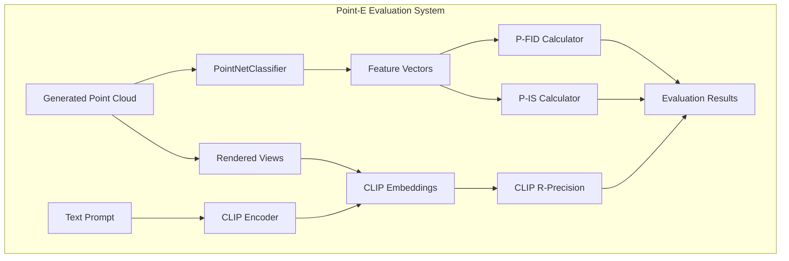
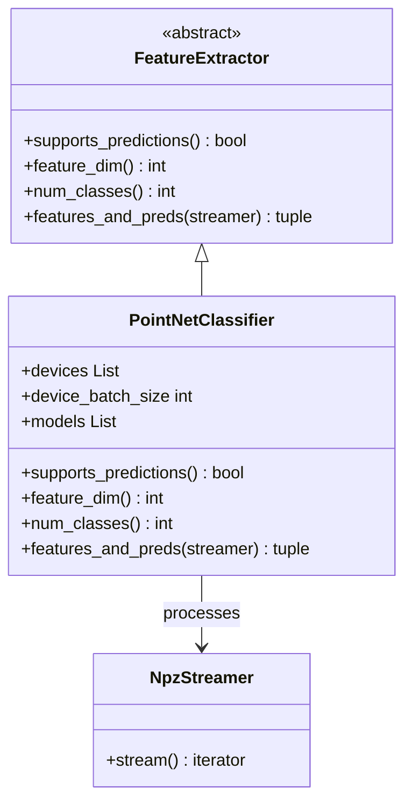

<!-- source: DeepWiki mcp.deepwiki.com · repo openai/point-e · page 4.1 Evaluation Metrics · fetched 2026-10-26 -->

# Evaluation Metrics

<details>
<summary>Relevant source files</summary>

The following files were used as context for generating this wiki page:

- [README.md](README.md)
- [model-card.md](model-card.md)
- [point_e/evals/feature_extractor.py](point_e/evals/feature_extractor.py)

</details>


This document outlines the evaluation metrics used in the Point-E system to assess the quality of generated 3D point clouds. Point-E's evaluation framework includes several quantitative metrics that measure the fidelity and diversity of generated point clouds, as well as their alignment with text prompts when applicable. For details about how these metrics are extracted and processed, see [Feature Extraction](#4.2).

## Overview of Point-E Evaluation System

Point-E uses several established metrics adapted specifically for point cloud evaluation:

1. **P-FID (Point Fréchet Inception Distance)** - Measures the similarity between generated and real point cloud distributions
2. **P-IS (Point Inception Score)** - Evaluates the quality and diversity of generated point clouds
3. **CLIP R-Precision** - Assesses text-to-point cloud alignment

These metrics are implemented using a PointNet classifier for feature extraction and are accessible through dedicated evaluation scripts.



Sources: [README.md:17-20](), [point_e/evals/feature_extractor.py:51-111]()

## Feature Extraction Pipeline

At the core of Point-E's evaluation system is the feature extraction pipeline, which processes point clouds to extract meaningful features for metric calculation.



The PointNetClassifier:
- Uses a pre-trained PointNet model with 40 classes
- Outputs 256-dimensional feature vectors
- Normalizes point clouds before processing
- Can distribute computation across multiple devices

Sources: [point_e/evals/feature_extractor.py:21-49](), [point_e/evals/feature_extractor.py:51-111]()

## P-FID (Point Fréchet Inception Distance)

P-FID adapts the Fréchet Inception Distance metric for point cloud evaluation. It measures the distance between the distribution of features extracted from real and generated point clouds.

### How P-FID Works

1. Extract features from a batch of real point clouds using PointNetClassifier
2. Extract features from a batch of generated point clouds
3. Calculate the mean and covariance of each feature distribution
4. Compute the Fréchet distance between the two distributions:

FD = ||μ₁ - μ₂||² + Tr(Σ₁ + Σ₂ - 2√(Σ₁Σ₂))

Where:
- μ₁, μ₂ are the feature means for real and generated point clouds
- Σ₁, Σ₂ are the feature covariances for real and generated point clouds

Lower P-FID values indicate better quality and more realistic point clouds.

### Usage

Point-E provides a script to calculate P-FID scores:

```
python -m point_e.evals.scripts.evaluate_pfid
```

Sources: [README.md:17-19]()

## P-IS (Point Inception Score)

P-IS adapts the Inception Score concept to point clouds. It measures both the quality and diversity of generated point clouds.

### How P-IS Works

1. Extract class predictions for generated point clouds using PointNetClassifier
2. Calculate the KL divergence between:
   - The conditional class distribution for each sample
   - The marginal class distribution across all samples

The formula is:
IS = exp(𝔼ₓ[KL(p(y|x) || p(y))])

Where:
- p(y|x) is the predicted class distribution for a point cloud x
- p(y) is the average class distribution across all point clouds

Higher P-IS values indicate better quality and diversity.

### Usage

Point-E provides a script to calculate P-IS scores:

```
python -m point_e.evals.scripts.evaluate_pis
```

Sources: [README.md:17-20]()

## CLIP R-Precision

CLIP R-Precision measures how well generated point clouds align with their conditioning text prompts or images. This metric leverages CLIP's multimodal understanding to assess semantic alignment.

### How CLIP R-Precision Works

1. Generate point clouds from text prompts or images
2. Render the point clouds from multiple viewpoints
3. Compute CLIP embeddings for:
   - The original text prompts or images
   - The rendered views of generated point clouds
4. Calculate the retrieval precision by:
   - Matching each text/image prompt to the closest rendered point cloud view
   - Computing the percentage of correct matches

Higher R-Precision indicates better text/image-to-point-cloud alignment.

### Dataset

Point-E uses COCO images for CLIP R-Precision evaluation, as mentioned in the README:

```
You can download the seed images used for COCO CLIP R-Precision evaluations [here](https://openaipublic.azureedge.net/main/point-e/coco_images.zip).
```

Sources: [README.md:26-28]()

## Feature Extraction Implementation Details

The PointNetClassifier implements the feature extraction process necessary for all evaluation metrics:

```python
# Key properties of PointNetClassifier
feature_dim = 256  # Dimension of extracted feature vectors
num_classes = 40   # Number of object classes in the classifier
```

The feature extraction process:

1. Normalize point clouds by:
   - Centering them at the origin
   - Scaling to unit size
2. Process point clouds in batches across available devices
3. Extract both feature vectors and class predictions
4. Return feature vectors for P-FID and class predictions for P-IS

Sources: [point_e/evals/feature_extractor.py:73-83](), [point_e/evals/feature_extractor.py:84-111](), [point_e/evals/feature_extractor.py:114-119]()

## Practical Usage of Evaluation Metrics

To evaluate generated point clouds using Point-E's metrics:

1. Generate a batch of point clouds using Point-E's generation models
2. Use the evaluation scripts to calculate P-FID and P-IS:

```bash
# For P-FID evaluation
python -m point_e.evals.scripts.evaluate_pfid \
    --gen_dir path/to/generated/point_clouds \
    --ref_dir path/to/reference/point_clouds

# For P-IS evaluation
python -m point_e.evals.scripts.evaluate_pis \
    --gen_dir path/to/generated/point_clouds
```

For CLIP R-Precision, you would need to:
1. Generate point clouds from text prompts or images
2. Render these point clouds using the Blender script
3. Calculate the CLIP similarity between original prompts and renderings

Sources: [README.md:17-22]()

## Summary

The evaluation metrics in Point-E provide quantitative measures to assess:

1. **Quality and realism** of generated point clouds (P-FID)
2. **Diversity and class separability** of generated samples (P-IS)
3. **Semantic alignment** with text prompts or images (CLIP R-Precision)

These metrics rely on feature extraction using a PointNet classifier and provide complementary perspectives on model performance. When evaluating Point-E models, it's recommended to consider all these metrics together for a comprehensive assessment.

---

